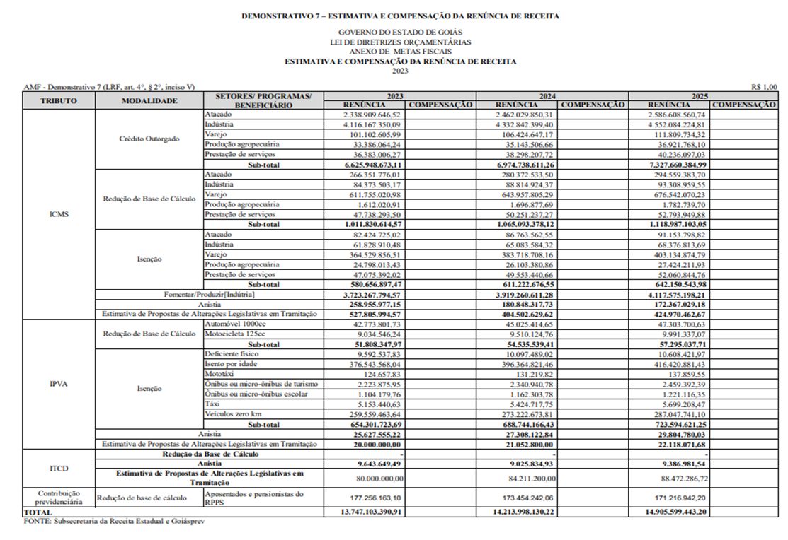

LEI Nº 21.633, DE 17 DE NOVEMBRO DE 2022

Altera a [Lei nº 21.527](https://legisla.casacivil.go.gov.br/pesquisa_legislacao/105974/lei-21527), de 26 de julho de 2022, que dispõe sobre as diretrizes para a elaboração e a execução da Lei Orçamentária referente ao exercício de 2023 e dá outras providências.

A **ASSEMBLEIA LEGISLATIVA DO ESTADO DE GOIÁS**, nos termos do art. 10 da [Constituição do Estado de Goiás](https://legisla.casacivil.go.gov.br/pesquisa_legislacao/103152/constituicao-estadual), decreta e eu sanciono a seguinte Lei:

Art. 1º A [Lei nº 21.527](https://legisla.casacivil.go.gov.br/pesquisa_legislacao/105974/lei-21527), de 26 de julho de 2022, passa a vigorar com as seguintes alterações:

“Art. 24. No Projeto de Lei Orçamentária para o exercício de 2023, a soma das despesas classificadas nos Grupos de Natureza de Despesa GND 1, GND 3, GND 4 e GND 5 não poderá exceder os seus valores nominais consignados nos respectivos orçamentos iniciais do exercício de 2022, respectivamente, para os Poderes Executivo (administração direta, autárquica e fundacional, fundos especiais e empresas estatais dependentes), Legislativo e Judiciário, bem como para os órgãos governamentais autônomos (Tribunal de Contas do Estado e Tribunal de Contas dos Municípios, Defensoria Pública e Ministério Público), corrigidos pela variação do Índice Nacional de Preços ao Consumidor Amplo – IPCA previsto para 2022 e 2023.

§ 1º Não serão consideradas para efeito dos limites de que trata o _caput_ deste artigo as exclusões previstas na Lei Complementar federal nº 159, de 19 de maio de 2017, e na Portaria STN nº 1.487, de 12 de julho de 2022.

..........................................................................................................................” (NR)

Art. 2º O Demonstrativo 7 – Estimativa e Compensação da Renúncia de Receita, do Anexo I – Metas Fiscais, da [Lei nº 21.527](https://legisla.casacivil.go.gov.br/pesquisa_legislacao/105974/lei-21527), de 2022, passa a vigorar nos termos do Anexo Único desta Lei.

Art. 3º As adequações das classificações, das codificações e das denominações orçamentárias de que trata o art. 9º da [Lei nº 21.232](https://legisla.casacivil.go.gov.br/pesquisa_legislacao/104764/lei-21232), de 11 de janeiro de 2022, que estima a receita e fixa a despesa do Estado para o exercício de 2022, podem abranger a subfunção para adequá-la à descrição da ação orçamentária, desde que seja mantido o valor total autorizado para a dotação, podendo utilizar-se da faculdade concedida pelo § 1º do mencionado artigo.

Art. 4º Esta Lei entra em vigor na data de sua publicação.

Goiânia, 17 de novembro de 2022; 134º da República.

RONALDO CAIADO

Governador do Estado

ANEXO ÚNICO

“

” (NR)
