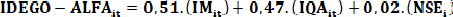
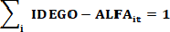
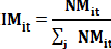
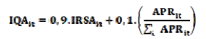
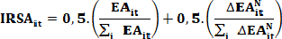
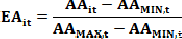
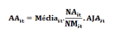
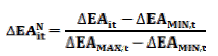
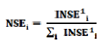
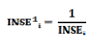

DECRETO Nº 10.189, DE 30 DE DEZEMBRO DE 2022

Regulamenta a apuração do Índice de Participação dos Municípios – IPM, com base nos critérios de educação, referente à entrega dos 10% (dez por cento) do Imposto sobre Operações Relativas à Circulação de Mercadorias e sobre Prestações de Serviços de Transporte Interestadual e Intermunicipal e de Comunicação – ICMS pertencentes aos municípios, na forma da [Lei Complementar nº 177](https://legisla.casacivil.go.gov.br/pesquisa_legislacao/106018/lei-complementar-177), de 24 de agosto de 2022.

O GOVERNADOR DO ESTADO DE GOIÁS, no uso de suas atribuições constitucionais e legais, em atenção ao regime de colaboração na promoção da cooperação mútua entre o Estado e os municípios para a melhoria da educação básica e dos índices de alfabetização estaduais, também em consideração aos indicadores educacionais para a distribuição da cota-parte do ICMS previstos na alínea “a” do inciso III do art. 2º da [Lei Complementar estadual nº 177](https://legisla.casacivil.go.gov.br/pesquisa_legislacao/106018/lei-complementar-177), de 24 de agosto de 2022, e tendo em vista o que consta dos Processos nº 202200013002310 e nº 202200006076157,

**DECRETA:**

Art. 1º Este Decreto regulamenta a apuração do Índice de Participação dos Municípios – IPM, com base nos critérios de educação, referente à entrega dos 10% (dez por cento) do Imposto sobre Operações Relativas à Circulação de Mercadorias e sobre Prestações de Serviços de Transporte Interestadual e Intermunicipal e de Comunicação – ICMS pertencentes aos municípios, nos termos da [Lei Complementar nº 177](https://legisla.casacivil.go.gov.br/pesquisa_legislacao/106018/lei-complementar-177), de 24 de agosto de 2022.

Art. 2º A parcela de que trata o art. 1º deste Decreto será apurada e distribuída com a consideração do disposto nas alíneas “a”, “b”, “c” e “d” do § 7º do art. 107 da Constituição do Estado de Goiás, acrescidas pela [Emenda Constitucional nº 70](https://legisla.casacivil.go.gov.br/pesquisa_legislacao/104678/emenda-constitucional-70), de 2021, bem como nos termos na [Lei Complementar estadual nº 177](https://legisla.casacivil.go.gov.br/pesquisa_legislacao/106018/lei-complementar-177), de 2022, com a observância dos critérios integrantes do Índice de Desenvolvimento da Educação dos Municípios de Goiás – IDEGO-ALFA.

Parágrafo único. O IDEGO-ALFA tem como base as matrículas da rede pública municipal nos anos iniciais, a taxa de aprovação e o desempenho acadêmico dos alunos no 2º ano do ensino fundamental da rede municipal em língua portuguesa, mensurados por meio do Sistema de Avaliação Educacional do Estado de Goiás – SAEGO-Alfa, considerados a equidade e o Indicador de Nível Socioeconômico –INSE dos estudantes da rede pública municipal, conforme as seguintes especificações:

I – a quantidade de matrícula na rede municipal de ensino como principal critério, o qual corresponderá a 51% (cinquenta e um por cento) do cálculo, proporcionalmente, ao número de alunos matriculados nas redes municipais no Estado de Goiás, a serem somados aos demais critérios, obtidos por meio da última publicação do censo escolar divulgado pelo Instituto Nacional de Estudos e Pesquisas Anísio Teixeira –INEP;

II – o Índice de Qualidade da Aprendizagem – IQA, o qual corresponderá a 47% (quarenta e sete por cento) do cálculo do IDEGO-ALFA, formado pelos resultados de aprendizagem do 2º ano do ensino fundamental avaliados no Sistema de Avaliação Educacional do Estado de Goiás –SAEGO-Alfa, considerado o aumento da equidade e a média da taxa de aprovação dos alunos nos anos iniciais do ensino fundamental; e

III – o Indicador de Nível Socioeconômico – INSE do município, publicado no último ano pelo Instituto Nacional de Estudos e Pesquisas Anísio Teixeira –INEP, o qual corresponderá a 2% (dois por cento) , obtido através dos questionários contextuais aplicados aos estudantes da Educação Básica.

Art. 3º O IDEGO-ALFA é calculado de acordo com a metodologia constante do Anexo Único deste Decreto.

§ 1º O IDEGO-ALFA de um determinado ano de avaliação (“t”) deverá ser calculado no ano seguinte à realização dela (“t+1”) e terá efeitos financeiros para os municípios no ano subsequente (“t+2”).

§ 2º A Secretaria de Estado da Educação– SEDUC será responsável pelas avaliações padronizadas de desempenho acadêmico dos estudantes por meio do Sistema de Avaliação Educacional, que fornecerão as médias do 2º ano do ensino fundamental da rede municipal, que integrarão o cálculo do IDEGO-ALFA.

§ 3º Se, por caso fortuito ou motivo de força maior, em um determinado ano não for realizada a avaliação do SAEGO-Alfa, prevalecerão para o referido período os resultados mais recentes disponíveis.

§ 4º Os dados provenientes de fontes externas que serão utilizados nos cálculos do IDEGO-ALFA deverão ser preferencialmente referentes ao ano da avaliação, mas,caso não estejam disponíveis, serão considerados os dados mais recentes divulgados.

Art. 4º A participação percentual que caberá a cada município no montante da arrecadação do ICMS destinado aos municípios, calculada no ano seguinte ao da avaliação (“t+ 1”), conforme os critérios educacionais definidos nos incisos I, II e III do parágrafo único do art. 2º deste Decreto, será determinada pelo produto do IDEGO-ALFA do município no ano da avaliação (“t”) e o percentual estabelecido (10%), com a fórmula PARTICIPAÇÃOit+1 = IDEGO-ALFAit x 10%, em que “i” identifica o município.

Parágrafo único. A participação a que se refere o _caput_ deste artigo será utilizada para o rateio dos recursos no ano seguinte ao cálculo (ou seja, em “t+2”).

Art. 5º A Secretaria de Estado da Educação – SEDUC fornecerá anualmente até o dia 15 de junho ao Conselho Deliberativo dos Índices de Participação dos Municípios – COÍNDlCE a relação nominal dos municípios goianos com os respectivos percentuais para a divisão da cota-parte do ICMS relacionada ao desempenho da gestão municipal na área de educação de que trata a alínea “a” do inciso III do art. 2º da [Lei Complementar estadual nº 177](https://legisla.casacivil.go.gov.br/pesquisa_legislacao/106018/lei-complementar-177), de 2022.

Art. 6º Este Decreto entra em vigor na data de sua publicação, com efeitos financeiros a partir de 1º de janeiro de 2025.

Goiânia, 30 de dezembro de 2022; 134º da República.

RONALDO CAIADO

Governador do Estado

ANEXO I

METODOLOGIA PARA CÁLCULO DO ÍNDICE DE DESENVOLVIMENTO DA EDUCAÇÃO DOS MUNICÍPIOS DE GOIÁS EM ALFABETIZAÇÃO – IDEGO-ALFA

Para um determinado ano de avaliação, o Índice de Desenvolvimento da Educação dos Municípios de Goiás – IDEGO-ALFA é dado pela seguinte expressão:

Nela, considera-se que:

a) IDEGO-ALFAit é o Índice de Desenvolvimento da Educação do município “i” no ano da avaliação "t";

b) IMit é o Índice de Matrículas da educação básica na rede municipal, obtido por meio do Censo Escolar do município “i” no ano da avaliação “t” (ou no ano mais recente em que os dados estiverem disponíveis);

c) IQAit é o Índice de Qualidade da Aprendizagem do município “i” no ano da avaliação “t”, obtido por meio do SAEGO-Alfa e a taxa de aprovação nos anos iniciais do ensino fundamental; e

d) NSEi é o índice referente ao Nível Socioeconômico dos alunos matriculados nas escolas públicas do município “i”, calculado com base no valor mais recente disponível do Indicador de Nível Socioeconômico (INSE) , construído pela Diretoria de Avaliação da Educação Básica (DAEB) , do Instituto Nacional de Estudos e Pesquisas Educacionais Anísio Teixeira (INEP) .

Uma característica importante do IDEGO-ALFAit é que sua soma para todos os municípios goianos deverá sempre ser igual a 1, ou seja:

Isso acontece porque todos os demais índices que o compõem (IMit, IQAit e NSEi) foram construídos de forma que suas somas também são iguais a 1.

1 Índice de matrículas

O Índice de Matrículas da educação básica na rede municipal (IMit) é obtido pela seguinte fórmula:

Nela, considera-se que:

NMit é o número de matrículas da rede municipal na educação básica do município “i” no ano da avaliação “t”.

2 Índice de Qualidade de Aprendizagem

O Índice de Qualidade da Aprendizagem do município (IQAit) é obtido pela seguinte fórmula:

Nela, considera-se que:

a) IRSAit é o Índice de Resultado da Avaliação do SAEGO-Alfa do município “i” no ano da avaliação “t”; e

b) APRit é a média da Taxa de Aprovação nos Anos Iniciais do Ensino Fundamental, levantada a partir de informações derivadas do Censo Escolar do município "i" no ano da avaliação “t” (ou no ano mais recente em que os dados estiverem disponíveis).

Considera-se que:

Na fórmula acima, EAit é o resultado padronizado da avaliação do SAEGO-Alfa do município “i” no ano da avaliação “t”, assim calculado:

Considera-se que:

a) AAit é o resultado da avaliação da alfabetização do município “i” no ano de ocorrência da avaliação do SAEGO-Alfa;

b) AAMAX,t é o maior entre os AAit no ano de ocorrência da avaliação do SAEGO-Alfa; e

c) AAMIN,t é o menor dentre os AAit no ano de ocorrência da avaliação do SAEGO-Alfa.

Considera-se ainda que AAit é dado pela seguinte fórmula:

Nela, considera-se que:

a) Médiait é a média dos resultados de proficiência dos alunos do 2º ano do ensino fundamental de 9 (nove) anos da rede municipal do município “i” no ano “t” a partir da avaliação do SAEGO-Alfa;

b) NAit é o número de alunos do 2º ano do ensino fundamental de 9 (nove) anos da rede municipal do município “i” que fizeram a avaliação do SAEGO-Alfa no ano “t”;

c) NMit é o número total de alunos matriculados no 2º ano do ensino fundamental de 9 (nove) nove anos da rede municipal do município “i” no ano “t” (ou no ano mais recente em que os dados estiverem disponíveis) ; e

d) AJAit representa o índice para a universalização do aprendizado, calculado a partir dos resultados do SAEGO-Alfa dos alunos do 2º ano do ensino fundamental de 9 (nove) anos da rede municipal do município “i” no ano “t”, obtido da seguinte maneira:

Na fórmula acima, abit e avit representam, respectivamente, os percentuais de alunos classificados como “abaixo do básico”, ou seja, são os alunos que obtiveram pontuação abaixo de 350 (trezentos e cinquenta) na escala do SAEGO-Alfa, e como “alfabetização avançada”, que obtiveram pontuação acima de 500 (quinhentos) na escala do SAEGO-Alfa do município “i” no ano “t”.

O outro componente de IRSAit é ΔEAitN, que é a variação padronizada do resultado da avaliação do SAEGO-Alfa do município “i” no ano “t” em relação ao ano anterior (“t - 1”), calculada da seguinte forma:

Considera-se que ΔEAit é a variação do resultado padronizado da avaliação do SAEGO-Alfa do município “i” no ano “t” em relação ao ano anterior (“t - 1”), ou seja:

Na fórmula acima, considera-se que:

a) ΔEAMAX,t é a maior entre as variações dos resultados padronizados da avaliação do SAEGO-Alfa dos municípios goianos; e

b) ΔEAMIN,t é a menor entre as variações dos resultados padronizados da avaliação do SAEGO-Alfa dos municípios goianos.

3 Nível socioeconômico

Por fim, evidencia-se o NSEi, calculado desta maneira:

Considera-se que:

Na fórmula acima, INSEi é o resultado mais recente disponível do Indicador do Nível Socioeconômico do município “i” calculado com o uso da média ponderada dos índices individuais dos participantes do SAEB matriculados nas escolas públicas do respectivo município. Ele é publicado pelo Instituto Nacional de Estudos e Pesquisas Educacionais Anísio Teixeira –INEP.

Ademais, como quanto maior for o valor de INSEi, melhor será o nível socioeconômico dos alunos do município, então o INSE1i considera o inverso desse índice de modo a favorecer os municípios com as piores condições dos alunos.
