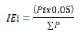

DECRETO Nº 10.190, DE 30 DE DEZEMBRO DE 2022

Regulamenta a apuração do Índice de Participação dos Municípios – IPM referente à entrega dos 5% (cinco por cento) do Imposto sobre Operações Relativas à Circulação de Mercadorias e sobre Prestações de Serviços de Transporte Interestadual e Intermunicipal e de Comunicação – ICMS pertencentes aos municípios, na forma da [Lei Complementar estadual nº 177](https://legisla.casacivil.go.gov.br/pesquisa_legislacao/106018/lei-complementar-177), de 24 de agosto de 2022, e dá outras providências.

O **GOVERNADOR DO ESTADO DE GOIÁS**, no uso de suas atribuições constitucionais e legais, e tendo em vista o que consta do Processo nº 202200013002310,

**DECRETA:**

Art. 1º Fica regulamentada a distribuição do produto da arrecadação do Imposto sobre Operações Relativas à Circulação de Mercadorias e sobre Prestações de Serviços de Transporte Interestadual e Intermunicipal e de Comunicação – ICMS previsto na alínea “c” do inciso IV do § 1º do art. 107 da [Constituição estadual](https://legisla.casacivil.go.gov.br/pesquisa_legislacao/103152/constituicao-estadual) e nos arts. 11 a 15 da [Lei Complementar estadual nº 177](https://legisla.casacivil.go.gov.br/pesquisa_legislacao/106018/lei-complementar-177), de 24 de agosto de 2022, exclusivamente aos municípios que abriguem em seus territórios unidades de conservação da natureza – UCs, terras indígenas e territórios quilombolas, em razão de seu potencial ecológico – ICMS Ecológico, conforme as regras e as condições definidas neste Decreto.

Art. 2º São consideradas unidades de conservação por este Decreto todas as definidas pelo Sistema Nacional de Unidade de Conservação e pelo Sistema Estadual de Unidade de Conservação.

Parágrafo único. Para o que este Decreto estabelece, os hortos florestais também serão considerados unidades de conservação de uso sustentável, constituídos de áreas de vegetação nativa próximas aos centros urbanos, em que o manejo do uso humano compreende a preservação, a manutenção, a utilização sustentável, a restauração, a recuperação e a realização de pesquisa científica para garantir maior benefício ao meio ambiente.

Art. 3º As unidades de conservação devem obrigatoriamente constar do Cadastro Nacional de Unidades de Conservação – CNUC, do Cadastro Estadual de Unidades de Conservação – CEUC e/ou do Sistema Informatizado de Monitoria de RPPN – SIMRPPN.

Art. 4º Serão considerados territórios quilombolas e terras indígenas os que constarem de cadastros oficiais ou que forem assim reconhecidos pela União.

Art. 5º Na hipótese de perda do acesso à política pública objeto deste Decreto, o município poderá pleiteá-lo para o ano fiscal subsequente, desde que seja comprovado o preenchimento dos requisitos e sejam observados os procedimentos previstos neste Decreto.

Art. 6º A distribuição do produto da arrecadação do ICMS previsto na alínea “c” do inciso IV do § 1º do art. 107 da [Constituição estadual](https://legisla.casacivil.go.gov.br/pesquisa_legislacao/103152/constituicao-estadual) será creditada aos municípios por meio de rateio proporcional à pontuação obtida, conforme o critério de cálculo definido no Anexo Único deste Decreto.

Art. 7º A pontuação de cada município será aferida pelo atendimento aos critérios definidos neste Decreto.

Art. 8º Para os exercícios de 2023 e 2024, serão considerados os seguintes critérios:

I – ações de gerenciamento de resíduos sólidos, inclusive da construção civil e lixo hospitalar: coleta, transporte, tratamento e destinação dos resíduos sólidos a aterro sanitário, incineração, reciclagem e compostagem;

II – ações efetivas de educação ambiental instituídas por intermédio de lei municipal e/ou programas específicos em escolas e grupos da sociedade organizada nas zonas urbana e rural;

III – ações de combate e redução do desmatamento, com as devidas fiscalização e comprovação da efetiva recuperação de áreas degradadas mediante reflorestamento;

IV – programas de redução do risco de queimadas, conservação do solo, da água e da biodiversidade;

V – programa de proteção de mananciais de abastecimento público;

VI – identificação das edificações irregulares, com a comprovação das medidas adotadas para sua adequação às normas de uso e ocupação do solo;

VII – programas de instituição e proteção das unidades de conservação ambiental; e

VIII – elaboração de legislação sobre a política municipal de meio ambiente, que inclua a criação do Conselho Municipal do Meio Ambiente e do Fundo Municipal do Meio Ambiente, obedecidas as peculiaridades locais e respeitadas as legislações federal e estadual sobre o assunto.

§ 1º Os municípios que atenderem pelo menos 6 (seis) critérios estabelecidos por este artigo receberão 3% (três por cento) da distribuição do produto da arrecadação do ICMS Ecológico.

§ 2º Os municípios que atenderem pelo menos 4 (quatro) critérios estabelecidos por este artigo receberão 1,25% (um inteiro e vinte e cinco centésimos por cento) da distribuição do produto da arrecadação do ICMS Ecológico.

§ 3º Os municípios que atenderem pelo menos 3 (três) critérios estabelecidos por este artigo receberão 0,75% (setenta e cinco centésimos por cento) da distribuição do produto da arrecadação do ICMS Ecológico.

Art. 9º Nos exercícios subsequentes ao ano de 2024 serão considerados os critérios elencados nos arts. 10 a 16 deste Decreto.

Art. 10. O município que realizar a coleta seletiva, a separação e a destinação adequada dos resíduos sólidos:

I – maior ou igual a 1% (um por cento) e menor que 3% (três por cento) de sua população total obterá 100 (cem) pontos;

II – maior ou igual a 3% (três por cento) e menor que 10% (dez por cento) de sua população total obterá 250 (duzentos e cinquenta) pontos;

III – maior ou igual a 10% (dez por cento) e menor que 40% (quarenta por cento) de sua população total obterá 400 (quatrocentos) pontos;

IV – maior ou igual a 40% (quarenta por cento) e menor que 70% (setenta por cento) de sua população total obterá 600 (seiscentos) pontos; e

V – maior ou igual a 70% (setenta por cento) de sua população total obterá 700 (setecentos) pontos.

§ 1º Na avaliação das ações de gerenciamento de resíduos sólidos serão consideradas as disposições da Lei federal nº 12.305, de 2 de agosto de 2010, e os regulamentos estabelecidos pelo órgão estadual do meio ambiente.

§ 2º Nos dois primeiros anos do programa o órgão ambiental estadual fica autorizado a considerar, como critério único, independentemente da coleta seletiva e da separação, a destinação adequada dos resíduos sólidos, assim considerados quaisquer métodos devidamente licenciados.

§ 3º Para o que dispõe o _caput_ deste artigo, deve ser considerado o censo demográfico ou a estimativa mais recente divulgada oficialmente pelo Instituto Brasileiro de Geografia e Estatística – IBGE.

Art. 11. O município que exercer a competência originária para o licenciamento e a fiscalização ambientais municipais, nos termos da Lei Complementar federal nº 140, de 8 de dezembro de 2011, a serem demonstrados por ato do Conselho Estadual de Meio Ambiente, devidamente publicado, conforme o nível de exercício das atribuições municipais, que obtiver competência:

I – nível 1 obterá 100 (cem) pontos; e

II – nível 2 obterá 200 (duzentos) pontos.

Art. 12. O município que tiver seu território ocupado com vegetação nativa preservada, descontadas as áreas de unidades de conservação, as terras indígenas e os territórios quilombolas, com área:

I – maior ou igual a 20% (vinte por cento) e menor que 30% (trinta por cento) obterá 400 (quatrocentos) pontos;

II – maior ou igual a 30% (trinta por cento) e menor que 40% (quarenta por cento) obterá 500 (quinhentos) pontos;

III – maior ou igual a 40% (quarenta por cento) e menor que 50% (cinquenta por cento) obterá 600 (seiscentos) pontos;

IV – maior ou igual a 50% (cinquenta por cento) e menor que 60% (sessenta por cento) obterá 700 (setecentos) pontos; e

V – maior ou igual a 60% (sessenta por cento) obterá 800 (oitocentos) pontos.

Parágrafo único. O município que não atingir o percentual mínimo de 20% (vinte e cinco por cento) poderá apresentar proposta de projeto ou programa de recuperação de áreas degradadas, conforme o regulamento do órgão estadual do meio ambiente, para obter a pontuação mínima de 300 (trezentos) pontos para o primeiro ano, e a pontuação dos anos subsequentes equivalerá às áreas efetivamente recuperadas ou colocadas em recuperação.

Art. 13. O município que tiver seu território ocupado por unidades de conservação de proteção integral com área:

I – maior ou igual a 0,2% (dois décimos por cento) e menor que 2% (dois por cento) obterá 400 (quatrocentos) pontos;

II – maior ou igual a 2% (dois por cento) e menor que 5% (cinco por cento) obterá 600 (seiscentos) pontos;

III – maior ou igual a 5% (cinco por cento) e menor que 10% (dez por cento) obterá 700 (setecentos) pontos;

IV – maior ou igual a 10% (dez por cento) e menor que 40% (quarenta por cento) obterá 800 (oitocentos) pontos; e

V – maior ou igual a 40% (quarenta por cento) obterá 900 (novecentos) pontos.

Art. 14. O município que tiver seu território ocupado por unidades de conservação de uso sustentável, terras indígenas e territórios quilombolas, com área:

I – maior ou igual a 2% (dois por cento) e menor que 20% (vinte por cento) obterá 100 (cem) pontos;

II – maior ou igual a 20% (vinte por cento) e menor que 40% (quarenta por cento) obterá 300 (trezentos) pontos;

III – maior ou igual a 40% (quarenta por cento) e menor que 60% (sessenta por cento) obterá 600 (seiscentos) pontos; e

IV – maior ou igual a 60% (sessenta por cento) obterá 800 (oitocentos) pontos.

Art. 15. O município que desenvolver e executar programas e projetos de educação ambiental, conforme as disposições da Política Nacional de Educação Ambiental estabelecida pela Lei federal nº 9.795, de 27 de abril de 1999, com a abrangência:

I – maior ou igual a 3% (três por cento) e menor que 5% (cinco por cento) de sua população total como beneficiária obterá 300 (trezentos) pontos;

II – maior ou igual a 5% (cinco por cento) e menor que 10% (dez por cento) de sua população total como beneficiária obterá 400 (quatrocentos) pontos;

III – maior ou igual a 10% (dez por cento) e menor que 20% (vinte por cento) de sua população total como beneficiária obterá 500 (quinhentos) pontos; e

IV – maior ou igual a 20% (vinte por cento) de sua população total como beneficiária obterá 600 (seiscentos) pontos.

Parágrafo único. Para o que dispõe este artigo, deve ser considerado o censo demográfico ou a estimativa mais recente divulgada oficialmente pelo Instituto Brasileiro de Geografia e Estatística – IBGE.

Art. 16. O município que desenvolver e executar programas e projetos nas temáticas de combate e redução de desmatamento via a fiscalização e a comprovação da recuperação das áreas e/ou da reparação do dano florestal, de prevenção de queimadas, de conservação do solo e da biodiversidade, de proteção de mananciais de abastecimento público, entre outros programas regulamentados pelo órgão estadual de meio ambiente, com a abrangência:

I – maior ou igual a 1% (um por cento) e menor que 2% (dois por cento) de seu território obterá 300 (trezentos) pontos;

II – maior ou igual a 2% (dois por cento) e menor que 5% (cinco por cento) de seu território obterá 400 (quatrocentos) pontos

III – maior ou igual a 5% (cinco por cento) e menor que 10% (dez por cento) de seu território obterá 500 (quinhentos) pontos; e

IV – maior ou igual a 10% (dez por cento) de seu território obterá 600 (seiscentos) pontos.

Art. 17. Para o município que tiver sua área afetada por mais de um tipo de área especialmente protegida, conforme os arts. 13 e 14 deste Decreto, será considerado o somatório da pontuação obtida em suas respectivas categorias.

Parágrafo único. No caso de sobreposição de área entre unidades de conservação de categorias de manejo diferentes, será considerada a que caracterizar maior restrição de uso ao município beneficiário.

Art. 18. Os critérios estabelecidos nos arts. 11 a 14 deste Decreto serão publicados anualmente pelo órgão estadual do meio ambiente, e os critérios fixados pelos arts. 10, 15 e 16 serão apresentados anualmente pelos municípios à Secretaria de Estado de Meio Ambiente e Desenvolvimento Sustentável – SEMAD, que analisará e aferirá os resultados.

Art. 19. Normas complementares poderão ser expedidas pelo titular do órgão estadual do meio ambiente para regulamentar a execução deste Decreto.

Art. 20. Para os exercícios de 2023 e 2024, além dos municípios que possuem unidades de conservação, terras indígenas e territórios quilombolas como critérios de participação no rateio, também serão aceitos os municípios com mananciais para abastecimento público, assim entendidos os que possuem territórios com bacias hidrográficas, no todo ou em parte, com mananciais abastecedores de municípios confrontantes, devidamente outorgados.

Art. 21. Para que possam ser devidamente preparados e adaptados os procedimentos necessários à implantação dos novos critérios estabelecidos neste Decreto, os municípios deverão apresentar ao órgão ambiental estadual durante os exercícios de 2023 e 2024 os critérios definidos tanto no art. 8º quanto nos arts. 10 a 16 deste Decreto, e os resultados destes últimos serão publicados, nos dois exercícios mencionados, para conhecimento e providências de preparação e adaptação a que todos estarão submetidos.

Art. 22. Fica revogado o [Decreto nº 8.147](https://legisla.casacivil.go.gov.br/pesquisa_legislacao/67037/decreto-8147), de 8 de abril de 2014.

Art. 23. Este Decreto entra em vigor na data de sua publicação.

Goiânia, 30 de dezembro de 2022; 134º da República.

Ronaldo Caiado

Governador do Estado

**ANEXO ÚNICO**

A distribuição do produto da arrecadação do Imposto sobre Operações Relativas à Circulação de Mercadorias e sobre Prestações de Serviços de Transporte Interestadual e Intermunicipal e de Comunicação – ICMS previsto na alínea “c” do inciso IV do § 1º do art. 107 da [Constituição estadual](https://legisla.casacivil.go.gov.br/pesquisa_legislacao/103152/constituicao-estadual), para os exercícios subsequentes ao ano de 2025, se dará de acordo com o cálculo apresentado a seguir.

Conforme a pontuação obtida quanto aos critérios estabelecidos neste Decreto, será feito o seguinte cálculo para a distribuição do ICMS Ecológico:

Índice Ecológico

Para fins de cálculo será considerado a pontuação obtida pelo município multiplicada por 5%, relativo ao ecológico, dividido pela pontuação total obtida pelos municípios aptos a participarem do ICMS Ecológico.

Nela, considera-se que:

IEi: Índice Ecológico do município “i”

i = município “i”

Pi = pontuação do município “i”

P = pontuação dos Municípios
