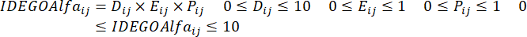
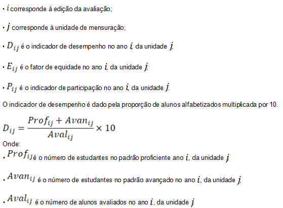
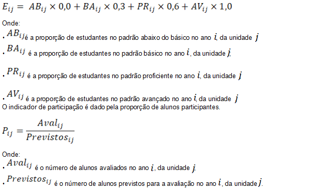

DECRETO Nº 10.270, DE 13 DE JUNHO DE 2023

Regulamenta, para o exercício de 2023, a [Lei nº 21.073](https://legisla.casacivil.go.gov.br/pesquisa_legislacao/104260), de 9 de agosto de 2021, que cria o incentivo à alfabetização, destinado a premiar as escolas públicas da rede estadual e municipal de ensino, de acordo com os resultados no Índice de Desenvolvimento da Educação do Estado de Goiás na Alfabetização – IDEGO-Alfa e no Sistema de Avaliação Educacional do Estado de Goiás – SAEGO.

O **GOVERNADOR DO ESTADO DE GOIÁS**, no uso de suas atribuições constitucionais e legais, com fundamento no inciso IV do art. 37 da [Constituição do Estado de Goiás](https://legisla.casacivil.go.gov.br/pesquisa_legislacao/103152) e em atenção ao Processo nº 202200006077736,

**DECRETA:**

Art. 1º Este Decreto regulamenta, para o exercício de 2023, a [Lei nº 21.073](https://legisla.casacivil.go.gov.br/pesquisa_legislacao/104260), de 9 de agosto de 2021, que institui a Lei de Incentivo à Alfabetização – LEIA e o incentivo nas gradações prêmio e fomento destinado às escolas das redes estadual e municipal de ensino de acordo com os resultados no Índice de Desenvolvimento da Educação do Estado de Goiás na Alfabetização – IDEGO-Alfa e no Sistema de Avaliação Educacional do Estado de Goiás – SAEGO.

Parágrafo único. Serão premiadas e fomentadas somente as escolas das redes estadual e municipal que possuem turmas formadas por estudantes do 2º ano do Ensino Fundamental.

Art. 2º O Prêmio LEIA objetiva:

I – contribuir para o processo de alfabetização na idade certa de todas as crianças do território goiano, com o desenvolvimento de competências e habilidades que garantam o direito à aprendizagem significativa;

II – promover uma política de fomento às unidades escolares de Ensino Fundamental para melhorarem seus resultados de aprendizagem;

III – premiar e fomentar as unidades escolares das redes de ensino estadual e municipal de Goiás, de acordo com o Índice de Desempenho Escolar – Alfabetização – IDE-Alfa, considerado o Sistema de Avaliação Educacional do Estado de Goiás na Alfabetização – SAEGO-Alfa; e

IV – promover incentivo, apoio pedagógico e aporte financeiro às unidades escolares das redes de ensino estadual e municipal de Goiás, que apresentarem os menores resultados de aprendizagem de acordo com o IDE-Alfa, considerado o SAEGO-Alfa.

Art. 3º Para os fins deste Decreto, considera-se:

I – escola premiada: unidade escolar das redes estadual ou municipal que apresentar os melhores resultados no 2º ano do Ensino Fundamental dos Anos Iniciais no SAEGO-Alfa, nos termos do inciso I do art. 2º da [Lei nº 21.073](https://legisla.casacivil.go.gov.br/pesquisa_legislacao/104260), de 2021, calculados de acordo com o IDE-Alfa, conforme o Anexo Único deste Decreto; e

II – escola fomentada: unidade escolar das redes estadual ou municipal com resultados menos promissores no 2º ano do Ensino Fundamental dos Anos Iniciais no SAEGO-Alfa, nos termos do inciso II do art. 2º da [Lei nº 21.073](https://legisla.casacivil.go.gov.br/pesquisa_legislacao/104260), de 2021, calculados de acordo com o IDE-Alfa, conforme o Anexo Único deste Decreto.

Parágrafo único. Os cálculos do IDE-Alfa serão realizados na forma descrita no Anexo Único deste Decreto, conforme os seguintes critérios:

I – indicador de desempenho em uma escala de 0 a 10, que é o número de alunos nos padrões proficiente e avançado sobre o número de alunos avaliados;

II – fator de equidade em uma escala de 0 a 1, que é a soma ponderada da proporção de alunos distribuídos pelos padrões de desempenho em Língua Portuguesa; e

III – indicador de participação em uma escala de 0 a 1, que é dado pela razão entre o número de alunos avaliados e o número de alunos previstos.

Art. 4º As unidades escolares que não se enquadrarem nas categorias predefinidas no art. 4º da [Lei nº 21.073](https://legisla.casacivil.go.gov.br/pesquisa_legislacao/104260) , de 2021, serão desclassificadas para a premiação.

Art. 5º Após a divulgação do resultado do SAEGO-Alfa, será constituída a lista classificatória com os resultados obtidos pelas escolas públicas no IDE-Alfa, considerado o SAEGO-Alfa, e serão premiadas 150 (cento e cinquenta) unidades escolares, nos termos do inciso I do art. 2º da [Lei nº 21.073](https://legisla.casacivil.go.gov.br/pesquisa_legislacao/104260), de 2021.

§ 1º As unidades escolares premiadas receberão o prêmio em dinheiro, com o depósito em conta específica para o Prêmio LEIA, no montante correspondente a R$ 80.000,00 (oitenta mil reais), que será pago em duas parcelas.

§ 2º A primeira parcela do prêmio corresponderá a 60% (sessenta por cento) do valor total devido à escola.

§ 3º O recebimento dos recursos financeiros referentes à segunda parcela do prêmio, correspondente ao restante do valor, está condicionado, cumulativamente:

I – ao acolhimento de uma escola fomentada que deverá, preferencialmente, pertencer à mesma jurisdição regional da escola premiada;

II – à apresentação para a Coordenação Regional de Educação de um plano de trabalho de cooperação técnico- pedagógico nas unidades escolares fomentadas;

III – à continuidade dos bons resultados de alfabetização, comprovados pelo SAEGO-Alfa, subsequente ao do ano em que a escola foi premiada; e

IV – ao acréscimo no índice do SAEGO-Alfa nas escolas fomentadas, subsequente ao ano que a unidade escolar assim foi considerada.

Art. 6º As escolas premiadas ficam inelegíveis à concessão de incentivo na gradação prêmio somente na edição seguinte do SAEGO-Alfa.

Art. 7º Após a divulgação do resultado do SAEGO-Alfa, será constituída a lista classificatória com os resultados obtidos pelas escolas públicas no IDE-Alfa, considerado o SAEGO-Alfa, e serão fomentadas 150 (cento e cinquenta) unidades escolares, nos termos do inciso II do art. 2º da [Lei nº 21.073](https://legisla.casacivil.go.gov.br/pesquisa_legislacao/104260), de 2021.

§ 1º As unidades escolares fomentadas receberão o fomento em dinheiro, com o depósito em conta específica para o Prêmio LEIA, no montante correspondente a R$ 40.000,00 (quarenta mil reais), que será pago em duas parcelas.

§ 2º A primeira parcela do fomento corresponderá a 60% (sessenta por cento) do valor total devido à escola.

§ 3º O recebimento dos recursos financeiros referentes à segunda parcela do fomento, correspondente ao restante do valor, está condicionado, cumulativamente:

I – à elaboração de relatório descritivo que contenha o plano de ação e cooperação técnico-pedagógico com a escola premiada, que vise à melhoria dos resultados próprios no índice do SAEGO-Alfa;

II – à melhoria dos resultados próprios de alfabetização no índice do SAEGO-Alfa, subsequente ao do ano em que a escola foi fomentada; e

III – à elaboração de relatório descritivo no qual se comprove que o recurso da primeira parcela foi utilizado em ações que visem à melhoria do ensino e da aprendizagem na edição do SAEGO-Alfa subsequente ao ano em que a escola foi fomentada.

Parágrafo único. Os relatórios de que tratam os incisos I e III do § 3º deste artigo deverão ser encaminhados para a Coordenação Regional de Educação a que escola se encontra jurisdicionada para a análise de viabilidade e acompanhamento por equipe técnica criada exclusivamente para essa finalidade.

Art. 8º A Coordenação Regional de Educação, por regime de colaboração, mediará as ações técnico-pedagógicas entre as escolas premiadas e as escolas fomentadas para a melhoria do nível educacional.

Art. 9º A relação das unidades escolares contempladas nas gradações prêmio e fomento será divulgada no Portal da Secretaria de Estado da Educação – SEDUC antes da premiação que será realizada por esse órgão.

Art. 10. Os recursos recebidos nas gradações prêmio e fomento serão utilizados exclusivamente em ações para a melhoria das condições das unidades escolares e dos resultados de aprendizagem de seus estudantes, como o aperfeiçoamento de suas instalações físicas e equipamentos, o incentivo ao bom desempenho dos profissionais da escola, o apoio logístico em capacitaç ões e treinamentos, a bonificação obrigatória aos docentes, a promoção da formação continuada e o enriquecimento de seus acervos didático- pedagógicos.

Art. 11. A unidade escolar premiada deverá destinar um percentual de 20% (vinte por cento) dos recursos recebidos aos professores regentes do 1º e do 2º ano do Ensino Fundamental (ciclo de alfabetização) como forma de bonificação pelos resultados positivos alcançados.

Parágrafo único. Os critérios que definirão a bonificação de que trata o _caput_ deste artigo serão regulados em portaria da SEDUC.

Art. 12. As unidades escolares premiadas e fomentadas deverão criar um Plano de Aplicação dos Recursos Financeiros recebidos pelo Prêmio LEIA, voltado à cooperação técnico-pedagógica, assinado pelo Diretor da escola e, se for escola municipal, também deverá ser chancelado pelo Secretário Municipal de Educação, encaminhado à Coordenação Regional de Educação para análise, aprovação e acompanhamento, em conformidade com as orientações da SEDUC.

Art. 13. A prestação de contas dos recursos recebidos pelas escolas premiadas e fomentadas será regulada em portaria da SEDUC.

Art. 14. Os bens adquiridos com os recursos financeiros oriundos da [Lei nº 21.073](https://legisla.casacivil.go.gov.br/pesquisa_legislacao/104260), de 2021, devem ser incorporados como patrimônio do município, quando a escola premiada ou fomentada for municipal, e como patrimônio estadual, quando se tratar de escola estadual.

Art. 15. Caberá à SEDUC emitir regulações específicas e complementares por portaria para a perfeita execução dos procedimentos de que trata este Decreto.

Art. 16. Este Decreto entra em vigor na data de sua publicação.

Goiânia, 13 de junho de 2023; 135º da República.

Ronaldo Caiado

Governador do Estado

ANEXO ÚNICO

O ÍNDICE DE DESEMPENHO ESCOLAR – ALFABETIZAÇÃO – IDE-ALFA

O Índice de Desenvolvimento da Educação do Estado de Goiás na Alfabetização –IDEGO-Alfa reflete de forma sintética a qualidade da educação. O cálculo dos indicadores específicos e do índice sintético é feito a partir dos insumos do Sistema de Avaliação Educacional do Estado de Goiás – SAEGO. Os procedimentos executados para o cálculo do IDEGO-Alfa estão descritos a seguir.

O IDEGO-Alfa é o produto do desempenho, da equidade e da participação. O desempenho é dado pela proporção de alunos com aprendizado adequado em Língua Portuguesa, padronizado na escala de 0 a 10. A equidade é dada pelo fator de ajuste para a universalização do aprendizado de Língua Portuguesa, e os valores variam entre 0 e 1. A participação é dada pela proporção de alunos efetivos sobre os previstos, e os valores também variam entre 0 e 1.

**Onde:**

A equidade é a soma ponderada da proporção de alunos distribuídos pelos padrões de desempenho em Língua Portuguesa1. Este indicador visa estimular o aumento da equidade, sem desconsiderar a eficácia. Em qualquer nível de agregação, quando o percentual de alunos no padrão mais baixo for 100%, o indicador assume o valor 0. Se, ao contrário, todos os alunos estiverem no padrão mais alto, o indicador assume o valor 1. A utilização desse fator leva as redes de ensino e unidades escolares a perseguir o objetivo de ter o maior percentual possível de alunos nos padrões mais altos.

1 Os padrões de desempenho do SAEGO para Língua Portuguesa no 2º ano do Ensino Fundamental são: abaixo do básico (até 350), básico (351 a 400), proficiente (401 a 500) e avançado (acima de 500).
