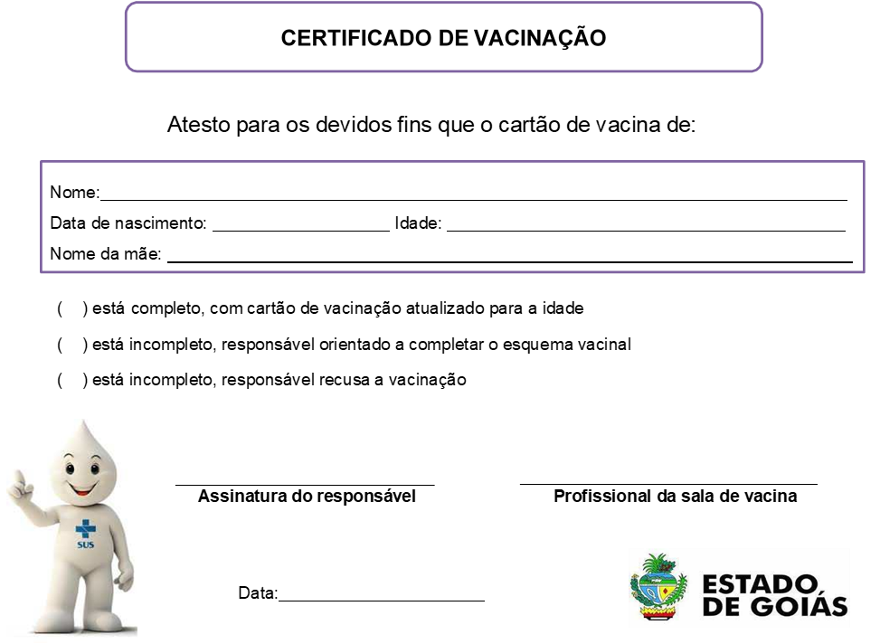
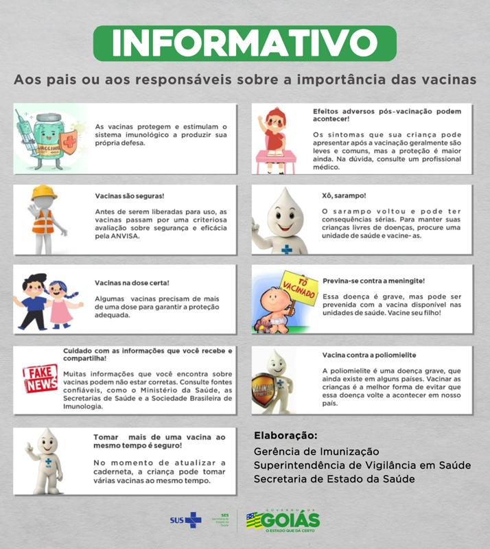

LEI Nº 22.243, DE 28 DE AGOSTO DE 2023

Altera a [Lei nº 19.519](https://legisla.casacivil.go.gov.br/pesquisa_legislacao/98836), de 02 de dezembro de 2016, que estabelece a obrigatoriedade de exigência do Cartão da Criança ou da Caderneta de Saúde da Criança no ato da matrícula dos alunos da educação infantil e da primeira etapa do ensino fundamental.

A **ASSEMBLEIA LEGISLATIVA DO ESTADO DE GOIÁS**, nos termos do art. 10 da [Constituição Estadual](https://legisla.casacivil.go.gov.br/pesquisa_legislacao/103152), decreta e eu sanciono a seguinte Lei:

Art. 1º A ementa da [Lei nº 19.519](https://legisla.casacivil.go.gov.br/pesquisa_legislacao/98836), de 02 de dezembro de 2016, passa a vigorar com as seguintes alterações:

“Estabelece a obrigatoriedade da exigência do Certificado de Vacinação no ato da matrícula dos alunos até 18 (dezoito) anos de idade da Educação Infantil, do Ensino Fundamental e do Ensino Médio.” (NR)

Art. 2º A [Lei nº 19.519](https://legisla.casacivil.go.gov.br/pesquisa_legislacao/98836), de 2016, passa a vigorar com as seguintes alterações:

“Art. 1º As instituições de ensino das redes pública e particular, no ato da matrícula, devem solicitar aos pais ou aos responsáveis a apresentação do Certificado de Vacinação dos alunos até 18 (dezoito) anos de idade da Educação Infantil, do Ensino Fundamental e do Ensino Médio.

§ 1º O Certificado de Vacinação será emitido por qualquer unidade de saúde, pública ou privada que possua sala para a aplicação de injetáveis e seja autorizada pelo serviço de vigilância sanitária local, mediante a apresentação da Caderneta de Vacinação (registro impresso ou digital) que ateste a aplicação de todas as vacinas recomendadas pelo Programa Nacional de Imunizações do Ministério da Saúde, de acordo com o Calendário Nacional de Vacinação da Criança e do Adolescente.

§ 2º Compete aos profissionais de saúde promover a sensibilização dos pais ou dos responsáveis sobre a importância da vacinação.” (NR)

“Art. 2º Cabe à instituição de ensino, caso não seja apresentado o documento de que trata o art. 1º desta Lei, adotar as seguintes providências:

I – orientar os pais ou os responsáveis e os alunos a se dirigirem imediatamente a um posto de saúde com os comprovantes de vacinação para a obtenção do Certificado de Vacinação;

II – esclarecer os pais ou os responsáveis e os alunos sobre a importância da vacinação de acordo com o Calendário Nacional de Vacinação da Criança e do Adolescente;

...................................................................................................................................

§ 1º A não apresentação do documento exigido no art. 1º desta Lei ou a constatação da falta de alguma das vacinas recomendadas não impossibilitará a matrícula nem a frequência escolar, porém a situação deverá ser regularizada no prazo máximo de 30 (trinta) dias pelos pais ou pelos responsáveis, sob pena de a instituição de ensino comunicar imediatamente a ocorrência ao Conselho Tutelar para as providências cabíveis, as quais deverão ser adotadas também no prazo máximo de 30 (trinta) dias.

§ 2º O Conselho Tutelar, ultrapassado o prazo de 30 (trinta) dias que lhe foi conferido sem a regularização da situação do aluno, comunicará o fato ao Ministério Público estadual para o conhecimento e as providências cabíveis.” (NR)

“Art. 3º-A Os documentos a que se refere esta Lei serão padronizados conforme os Anexos I e II.” (NR)

Art. 3º Ficam revogados os incisos III e IV e o parágrafo único do art. 2º da [Lei nº 19.519](https://legisla.casacivil.go.gov.br/pesquisa_legislacao/98836), de 2016.

Art. 4º Esta Lei entra em vigor na data de sua publicação.

Goiânia, 28 de agosto de 2023; 135º da República.

RONALDO CAIADO

Governador do Estado

ANEXO I

(a que se refere o art. 3º-A da [Lei nº 19.519](https://legisla.casacivil.go.gov.br/pesquisa_legislacao/98836), de 02 de dezembro de 2016)

ANEXO II

(a que se refere o art. 3º-A da [Lei nº 19.519](https://legisla.casacivil.go.gov.br/pesquisa_legislacao/98836), de 02 de dezembro de 2016)

.

.
