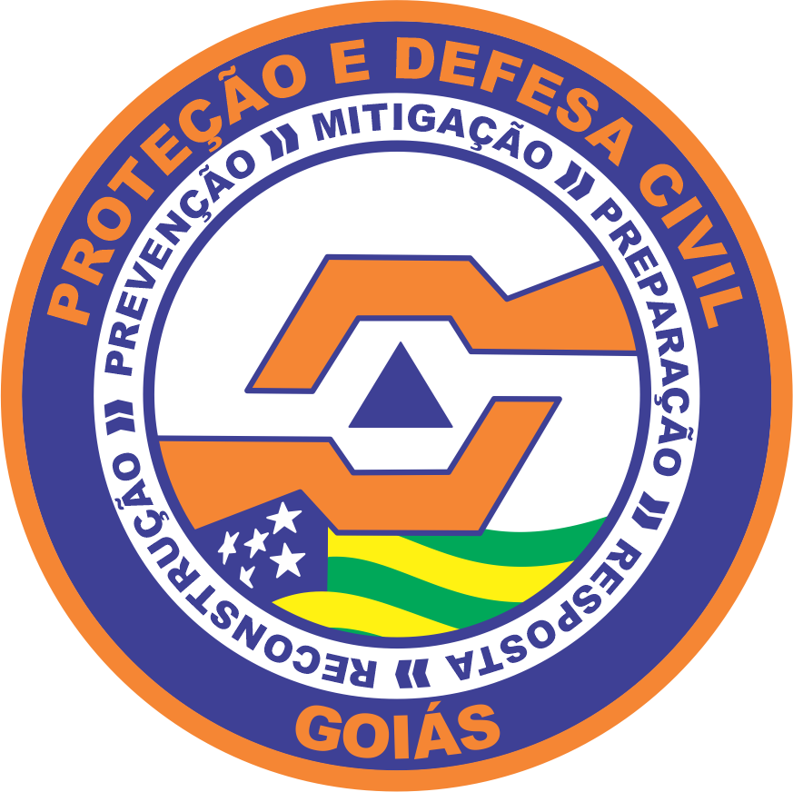
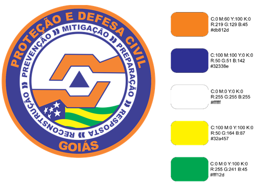
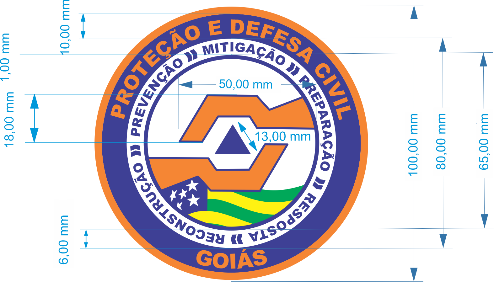
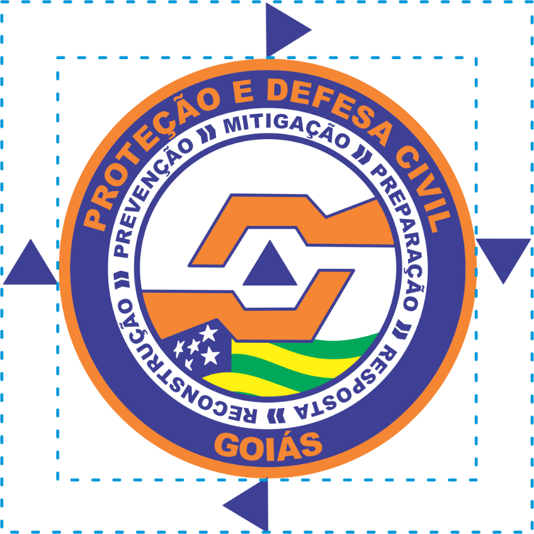

DECRETO Nº 10.311 , DE 1º DE SETEMBRO DE 2023

Institui o símbolo de Proteção e Defesa Civil do Estado de Goiás – P&DC/GO e dá outras providências.

O **GOVERNADOR DO ESTADO DE GOIÁS**, no uso de suas atribuições constitucionais, com fundamento na alínea “a” do inciso XVIII do art. 37 da [Constituição do Estado de Goiás](https://legisla.casacivil.go.gov.br/pesquisa_legislacao/103152) e em atenção ao Processo nº 202300011010808,

**DECRETA:**

Art. 1º Fica instituído, no Sistema Estadual de Proteção e Defesa Civil do Estado de Goiás – SEPDEC/GO, o uso do símbolo de Proteção e Defesa Civil do Estado de Goiás – P&DC/GO.

Art. 2º O símbolo de P&DC/GO representa a importância do SEPDEC/GO e identifica o órgão responsável pela articulação e pela coordenação de ações preventivas, mitigadoras, responsivas, assistenciais e reconstrutivas destinadas a evitar ou minimizar os desastres naturais e os incidentes tecnológicos, preservar a moral da população e restabelecer a normalidade social no Estado de Goiás.

Art. 3º O símbolo de P&DC/GO é de uso privativo dos agentes de proteção e defesa civil do SEPDEC/GO, e quem fizer uso indevido e/ou não autorizado dele incorrerá em violação do direito ao uso de marcas, logotipos, siglas e símbolos de entidades públicas.

§ 1º Os calendários, os adesivos, os _folders_ de campanhas e as demais publicações para a divulgação da Coordenadoria Estadual de Proteção e Defesa Civil do Estado de Goiás devem ter a aprovação prévia do Coordenador Estadual de Proteção e Defesa Civil.

§ 2º Os Coordenadores Regionais de Proteção e Defesa Civil, por meio das unidades operacionais subordinadas, deverão fiscalizar e coibir a utilização indevida do símbolo de P&DC/GO em cartazes de eventos, painéis e recibos de firmas não condizentes com o SEPDEC/GO ou em formas de apoio às atividades promocionais e comunitárias não autorizadas.

Art. 4º O símbolo de P&DC/GO é o que consta dos Anexos I e II deste Decreto, com sua descrição heráldica e propriedades gráficas, respectivamente.

§ 1º O nível de detalhamento dos elementos que compõem o símbolo de P&DC/GO exige que sejam utilizados arquivos digitais disponibilizados pela Coordenadoria Estadual de Proteção e Defesa Civil do Estado de Goiás.

§ 2º Haverá um arquivo para cada versão do símbolo de P&DC/GO prevista neste Decreto, para manter a correta padronização do sistema de identidade visual.

Art. 5º Os casos não previstos neste Decreto serão encaminhados ao Coordenador Estadual de Proteção e Defesa Civil para apreciação.

Art. 6º Este Decreto entra em vigor na data de sua publicação.

Goiânia, 1º de setembro de 2023; 135º da República.

DANIEL VILELA

Governador do Estado em exercício

ANEXO I

DESCRIÇÃO HERÁLDICA DO SÍMBOLO DE PROTEÇÃO E DEFESA CIVIL DO ESTADO DE GOIÁS – P&DC/GO

Figura 1 – Símbolo de P&DC/GO

O símbolo de P&DC/GO tem em sua ênfase gráfica circular as impressões que representam o seu simbolismo disposto sob a forma de três círculos concêntricos. Há, no círculo azul externo, as inscrições “PROTEÇÃO E DEFESA CIVIL”, na parte superior, e “GOIÁS”, na parte inferior, em fonte _Arial Black_, tamanho 24, na cor laranja. No círculo branco intermediário, há as inscrições alusivas ao ciclo operacional completo de proteção e defesa civil, em fonte _Arial Black_, tamanho 14, na cor azul: “PREVENÇÃO”, “MITIGAÇÃO”, “PREPARAÇÃO”, “RESPOSTA” e “RECONSTRUÇÃO”. Veicula-se a ideia de continuidade nas ações de proteção e defesa civil.

Todas as inscrições são posicionadas para acompanhar a curvatura do círculo que as contém. No círculo branco interno, há duas mãos estilizadas, na cor laranja, para figurar o socorro, o amparo, o carinho, o amor e o cuidado com o povo goiano. No interior, compreendido entre as mãos, há um triângulo equilátero na cor azul para representar a união das forças e a cooperação de todos, que são condições essenciais da proteção e da defesa civil. A base do triângulo manifesta a segurança, a estabilidade e o bem-estar social, metas de toda proteção e defesa civil. Os outros vértices simbolizam, do lado direito, a prevenção e, do lado esquerdo, a ação, que são medidas fundamentais para se manterem a segurança e a proteção da população. Na parte inferior da mão, há a bandeira do Estado de Goiás, para simbolizar a importância, a força, a união e a camaradagem do povo goiano.

ANEXO II

PROPRIEDADES GRÁFICAS DO SÍMBOLO DE PROTEÇÃO E DEFESA CIVIL DO ESTADO DE GOIÁS – P&DC/GO

Figura 2 – Especificação de cores do símbolo de P&DC/GO

As cores seguem padrão internacional de proteção e defesa civil. A cor laranja é a cor oficial da simbologia internacional da proteção e da defesa civil, para indicar o calor humano e a solidariedade. A cor azul traduz a tranquilidade, o equilíbrio e a serenidade com que agem a proteção e a defesa civil no mundo. As cores da bandeira do Estado de Goiás têm suas distinções próprias. Em resumo, as cores básicas do símbolo são o laranja e o azul.

A especificação de cores no padrão policromia (CMYK), versão eletrônica (RGB) e #Hexadecimal utiliza os códigos conforme a Figura 2.

As versões com apenas uma cor devem ser usadas em casos de necessidade excepcional. Permite-se a utilização do símbolo de P&DC/GO: _i)_ em tons de cinza, nas impressões ou exibições monocromáticas; _ii)_ em alto relevo com tons de cinza, nos documentos oficiais, nos termos da norma de correspondências vigente; _iii)_ de transparência ou marca d’água, em certificados, capas de documentos e relatórios diversos, com a aplicação de efeito uniforme e opacidade 60 a 80; e _iv)_ de chancela ou carimbo, na certificação, na numeração de autos e no recebimento de documentos.

O símbolo de P&DC/GO não deve ser aplicado em cores que não sejam originais, bordas adicionais ou distorções. Além disso, é proibida qualquer mudança nos elementos estruturais e cromáticos, portanto é indevido: rotacionar, distorcer, alterar as cores, usar fontes _outline_, aplicar como marca d’agua, desalinhar ou remover elementos e aplicar moldura.

Figura 3 – Dimensões do símbolo de P&DC/GO

Para a definição das respectivas dimensões, em um símbolo de 10 cm de diâmetro de borda, a composição da imagem deve conter as seguintes especificações:

I – inscrição “PROTEÇÃO E DEFESA CIVIL”, na cor laranja, em letras maiúsculas, fonte _Arial Black_, tamanho 24, no primeiro e no quarto quadrante da circunferência, com o tangenciamento da parte interna da borda do símbolo dentro do contorno da circunferência de 100 mm de diâmetro da sua borda externa e de 10 mm de largura, na cor azul;

II – inscrição “GOIÁS”, na cor laranja, em letras maiúsculas, fonte _Arial Black_, tamanho 24, no segundo e no terceiro quadrante da circunferência, com o tangenciamento da parte interna da borda do símbolo dentro do contorno da circunferência de 100 mm de diâmetro da sua borda externa e de 10 mm de largura, na cor azul;

III – círculo branco de 80 mm de diâmetro da sua borda externa e de 6 mm de largura com as inscrições do ciclo operacional de proteção e defesa civil (PREVENÇÃO >> MITIGAÇÃO >> PREPARAÇÃO >> RESPOSTA >> RECONSTRUÇÃO) em letras maiúsculas, fonte _Arial Black_, tamanho 14, e setas duplas sentido horário com a mesma dimensão, entre as ações do ciclo operacional, tudo na cor azul;

IV – duas figuras com as mãos estilizadas em forma hexagonal, com a extensão de 50 mm de comprimento e 18 mm de altura, envoltas por círculo azul de linha curva de 65 mm de diâmetro e 1 mm de largura, no fundo branco;

V – no centro do símbolo, o triângulo equilátero com 13 mm de lado, centralizado no hexágono formador das palmas das mãos, no fundo branco; e

VI – desenho da bandeira do Estado de Goiás, com o tangenciamento das costas da mão inferior, a apresentação das suas 5 (cinco) estrelas no quadrado na cor azul e a intercalação das suas cores verde e amarela.

Para que sejam mantidas a integridade e a legibilidade do símbolo, sua aplicação não pode ser menor que 35 mm de diâmetro em meios impressos e, no meio digital, a redução máxima é de 413Px. Essa redução só deve ocorrer em casos de necessidade excepcional.

A estrutura do símbolo deve ser mantida no que se refere à proporção. Não poderá ser estendida ou condensada e sofrer qualquer forma de distorção. A ampliação e a redução do símbolo de P&DC/GO devem ser feitas somente de forma proporcional às suas medidas e manter a configuração original.

São vedadas as seguintes alterações no símbolo de P&DC/GO: _i)_ alteração de formas; _ii)_ mistura ou mudança de cores; _iii)_ exibição parcial (corte) ou exclusão de partes; _iv)_ mudança de fonte; _v)_ inclusão de formas ou de texto; _vi)_ efeitos esféricos, de iluminação, extrusão, mistura de cores, contorno, distorção e envelope; e _vii)_ outros que deformem ou descaracterizem o símbolo aprovado pelo decreto que este anexo integra.

Figura 4 – Aplicação do símbolo de P&DC/GO

Ao aplicar o símbolo de P&DC/GO em materiais gráficos, sem poluição visual, deve-se manter uma área de não interferência em torno dele, com a distância mínima X igual ao lado do triângulo equilátero de qualquer outro elemento visual que não seja o distintivo. São proibidas a fusão e a sobreposição com outras marcas.

No caso de aplicação sobre fundos instáveis, fotos, imagens de paisagem ou similares, deve-se utilizar fundo na cor laranja ou na cor azul, ou com o contorno branco e o padrão de não interferência já descrito.

O símbolo poderá sofrer inclinação até 45° desde que seja para acompanhar a orientação de texto ou a coerência de elementos do projeto em que estiver inserido.

A aplicação de bordados, bolacha emborrachada e serigrafia ( _silkscreen_) do símbolo de P&DC/GO é permitida apenas nos fardamentos e vestimentas previstas em regulamentos da Coordenadoria Estadual de Proteção e Defesa Civil do Estado de Goiás e nos atos complementares baixados pelo Coordenador Estadual de Proteção e Defesa Civil.
