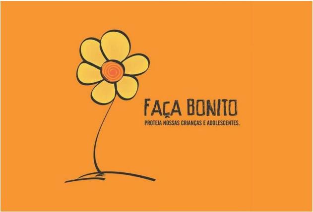

LEI Nº 22.972, DE 3 DE SETEMBRO DE 2024

Altera a [Lei nº 16.296](https://legisla.casacivil.go.gov.br/pesquisa_legislacao/87013), de 02 de julho de 2008, que institui o Dia Estadual de Combate ao Abuso Sexual e à Exploração de Crianças e Adolescentes.

A **ASSEMBLEIA LEGISLATIVA DO ESTADO DE GOIÁS**, nos termos do art. 10 da [Constituição Estadual](https://legisla.casacivil.go.gov.br/pesquisa_legislacao/103152), decreta e eu sanciono a seguinte Lei:

Art. 1º A [Lei nº 16.296](https://legisla.casacivil.go.gov.br/pesquisa_legislacao/87013), de 02 de julho de 2008, passa a vigorar com as seguintes alterações:

“Art. 1º ......................................................................................................

.................................................................................................................................... ” (NR)

II – o Mês Estadual ‘Maio Laranja: Campanha Faça Bonito’, dedicado ao combate ao abuso e à exploração sexual de crianças e adolescentes.

.................................................................................................................................... ” (NR)

“Art. 1º-A Durante o Mês Estadual ‘Maio Laranja: Campanha Faça Bonito’, sempre que possível, serão utilizadas, nas edificações públicas estaduais, a iluminação na cor laranja e a aplicação do símbolo da campanha ou sinalização alusiva ao tema.” (NR)

“Art. 1º-B O Mês Estadual ‘Maio Laranja: Campanha Faça Bonito’ contará com ações educativas, divulgadas especialmente com a realização de eventos e palestras, pelos meios de comunicação, pela afixação de cartazes e pela distribuição de folhetos em órgãos públicos. 

.................................................................................................................................... ” (NR)

“Art. 1º-C A flor amarela e laranja, cuja formatação consta do Anexo Único desta Lei, fica reconhecida, no âmbito do Estado de Goiás, como símbolo oficial para o combate ao abuso sexual e à exploração de crianças e adolescentes.

Parágrafo único. As campanhas realizadas pela mídia e por outros meios de comunicação, bem como os materiais ilustrativos, relativos ao Dia Estadual de Combate ao Abuso e à Exploração Sexual de Crianças e Adolescentes e ao Mês Estadual ‘Maio Laranja: Campanha Faça Bonito’, se orientarão pela utilização do símbolo de que trata o _caput_ deste artigo.”

Art. 2º As despesas porventura decorrentes desta Lei correrão à conta de dotações orçamentárias próprias, consignadas no orçamento vigente.

Art. 3º Esta Lei entra em vigor na data de sua publicação.

Goiânia, 3 de setembro de 2024; 136º da República.

DANIEL VILELA

Governador do Estado em exercício

BIA DE LIMA

Deputada Estadual

ANEXO ÚNICO

SÍMBOLO OFICIAL DA CAMPANHA PARA O COMBATE AO ABUSO SEXUAL E À EXPLORAÇÃO DE CRIANÇAS E ADOLESCENTES

