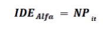
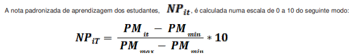
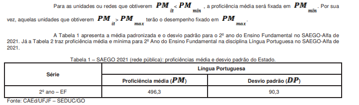
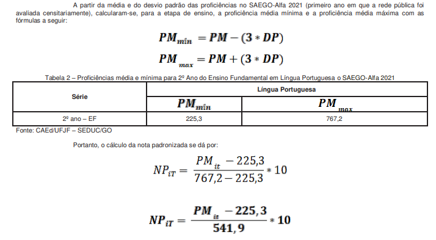
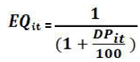
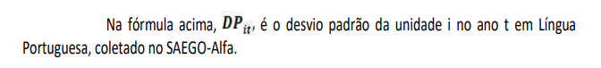
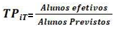

DECRETO Nº 10.590, DE 10 DE DEZEMBRO DE 2024

Regulamenta, para o exercício de 2025, a [Lei nº 21.073](https://legisla.casacivil.go.gov.br/pesquisa_legislacao/104260), de 9 de agosto de 2021, que cria o incentivo à alfabetização, destinado a premiar as escolas públicas da rede estadual e municipal de ensino, de acordo com os resultados no Índice de Desenvolvimento da Educação do Estado de Goiás na Alfabetização – IDEGO-Alfa e no Sistema de Avaliação Educacional do Estado de Goiás – SAEGO.

O GOVERNADOR DO ESTADO DE GOIÁS, no uso de suas atribuições constitucionais e legais, com fundamento no inciso IV do art. 37 da [Constituição do Estado de Goiás](https://legisla.casacivil.go.gov.br/pesquisa_legislacao/103152), também em atenção ao que consta do Processo nº 202200006077736,

**DECRETA:**

Art. 1º Este Decreto regulamenta, para o exercício de 2025, a [Lei nº 21.073](https://legisla.casacivil.go.gov.br/pesquisa_legislacao/104260), de 9 de agosto de 2021, que institui a Lei de Incentivo à Alfabetização – LEIA e o incentivo nas gradações prêmio e fomento destinado às escolas das redes estadual e municipal de ensino, de acordo com os resultados no Índice de Desenvolvimento da Educação do Estado de Goiás na Alfabetização – IDEGO-Alfa e no Sistema de Avaliação Educacional do Estado de Goiás – SAEGO.

§ 1º Serão premiadas e fomentadas somente as escolas das redes estadual e municipal que possuem turmas formadas por estudantes do 2º ano do Ensino Fundamental.

§ 2º As unidades escolares premiadas e fomentadas das redes estadual e municipal que deixarem de ofertar turmas do 2º ano do Ensino Fundamental não farão jus ao incentivo nas gradações prêmio e fomento, mesmo que essas unidades, no ano da avaliação, tenham ofertado as referidas turmas.

Art. 2º O Prêmio LEIA objetiva:

I – contribuir para o processo de alfabetização na idade certa de todas as crianças do território goiano, com o desenvolvimento de competências e habilidades que garantam o direito à aprendizagem significativa;

II – promover uma política de fomento às unidades escolares do Ensino Fundamental para melhorarem seus resultados de aprendizagem;

III – premiar e fomentar as unidades escolares das redes de ensino estadual e municipal de Goiás, de acordo com o Índice de Desempenho Educacional de Goiás – IDE-Alfa, considerado o Sistema de Avaliação Educacional do Estado de Goiás na Alfabetização – SAEGO-Alfa; e

IV – promover incentivo, apoio pedagógico e aporte financeiro às unidades escolares das redes de ensino estadual e municipal de Goiás que apresentarem os menores resultados de aprendizagem de acordo com o IDE-Alfa, considerado o SAEGO-Alfa.

Art. 3º Este Decreto considera:

I – escola premiada: unidade escolar da rede estadual ou da municipal que apresentar os melhores resultados no 2º ano do Ensino Fundamental dos Anos Iniciais no SAEGO-Alfa, como dispõe o inciso I do art. 2º da [Lei nº 21.073](https://legisla.casacivil.go.gov.br/pesquisa_legislacao/104260), de 2021, calculados de acordo com o IDE-Alfa, conforme o Anexo Único deste Decreto; e

II – escola fomentada: unidade escolar da rede estadual ou da municipal com resultados menos promissores no 2º ano do Ensino Fundamental dos Anos Iniciais no SAEGO-Alfa, como dispõe o inciso II do art. 2º da [Lei nº 21.073](https://legisla.casacivil.go.gov.br/pesquisa_legislacao/104260), de 2021, calculados de acordo com o IDE-Alfa, conforme o Anexo Único deste Decreto.

Parágrafo único. Os cálculos do IDE-Alfa serão realizados na forma descrita no Anexo Único deste Decreto, com nota padronizada em escala de 0 a 10, conforme a média de desempenho em proficiência em Língua Portuguesa dos alunos avaliados no 2º ano do Ensino Fundamental.

Art. 4º As unidades escolares que não se enquadrarem nas categorias predefinidas no art. 4º da [Lei nº 21.073](https://legisla.casacivil.go.gov.br/pesquisa_legislacao/104260), de 2021, serão desclassificadas para a premiação.

Art. 5º Após a divulgação do resultado do SAEGO-Alfa, será constituída a lista classificatória com os resultados obtidos pelas escolas públicas no IDE-Alfa, considerado o SAEGO-Alfa, e serão premiadas 150 (cento e cinquenta) unidades escolares, nos termos do inciso I do art. 2º da [Lei nº 21.073](https://legisla.casacivil.go.gov.br/pesquisa_legislacao/104260), de 2021.

§ 1º Cada unidade premiada receberá em dinheiro o prêmio de R$ 80.000,00 (oitenta mil reais), depositado em conta específica para o Prêmio LEIA, pago em duas parcelas.

§ 2º A primeira parcela do prêmio corresponderá a 60% (sessenta por cento) do valor total devido à escola.

§ 3º O recebimento dos recursos financeiros referentes à segunda parcela do prêmio, correspondente ao restante do valor, está condicionado, cumulativamente:

I – ao pareamento das escolas, seguidos os critérios definidos no § 4º deste artigo;

II – à apresentação para a Coordenação Regional de Educação de um plano de trabalho de cooperação técnico- pedagógica nas unidades escolares fomentadas;

III – à continuidade dos bons resultados de alfabetização, comprovados pelo SAEGO-Alfa, subsequente ao do ano em que a escola foi premiada; e

IV – à manutenção ou ao acréscimo no índice do SAEGO-Alfa nas escolas fomentadas, subsequente ao ano em que a unidade escolar assim foi considerada.

§ 4º O pareamento das escolas na mesma categoria de que trata o inciso I do § 3º deste artigo deve atender aos seguintes critérios:

I – mesmo município;

II – municípios próximos;

III – mesma regional; e

IV – distância.

§ 5º Caso o pareamento dentro da mesma categoria não seja possível, o pareamento deverá prosseguir consideradas as escolas de categorias vizinhas.

§ 6º As unidades escolares premiadas inseridas nas categorias 4, 3, 2 e 1, nessa ordem, terão prioridade para acompanhar a unidade escolar fomentada mais próxima de cada unidade acompanhante.

Art. 6º As escolas premiadas ficam inelegíveis à concessão de incentivo na gradação prêmio somente na edição seguinte do SAEGO-Alfa.

Art. 7º Após a divulgação do resultado do SAEGO-Alfa, será constituída a lista classificatória com os resultados obtidos pelas escolas públicas no IDE-Alfa, considerado o SAEGO-Alfa, e serão fomentadas 150 (cento e cinquenta) unidades escolares, nos termos do inciso II do art. 2º da [Lei nº 21.073](https://legisla.casacivil.go.gov.br/pesquisa_legislacao/104260), de 2021.

§ 1º Cada unidade fomentada receberá em dinheiro o fomento de R$ 40.000,00 (quarenta mil reais), depositado em conta específica para o Prêmio LEIA, pago em duas parcelas.

§ 2º A primeira parcela do fomento corresponderá a 60% (sessenta por cento) do valor total devido à escola.

§ 3º O recebimento dos recursos financeiros referentes à segunda parcela do fomento, correspondente ao restante do valor, está condicionado, cumulativamente:

I – à elaboração do relatório descritivo que contenha o plano de ação e cooperação técnico-pedagógica com a escola premiada para a melhoria dos resultados próprios no índice do SAEGO-Alfa;

II – à melhoria dos resultados próprios de alfabetização no índice do SAEGO-Alfa, subsequente ao do ano em que a escola foi fomentada; e

III – à elaboração do relatório descritivo no qual se comprove que o recurso da primeira parcela foi utilizado em ações para a melhoria do ensino e da aprendizagem na edição do SAEGO-Alfa subsequente ao ano em que a escola foi fomentada.

§ 4º Os relatórios de que tratam os incisos I e III do § 3º deste artigo deverão ser encaminhados à Coordenação Regional de Educação a que escola se encontra jurisdicionada, para a análise de viabilidade e acompanhamento por equipe técnica cr iada exclusivamente para essa finalidade, bem como inseridos no Sistema de Acompanhamento do Programa AlfaMais Goiás – SIAM.

Art. 8º A Coordenação Regional de Educação, por regime de colaboração, mediará as ações técnico-pedagógicas entre as escolas premiadas e as escolas fomentadas para a melhoria do nível educacional.

Art. 9º A relação das unidades escolares contempladas nas gradações prêmio e fomento será divulgada no portal da Secretaria de Estado da Educação – SEDUC antes da premiação que será realizada por esse órgão.

Art. 10. Os recursos recebidos nas gradações prêmio e fomento serão utilizados exclusivamente em ações para a melhoria das condições das unidades escolares e dos resultados de aprendizagem de seus estudantes, como o aperfeiçoamento de suas instalações físicas e equipamentos, o incentivo ao bom desempenho dos profissionais da escola, o apoio logístico a capacitações e treinamentos, a bonificação obrigatória aos docentes, a promoção da formação continuada e o enriquecimento de seus acer vos didático- pedagógicos.

Art. 11. A unidade escolar premiada deverá destinar o percentual de 20% (vinte por cento) do valor do prêmio aos professores regentes do 1º e do 2º ano do Ensino Fundamental (ciclo de alfabetização) como forma de bonificação pelos resultados positivos alcançados.

§ 1º Farão jus à divisão da bonificação os professores regentes nas turmas de 1º e 2º ano do Ensino Fundamental que:

I – permanecerem por, no mínimo, 4 (quatro) meses nessa regência no ano da avaliação que premiou a unidade escolar; e

II – exercerem essa regência em mais de uma turma no ano da avaliação que premiou a unidade escolar, caso em que receberão a bonificação por turma, desde que cumpram o período estabelecido no inciso I deste artigo.

§ 2º Observados os incisos I e II do § 1º deste artigo, a bonificação do professor contemplado que f alecer antes do recebimento será distribuída entre os docentes das turmas de 1º e 2º ano do Ensino Fundamental da unidade escolar premiada.

§ 3º Fará jus à premiação o professor da unidade escolar premiada que, por qualquer motivo, deixar de ofertar turma do 2º ano do Ensino Fundamental.

§ 4º Não haverá pagamento de bonificação na 2ª parcela da premiação.

§ 5º O valor total da bonificação, que será distribuído entre os professores regentes nas turmas de 1º e 2º ano do Ensino Fundamental, no valor de R$ 16.000,00 (dezesseis mil reais), correspondente aos 20% (vinte por cento) dos R$ 80.000,00 (oitenta mil reais), deverá ser pago em sua totalidade pelo conselho escolar, do recebimento da primeira parcela da premiação.

§ 6º A bonificação concedida aos professores regentes do 1º e do 2º ano do Ensino Fundamental (ciclo de alfabetização) pelos resultados positivos alcançados não se incorpora, em nenhuma hipótese, à remuneração mensal deles, também é:

I – rendimento não tributável;

II – livre da incidência de contribuição previdenciária;

III – não computável para efeito de 13º (décimo terceiro) salário; e

IV – não considerável para a base de cálculo de margem consignável.

§ 7º Os critérios que definirão a bonificação de que trata o _caput_ deste artigo serão regulados por portaria da SEDUC.

Art. 12. As unidades escolares premiadas e fomentadas deverão criar um plano de aplicação dos recursos financeiros recebidos pelo Prêmio LEIA, voltado à cooperação técnico-pedagógica, assinado pelo diretor da escola e, se for escola municipal, também chancelado pelo secretário municipal de Educação, encaminhado à Coordenação Regional de Educação para análise, aprovação e acompanhamento, em conformidade com as orientações da SEDUC.

Art. 13. A prestação de contas dos recursos recebidos pelas escolas premiadas e fomentadas será regulada por portaria da SEDUC.

Art. 14. Os bens adquiridos com os recursos financeiros oriundos da [Lei nº 21.073](https://legisla.casacivil.go.gov.br/pesquisa_legislacao/104260), de 2021, devem ser incorporados como patrimônio do município, quando a escola premiada ou fomentada for municipal, e como patrimônio do Estado de Goiás, quando se tratar de escola estadual.

Art. 15. Caberá à SEDUC emitir regulações específicas e complementares por portaria para a perfeita execução dos procedimentos de que trata este Decreto.

Art. 16. Este Decreto entra em vigor na data de sua publicação.

Goiânia, 10 de dezembro de 2024; 136º da República.

Ronaldo Caiado

Governador do Estado

[ANEXO ÚNICO](https://legisla.casacivil.go.gov.br/api/v1/arquivos/18611)

ÍNDICE DE DESEMPENHO EDUCACIONAL DE GOIÁS – IDE-Alfa

1                        Introdução

O Índice de Desempenho Educacional de Goiás – IDE-Alfa foi criado para, com avaliações externas, aferir a qualidade do ensino em diferentes níveis: estadual, regional, municipal e por unidade ou rede. Assim, o IDE-Alfa é fundamental na formulação de políticas públicas voltadas à educação. Seu principal objetivo é promover a aprendizagem mais equitativa para reduzir as discrepâncias de aprendizado entre estudantes, incentivar unidades e redes a diminuírem as taxas de reprovação e abandono e estimular a participação abrangente dos estudantes nas avaliações. A escala de medida adotada vai de 0 a 10.

2                        Componentes do IDE-Alfa

O IDE-Alfa é calculado com base nos resultados da avaliação somativa do Sistema de Avaliação do Estado de Goiás – SAEGO. O IDE-Alfa é referente ao 2º ano do Ensino Fundamental. Ele é composto pela nota padronizada dos estudantes na disciplina Língua Portuguesa, que evidencia o nível de aquisição pelos estudantes das habilidades delineadas no Documento de Referência Curricular do Estado de Goiás.

3                        Cálculo da nota padronizada

4                        Ranqueamento e critérios de desempate

\- [Acrescido pelo Decreto nº 10.736, de 21-7-2025](https://legisla.casacivil.go.gov.br/pesquisa_legislacao/111092/decreto-10736).

Com a nota padronizada, serão ranqueadas as escolas participantes, entre as quais, conforme a [Lei nº 21.073](https://legisla.casacivil.go.gov.br/pesquisa_legislacao/104260), de 9 de agosto de 2021, haverá cento e cinquenta escolas premiadas e cento e cinquenta escolas fomentadas, que atendam aos critérios especificados na referida lei. Ainda conforme o art. 4º, § 2º, da a [Lei nº 21.073](https://legisla.casacivil.go.gov.br/pesquisa_legislacao/104260), de 2021, os empates serão resolvidos com observância à seguinte ordem de critérios: _i)_ maior fator de equidade educacional; _ii)_ maior proficiência média; e _iii)_ maior taxa de participação. Os três serão coletados para a unidade escolar na avaliação do SAEGO-Alfa.

O Fator de Equidade Educacional EQit é calculado por meio do desvio padrão da unidade em Língua Portuguesa, assumido um valor entre 0 e 1, com a seguinte formulação:

A taxa de participação TP, que é calculada na escala de 0 a 1, é definida como:

Nesta última fórmula, o segmento 'alunos efetivos' indica o total de alunos que participaram da avaliação somativa na série avaliada no ano t, e o segmento 'alunos previstos' indica o total de alunos matriculados na série avaliada no ano t.
