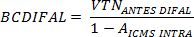
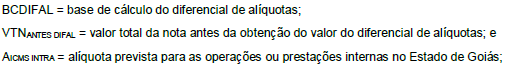

DECRETO Nº 10.611, DE 18 DE DEZEMBRO DE 2024

Altera o [Decreto nº 4.852](https://legisla.casacivil.go.gov.br/pesquisa_legislacao/67266), de 29 de dezembro de 1997, Regulamento do Código Tributário do Estado de Goiás – RCTE, e revoga o [Decreto nº 9.104](https://legisla.casacivil.go.gov.br/pesquisa_legislacao/69848), de 5 de dezembro de 2017.

O **GOVERNADOR DO ESTADO DE GOIÁS**, no uso de suas atribuições constitucionais, com fundamento no inciso IV do art. 37 da [Constituição do Estado de Goiás](https://legisla.casacivil.go.gov.br/pesquisa_legislacao/103152), no art. 4º das Disposições Finais e Transitórias da [Lei nº 11.651](https://legisla.casacivil.go.gov.br/pesquisa_legislacao/87836), de 26 de dezembro de 1991, Código Tributário do Estado de Goiás – CTE, em atenção às Leis [nº 21.690](https://legisla.casacivil.go.gov.br/pesquisa_legislacao/106466), de 15 de dezembro de 2022, e [nº 22.424](https://legisla.casacivil.go.gov.br/pesquisa_legislacao/108130), de 1º de dezembro de 2023, também ao Convênio ICMS nº 236, de 27 de dezembro de 2021, e ao Processo nº 202400004086006,

**DECRETA:**

Art. 1º O [Decreto nº 4.852](https://legisla.casacivil.go.gov.br/pesquisa_legislacao/67266), de 29 de dezembro de 1997, Regulamento do Código Tributário do Estado de Goiás – RCTE, passa a vigorar com as seguintes alterações:

“Art 4º ..............................................................................................

....................................................................................................................................

§ 1º ....................................................................................................

....................................................................................................................................

II – a entrada, no território goiano, de mercadoria ou bem oriundos de outro Estado, ainda que o imposto não tenha sido cobrado na origem, adquiridos por contribuinte e destinados ao seu uso, ao consumo final ou à integração ao seu ativo imobilizado;

....................................................................................................................................

VIII – a utilização, por contribuinte, de serviço de transporte ou de comunicação cuja prestação tenha– se iniciado em outro Estado, ainda que o imposto não tenha sido cobrado na origem, desde que não esteja vinculada à operação ou prestação subsequente;

....................................................................................................................................

XI – a saída de estabelecimento de contribuinte localizado em outro Estado de mercadoria ou bem destinados a consumidor final não contribuinte do imposto domiciliado ou estabelecido em território goiano;

XII – a prestação de serviço de transporte iniciada em outro Estado, não vinculada a operação ou prestação subsequente, destinada a tomador não contribuinte do imposto domiciliado ou estabelecido em território goiano; e

XIII – a entrada, no território goiano, de mercadoria oriunda de outro Estado, adquirida por contribuinte optante pelo Simples Nacional, inclusive o Microempreendedor Individual – MEI, nos termos da Lei Complementar federal nº 123, de 14 de dezembro de 2006, e destinada à comercialização, produção rural ou utilização em processo de industrialização como produto intermediário, material de embalagem e material secundário. ”.

.............................................................................................. (NR)

“Art 6º ..............................................................................................

....................................................................................................................................

II – da entrada, no território goiano, de mercadoria ou bem oriundos de outro Estado, ainda que o imposto não tenha sido cobrado na origem, adquiridos por contribuinte, desde que destinados ao seu uso, consumo final ou à integração ao seu ativo imobilizado;

....................................................................................................................................

X – da utilização, por contribuinte, de serviço de transporte ou de comunicação cuja prestação tenha– se iniciado em outro estado, ainda que o imposto não tenha sido cobrado na origem, e não esteja vinculada a operação ou prestação subsequente;

....................................................................................................................................

XVI – da saída de estabelecimento de contribuinte localizado em outro estado de bem ou mercadoria destinados a consumidor final não contribuinte do imposto domiciliado ou estabelecido em território goiano;

XVII – do início da prestação de serviço de transporte interestadual não vinculada a operação ou prestação subsequente, com destino a tomador não contribuinte do imposto domiciliado ou estabelecido em território goiano; e

XVIII – da entrada, no território goiano, de mercadoria oriunda de outro estado e adquirida por contribuinte optante pelo Simples Nacional, inclusive o MEI, nos termos da Lei Complementar federal nº 123, de 2006, desde que destinada à comercialização, produção rural ou utilização em processo de industrialização como produto intermediário, material de embalagem e material secundário. 

..............................................................................................” (NR)

“Art 12 ..............................................................................................

....................................................................................................................................

IV – na entrada de mercadoria ou bem adquiridos em outro estado destinados ao uso, ao consumo final ou à integração ao ativo imobilizado do estabelecimento contribuinte do imposto, ainda que tenham sido adquiridos inicialmente para comercialização ou industrialização, o valor da operação no Estado de Goiás, acrescido do valor do Imposto sobre Produtos Industrializados;

....................................................................................................................................

XVII – na utilização de serviço de transporte ou de comunicação, cuja prestação tenha– se iniciado em outro Estado, por contribuinte, desde que não esteja vinculada a operação ou prestação subsequente, o valor da prestação no Estado de Goiás;

....................................................................................................................................

XXI – na saída de estabelecimento de contribuinte localizado em outro estado de bem ou mercadoria destinados a consumidor final não contribuinte do imposto domiciliado ou estabelecido em território goiano, o valor da operação, acrescido do valor do Imposto sobre Produtos Industrializados;

XXII – na prestação de serviço interestadual não vinculada a operação ou prestação subsequente cujo tomador domiciliado ou estabelecido em território goiano não seja contribuinte do imposto, o valor da prestação de serviço; e

XXIII – na entrada, no território goiano, de mercadoria oriunda de outro Estado, adquirida por contribuinte optante pelo Simples Nacional, inclusive o MEI, nos termos da Lei Complementar federal nº 123, de 2006, quando destinada à comercialização, à produção rural ou à utilização em processo de industrialização como produto intermediário, material de embalagem e material secundário, o valor da operação. ”

..............................................................................................” (NR)

“Art 14 ..............................................................................................

....................................................................................................................................

III – Imposto sobre Produtos Industrializados e do valor do frete, na hipótese prevista no inciso XXIII do art. 12 deste Regulamento. ”

..............................................................................................” (NR)

“Art 20 ..............................................................................................

....................................................................................................................................

§ 1º ....................................................................................................

....................................................................................................................................

IV – ....................................................................................................

a) entrada de mercadoria ou bem oriundos de outro estado destinados a estabelecimento de contribuinte para seu uso, consumo final ou integração ao ativo imobilizado;

....................................................................................................................................

b) utilização de serviço, cuja prestação de serviço de transporte ou de comunicação tenha-se iniciado em outro estado, por contribuinte, desde que não esteja vinculada a operação ou prestação subsequente;

....................................................................................................................................

c) saída de estabelecimento de contribuinte localizado em outro estado de bem ou mercadoria destinados a consumidor final não contribuinte do imposto domiciliado ou estabelecido no território goiano;

d) prestação de serviço de transporte iniciada em outro estado, não vinculada a operação ou prestação subsequente, destinada a tomador não contribuinte do imposto domiciliado ou estabelecido no território goiano; e

e) entrada, no território goiano, de mercadoria oriunda de outro Estado, adquirida por contribuinte optante pelo Simples Nacional, inclusive o MEI, nos termos da Lei Complementar federal nº 123, de 2006, destinada à comercialização, à produção rural ou à utilização em processo de industrialização como produto intermediário, material de embalagem e material secundário.

....................................................................................................................................

§ 2º ....................................................................................................

....................................................................................................................................

IX – na prestação de serviço de transporte interestadual de passageiros iniciado no Estado de Goiás cujo tomador não seja contribuinte do imposto. ”.

..............................................................................................” (NR)

“Art 27 ..............................................................................................

....................................................................................................................................

XII – tratando-se de operação interestadual destinada a consumidor final estabelecido ou domiciliado em território goiano, em relação à diferença entre a alíquota interna do Estado de Goiás e a alíquota interestadual aplicável na origem:

a) o do estabelecimento do destinatário, quando o destinatário for contribuinte do imposto; e

b) o do estabelecimento do remetente, quando o destinatário não for contribuinte do imposto.

....................................................................................................................................

§ 2º Na hipótese da alínea ‘b’ do inciso XII do _caput_ deste artigo, quando o destino final da mercadoria ou do bem for estado diferente daquele em que estiver domiciliado ou estabelecido o adquirente, o imposto corres pondente à diferença entre a alíquota interna e a interestadual é devido ao estado no qual efetivamente ocorrer a entrada física da mercadoria ou do bem.”.

..............................................................................................” (NR)

“Art 29 ..............................................................................................

....................................................................................................................................

III – serviço de transporte ou de comunicação destinado a contribuinte estabelecido em território goiano, em relação à diferença entre a alíquota interna do Estado de Goiás e a alíquota interestadual aplicável na origem, o do estabelecimento do destinatário; e

....................................................................................................................................

IV – serviço de transporte destinado a consumidor final não contribuinte estabelecido ou domiciliado em território goiano, em relação à diferença entre a alíquota interna do Estado de Goiás e a alíquota interestadual aplicável na origem, o do estabelecimento do remetente ou onde tiver início a prestação.

....................................................................................................................................

§ 5º Na hipótese do inciso IV do _caput_ deste artigo, quando o destino final do serviço ocorrer em estado diferente daquele em que estiver domiciliado ou estabelecido o tomador, o imposto correspondente à diferença entre a alíquota interna e a interestadual é devido ao estado no qual efetivamente ocorrer o fim da prestação do serviço.

§ 6º Na hipótese de serviço de transporte interestadual de passageiros cujo tomador não seja contribuinte do imposto:

I – o passageiro é considerado o consumidor final do serviço, e o fato gerador será considerado ocorrido no Estado referido no art. 28 ou no inciso I do art. 29, conforme o caso, e não se aplicará o disposto no inciso IV do _caput_ e no § 5º deste artigo; e

II – o destinatário do serviço será considerado localizado no Estado da ocorrência do fato gerador, e a prestação ficará sujeita à tributação pela alíquota prevista para a prestação interna.” (NR)

“Art 34 ..............................................................................................

....................................................................................................................................

§ 1º-C É ainda contribuinte do imposto, nas operações ou nas prestações que destinem mercadorias, bens e serviços a consumidor final domiciliado ou estabelecido em território goiano, em relação à diferença entre a alíquota interna do Estado de Goiás e a alíquota interestadual aplicável na origem:

I – o destinatário da mercadoria, do bem ou do serviço, na hipótese de contribuinte do imposto; e

II – o remetente da mercadoria ou do bem ou o prestador de serviço, na hipótese de o destinatário não ser contribuinte do imposto.

§ 1º-D É também contribuinte do imposto o optante pelo Simples Nacional, inclusive o MEI, nos termos da Lei Complementar federal nº 123, de 2006, que adquirir mercadoria oriunda de outro Estado, destinada à comercialização, produção rural ou para utilização em processo de industrialização como produto intermediário, material de embalagem e material secundário, em relação à diferença entre a alíquota interna do Estado de Goiás e a alíquota interestadual aplicável na origem. ” 

..............................................................................................(NR)

“Art 65 ..............................................................................................

....................................................................................................................................

III – relativamente ao diferencial de alíquotas devido pela aquisição de bens ou mercadorias para uso, consumo final ou integração ao ativo imobilizado, o contribuinte deve calcular o montante do imposto devido em cada operação ou prestação, mediante a aplicação do percentual correspondente à diferença entre a alíquota prevista para as operações e as prestações internas e a prevista para as operações e as prestações interestaduais destinadas a este Estado sobre a base de cálculo obtida a partir da seguinte fórmula:

Onde:

IV – relativamente ao diferencial de alíquotas devido na operação com mercadoria ou bem e na prestação de serviço não vinculada a operação ou prestação subsequente destinados a consumidor final não contribuinte do ICMS, o remetente ou o prestador deve calcular o montante do imposto devido em cada operação ou prestação, observado o disposto no Anexo XV deste Regulamento; e

V – relativamente ao diferencial de alíquotas devido na aquisição de mercadoria destinada à comercialização, à produção rural ou à utilização em processo de industrialização como produto intermediário, material de embalagem e material secundário adquiridos por contribuinte optante pelo Simples Nacional, inclusive o MEI, nos termos da Lei Complementar federal nº 123, de 2006, o contribuinte deve observar o disposto no Anexo XX deste Regulamento.

§ 1º Na aplicação da fórmula prevista no inciso III do _caput_ deste artigo, no caso de prestação de serviço, a referência à nota fiscal deve ser substituída por referência ao documento fiscal correspondente à prestação de serviço.

§ 2º Nas hipóteses previstas nos incisos XVI e XVII do _caput_ do art. 6º deste Decreto, o crédito relativo às operações e às prestações anteriores deve ser deduzido apenas do débito correspondente ao imposto devido à unidade federada de origem.” (NR)

“Art 73 ..............................................................................................

....................................................................................................................................

§ 1º Relativamente ao diferencial de alíquotas, o contribuinte deve calcular o montante do imposto correspondente à diferença entre as alíquotas devido em cada operação ou prestação, totalizando-o ao final de cada período de apuração, observado o disposto nos §§ 1º-A e 1º-B, e ainda: ([Lei nº 11.651](https://legisla.casacivil.go.gov.br/pesquisa_legislacao/87836), de 1991, art. 63, §§ 1º e 2º):

I – lançar os valores:

a) por operação e o total apurado no mês, a débito, na apuração do ICMS próprio, se obrigado à Escrituração Fiscal Digital – EFD; ou

b) em demonstrativo mensal, nos termos definidos em ato do Secretário de Estado da Economia, por operação e, na coluna ‘OBSERVAÇÕES’ do livro Registro de Entradas, o valor total apurado no período, se for optante pelo Simples Nacional ou MEI; e

....................................................................................................................................

§ 1º-A Relativamente ao diferencial de alíquotas devido na operação com mercadoria ou bem e na prestação de serviço não vinculada a operação ou prestação subsequente destinados a consumidor final não contribuinte do ICMS domiciliado ou estabelecido em território goiano, o estabelecimento de contribuinte localizado em outro estado deve efetuar o pagamento e informar seu valor na escrita fiscal na forma e no prazo previsto no Anexo XV deste Regulamento.

§ 1º-B Relativamente ao diferencial de alíquotas devido na aquisição de mercadoria destinada à comercialização, produção rural ou utilização em processo de industrialização como produto intermediário, material de embalagem e material secundário adquiridos por contribuinte optante pelo Simples Nacional, inclusive o MEI, nos termos da Lei Complementar federal nº 123, de 2006, o contribuinte deve efetuar o pagamento e informar seu valor na escrita fiscal na forma e no prazo previsto no Anexo XX deste Regulamento.”.

.............................................................................................. (NR)

Art. 2º O Anexo IX do [Decreto nº 4.852](https://legisla.casacivil.go.gov.br/pesquisa_legislacao/67266), de 1997, passa a vigorar com as seguintes alterações:

“Art 6º ..............................................................................................

....................................................................................................................................

CXXIV – as aquisições interestaduais de mercadorias para utilização como matéria– prima na fabricação de nova espécie de mercadoria ou de mercadorias expressamente excepcionadas do pagamento no Apêndice I do Anexo XX deste Regulamento realizadas por empresas optantes pelo Simples Nacional, quanto ao ICMS relativo à diferença entre a alíquota interna e a interestadual, exceto as aquisições de (Lei nº 13.453, de 1999, art. 2º, XII):

....................................................................................................................................

b) mercadorias relacionadas no Apêndice XXVI do Anexo VIII deste Regulamento. ”

.................................................................................................................................... (NR)

Art. 3º O Anexo XV do [Decreto nº 4.852](https://legisla.casacivil.go.gov.br/pesquisa_legislacao/67266), de 1997, passa a vigorar com a redação constante do Anexo I deste Decreto.

Art. 4º O Anexo XX fica acrescido ao [Decreto nº 4.852](https://legisla.casacivil.go.gov.br/pesquisa_legislacao/67266), de 1997, com a redação constante do Anexo II deste Decreto.

Art. 5º Os parágrafos únicos dos arts. 27 e 65 do [Decreto nº 4.852](https://legisla.casacivil.go.gov.br/pesquisa_legislacao/67266), de 1997, ficam renumerados para § 1º.

Art. 6º Ficam revogados:

I – os seguintes dispositivos do [Decreto nº 4.852](https://legisla.casacivil.go.gov.br/pesquisa_legislacao/67266), de 1997:

a) alíneas “a” e “b” dos incisos II e VIII do § 1º do art. 4º;

b) alíneas “a” e “b” dos incisos II e X do art. 6º;

c) alíneas “a” e “b” dos incisos IV e XVII do art. 12;

d) itens 1 e 2 das alíneas “a” e “b” do inciso IV do § 1º do art. 20;

e) alíneas “a” e “b” do inciso III do art. 29;

f) inciso V do § 1º do art. 34; e

g) inciso XIV do art. 36; e

II – o [Decreto nº 9.104](https://legisla.casacivil.go.gov.br/pesquisa_legislacao/69848), de 5 de dezembro de 2017.

Art. 7º Este Decreto entra em vigor na data da publicação e produz efeitos a partir de:

I – 29 de fevereiro de 2024, quanto aos seguintes dispositivos:

a) do [Decreto nº 4.852](https://legisla.casacivil.go.gov.br/pesquisa_legislacao/67266), de 1997:

1\. inciso XIII do § 1º do art. 4º;

2\. inciso XVIII do art. 6º;

3\. inciso XXIII do art. 12;

4\. inciso III do art. 14;

5\. alínea “e” do inciso IV do § 1º do art. 20;

6\. § 1º-D do art. 34;

7\. inciso V do art. 65;

8\. § 1º-B do art. 73;

b) arts. 2º e 4º deste Decreto; e

c) o inciso II do art. 6º deste Decreto; e

II – 5 de abril de 2022, quanto aos demais dispositivos deste Decreto.

Goiânia, 18 de dezembro de 2024; 136º da República.

Ronaldo Caiado

Governador do Estado

ANEXO I

“Anexo XV

DAS OPERAÇÕES E PRESTAÇÕES QUE DESTINEM MERCADORIA, BEM OU SERVIÇO A CONSUMIDOR FINAL NÃO CONTRIBUINTE LOCALIZADO NO ESTADO DE GOIÁS

Art. 1º Nas operações e nas prestações interestaduais que destinem mercadorias, bens e serviços a consumidor final não contribuinte do ICMS localizado em Goiás, devem ser observadas as disposições previstas neste Anexo (Convênio ICMS nº 236/21, cláusula primeira).

Art. 2º Nas operações e prestações de que trata este Anexo, o contribuinte que as realizar deve (Convênio ICMS nº 236/21, cláusula segunda):

I – se remetente da mercadoria ou do bem:

a) utilizar a alíquota interna prevista na legislação tributária do Estado de Goiás para calcular o ICMS total devido na operação;

b) utilizar a alíquota interestadual prevista para a operação para o cálculo do imposto devido à unidade federada de origem; e

c) recolher para ao Estado de Goiás o imposto correspondente à diferença entre o imposto calculado na forma da alínea ‘a’ deste inciso e o calculado na forma da alínea ‘b’ deste inciso;

II – se prestador de serviço:

a) utilizar a alíquota interna prevista na legislação tributária do Estado de Goiás para calcular o ICMS total devido na prestação; e

b) utilizar a alíquota interestadual prevista para a prestação para o cálculo do imposto devido à unidade federada de origem; e

c) recolher para ao Estado de Goiás o imposto correspondente à diferença entre o imposto calculado na forma da alínea ‘a’ deste inciso e o calculado na forma da alínea ‘b’ deste inciso.

§ 1º A base de cálculo do imposto de que tratam os incisos I e II do _caput_ deste artigo é única e corresponde ao valor da operação ou o preço do serviço, observado o art. 13 da Lei Complementar nº 87, de 13 de setembro de 1996.

§ 2º O Estado de Goiás será considerado unidade federada de destino da prestação de serviço de transporte quando nele tenha fim a prestação.

§ 3º O recolhimento de que trata a alínea ‘c’ do inciso II do _caput_ deste artigo não se aplica quando o transporte for efetuado pelo próprio remetente ou por sua conta e ordem.

§ 4º O adicional de até 2 (dois) pontos percentuais na alíquota de ICMS aplicável às operações e às prestações, nos termos previstos no § 6º do art. 20 deste Regulamento, é considerado para o cálculo do imposto, conforme o disposto na alínea ‘a’ dos incisos I e II do _caput_ deste artigo, observado o § 2º do art. 4º deste Anexo.

§ 5º Os benefícios fiscais da redução da base de cálculo ou de isenção do ICMS autorizados por meio de convênios ICMS com base na Lei Complementar nº 24, de 7 de janeiro de 1975, ou na Lei Complementar nº 160, de 7 de agosto de 2017, e implementados na unidade federada de origem ou no Estado de Goiás serão considerados no cálculo do valor da DIFAL nos termos do Convênio ICMS nº 153, de 11 de dezembro de 2015.

Art. 3º As operações e as prestações de que tratam este Anexo devem ser acobertadas por documentos fiscais eletrônicos, conforme ajustes SINIEF (Convênio ICMS nº 236/21, cláusula quarta).

Art. 4º O recolhimento da DIFAL a que se refere a alínea ‘c’ dos incisos I e II do _caput_ do art. 2º deve ser efetuado por meio da Guia Nacional de Recolhimento de Tributos Estaduais – GNRE ou do Documento de Arrecadação de Receitas Estaduais – DARE , de acordo com a legislação tributária goiana, por ocasião da saída da mercadoria ou do bem ou do início da prestação de serviço, em relação a cada operação ou prestação (Convênio ICMS nº 236/21, cláusula quinta).

§ 1º O documento de arrecadação deve mencionar o número da chave de acesso do respectivo documento f iscal e acompanhar o trânsito da mercadoria ou do bem ou a prestação.

§ 2º O recolhimento da DIFAL de que trata o § 4º do art. 2º deve ser feito em DARE ou GNRE distintos.

§ 3º Caso as informações relativas à data de saída ou de início da prestação de serviço não sejam informadas nos documentos fiscais eletrônicos, será considerada a data de emissão do documento fiscal como data de saída ou de início da prestação.

Art. 5º A inscrição no Cadastro de Contribuintes do Estado – CCE pode ser exigida pela Secretaria de Estado da Economia, de acordo com o interesse da administração tributária, ou concedida, mediante solicitação do contribuinte remetente, com a ad oção do procedimento e apresentação dos documentos previstos no art. 37 do Anexo VIII deste regulamento (Convênio ICMS nº 236/21, cláusula sexta).

§ 1º O número de inscrição a que se refere este artigo deve ser aposto em todos os documentos dirigidos ao Estado de Goiás, inclusive nos respectivos documentos de arrecadação.

§ 2º O contribuinte inscrito nos termos deste artigo deve recolher a DIFAL prevista na alínea ‘c’ dos incisos I e II do _caput_ do art. 2º deste Anexo até o 15º (décimo quinto) dia do mês subsequente à saída da mercadoria ou do bem ou ao início da prestação de serviço.

§ 3º Na hipótese de inadimplência do contribuinte inscrito em relação à DIFAL, a que se refere a alínea ‘c’ dos incisos I e II do _caput_ do art. 2º, ou de irregularidade de sua inscrição estadual, a administração tributária do Estado de Goiás pode exigir que a DIFAL seja recolhida na forma do art. 4º deste Anexo.

§ 4º Fica dispensado de nova inscrição estadual o contribuinte já inscrito na condição de substituto tributário no Cadastro de Contribuinte do Estado de Goiás.

§ 5º Na hipótese prevista no § 4º, o contribuinte deve recolher a DIFAL prevista na alínea ‘c’ dos incisos I e II do _caput_ do art. 2º deste Anexo no prazo previsto no respectivo convênio ou protocolo que dispõe sobre a substituição tributária.

Art. 6º O contribuinte da DIFAL de que trata a alínea ‘c’ dos incisos I e II do _caput_ da cláusula segunda do Convênio ICMS nº 236, de 27 de dezembro de 2021, situado no Estado de Goiás deve observar a legislação da unidade federada de destino da mercadoria ou do bem ou do serviço (Convênio ICMS nº 236/21, cláusula sétima).

Art. 7º A fiscalização do estabelecimento contribuinte situado na unidade federada de origem pode ser exercida, conjunta ou isoladamente, pelas unidades federadas envolvidas nas operações ou prestações, com o condicionamento da administração tributária da unidade federada de destino a credenciamento prévio junto à administração tributária da unidade federada do estabelecimento a ser fiscalizado (Convênio ICMS nº 236/21, cláusula oitava).

Parágrafo único. Fica dispensado o credenciamento prévio na hipótese de a fiscalização ser exercida sem a presença física da autoridade fiscal no local do estabelecimento a ser fiscalizado.

Art. 8º A escrituração das operações e prestações de serviço de que trata este Anexo deve observar o disposto no Guia Prático da Escrituração Fiscal Digital (EFD ICMS/IPI) de Goiás.

Art. 9º O contribuinte situado em outros Estados ou no Distrito Federal inscrito no CCE do Estado de Goiás e que remeter mercadoria, bem ou serviço a consumidor final não contribuinte do ICMS localizado em território goiano deve apresentar, na forma e no prazo previstos no Anexo VIII deste Regulamento, a Guia Nacional de Informação e Apuração do ICMS Substituição Tributária - GIA-ST (Ajustes SINIEF 4/93, cláusula décima, XL).

Art. 10. No caso de não aceitação ou devolução do bem ou mercadoria pelo consumidor final não contribuinte do ICMS, o retorno ao remetente pode ser feito por meio:

I – do próprio DANFE correspondente à remessa, desde que conste do verso dele o motivo da não aceitação ou da devolução, bem como a lista das mercadorias ou dos bens não aceitos ou devolvidos, no caso de não aceitação ou devolução parcial; e

II – de Nota Fiscal Eletrônica – NF-e emitida pela Secretaria de Estado da Economia.

Parágrafo único. O contribuinte remetente pode, na hipótese prevista neste artigo:

I – deduzir o valor do ICMS correspondente ao diferencial de alíquotas do montante que tiver que pagar ao Estado de Goiás no período de apuração seguinte ao da devolução ou da não aceitação da mercadoria ou do bem, na hipótese de remetente inscrito no CCE de Goiás; e

II – solicitar restituição do valor pago, na forma prevista na legislação tributária, na hipótese de remetente não inscrito no CCE de Goiás.

Art. 11. Aplicam-se ao diferencial de alíquotas de que trata este Anexo as demais normas previstas no Decreto nº 4.852, de 29 de dezembro de 1997, excetuadas aquelas aqui disciplinadas.” (NR)

ANEXO II

“Anexo XX

DA APURAÇÃO E DO PAGAMENTO DO ICMS DIFAL-SN

Art. 1º A apuração e o pagamento do ICMS DIFAL-SN, correspondente à diferença entre a alíquota interna utilizada neste Estado e a alíquota interestadual aplicável na origem, quando da aquisição interestadual de mercadoria destinada à comerciali zação, à produção rural ou à utilização em processo de industrialização como produto intermediário, material de embalagem e material secundário efetivada por contribuinte optante pelo Simples Nacional, inclusive o Microempreendedor Individual – MEI, nos termos da Lei Complementar federal nº 123, de 14 de dezembro de 2006, devem observar o disposto neste Anexo.

Art. 2º O disposto neste Anexo não se aplica às mercadorias:

I – sujeitas ao regime de substituição tributária;

II – relacionadas no Apêndice I deste Anexo;

III – adquiridas por contribuinte franqueado cujo contrato de franquia contenha cláusula de exclusividade para aquisição de mercadoria junto à empresa franqueadora ou junto à empresa por ela indicada; e

IV – adquiridas por contribuinte que tenha auferido receita bruta acumulada nos 12 (doze) meses anteriores ao período de apuração igual ou inferior a 10% (dez por cento) do sublimite de receita bruta anual previsto no § 1º do art. 9º da Resolução do Comitê Gestor do Simples Nacional nº 140, de 22 de maio de 2018, observado o seguinte:

a) no caso de início de atividade no próprio ano-calendário da opção pelo Simples Nacional, o limite referido no _caput_ deste inciso será proporcional ao número de meses em que o contribuinte houver exercido atividade, inclusive as f rações de meses, observado o seguinte:

1\. no 1º (primeiro) mês de atividade, o contribuinte deve utilizar, como receita bruta total acumulada, a receita auferida no próprio período de apuração multiplicada por 12 (doze) ; e

2\. nos 11 (onze) meses posteriores ao do início de atividade, o contribuinte deve utilizar, como receita bruta total acumulada, a média aritmética da receita bruta total auferida nos meses anteriores ao do período de apuração multiplicada por 12 (doze) ;

b) no caso de início de atividade em ano-calendário imediatamente anterior ao da opção pelo Simples Nacional, o contribuinte deve utilizar a regra prevista:

1\. na alínea ‘a’ deste inciso, até completar 12 (doze) meses de atividade; e

2\. no _caput_ deste inciso, a partir do décimo terceiro mês de atividade;

c) a ultrapassagem do limite referido no _caput_ deste inciso em determinado período de apuração:

1\. obriga o contribuinte ao pagamento do ICMS DIFAL-SN correspondente ao período de apuração em que houver a ultrapassagem do limite; e

2\. não impede que o pagamento volte a ser dispensado nos períodos de apuração seguintes nos quais o limite referido no _caput_ não tenha sido ultrapassado; e

d) para os fins do disposto neste inciso, receita bruta é aquela definida no § 1º do art. 3º da Lei Complementar federal nº 123, de 14 de dezembro de 2006.

Art. 3º No cálculo do ICMS correspondente à DIFAL-SN, pode ser utilizado o benefício fiscal da redução da base de cálculo de tal forma que resulte aplicação sobre o valor da operação do equivalente ao percent ual de 11% (onze por cento), previsto no inciso VIII do art. 8º do Anexo IX deste Regulamento, exceto nas aquisições de:

I – petróleo, combustível, lubrificante e energia elétrica;

II – milho, sorgo e soja, em grãos, posições 1005, 1007 e 1201 da Nomenclatura Comum do Mercosul/Sistema Harmonizado – NCM/SH;

III – cana-de-açúcar, posição 1212 da NCM/SH; e

IV – couro verde e couro salgado.

Parágrafo único. Na aplicação do disposto no _caput_ deste artigo não se exige a observância das condições previstas nos

§§ 1º e 3º do art. 1º do Anexo IX deste Regulamento.

Art. 4º O valor do ICMS correspondente à DIFAL-SN deve ser obtido por meio das seguintes fórmulas:

I – se o contribuinte optar pela utilização do benefício fiscal referido no art. 3º deste Anexo:

a) nas aquisições interestaduais submetidas à alíquota de 4% (quatro por cento) : DIFAL-SN = 0,0787 x VOper; e

b) nas demais aquisições interestaduais: DIFAL-SN = 0,0449 x VOper;

II – se o contribuinte optar pela não utilização do benefício fiscal referido no art. 3º deste Anexo: DIFAL– SN = \[V Oper ÷ (1 – AICMS Intra)\] x (AICMS Intra – AICMS Inter).

§ 1º Para efeito de aplicação das fórmulas de que trata este artigo, considera-se:

I – DIFAL– SN = valor do diferencial de alíquotas devido nas aquisições interestaduais de que trata este Anexo;

II – VOper = valor da operação interestadual, acrescido dos valores correspondentes a seguro, impostos, contribuições e outros encargos transferíveis ou cobrados do destinatário, ainda que por terceiros;

III – AICMS INTRA = coeficiente correspondente à alíquota interna aplicável à mercadoria; e

IV – AICMS INTER = alíquota aplicável para as operações interestaduais destinadas ao Estado de Goiás.

§ 2º A alíquota prevista para as operações e as prestações interestaduais prevalece para fins de obtenção da DIFAL-SN, ainda que:

I – no Estado ou Distrito Federal de origem, as operações estejam contempladas com redução da base de cálculo ou isenção do ICMS; ou

II – o remetente seja optante pelo Simples Nacional.

§ 3º A opção por utilizar ou não o benefício fiscal em determinada operação correspondente à aquisição independe de quaisquer formalidades e pode ser feita individualmente por espécie de mercadoria.

§ 4º Se, na Nota Fiscal Eletrônica – NF-e correspondente à aquisição, houver mercadorias sujeitas às alíquotas distintas na operação interna e for impossível atribuir os valores dos acréscimos referidos no inciso II do § 1º deste artigo individualmente a cada mercadoria, a atribuição deverá ser feita na proporção que o valor de cada mercadoria representar no valor total da nota.

Art. 5º O ICMS correspondente à DIFAL-SN deve ser:

I – apurado a cada operação;

II – totalizado mensalmente pelo destinatário; e

III – pago até o dia 10 (dez) do segundo mês seguinte ao da ocorrência da entrada da mercadoria no estabelecimento, por meio de Documento de Arrecadação de Receita Estadual – DARE distinto, com a utilização do código de detalhe de receita 4502 – “ICMS DIFAL– SN – Mercadoria para comercialização ou industrialização”.

Art. 6º O contribuinte deve elaborar o “Demonstrativo Mensal das Aquisições e das Devoluções Interestaduais – DIFAL- SN”, conforme modelo constante do Apêndice II deste Anexo, o qual deve ser mantido à disposição do Fisco pelo prazo decadencial.

Art. 7º O contribuinte que efetuar a devolução da mercadoria em período posterior ao da aquisição pode:

I – deduzir o valor do ICMS correspondente à DIFAL– SN pago quando da aquisição da mercadoria, do valor que tiver que pagar ao Estado de Goiás quando de futuras aquisições interestaduais; ou

II – solicitar a restituição do valor pago, na forma prevista na legislação tributária, na hipótese de impossibilidade de dedução em futuras aquisições.

Parágrafo único. Caso o valor da DIFAL-SN correspondente à mercadoria devolvida seja superior ao relativo às demais aquisições, o saldo remanescente pode ser deduzido do valor da DIFAL-SN devido nos meses subsequentes, até ser integralmente utilizado. emitida:

Art. 8º No caso de devolução de mercadoria efetuada por MEI, o retorno ao remetente pode ser feito por meio de NF-e

I – pelo MEI, caso seja autorizado a emitir NF-e; ou

II – pela Secretaria de Estado da Economia, caso não esteja autorizado a emitir NF-e.

APÊNDICE I

MERCADORIAS EXCEPCIONADAS DO PAGAMENTO DO ICMS DIFAL-SN

(Anexo XX do RCTE, art. 2º, II, e Anexo IX do RCTE, art. 6º, CXXIV)

I – TECIDOS E ACESSÓRIOS

| NCM | DESCRIÇÃO |
| --- | --- |
| 5007 | Tecidos de seda ou de desperdícios de seda |
| 5111 | Tecidos de lã cardada ou de pelos finos cardados |
| 5112 | Tecidos de lã penteada ou de pelos finos penteados |
| 5113 | Tecidos de pelos grosseiros ou de crina |
| 5204 | Linhas para costurar, de algodão, mesmo acondicionadas para venda a retalho |
| 5208 | Tecidos de algodão que contenham pelo menos 85%, em peso, de algodão, de peso não superior a 200 g/ m² |
| 5209 | Tecidos de algodão que contenham pelo menos 85%, em peso, de algodão, de peso superior a 200 g/ m² |
| 5210 | Tecidos de algodão que contenham menos de 85%, em peso, de algodão, combinados, principal ou unicamente, com fibras sintéticas ou artificiais, de peso não superior a 200 g/m² |
| 5211 | Tecidos de algodão que contenham menos de 85%, em peso, de algodão, combinados, principal ou unicamente, com fibras sintéticas ou artificiais, de peso superior a 200 g/ m² |
| 5212 | Outros tecidos de algodão |
| 5309 | Tecidos de linho |
| 5310 | Tecidos de juta ou de outras fibras têxteis liberianas da posição 53.03 |
| 5311.00.00 | Tecidos de outras fibras têxteis vegetais; tecidos de fios de papel |
| 5401 | Linhas para costurar de filamentos sintéticos ou artificiais, mesmo acondicionadas para venda a retalho |
| 5407 | Tecidos de fios de filamentos sintéticos, incluindo os tecidos obtidos a partir dos produtos da posição 54.04 |
| 5408 | Tecidos de fios de filamentos artificiais, incluindo os tecidos obtidos a partir dos produtos da posição 54.05 |
| 5508 | Linhas para costurar de fibras sintéticas ou artificiais descontínuas, mesmo acondicionadas para venda a retalho |
| 5512 | Tecidos de fibras sintéticas descontínuas, que contenham pelo menos 85%, em peso, destas fibras |
| 5513 | Tecidos de fibras sintéticas descontínuas, que contenham menos de 85%, em peso, destas fibras, combinados, principal ou unicamente, com algodão, de peso não superior a 170 g/m² |
| 5514 | Tecidos de fibras sintéticas descontínuas, que contenham menos de 85%, em peso, destas fibras, combinados, principal ou unicamente, com algodão, de peso superior a 170 g/m² |
| 5515 | Outros tecidos de fibras sintéticas descontínuas |
| 5516 | Tecidos de fibras artificiais descontínuas |
| 5602 | Feltros, mesmo impregnados, revestidos, recobertos ou estratificados |
| 5603 | Falsos tecidos (tecidos não tecidos), mesmo impregnados, revestidos, recobertos ou estratificados |
| 5801 | Veludos e pelúcias tecidos e tecidos de froco ( _chenille_), exceto os artigos das posições 58.02 ou 58.06 |
| 5802 | Tecidos atoalhados (turcos), exceto os artigos da posição 58.06; tecidos tufados, exceto os artigos da posição 57.03 |
| 5803 | Tecidos em ponto de gaze, exceto os artigos da posição 58.06 |
| 5804 | Tules, filó e tecidos de malhas com nós; rendas em peça, em tiras ou em motivos, para aplicar, exceto os produtos das posições 60.02 a 60.06 |
| 5806 | Fitas, exceto os artefatos da posição 58.07; fitas sem trama, de fios ou fibras paralelizados e colados ( _bolducs_) |
|   5809.00.00 | Tecidos de fios de metal e tecidos de fios metálicos ou de fios têxteis metalizados da posição 56.05, do tipo utilizado em vestuário, para guarnição de interiores ou usos semelhantes, não especificados nem compreendidos noutras posições |
| 5810 | Bordados em peça, em tiras ou em motivos |
|   5811 | Artigos têxteis acolchoados em peça, constituídos por uma ou mais camadas de matérias têxteis associadas a uma matéria de enchimento ou estofamento, acolchoados por qualquer processo, exceto os bordados da posição 58.10 |
| 5903 | Tecidos impregnados, revestidos, recobertos ou estratificados, com plástico, exceto os da posição 59.02 |
| 5906.91.00 | Tecidos com borracha, exceto os da posição 59.02, de malha |
| 6001 | Veludos e pelúcias (incluindo os tecidos denominados de “felpa longa” ou “pelo comprido”) e tecidos de anéis, de malha |
| 6002 | Tecidos de malha de largura não superior a 30 cm, que contenham, em peso, 5% ou mais de fios de elastômeros ou de fios de borracha, exceto os da posição 60.01 |
| 6004 | Tecidos de malha de largura superior a 30 cm, que contenham, em peso, 5% ou mais de fios de elastômeros ou de fios de borracha, exceto os da posição 60.01 |
| 6005 | Tecidos de malha-urdidura (incluindo os fabricados em teares para galões), exceto os das posições 60.01 a 60.04 |
| 6006 | Outros tecidos de malha |
|   8308 | Fechos, armações com fecho, fivelas, fivelas-fecho, grampos, colchetes, ilhoses e artigos semelhantes, de metais comuns, para vestuário ou acessórios de vestuário, calçado, joalheria, relógios de pulso, livros, encerados, artigos de couro, artigos de seleiro, artigos de viagem, ou para outras confecções; rebites tubulares ou de haste fendida, de metais comuns; contas e lantejoulas, de metais comuns |
| 9606 | Botões, incluindo os de pressão; formas e outras partes, de botões ou de botões de pressão; esboços de botões |
| 9607 | Fechos ecler (de correr) e suas partes |

II – CALÇADOS, POLAINAS E ARTIGOS SEMELHANTES E SUAS PARTES

| NCM | DESCRIÇÃO |
| --- | --- |
| 6401 | Calçado impermeável de sola exterior e parte superior de borracha ou plástico, em que parte superior não tenha sido reunida à sola exterior por costura ou por meio de rebites, pregos, parafusos, espigões ou dispositivos semelhantes, nem formada por diferentes partes reunidas pelos mesmos processos |
| 6402 | Outro calçado com sola exterior e parte superior de borracha ou plástico |
| 6403 | Calçado com sola exterior de borracha, plástico, couro natural ou reconstituído e parte superior de couro natural |
| 6404 | Calçado com sola exterior de borracha, plástico, couro natural ou reconstituído e parte superior de matérias têxteis |
| 6405 | Outro calçado |
|   6406 | Partes de calçado (incluindo as partes superiores, mesmo fixadas a solas que não sejam as solas exteriores); palmilhas, reforços interiores e artigos semelhantes, amovíveis; polainas, perneiras e artigos semelhantes, e suas partes. |

III – MERCADORIAS DIVERSAS

| NCM | DESCRIÇÃO |
| --- | --- |
| 8407.2190 | Motor de popa |

APÊNDICE II

DEMONSTRATIVO MENSAL DAS AQUISIÇÕES E DAS DEVOLUÇÕES INTERESTADUAIS – DIFAL-SN

Demonstrativo Mensal das Aquisições e Devoluções Interestaduais – DIFAL-SN

Período de                                     

Apuração                                      

(Mês/Ano)              \_\_\_\_/\_\_\_\_\_

Aquisições

| Data da Entrada da Mercadoria | CNPJ Remetente | Nº NF-e | Chave da NF-e | Voper DIFAL | Valor do DIFAL |
| --- | --- | --- | --- | --- | --- |
|   |   |   |   |   |   |
|   |   |   |   |   |   |
|   |   |   |   |   |   |
|   |   |   |   |   |   |
|   |   |   |   |   |   |
|   |   |   |   |   |   |
|   |   |   |   |   |   |
|   |   |   |   |   |   |
|   |   |   |   |   |   |
|   |   |   |   |   |   |
|   |   |   |   |   |   |
|   |   |   |   |   |   |
|   |   |   |   |   |   |
|   |   |   |   |   |   |
| 1 – Total DIFAL – Aquisições |   |

Devoluções

| Data da Entrada da Mercadoria | CNPJ Remetente | Nº NF-e | Chave da NF-e | Voper DIFAL | Valor do DIFAL |
| --- | --- | --- | --- | --- | --- |
|   |   |   |   |   |   |
|   |   |   |   |   |   |
|   |   |   |   |   |   |
|   |   |   |   |   |   |
|   |   |   |   |   |   |
|   |   |   |   |   |   |
|   |   |   |   |   |   |
|   |   |   |   |   |   |
|   |   |   |   |   |   |
|   |   |   |   |   |   |
|   |   |   |   |   |   |
|   |   |   |   |   |   |
|   |   |   |   |   |   |
|   |   |   |   |   |   |
| 2 – Total DIFAL – Devoluções |   |
| DIFAL a pagar |   |
| DIFAL a Compensar em Períodos Posteriores |   |

” (NR)
