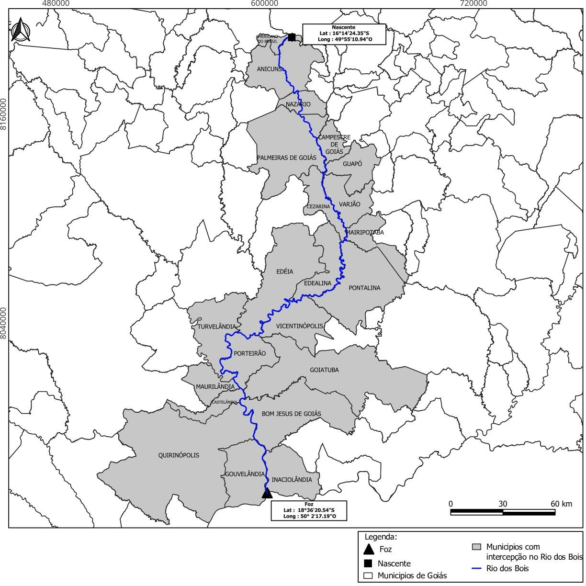

DECRETO Nº 10.628, DE 20 DE JANEIRO DE 2025

Proíbe reservatórios, barragens e diques de qualquer natureza no leito do Rio dos Bois, para preservar as espécies aquáticas.

O GOVERNADOR DO ESTADO DE GOIÁS, no uso de suas atribuições constitucionais, com fundamento no inciso IV do art. 37 da [Constituição estadual](https://legisla.casacivil.go.gov.br/pesquisa_legislacao/103152) e em atenção ao Processo nº 202300017011704,

DECRETA :

Art. 1º Fica proibida a implantação de reservatórios, barragens e diques de qualquer natureza no leito do Rio dos Bois, entre a sua nascente, localizada nas coordenadas geográficas 16°14'24.35"S 49°55'10.94"O, e a sua foz, localizada nas coordenadas geográficas 18°36'20.54"S 50°2'17.19"O, conforme o mapa inserido no Anexo Único deste Decreto, para permitir o desenvolvimento dos fluxos naturais de vida e a reprodução das espécies aquáticas, com a sua consequente preservação.

Art. 2º Este Decreto entra em vigor na data de sua publicação.

Goiânia, 20 de janeiro de 2025; 137º da República.

Ronaldo Caiado

Governador do Estado

ANEXO ÚNICO

MAPA DO LEITO DO RIO DOS BOIS A SER PRESERVADO

