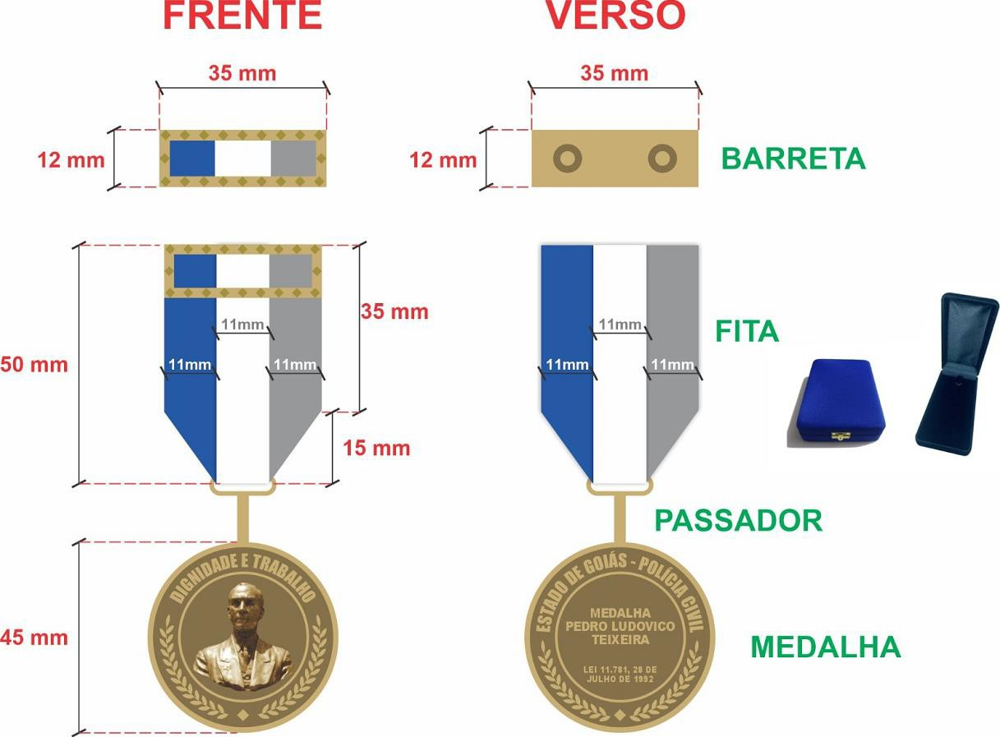
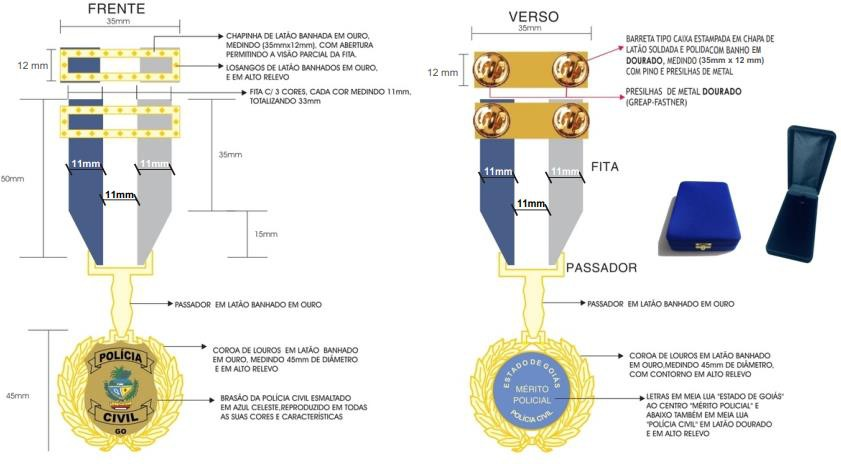
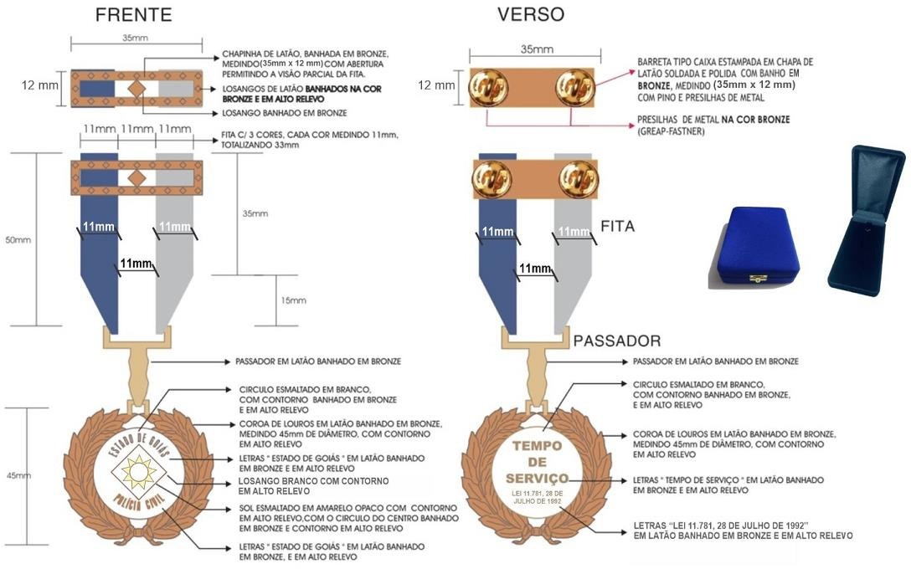
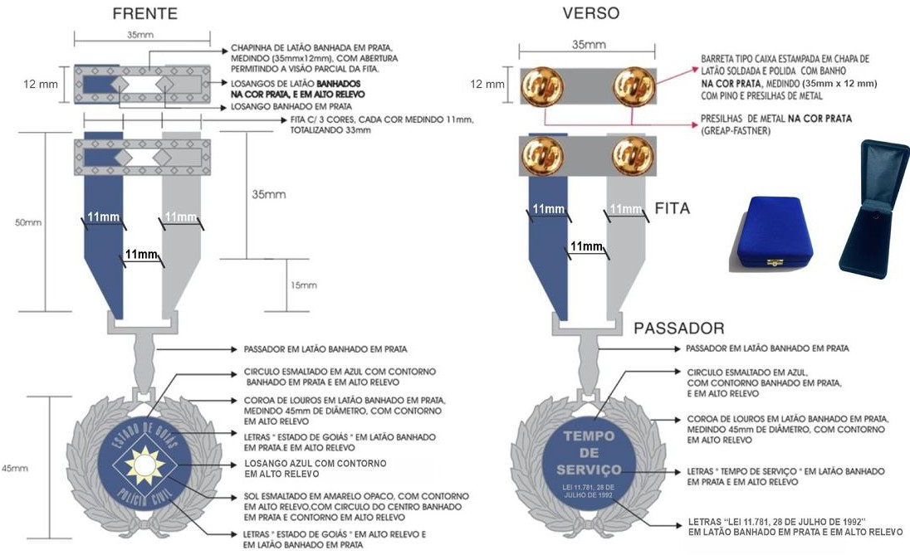
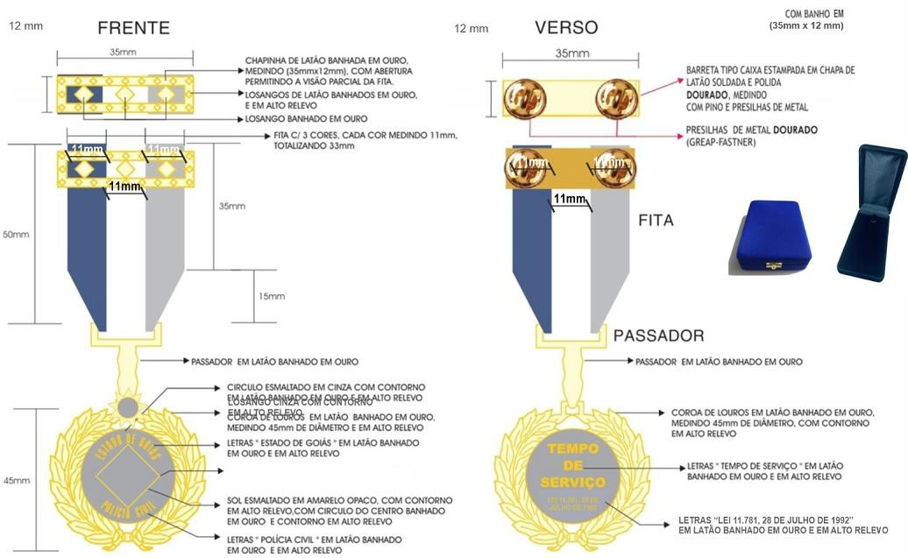

DECRETO Nº 10.705, DE 4 DE JUNHO DE 2025

Regulamenta a concessão das medalhas da Polícia Civil do Estado de Goiás instituídas pela [Lei nº 11.781](https://legisla.casacivil.go.gov.br/pesquisa_legislacao/84056), de 28 de julho de 1992, e revoga o [Decreto nº 4.784](https://legisla.casacivil.go.gov.br/pesquisa_legislacao/62253), de 25 de abril de 1997.

**O GOVERNADOR DO ESTADO DE GOIÁS**, no uso de suas atribuições constitucionais e legais, com fundamento no inciso IV do art. 37 da [Constituição do Estado de Goiás](https://legisla.casacivil.go.gov.br/pesquisa_legislacao/103152), também em atenção ao Processo nº 202400007089635,

**DECRETA :**

CAPÍTULO I

DISPOSIÇÕES GERAIS

Art. 1º Este Decreto regulamenta a concessão das medalhas da Polícia Civil do Estado de Goiás instituídas pela [Lei nº 11.781](https://legisla.casacivil.go.gov.br/pesquisa_legislacao/84056), de 28 de julho de 1992.

Art. 2º A confecção das Medalhas Pedro Ludovico Teixeira, de Mérito Policial e de Tempo de Serviço, instituídas pela [Lei nº 11.781](https://legisla.casacivil.go.gov.br/pesquisa_legislacao/84056), de 1992, observará, quanto às características e aos modelos, o disposto nos Anexos I e II deste Decreto.

§ 1º Cada medalha contará com passador, barreta, estojo e diploma.

§ 2º A confecção do diploma observará o padrão fixado pelo Conselho Superior da Polícia Civil.

CAPÍTULO II

DIREITO ÀS MEDALHAS

Seção I

Medalhas

Art. 3º A Medalha Pedro Ludovico Teixeira, como a mais alta distinção, destina- se ao agraciamento das autoridades civis, militares e eclesiásticas que houverem prestado relevantes serviços à Polícia Civil ou à defesa dos interesses institucionais e ao agraciamento dos policiais civis que, no desempenho da função, houverem praticado ato de excepcional bravura na preservação da ordem pública, na defesa das instituições ou no salvamento de vida humana.

Art. 4º A Medalha de Mérito Policial destina­-se ao agraciamento dos policiais civis que, no desempenho de suas funções, houverem se distinguido de modo especial, ou pela prática de atos de invulgar merecimento, ou pela excelência e pela retidão no cumprimento das atribuições em mais de 20 (vinte) anos de efetivo exercício da função, com a prestação à Polícia Civil de bons e leais serviços, a extrema devoção e a inquestionável dedicação à instituição e às competências institucionais nas diversas unidades policiais ou nas missões especiais para as quais houverem sido designados.

Art. 5º A Medalha de Tempo de Serviço destina­-se ao agraciamento dos policiais civis pelos bons e leais serviços prestados, com devoção e dedicação à Polícia Civil e às competências institucionais a cada 10 (dez) anos de efetivo exercício da função estritamente policial.

Seção II

Requisitos ao agraciamento

Art. 6º Fará jus à Medalha Pedro Ludovico Teixeira quem, observados os impedimentos ao agraciamento:

I – houver prestado relevantes serviços à Polícia Civil ou à defesa dos interesses institucionais ou, se for policial civil, houver praticado, no desempenho da função, ato de excepcional bravura na preservação da ordem pública, na defesa das instituições ou no salvamento de vida humana;

II – possuir idoneidade moral e reputação ilibada; e

III – for considerado merecedor, preliminarmente, pelo Chefe de Polícia Judiciária ou pelo Delegado-­Geral da Polícia Civil e, definitivamente, pelo Conselho Superior da Polícia Civil.

Art. 7º Fará jus à Medalha de Mérito Policial o policial civil que, observados os impedimentos ao agraciamento:

I – houver se distinguido, no desempenho das funções policiais, de modo especial, ou pela prática de atos de invulgar merecimento, ou pela excelência e pela retidão no cumprimento das atribuições;

II – houver prestado bons e leais serviços à Polícia Civil, com extrema devoção e inquestionável dedicação à instituição e às competências institucionais nas diversas unidades policiais ou nas missões especiais para as quais houver sido designado;

III – contar com efetivo exercício da função policial por mais de 20 (vinte) anos; e

IV – for considerado merecedor, preliminarmente, pelo Chefe de Polícia Judiciária ou pelo Delegado-­Geral da Polícia Civil e, definitivamente, pelo Conselho Superior da Polícia Civil.

Art. 8º Fará jus à Medalha de Tempo de Serviço o policial civil que, observados os impedimentos ao agraciamento:

I – houver prestado, no desempenho das atribuições durante o decênio, bons e leais serviços, com devoção e dedicação à Polícia Civil e às competências institucionais;

II – cumprir o respectivo decênio de efetivo exercício em funções estritamente policiais; e

III – for considerado merecedor, preliminarmente, pelo Chefe de Polícia Judiciária ou pelo Delegado­-Geral da Polícia Civil e, definitivamente, pelo Conselho Superior da Polícia Civil.

§ 1º Para a concessão da Medalha de Tempo de Serviço, o policial civil que houver sido demitido e, posteriormente, reintegrado ao cargo terá contado o período de efetivo exercício até a data da demissão e a partir do retorno ao exercício das funções, observadas as demais exigências deste Decreto.

§ 2º Terá direito à Medalha de Tempo de Serviço o policial civil aposentado que houver completado, durante a atividade, o decênio de tempo de serviço correspondente e que satisfaça as demais exigências especificadas neste Decreto.

Art. 9º São impedimentos ao agraciamento com medalhas da Polícia Civil:

I – condenação transitada em julgado pela prática de crime, ainda que o condenado haja sido beneficiado por indulto ou perdão; e

II – condenação, da qual não caiba recurso pela prática de transgressão disciplinar que implique falta de lealdade ou que comprometa a honra ou a dignidade da função policial, bem como afete a imagem ou a consideração pública da Polícia Civil.

§ 1º Para a Medalha de Tempo de Serviço, também é obstáculo a condenação, durante o decênio de apuração, a penas disciplinares que, somadas ou não, ultrapassem 30 (trinta) dias de suspensão, ainda que elas sejam convertidas em multa.

§ 2º Nos casos previstos no § 1º deste artigo, o policial civil só fará jus à Medalha de Tempo de Serviço quando forem anuladas ou canceladas as penas disciplinares, na forma da [Lei nº 20.756](https://legisla.casacivil.go.gov.br/pesquisa_legislacao/100979), de 28 de janeiro de 2020.

CAPÍTULO III

PROCESSAMENTO

Art. 10. O processo administrativo para a concessão das medalhas da Polícia Civil observará as seguintes etapas:

I – instauração: início do processo, originado de proposta de um dos legitimados, da qual deverão constar a especificação da medalha, a indicação do pretenso agraciado e as razões que, a juízo do proponente, o qualifiquem ao recebimento da honraria, conforme os requisitos exigidos por este Decreto;

II – instrução: instrução do processo com as informações produzidas pela Superintendência de Inteligência Policial Civil, pela Superintendência de Correições e Disciplina da Polícia Civil e pela Gerência de Gestão e Desenvolvimento de Pessoas, as quais versarão, respectivamente, sobre as circunstâncias relevantes à qualificação ou à desqualificação do indicado ao recebimento da honraria, sobre a existência ou não de impedimento, previsto neste Decreto, ao agraciamento e sobre as informações funcionais que comprovem o preenchimento ou não dos requisitos exigidos para a concessão da medalha;

III – atestamento do mérito: declaração da existência ou não do mérito do indicado pela Chefia de Polícia Judiciária, consideradas a instrução processual e as observações pessoais;

IV – análise e deliberação: prosseguimento do processo, após a conclusão da instrução processual e o atestamento do mérito, à análise e à deliberação do Conselho Superior da Polícia Civil, que considerará aceita a proposta se for aprovada por ⅔ (dois terços) dos membros, caso em que o indicado será incluído na lista provisória de agraciados;

V – formatação da lista definitiva de agraciados: confecção da lista definitiva de agraciados pelo Conselho Superior da Polícia Civil após a apreciação de todas as propostas de concessão de medalhas, que será remetida pelo Delegado­-Geral da Polícia Civil ao Governador do Estado, com o requerimento de concessão das honrarias por decreto;

VI – publicação do decreto de concessão das medalhas; e

VII – solenidade: evento de entrega das medalhas providenciado pelo Conselho Superior da Polícia Civil após a publicação do decreto de concessão das medalhas, com a realização pelo próprio conselho da expedição dos diplomas que as acompanharão e do convite aos agraciados para a participação no evento.

§ 1º São legitimados à apresentação da proposta para a instauração do processo de concessão das medalhas os membros do Conselho Superior da Polícia Civil e o chefe imediato do policial civil pretenso agraciado.

§ 2º Os processos de concessão de medalhas deverão ser instaurados até o último dia útil do mês de janeiro, e as propostas intempestivas não serão processadas.

§ 3º Se a Chefia de Polícia Judiciária não atestar o mérito do indicado, o processo seguirá ao Delegado-­Geral da Polícia Civil para o atestamento em substituição e, caso haja a recusa por ele, será arquivado pelo não preenchimento dos requisitos necessários à continuidade do processamento.

CAPÍTULO IV

COMPETÊNCIA PARA A CONCESSÃO

Art. 11. As medalhas da Polícia Civil serão concedidas pelo Governador do Estado mediante decreto a partir de requerimento do Delegado­-Geral da Polícia Civil, com a indicação dos nomes dos agraciados, conforme a deliberação do Conselho Superior da Polícia Civil.

Parágrafo único. O requerimento do Delegado­-Geral da Polícia Civil deverá ser apresentado ao Governador do Estado com a antecedência mínima de 10 (dez) dias úteis da data de entrega das medalhas.

CAPÍTULO V

DATA PARA A ENTREGA DAS MEDALHAS

Art. 12. Publicado o decreto de concessão das medalhas, os agraciados as receberão em ato público solene, com o devido cerimonial, no dia 5 de abril, em que se comemora o Dia da Polícia Civil, nos termos da Lei federal nº 14.735 (Lei Orgânica Nacional das Polícias Civis), de 23 de novembro de 2023.

CAPÍTULO VI

CERIMONIAL

Art. 13. As medalhas, acompanhadas dos respectivos passadores, barretas, estojos e diplomas, serão entregues aos agraciados em solenidade pública, comandada pelo Delegado-­Geral da Polícia Civil, com o assessoramento dos demais membros do Conselho Superior da Polícia Civil, cujo cerimonial observará o rito inerente.

Parágrafo único. As medalhas serão entregues na seguinte ordem, obedecida a hierarquia:

I – Medalha Pedro Ludovico Teixeira;

II – Medalha de Mérito Policial; e

III – Medalha de Tempo de Serviço.

Art. 14. Quando o agraciado for o próprio Delegado­-Geral da Polícia Civil, a entrega da medalha será realizada no Palácio das Esmeraldas, cujo paraninfo será o Governador do Estado, e contará com a presença dos membros do Conselho Superior da Polícia Civil e de convidados.

Parágrafo único. No caso previsto no _caput,_ a solenidade ficará a cargo da equipe de cerimonial do Palácio das Esmeraldas.

CAPÍTULO VII

USO DAS MEDALHAS E DAS BARRETAS

Art. 15. Será obrigatório o uso das medalhas com passadores, em traje de passeio, nas solenidades oficiais, quando for expressamente determinado pelo Delegado­-Geral da Polícia Civil.

Art. 16. Os policiais civis ativos e inativos agraciados com medalhas poderão usá­ las, com passadores, em traje de passeio, nas solenidades oficiais alusivas às seguintes datas, ainda que não seja não determinado o uso pelo Delegado-­Geral da Polícia Civil:

I – 5 de abril, Dia da Polícia Civil;

II – 9 de maio, Dia do Policial Civil;

III – 5 de agosto, Marco da Fundação da Polícia Civil do Estado de Goiás; e

IV – 7 de setembro, Dia da Independência do Brasil.

Art. 17. Nas solenidades oficiais em que for dispensado o uso das medalhas, os policiais civis ativos e inativos agraciados com medalhas poderão usar, em traje de passeio, as barretas.

Art. 18. O Conselho Superior da Polícia Civil poderá expedir resolução para regulamentar as especificidades do uso das medalhas e das barretas.

CAPÍTULO VIII

CASSAÇÃO E ANULAÇÃO DA CONCESSÃO DAS MEDALHAS

Art. 19. A concessão de medalha será:

I – cassada, quando, após o recebimento da honraria, o agraciado incorrer em hipótese de impedimento, nos termos do art. 9º deste Decreto; ou

II – anulada, quando for constatado vício de validade no processo de concessão da honraria.

Art. 20. O processo administrativo de cassação ou de anulação da concessão de medalha será instaurado pelo Conselho Superior da Polícia Civil e observará as seguintes etapas:

I – instauração: abertura do processo, por iniciativa de qualquer dos membros do Conselho Superior da Polícia Civil;

II – instrução: apresentação, pela Superintendência de Inteligência da Policial Civil, pela Superintendência de Correições e Disciplina ou pela Gerência de Gestão e Desenvolvimento de Pessoas, conforme a pertinência temática, de relatório circunstanciado sobre os fatos que suscitam a cassação ou a anulação da concessão da medalha;

III – defesa do agraciado: apresentação de manifestação escrita do agraciado, a ser realizada no prazo de 15 (quinze) dias após o recebimento da notificação oficial, assegurado o direito à ampla defesa e ao contraditório;

IV – deliberação: decisão do Conselho Superior da Polícia Civil, após a instrução processual e a fase de defesa, sobre a cassação ou a anulação da concessão da medalha, com a necessidade do voto favorável de, pelo menos, ⅔ (dois terços) de seus membros para a aprovação da medida;

V – solicitação de decreto de cassação ou anulação: encaminhamento pelo Delegado­-Geral da Polícia Civil ao Governador do Estado da decisão do Conselho Superior da Polícia Civil sobre a aprovação da cassação ou da anulação da concessão da medalha, com o requerimento de edição do respectivo decreto;

VI – publicação do decreto de cassação ou anulação; e

VII – recolhimento da medalha: adoção das providências para o recolhimento da medalha, do passador, da barreta, do estojo e do diploma, no prazo de 30 (trinta) dias da publicação do decreto de cassação ou anulação, pela Gerência de Comunicação e Cerimonial.

Parágrafo único. Se o Conselho Superior da Polícia Civil não aprovar a cassação ou a anulação da concessão da medalha, o processo administrativo será arquivado.

CAPÍTULO IX

DISPOSIÇÕES FINAIS

Art. 21. As medalhas, os passadores, as barretas, os estojos e os diplomas serão fornecidos gratuitamente aos agraciados, sem qualquer ônus, e a despesa com a aquisição deverá correr à conta de verbas orçamentárias ou de recursos próprios da Delegacia­-Geral da Polícia Civil.

Art. 22. Se o agraciado for falecido, a medalha será concedida _in_ _memoriam_ e será entregue ao cônjuge ou companheiro ou ao mais velho de seus herdeiros.

Art. 23. A Gerência de Comunicação e Cerimonial será responsável pelas providências necessárias à produção em tempo hábil das medalhas, dos passadores, das barretas, dos estojos e dos diplomas destinados às homenagens, bem como pela guarda e pela conservação das peças estocadas.

Art. 24. As decisões do Conselho Superior da Polícia Civil relativas à concessão de medalha e à cassação ou à anulação dela são irrecorríveis.

Parágrafo único. A decisão de cassação da concessão de medalha poderá ser revista pelo Conselho Superior da Polícia Civil, caso sejam apresentados fatos novos que afastem ou desconstituam a hipótese originadora da medida.

Art. 25. As dúvidas e os casos omissos surgidos na execução deste Decreto serão dirimidos pelo Conselho Superior da Polícia Civil.

Art. 26. Fica revogado o [Decreto nº 4.784](https://legisla.casacivil.go.gov.br/pesquisa_legislacao/62253), de 25 de abril de 1997.

Art. 27. Este Decreto entra em vigor na data de sua publicação.

Goiânia, 4 de junho de 2025; 137º da República.

Ronaldo Caiado

Governador do Estado

ANEXO I

CARACTERÍSTICAS DAS MEDALHAS

| MEDALHA | CARACTERÍSTICAS |
| --- | --- |
| MEDALHA PEDRO LUDOVICO TEIXEIRA | A Medalha Pedro Ludovico Teixeira será confeccionada de forma que todas as peças de metal sejam em latão, estampado de alto relevo e banhado em ouro. O formato da peça principal será circular, com 45 mm (quarenta e cinco milímetros) de diâmetro, e terá, no centro de sua parte superior, uma alça retangular onde se fixará um passador de fita. Na parte frontal, ao centro, destacará o busto do fundador de Goiânia, Dr. Pedro Ludovico Teixeira, e, acima de seu busto, em meia-lua, a inscrição “DIGNIDADE E TRABALHO”. Ainda no anverso, ao pé do busto, aparecerá 1 (um) losango na parte central, de onde sairão dois ramos, para fechar assim as laterais inferiores da peça principal. No verso, na parte superior, haverá em meia-lua a inscrição “ESTADO DE GOIÁS – POLÍCIA CIVIL”; no sentido horizontal, na parte média, a inscrição “MEDALHA PEDRO LUDOVICO TEIXEIRA”, distribuída em 3 (três) planos, com destaque na fonte das letras em relação às demais; e, finalmente, constará referência à [Lei nº 11.781](https://legisla.casacivil.go.gov.br/pesquisa_legislacao/84056), de 28 de julho de 1992, distribuída em dois (2) planos horizontais, e logo abaixo, 2 (dois) ramos, que formarão 1 (uma) meia-lua, que sobressairá do centro inferior, de onde também constará o mesmo losango do anverso.

Acima da peça principal, que será sustentada por 1 (um) passador, haverá 1 (uma) fita achamalotada em gorgorão, nas cores azul, branco e cinza, respectivamente da esquerda para a direita e com 11 mm (onze milímetros) cada cor, com o total de 33 mm (trinta e três milímetros) de largura e, alargada em forma de bisel, com 15 (quinze milímetros) no chanfrado, mais 35 (trinta e cinco milímetros) de comprimento, com o total de 50 mm (cinquenta milímetros). As pontas da fita estarão fixadas em um passador de metal no formato retangular, com todo o seu contorno em losangos estilizados, e o centro vazado, para, assim, dar visão à fita.  

Integrará a Medalha Pedro Ludovico Teixeira uma barreta de 35 mm (trinta e cinco milímetros) de largura e 12 mm (doze milímetros) de altura, revestida com a mesma fita da medalha e contornada por um retângulo em metal dourado, e, em toda a sua extensão, haverá losangos estilizados. 

A medalha será acondicionada em estojo de percalina, de cor azul, forrado internamente em cetim branco, cujo tamanho será adequado a embalá-la.  

  |
| MEDALHA DE MÉRITO POLICIAL | A Medalha de Mérito Policial será confeccionada de forma que todas as peças de metal sejam em latão, estampado de alto relevo, banhado em ouro e esmaltado. O formato da peça central da medalha será recortado e estampado em forma de 1 (uma) coroa de louros (ramagem) dourados, com 45 mm (quarenta e cinco milímetros) de diâmetro, e terá, no centro, o escudo da Polícia Civil, reproduzido em todas as suas características; na parte superior, haverá uma alça retangular onde se fixará 1 (um) passador de fita. No verso, ao centro, haverá 1 (um) círculo esmaltado em azul celeste, onde aparecerá, em meia-lua, na parte superior, a inscrição “ESTADO DE GOIÁS”; ao centro, em 2 (dois) planos horizontais, a inscrição “MÉRITO POLICIAL”; e, na parte inferior, em formato de meia-lua, “POLÍCIA CIVIL”.    

Acima de peça principal, que será sustentada por 1 (um) passador, haverá 1 (uma) fita achamalotada em gorgorão, nas cores azul, branco e cinza, respectivamente da esquerda para a direita e com 11 mm (onze milímetros) cada cor, com o total de 33 mm (trinta e três milímetros) de largura e, alargada em forma de bisel, com 15 mm (quinze milímetros) no chanfrado, mais 35 mm (trinta e cinco milímetros) de comprimento, com o total de 50 mm (cinquenta milímetros). As pontas da fita estarão fixadas a 1 (um) passador de metal no formato retangular, com todo o seu contorno em losangos estilizados, e o centro vazado, para, assim, dar visão à fita.  

Integrará a Medalha de Mérito Policial 1 (uma) barreta de 35 mm (trinta e cinco milímetros) de largura e 12 mm (doze milímetros) de altura, revestida com a mesma fita da medalha e contornada por 1 (um) retângulo em metal dourado, e haverá em toda a sua extensão losangos estilizados.  

A medalha será acondicionada em estojo de percalina, de cor azul, forrado internamente em cetim branco, cujo tamanho será adequado a embalá-la.  

  |
| MEDALHA DE TEMPO DE SERVIÇO – 10 ANOS | A Medalha de Tempo de Serviço – 10 anos será confeccionada de forma que todas as peças de metal sejam em latão, estampado de alto relevo, banhado em bronze e esmaltado. O formato da peça central da medalha será recortado e estampado em forma de 1 (uma) coroa de louros (ramagem) bronzeados, com 45 mm (quarenta e cinco milímetros) de diâmetro. A frente será constituída da seguinte forma: ao centro, haverá 1 (um) círculo esmaltado na cor branca, com 1 (um) sol estilizado, esmaltado em amarelo opaco, contornado por 1 (um) losango branco; haverá também, na parte superior, no formato de meia­-lua, a inscrição “ESTADO DE GOIÁS”, e, na parte inferior, para fechar o contorno, “POLÍCIA CIVIL”. No verso, haverá ao centro 1 (um) círculo esmaltado em branco, onde aparecerá na parte superior, em 3 (três) planos, a inscrição “TEMPO DE SERVIÇO”, em maior destaque; logo abaixo, em 2 (dois) planos, constará referência à [Lei nº 11.781](https://legisla.casacivil.go.gov.br/pesquisa_legislacao/84056), de 28 de julho de 1992.  

Acima da peça principal, que será sustentada por 1 (um) passador, haverá 1 (uma) fita achamalotada em gorgorão, nas cores azul, branco e cinza, respectivamente da esquerda para a direita e com 11 mm (onze milímetros) cada cor, com o total de 33 mm (trinta e três milímetros) de largura e, alargada em forma de bisel, com 15 mm (quinze milímetros) no chanfrado, mais 35 mm (trinta e cinco milímetros) de comprimento, com o total de 50 mm (cinquenta milímetros). As pontas da fita estarão fixadas a 1 (um) passador de metal no formato retangular, no centro, 1 (um)  losango recortado, para representar os 10 (dez) anos de serviço; e, com todo o seu contorno em losangos estilizados, deve ser permitida ainda visão parcial à fita.    

Integrará a Medalha de Tempo de Serviço – 10 anos 1 (uma) barreta de 35 mm (trinta e cinco milímetros) de largura e 12 mm (doze milímetros) de altura, revestida com a mesma fita da medalha e contornada por 1 (um) retângulo em metal dourado, e haverá, em toda a sua extensão, losangos estilizados e, ao centro, 1 (um) losango recortado, de maior dimensão, para representar os 10 (dez) anos de serviço.  

A medalha será acondicionada em estojo de percalina, de cor azul, forrado internamente em cetim branco, cujo tamanho será adequado a embalá-­la.  

  |
| MEDALHA DE TEMPO DE SERVIÇO – 20 ANOS | A Medalha de Tempo de Serviço – 20 anos será confeccionada de forma que todas as peças de metal sejam em latão, estampado de alto relevo, banhado em prata e esmaltado. O formado da peça central da medalha será recortado e estampado em forma de 1 (uma) coroa de louros (ramagem) prateados, com 45 mm (quarenta e cinco milímetros) de diâmetro. A frente será constituída da seguinte forma: ao centro, haverá 1 (um) círculo esmaltado na cor azul, com 1 (um) sol estilizado, esmaltado em amarelo opaco, contornado por 1 (um) losango azul; haverá também, na parte superior, no formato de meia­-lua, a inscrição “ESTADO DE GOIÁS”, e, na parte inferior, para fechar o contorno, “POLÍCIA CIVIL”. No verso, haverá ao centro 1 (um) círculo esmaltado em azul, onde aparecerá, na parte superior, em 3 (três) planos, a inscrição “TEMPO DE SERVIÇO”, em maior destaque; logo abaixo, em 2 (dois) planos, constará referência à [Lei nº 11.781](https://legisla.casacivil.go.gov.br/pesquisa_legislacao/84056), de 28 de julho de 1992.  

Acima da peça principal, que será sustentada por 1 (um) passador, haverá 1 (uma) fita achamalotada em gorgorão, nas cores azul, branco e cinza, respectivamente da esquerda para a direita e com 11 mm (onze milímetros) cada cor, com o total de 33 mm (trinta e três milímetros) de largura e, alargada em forma de bisel, com 15 mm (quinze milímetros) no chanfrado, mais 35 mm (trinta e cinco milímetros) de comprimento, com o total de 50 mm (cinquenta milímetros). As pontas da fita estarão fixadas a 1 (um) passador de metal no formato retangular, no centro, 2 (dois) losangos recortados, para representar os 20 (vinte) anos de serviço; todo o seu contorno será em losangos estilizados, e deve ser permitida ainda a visão parcial à fita.  

Integrará a Medalha de Tempo de Serviço – 20 anos 1 (uma) barreta de 35 mm (trinta e cinco milímetros) de largura e 12 mm (doze milímetros) de altura, revestida com a mesma fita da medalha e contornada por 1 (um) retângulo em metal prateado, com losangos estilizados em toda sua extensão e, ao centro, 2 (dois) losangos recortados, de maior dimensão, para representar os 20 (vinte) anos de serviço.  

A medalha será acondicionada em estojo de percalina, de cor azul, forrado internamente em cetim branco, cujo tamanho será adequado a embalá­-la.  

  |
| MEDALHA DE TEMPO DE SERVIÇO – 30 ANOS | A Medalha de Tempo de Serviço – 30 anos será confeccionada de forma que todas as peças de metal sejam em latão, estampado de alto relevo, banhado em ouro e esmaltado. O formato da peça central da medalha será recortado e estampado em forma de 1 (uma) coroa de louros (ramagem) dourados, com 45 mm (quarenta e cinco milímetros) de diâmetro. A frente será constituída da seguinte forma: ao centro, haverá 1 (um) círculo esmaltado na cor cinza, com 1 (um) sol estilizado, esmaltado em amarelo opaco, contornado por 1 (um) losango cinza; haverá, também, na parte superior, no formato de meia­-lua, a inscrição “ESTADO DE GOIÁS”, e, na parte inferior, para fechar o contorno, “POLÍCIA CIVIL”. No verso, haverá ao centro 1 (um) círculo esmaltado em cinza, onde aparecerá na parte superior, em 3 (três) planos, a inscrição “TEMPO DE SERVIÇO”, em maior destaque; logo abaixo, em 2 (dois) planos, constará referência à [Lei nº 11.781](https://legisla.casacivil.go.gov.br/pesquisa_legislacao/84056), de 28 de julho de 1992.

Acima da peça principal, que será sustentada por 1 (um) passador, haverá 1 (uma) fita achamalotada em gorgorão, nas cores azul, branco e cinza, respectivamente da esquerda para a direita e com 11 mm (onze milímetros) cada cor, no total de 33 mm (trinta e três milímetros) de largura e, alargada em forma de bisel, com 15 mm (quinze milímetros) no chanfrado, mais 35 mm (trinta e cinco milímetros) de comprimento, no total de 50 mm (cinquenta milímetros). As pontas da fita estarão fixadas a um passador de metal no formato retangular, no centro, 3 (três) losangos recortados, para representar os 30 (trinta) anos de serviço. Todo o seu contorno será em losangos estilizados, e deve ser permitida ainda a visão da fita.  

Integrará a Medalha de Tempo de Serviço – 30 anos 1 (uma) barreta de 35 mm (trinta e cinco milímetros) de largura e 12 mm (doze milímetros) de altura, revestida com a mesma fita da medalha e contornada por um retângulo em metal dourado, com losangos estilizados em toda a sua extensão e, ao centro, 3 (três) losangos recortados, de maior dimensão, para representar os 30 (trinta) anos de serviço.  

A medalha será acondicionada em estojo de percalina, de cor azul, forrado internamente em cetim branco, cujo tamanho será adequado a embalá­-la.   |

ANEXO II

MODELOS DAS MEDALHAS

I – Medalha Pedro Ludovico Teixeira

II – Medalha de Mérito Policial

III – Medalha de Tempo de Serviço – 10 anos

IV – Medalha de Tempo de Serviço – 20 anos

V – Medalha de Tempo de Serviço – 30 anos

