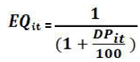
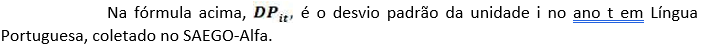
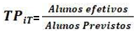

DECRETO Nº 10.736, DE 21 DE JULHO DE 2025

Altera o Anexo Único do [Decreto nº 10.590](https://legisla.casacivil.go.gov.br/pesquisa_legislacao/110121), de 10 de dezembro de 2024, que regulamenta, para o exercício de 2025, a [Lei nº 21.073](https://legisla.casacivil.go.gov.br/pesquisa_legislacao/104260), de 9 de agosto de 2021.

O **GOVERNADOR DO ESTADO DE GOIÁS**, no uso de suas atribuições constitucionais e legais, com fundamento no inciso IV do art. 37 da [Constituição do Estado de Goiás](https://legisla.casacivil.go.gov.br/pesquisa_legislacao/103152) e em atenção ao Processo nº 202200006077736,

**DECRETA:**

Art. 1º O Anexo Único do [Decreto nº 10.590](https://legisla.casacivil.go.gov.br/pesquisa_legislacao/110121), de 10 de dezembro de 2024, passa a vigorar com as alterações apresentadas no Anexo Único deste Decreto.

Art. 2º Este Decreto entra em vigor na data de sua publicação.

Goiânia, 21 de julho de 2025; 137º da República

DANIEL VILELA

Governador do Estado em exercício

ANEXO ÚNICO

(Alteração do [Decreto nº 10.590](https://legisla.casacivil.go.gov.br/pesquisa_legislacao/110121), de 10 de dezembro de 2024)

"ANEXO ÚNICO

ÍNDICE DE DESEMPENHO EDUCACIONAL DE GOIÁS IDE-ALFA

...................................................................................................................................

4 Ranqueamento e critérios de desempate

Com a nota padronizada, serão ranqueadas as escolas participantes, entre as quais, conforme a [Lei nº 21.073](https://legisla.casacivil.go.gov.br/pesquisa_legislacao/104260), de 9 de agosto de 2021, haverá cento e cinquenta escolas premiadas e cento e cinquenta escolas fomentadas, que atendam aos critérios especificados na referida lei. Ainda conforme o art. 4º, § 2º, da a [Lei nº 21.073](https://legisla.casacivil.go.gov.br/pesquisa_legislacao/104260), de 2021, os empates serão resolvidos com observância à seguinte ordem de critérios: _i)_ maior fator de equidade educacional; _ii)_ maior proficiência média; e _iii)_ maior taxa de participação. Os três serão coletados para a unidade escolar na avaliação do SAEGO-Alfa.

O Fator de Equidade Educacional EQit é calculado por meio do desvio padrão da unidade em Língua Portuguesa, assumido um valor entre 0 e 1, com a seguinte formulação:

A taxa de participação TP, que é calculada na escala de 0 a 1, é definida como:

Nesta última fórmula, o segmento 'alunos efetivos' indica o total de alunos que participaram da avaliação somativa na série avaliada no ano t, e o segmento 'alunos previstos' indica o total de alunos matriculados na série avaliada no ano t." (NR)
