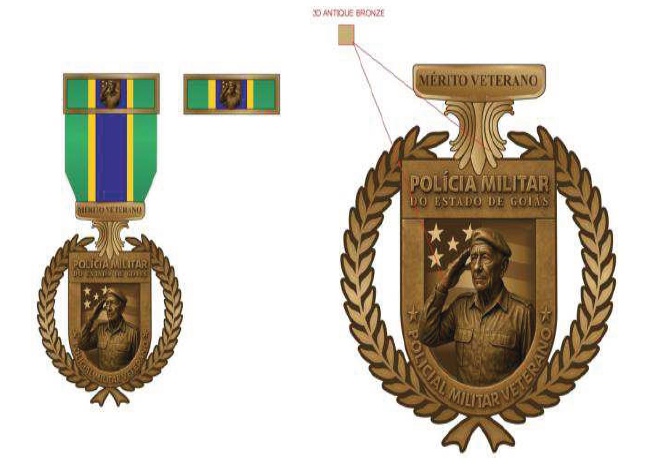
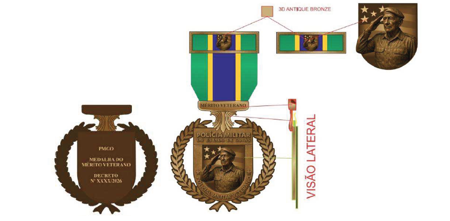
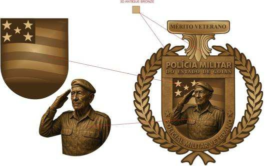
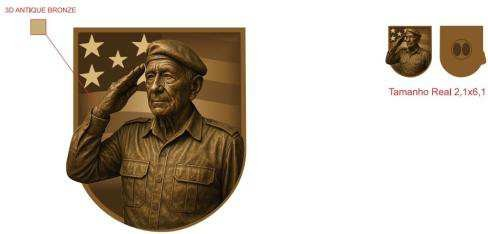

DECRETO Nº 10.884, DE 19 DE MARÇO DE 2026

Institui a Medalha do Mérito Veterano na Polícia Militar do Estado de Goiás.

O **GOVERNADOR DO ESTADO DE GOIÁS**, no uso de suas atribuições constitucionais e legais, também em atenção ao Processo nº 202600002004968,

**DECRETA:**

Art. 1º Fica instituída, na Polícia Militar – PM do Estado de Goiás, a Medalha do Mérito Veterano, com o detalhamento especificado no Anexo Único deste Decreto.

Parágrafo único. A Medalha do Mérito Veterano se destina a agraciar os policiais militares veteranos da corporação, da reserva remunerada ou reformados, que tenham prestado serviços relevantes e duradouros em sua trajetória na instituição e que tenham deixado legado reconhecido na história dela, com contribuição para sua construção, sua valorização e seu fortalecimento.

Art. 2º A medalha e a barreta terão as seguintes especificações:

I – a medalha será confeccionada em metal bronze envelhecido (Antique Bronze), no formato circular envolto por uma coroa de louros estilizada, com 60 mm de altura, 45 mm de largura e 3 mm de espessura, observado o seguinte:

a) no anverso, haverá um escudo estilizado, no interior do qual figurará:

1\. ao fundo, o campo representativo da bandeira do Estado de Goiás, em baixo-relevo;

2\. à frente, em destaque central, a efígie de um policial militar veterano fardado, que traje boina e preste continência, em alto-relevo;

3\. na parte superior, um listel com a inscrição “MÉRITO VETERANO”, na fonte Times New Roman, em relevo; e

4\. na parte inferior do escudo, ao lado da efígie, a inscrição “POLÍCIA MILITAR DO ESTADO DE GOIÁS – POLICIAL MILITAR VETERANO”, em relevo;

b) no reverso, em campo liso, constarão em relevo as inscrições:

1\. “PMGO”, na parte superior;

2\. “MEDALHA DO MÉRITO VETERANO”, ao centro; e

3\. “Decreto nº X.XXX, DE 2026”, na parte inferior; e

c) a confecção da fita será em gorgorão de seda chamalotada, com 35 mm de largura por 45 mm de altura, composta por três listas verticais (verde, de 12 mm, azul, de 11 mm, e amarela, de 12 mm), e, em sua base, haverá um suporte metálico trapezoidal em bronze envelhecido, com a inscrição “MÉRITO VETERANO”; e

II – a barreta terá 35 mm de largura por 10 mm de altura, confeccionada com a mesma fita da medalha, com bordadura metálica em bronze envelhecido de 2 mm em todo o perímetro, e, no centro, em relevo, constará a miniatura da efígie do veterano em continência, com 6 mm de altura, centralizada.

Parágrafo único. O disposto neste artigo considera os seguintes símbolos e significados:

I – bronze envelhecido: representa a antiguidade honrosa e a experiência acumulada pelo veterano;

II – efígie do veterano com boina: a boina, peça tradicional do fardamento militar, representa não apenas a identidade castrense e a honra do serviço cumprido, mas também a operacionalidade que caracteriza a trajetória do policial militar em atividade, assim, a efígie traduz o legado dos veteranos e os perpetua como memória viva e inspiração para as futuras gerações da corporação;

III – bandeira do Estado de Goiás: remete ao vínculo da Polícia Militar com o povo goiano; e

IV – fita verde, azul e amarela: traduz a ligação com as cores da bandeira do Estado de Goiás, que reflete a identidade estadual, o patriotismo e a integração histórica da Polícia Militar com o povo goiano.

Art. 3º Compete ao Comandante-Geral da Polícia Militar disciplinar, por meio de ato específico:

I – os requisitos para a concessão da Medalha do Mérito Veterano;

II – o calendário e a periodicidade das cerimônias de entrega da Medalha do Mérito Veterano; e

III – a estruturação e o fluxo dos processos de concessão da Medalha do Mérito Veterano.

Art. 4º A medalha e os componentes dela serão fornecidos aos agraciados sem nenhum ônus, conforme a disponibilidade orçamentária.

Art. 5º Este Decreto entra em vigor na data de sua publicação.

Goiânia, 19 de março de 2026; 138º da República.

 

RONALDO CAIADO

Governador do Estado

ANEXO ÚNICO

MEDALHA DO MÉRITO VETERANO

