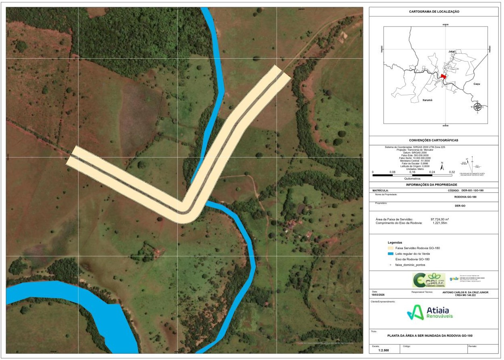

LEI Nº 24.314, DE 25 DE MAIO DE 2026

Autoriza o Poder Executivo a conceder à empresa Taboca Energia S/A o direito real de uso do bem imóvel público estadual que especifica, para a implantação da Pequena Central Hidrelétrica – PCH Taboca.

A **ASSEMBLEIA LEGISLATIVA DO ESTADO DE GOIÁS**, nos termos do art. 10, inciso V, da [Constituição do Estado de Goiás](https://legisla.casacivil.go.gov.br/pesquisa_legislacao/103152 "Abrir Constituição do Estado de Goiás em nova aba"), decreta e eu sanciono a seguinte Lei:

Art. 1º Fica autorizado o Poder Executivo a conceder à Taboca Energia S/A, CNPJ matriz nº 48.831.763/0001-00 e CNPJ filial nº 48.831.763/0002-91, o direito real de uso, a título oneroso e com dispensa de licitação, da área integrante do patrimônio público estadual correspondente a trecho da Rodovia GO-180 e localizada entre os Municípios de Jataí/GO e Itarumã/GO.

§ 1º A concessão de que trata o caput deste artigo tem a finalidade exclusiva de viabilizar a implantação e a operação da Pequena Central Hidrelétrica – PCH Taboca, empreendimento de geração de energia elétrica aprovado pela Agência Nacional de Energia Elétrica – ANEEL.

§ 2º A área da concessão corresponde ao trecho da Rodovia GO-180 com 97.724,00 m² (noventa e sete mil, setecentos e vinte e quatro metros quadrados), equivalente a 9,7724 ha (nove hectares, setenta e sete ares e vinte e quatro centiares), que será atingido pela formação do reservatório da PCH Taboca, delimitado conforme o memorial descritivo e a planta técnica constantes respectivamente dos Anexos I e II desta Lei, georreferenciados ao Sistema Geodésico Brasileiro, datum SIRGAS-2000, projeção UTM, zona 22S, e os demais documentos técnicos do Processo nº 202500036011539.

Art. 2º A concessão do direito real de uso será formalizada pelo Instrumento de Concessão de Direito Real de Uso, com o estabelecimento das condições de utilização do imóvel público e observadas as normas patrimoniais aplicáveis.

Art. 3º A concessão do direito real de uso será realizada a título oneroso, com o pagamento ao Estado de Goiás do valor apurado pela administração pública, conforme a avaliação técnica constante do processo administrativo correspondente.

Art. 4º O prazo da concessão autorizada por esta Lei será de trinta e cinco anos, admitidas renovações por igual período, enquanto perdurar a utilidade pública do empreendimento energético.

Art. 5º A concessionária ficará responsável por todos os custos decorrentes da implantação do empreendimento que impactem a infraestrutura viária existente, inclusive eventuais adequações necessárias à segurança e à continuidade da circulação na malha rodoviária estadual, nos termos do art. 2º desta Lei.

Art. 6º Extinta a concessão, por qualquer motivo, cessará o direito de uso da área pública.

Art. 7º Esta Lei entra em vigor na data de sua publicação.

Goiânia, 25 de maio de 2026; 138º da República.

 

DANIEL VILELA

Governador do Estado

ANEXO I

MEMORIAL DESCRITIVO DA ÁREA DA CONCESSÃO DO DIREITO REAL DE US

DENOMINAÇÃO

Rodovia GO-180 – área a ser inundada – 1/2

ÁREA

50.186,73 m²

PERÍMETRO

2.589,43 m

PROPRIETÁRIO

Estado de Goiás

MEMORIAL DESCRITIVO

Assim se descreve: “inicia-se a descrição deste perímetro no vértice GGW-P-Z670, definido pelas coordenadas E: 439.947,404 m e N: 7.953.582,595 m com azimute 208° 02' 59,54'' e distância de 3,80 m até o vértice GGW-P-Z671, definido pelas coordenadas E: 439.945,617 m e N: 7.953.579,241 m com azimute 208° 03' 15,72'' e distância de 4,18 m até o vértice GGW-P-Z672, definido pelas coordenadas E: 439.943,649 m e N: 7.953.575,548 m com azimute 208° 03' 09,86'' e distância de 4,10 m até o vértice GGW-P-Z673, definido pelas coordenadas E: 439.941,723 m e N: 7.953.571,933 m com azimute 207° 49' 36,50'' e distância de 4,36 m até o vértice GGW-P-Z674, definido pelas coordenadas E: 439.939,686 m e N: 7.953.568,075 m com azimute 207° 49' 19,59'' e distância de 3,68 m até o vértice GGW-P-Z675, definido pelas coordenadas E: 439.937,968 m e N: 7.953.564,819 m com azimute 205° 49' 14,52'' e distância de 3,41 m até o vértice GGW-P-Z676, definido pelas coordenadas E: 439.936,481 m e N: 7.953.561,745 m com azimute 205° 49' 17,43'' e distância de 4,18 m até o vértice GGW-P-Z677, definido pelas coordenadas E: 439.934,658 m e N: 7.953.557,979 m com azimute 205° 49' 21,16'' e distância de 4,18 m até o vértice GGW-P-Z678, definido pelas coordenadas E: 439.932,836 m e N: 7.953.554,214 m com azimute 206° 37' 08,93'' e distância de 1,23 m até o vértice GGW-P-Z679, definido pelas coordenadas E: 439.932,285 m e N: 7.953.553,113 m com azimute 207° 25' 24,62'' e distância de 4,35 m até o vértice GGW-P-Z680, definido pelas coordenadas E: 439.930,280 m e N: 7.953.549,250 m com azimute 207° 25' 24,62'' e distância de 4,35 m até o vértice GGW-P-Z681, definido pelas coordenadas E: 439.928,276 m e N: 7.953.545,387 m com azimute 208° 35' 02,52'' e distância de 1,78 m até o vértice GGW-P-Z682, definido pelas coordenadas E: 439.927,423 m e N: 7.953.543,822 m com azimute 209° 44' 26,17'' e distância de 3,82 m até o vértice GGW-P-Z683, definido pelas coordenadas E: 439.925,528 m e N: 7.953.540,505 m com azimute 209° 44' 52,96'' e distância de 3,82 m até o vértice GGW-P-Z684, definido pelas coordenadas E: 439.923,633 m e N: 7.953.537,189 m com azimute 210° 12' 17,08'' e distância de 0,69 m até o vértice GGW-P-Z685, definido pelas coordenadas E: 439.923,288 m e N: 7.953.536,596 m com azimute 212° 03' 54,80'' e distância de 2,21 m até o vértice GGW-P-Z686, definido pelas coordenadas E: 439.922,113 m e N: 7.953.534,721 m com azimute 213° 31' 37,69'' e distância de 3,36 m até o vértice GGW-P-Z687, definido pelas coordenadas E: 439.920,255 m e N: 7.953.531,916 m com azimute 213° 30' 54,29'' e distância de 3,43 m até o vértice GGW-P-Z688, definido pelas coordenadas E: 439.918,359 m e N: 7.953.529,054 m com azimute 213° 41' 35,85'' e distância de 2,96 m até o vértice GGW-P-Z689, definido pelas coordenadas E: 439.916,719 m e N: 7.953.526,594 m com azimute 213° 41' 28,20'' e distância de 2,89 m até o vértice GGW-P-Z690, definido pelas coordenadas E: 439.915,116 m e N: 7.953.524,189 m com azimute 215° 59' 08,53'' e distância de 3,54 m até o vértice GGW-P-Z691, definido pelas coordenadas E: 439.913,037 m e N: 7.953.521,326 m com azimute 220° 23' 11,15'' e distância de 3,19 m até o vértice GGW-P-Z692, definido pelas coordenadas E: 439.910,969 m e N: 7.953.518,896 m com azimute 222° 27' 11,31'' e distância de 4,64 m até o vértice GGW-P-Z693, definido pelas coordenadas E: 439.907,835 m e N: 7.953.515,470 m com azimute 224° 11' 45,13'' e distância de 2,69 m até o vértice GGW-P-Z694, definido pelas coordenadas E: 439.905,960 m e N: 7.953.513,541 m com azimute 226° 26' 05,15'' e distância de 0,68 m até o vértice GGW-P-Z695, definido pelas coordenadas E: 439.905,464 m e N: 7.953.513,070 m com azimute 226° 50' 38,16'' e distância de 3,20 m até o vértice GGW-P-Z696, definido pelas coordenadas E: 439.903,132 m e N: 7.953.510,883 m com azimute 226° 50' 38,16'' e distância de 3,20 m até o vértice GGW-P-Z697, definido pelas coordenadas E: 439.900,799 m e N: 7.953.508,696 m com azimute 230° 14' 07,37'' e distância de 5,20 m até o vértice GGW-P-Z698, definido pelas coordenadas E: 439.896,806 m e N: 7.953.505,373 m com azimute 237° 04' 16,58'' e distância de 5,30 m até o vértice GGW-P-Z699, definido pelas coordenadas E: 439.892,356 m e N: 7.953.502,491 m com azimute 240° 31' 27,61'' e distância de 2,89 m até o vértice GGW-P-Z700, definido pelas coordenadas E: 439.889,842 m e N: 7.953.501,070 m com azimute 240° 31' 27,61'' e distância de 2,89 m até o vértice GGW-P-Z701, definido pelas coordenadas E: 439.887,328 m e N: 7.953.499,649 m com azimute 240° 55' 51,46'' e distância de 0,58 m até o vértice GGW-P-Z702, definido pelas coordenadas E: 439.886,822 m e N: 7.953.499,368 m com azimute 245° 06' 28,42'' e distância de 5,88 m até o vértice GGW-P-Z703, definido pelas coordenadas E: 439.881,491 m e N: 7.953.496,894 m com azimute 250° 00' 39,75'' e distância de 1,67 m até o vértice GGW-P-Z704, definido pelas coordenadas E: 439.879,918 m e N: 7.953.496,322 m com azimute 251° 07' 11,67'' e distância de 2,93 m até o vértice GGW-P-Z705, definido pelas coordenadas E: 439.877,149 m e N: 7.953.495,375 m com azimute 251° 06' 04,99'' e distância de 2,93 m até o vértice GGW-P-Z706, definido pelas coordenadas E: 439.874,380 m e N: 7.953.494,427 m com azimute 253° 51' 32,40'' e distância de 4,21 m até o vértice GGW-P-Z707, definido pelas coordenadas E: 439.870,337 m e N: 7.953.493,257 m com azimute 257° 38' 50,73'' e distância de 1,61 m até o vértice GGW-P-Z708, definido pelas coordenadas E: 439.868,766 m e N: 7.953.492,913 m com azimute 258° 41' 09,73'' e distância de 4,46 m até o vértice GGW-P-Z709, definido pelas coordenadas E: 439.864,393 m e N: 7.953.492,038 m com azimute 261° 28' 45,77'' e distância de 4,27 m até o vértice GGW-P-Z710, definido pelas coordenadas E: 439.860,168 m e N: 7.953.491,405 m com azimute 265° 06' 42,95'' e distância de 1,36 m até o vértice GGW-P-Z711, definido pelas coordenadas E: 439.858,812 m e N: 7.953.491,289 m com azimute 266° 01' 56,40'' e distância de 2,63 m até o vértice GGW-P-Z712, definido pelas coordenadas E: 439.856,188 m e N: 7.953.491,107 m com azimute 266° 01' 57,48'' e distância de 2,63 m até o vértice GGW-P-Z713, definido pelas coordenadas E: 439.853,563 m e N: 7.953.490,925 m com azimute 268° 33' 08,37'' e distância de 3,88 m até o vértice GGW-P-Z714, definido pelas coordenadas E: 439.849,686 m e N: 7.953.490,827 m com azimute 271° 04' 57,17'' e distância de 3,86 m até o vértice GGW-P-Z715, definido pelas coordenadas E: 439.845,822 m e N: 7.953.490,900 m com azimute 271° 31' 15,91'' e distância de 0,64 m até o vértice GGW-P-Z716, definido pelas coordenadas E: 439.845,182 m e N: 7.953.490,917 m com azimute 275° 44' 29,18'' e distância de 5,88 m até o vértice GGW-P-Z717, definido pelas coordenadas E: 439.839,334 m e N: 7.953.491,505 m com azimute 280° 25' 26,82'' e distância de 1,33 m até o vértice GGW-P-Z718, definido pelas coordenadas E: 439.838,024 m e N: 7.953.491,746 m com azimute 281° 18' 51,18'' e distância de 4,46 m até o vértice GGW-P-Z719, definido pelas coordenadas E: 439.833,651 m e N: 7.953.492,621 m com azimute 283° 14' 11,47'' e distância de 2,95 m até o vértice GGW-P-Z720, definido pelas coordenadas E: 439.830,777 m e N: 7.953.493,297 m com azimute 285° 08' 42,15'' e distância de 3,62 m até o vértice GGW-P-Z721, definido pelas coordenadas E: 439.827,278 m e N: 7.953.494,244 m com azimute 286° 12' 51,96'' e distância de 1,60 m até o vértice GGW-P-Z722, definido pelas coordenadas E: 439.825,744 m e N: 7.953.494,690 m com azimute 287° 40' 44,59'' e distância de 0,65 m até o vértice GGW-P-Z723, definido pelas coordenadas E: 439.825,123 m e N: 7.953.494,888 m com azimute 288° 04' 48,05'' e distância de 3,76 m até o vértice GGW-P-Z724, definido pelas coordenadas E: 439.821,551 m e N: 7.953.496,054 m com azimute 290° 05' 10,75'' e distância de 3,09 m até o vértice GGW-P-Z725, definido pelas coordenadas E: 439.818,647 m e N: 7.953.497,116 m com azimute 292° 07' 15,29'' e distância de 2,52 m até o vértice GGW-P-Z726, definido pelas coordenadas E: 439.816,315 m e N: 7.953.498,064 m com azimute 292° 06' 02,46'' e distância de 2,52 m até o vértice GGW-P-Z727, definido pelas coordenadas E: 439.813,983 m e N: 7.953.499,011 m com azimute 293° 31' 00,24'' e distância de 2,14 m até o vértice GGW-P-Z728, definido pelas coordenadas E: 439.812,023 m e N: 7.953.499,864 m com azimute 296° 16' 25,42'' e distância de 2,15 m até o vértice GGW-P-Z729, definido pelas coordenadas E: 439.810,098 m e N: 7.953.500,814 m com azimute 297° 41' 53,49'' e distância de 4,16 m até o vértice GGW-P-Z730, definido pelas coordenadas E: 439.806,418 m e N: 7.953.502,746 m com azimute 297° 41' 06,73'' e distância de 3,86 m até o vértice GGW-P-Z731, definido pelas coordenadas E: 439.803,003 m e N: 7.953.504,538 m com azimute 296° 53' 53,56'' e distância de 2,44 m até o vértice GGW-P-Z732, definido pelas coordenadas E: 439.800,828 m e N: 7.953.505,641 m com azimute 296° 54' 37,58'' e distância de 2,74 m até o vértice GGW-P-Z733, definido pelas coordenadas E: 439.798,387 m e N: 7.953.506,880 m com azimute 298° 00' 50,10'' e distância de 1,70 m até o vértice GGW-P-Z734, definido pelas coordenadas E: 439.796,884 m e N: 7.953.507,680 m com azimute 299° 07' 15,82'' e distância de 3,89 m até o vértice GGW-P-Z735, definido pelas coordenadas E: 439.793,482 m e N: 7.953.509,575 m com azimute 299° 07' 18,40'' e distância de 3,89 m até o vértice GGW-P-Z736, definido pelas coordenadas E: 439.790,080 m e N: 7.953.511,470 m com azimute 299° 07' 27,13'' e distância de 3,84 m até o vértice GGW-P-Z737, definido pelas coordenadas E: 439.786,728 m e N: 7.953.513,338 m com azimute 298° 59' 09,11'' e distância de 4,01 m até o vértice GGW-P-Z738, definido pelas coordenadas E: 439.783,222 m e N: 7.953.515,280 m com azimute 298° 58' 47,77'' e distância de 4,06 m até o vértice GGW-P-Z739, definido pelas coordenadas E: 439.779,669 m e N: 7.953.517,248 m com azimute 298° 59' 00,07'' e distância de 4,06 m até o vértice GGW-P-Z740, definido pelas coordenadas E: 439.776,116 m e N: 7.953.519,216 m com azimute 298° 58' 48,19'' e distância de 3,14 m até o vértice GGW-P-Z741, definido pelas coordenadas E: 439.773,373 m e N: 7.953.520,735 m com azimute 296° 34' 00,26'' e distância de 3,04 m até o vértice GGW-P-Z742, definido pelas coordenadas E: 439.770,656 m e N: 7.953.522,094 m com azimute 296° 33' 23,95'' e distância de 3,97 m até o vértice GGW-P-Z743, definido pelas coordenadas E: 439.767,108 m e N: 7.953.523,867 m com azimute 296° 34' 01,16'' e distância de 3,97 m até o vértice GGW-P-Z744, definido pelas coordenadas E: 439.763,561 m e N: 7.953.525,641 m com azimute 298° 01' 43,59'' e distância de 2,25 m até o vértice GGW-P-Z745, definido pelas coordenadas E: 439.761,573 m e N: 7.953.526,699 m com azimute 299° 29' 50,08'' e distância de 4,88 m até o vértice GGW-P-Z746, definido pelas coordenadas E: 439.757,322 m e N: 7.953.529,104 m com azimute 299° 30' 10,20'' e distância de 4,89 m até o vértice GGW-P-Z747, definido pelas coordenadas E: 439.753,070 m e N: 7.953.531,510 m com azimute 299° 30' 16,53'' e distância de 5,04 m até o vértice GGW-P-Z748, definido pelas coordenadas E: 439.748,684 m e N: 7.953.533,992 m com azimute 299° 53' 10,17'' e distância de 4,64 m até o vértice GGW-P-Z749, definido pelas coordenadas E: 439.744,662 m e N: 7.953.536,303 m com azimute 299° 53' 48,17'' e distância de 4,48 m até o vértice GGW-P-Z750, definido pelas coordenadas E: 439.740,775 m e N: 7.953.538,538 m com azimute 299° 54' 21,17'' e distância de 4,48 m até o vértice GGW-P-Z751, definido pelas coordenadas E: 439.736,888 m e N: 7.953.540,774 m com azimute 301° 01' 03,66'' e distância de 1,73 m até o vértice GGW-P-Z752, definido pelas coordenadas E: 439.735,404 m e N: 7.953.541,666 m com azimute 301° 57' 42,89'' e distância de 3,28 m até o vértice GGW-P-Z753, definido pelas coordenadas E: 439.732,619 m e N: 7.953.543,404 m com azimute 295° 11' 52,69'' e distância de 3,29 m até o vértice GGW-P-Z754, definido pelas coordenadas E: 439.729,645 m e N: 7.953.544,803 m com azimute 296° 59' 11,89'' e distância de 3,01 m até o vértice GGW-P-Z755, definido pelas coordenadas E: 439.726,959 m e N: 7.953.546,171 m com azimute 298° 56' 46,01'' e distância de 3,54 m até o vértice GGW-P-Z756, definido pelas coordenadas E: 439.723,862 m e N: 7.953.547,884 m com azimute 298° 55' 55,36'' e distância de 2,70 m até o vértice GGW-P-Z757, definido pelas coordenadas E: 439.721,497 m e N: 7.953.549,191 m com azimute 296° 45' 11,17'' e distância de 3,98 m até o vértice GGW-P-Z758, definido pelas coordenadas E: 439.717,944 m e N: 7.953.550,982 m com azimute 296° 45' 58,16'' e distância de 4,82 m até o vértice GGW-P-Z759, definido pelas coordenadas E: 439.713,644 m e N: 7.953.553,151 m com azimute 296° 45' 16,06'' e distância de 4,82 m até o vértice GGW-P-Z760, definido pelas coordenadas E: 439.709,344 m e N: 7.953.555,319 m com azimute 296° 45' 44,66'' e distância de 4,82 m até o vértice GGW-P-Z761, definido pelas coordenadas E: 439.705,043 m e N: 7.953.557,488 m com azimute 298° 23' 32,92'' e distância de 2,51 m até o vértice GGW-P-Z762, definido pelas coordenadas E: 439.702,836 m e N: 7.953.558,681 m com azimute 300° 01' 36,40'' e distância de 4,59 m até o vértice GGW-P-Z763, definido pelas coordenadas E: 439.698,863 m e N: 7.953.560,977 m com azimute 300° 01' 43,50'' e distância de 4,40 m até o vértice GGW-P-Z764, definido pelas coordenadas E: 439.695,057 m e N: 7.953.563,177 m com azimute 299° 31' 04,52'' e distância de 4,54 m até o vértice GGW-P-Z765, definido pelas coordenadas E: 439.691,106 m e N: 7.953.565,414 m com azimute 299° 31' 41,97'' e distância de 4,31 m até o vértice GGW-P-Z766, definido pelas coordenadas E: 439.687,360 m e N: 7.953.567,536 m com azimute 298° 24' 34,87'' e distância de 2,94 m até o vértice GGW-P-Z767, definido pelas coordenadas E: 439.684,772 m e N: 7.953.568,936 m com azimute 298° 25' 13,82'' e distância de 3,37 m até o vértice GGW-P-Z768, definido pelas coordenadas E: 439.681,808 m e N: 7.953.570,540 m com azimute 298° 24' 25,76'' e distância de 2,51 m até o vértice GGW-P-Z769, definido pelas coordenadas E: 439.679,604 m e N: 7.953.571,732 m com azimute 296° 10' 03,04'' e distância de 3,76 m até o vértice GGW-P-Z770, definido pelas coordenadas E: 439.676,225 m e N: 7.953.573,392 m com azimute 296° 09' 43,46'' e distância de 4,63 m até o vértice GGW-P-Z771, definido pelas coordenadas E: 439.672,071 m e N: 7.953.575,433 m com azimute 297° 49' 50,85'' e distância de 2,59 m até o vértice GGW-P-Z772, definido pelas coordenadas E: 439.669,784 m e N: 7.953.576,640 m com azimute 299° 32' 17,22'' e distância de 3,99 m até o vértice GGW-P-Z773, definido pelas coordenadas E: 439.666,309 m e N: 7.953.578,609 m com azimute 299° 31' 42,46'' e distância de 3,99 m até o vértice GGW-P-Z774, definido pelas coordenadas E: 439.662,835 m e N: 7.953.580,577 m com azimute 299° 31' 36,97'' e distância de 3,35 m até o vértice GGW-P-Z775, definido pelas coordenadas E: 439.659,918 m e N: 7.953.582,229 m com azimute 297° 51' 21,33'' e distância de 3,21 m até o vértice GGW-P-Z776, definido pelas coordenadas E: 439.657,084 m e N: 7.953.583,727 m com azimute 297° 51' 35,28'' e distância de 3,85 m até o vértice GGW-P-Z777, definido pelas coordenadas E: 439.653,682 m e N: 7.953.585,525 m com azimute 297° 51' 58,90'' e distância de 3,27 m até o vértice GGW-P-Z778, definido pelas coordenadas E: 439.650,794 m e N: 7.953.587,052 m com azimute 296° 20' 36,51'' e distância de 3,69 m até o vértice GGW-P-Z779, definido pelas coordenadas E: 439.647,488 m e N: 7.953.588,689 m com azimute 296° 20' 45,68'' e distância de 4,27 m até o vértice GGW-P-Z780, definido pelas coordenadas E: 439.643,662 m e N: 7.953.590,584 m com azimute 296° 20' 47,82'' e distância de 4,27 m até o vértice GGW-P-Z781, definido pelas coordenadas E: 439.639,835 m e N: 7.953.592,479 m com azimute 296° 20' 37,11'' e distância de 4,27 m até o vértice GGW-P-Z782, definido pelas coordenadas E: 439.636,008 m e N: 7.953.594,374 m com azimute 297° 24' 26,43'' e distância de 1,62 m até o vértice GGW-P-Z783, definido pelas coordenadas E: 439.634,572 m e N: 7.953.595,119 m com azimute 298° 26' 51,20'' e distância de 4,95 m até o vértice GGW-P-Z784, definido pelas coordenadas E: 439.630,223 m e N: 7.953.597,475 m com azimute 298° 27' 19,91'' e distância de 4,95 m até o vértice GGW-P-Z785, definido pelas coordenadas E: 439.625,874 m e N: 7.953.599,832 m com azimute 298° 27' 30,29'' e distância de 4,54 m até o vértice GGW-P-Z786, definido pelas coordenadas E: 439.621,881 m e N: 7.953.601,996 m com azimute 297° 22' 56,76'' e distância de 3,34 m até o vértice GGW-P-Z787, definido pelas coordenadas E: 439.618,914 m e N: 7.953.603,533 m com azimute 297° 23' 36,26'' e distância de 3,75 m até o vértice GGW-P-Z788, definido pelas coordenadas E: 439.615,585 m e N: 7.953.605,258 m com azimute 297° 24' 12,44'' e distância de 3,75 m até o vértice GGW-P-Z789, definido pelas coordenadas E: 439.612,256 m e N: 7.953.606,984 m com azimute 297° 57' 18,43'' e distância de 0,90 m até o vértice GGW-P-Z790, definido pelas coordenadas E: 439.611,464 m e N: 7.953.607,404 m com azimute 298° 34' 21,04'' e distância de 4,68 m até o vértice GGW-P-Z791, definido pelas coordenadas E: 439.607,359 m e N: 7.953.609,640 m com azimute 298° 33' 31,74'' e distância de 4,68 m até o vértice GGW-P-Z792, definido pelas coordenadas E: 439.603,252 m e N: 7.953.611,875 m com azimute 298° 34' 30,87'' e distância de 4,93 m até o vértice GGW-P-Z793, definido pelas coordenadas E: 439.598,919 m e N: 7.953.614,235 m com azimute 299° 13' 19,31'' e distância de 4,69 m até o vértice GGW-P-Z794, definido pelas coordenadas E: 439.594,829 m e N: 7.953.616,523 m com azimute 299° 14' 03,74'' e distância de 4,43 m até o vértice GGW-P-Z795, definido pelas coordenadas E: 439.590,966 m e N: 7.953.618,685 m com azimute 299° 14' 58,32'' e distância de 4,53 m até o vértice GGW-P-Z796, definido pelas coordenadas E: 439.587,018 m e N: 7.953.620,896 m com azimute 299° 29' 06,63'' e distância de 3,50 m até o vértice GGW-P-Z797, definido pelas coordenadas E: 439.583,969 m e N: 7.953.622,620 m com azimute 299° 29' 06,90'' e distância de 3,41 m até o vértice GGW-P-Z798, definido pelas coordenadas E: 439.581,005 m e N: 7.953.624,296 m com azimute 299° 30' 06,86'' e distância de 3,33 m até o vértice GGW-P-Z799, definido pelas coordenadas E: 439.578,103 m e N: 7.953.625,938 m com azimute 299° 17' 49,36'' e distância de 4,25 m até o vértice GGW-P-Z800, definido pelas coordenadas E: 439.574,400 m e N: 7.953.628,016 m com azimute 299° 18' 25,80'' e distância de 4,32 m até o vértice GGW-P-Z801, definido pelas coordenadas E: 439.570,634 m e N: 7.953.630,130 m com azimute 299° 18' 39,49'' e distância de 4,19 m até o vértice GGW-P-Z802, definido pelas coordenadas E: 439.566,980 m e N: 7.953.632,181 m com azimute 298° 57' 27,63'' e distância de 4,54 m até o vértice GGW-P-Z803, definido pelas coordenadas E: 439.563,012 m e N: 7.953.634,377 m com azimute 299° 28' 38,85'' e distância de 0,69 m até o vértice GGW-P-Z804, definido pelas coordenadas E: 439.562,410 m e N: 7.953.634,717 m com azimute 299° 51' 32,69'' e distância de 4,24 m até o vértice GGW-P-Z805, definido pelas coordenadas E: 439.558,730 m e N: 7.953.636,830 m com azimute 299° 52' 12,87'' e distância de 3,79 m até o vértice GGW-P-Z806, definido pelas coordenadas E: 439.555,446 m e N: 7.953.638,716 m com azimute 298° 39' 53,76'' e distância de 2,20 m até o vértice GGW-P-Z807, definido pelas coordenadas E: 439.553,516 m e N: 7.953.639,771 m com azimute 298° 40' 18,81'' e distância de 2,50 m até o vértice GGW-P-Z808, definido pelas coordenadas E: 439.551,322 m e N: 7.953.640,971 m com azimute 298° 16' 36,45'' e distância de 3,69 m até o vértice GGW-P-Z809, definido pelas coordenadas E: 439.548,070 m e N: 7.953.642,720 m com azimute 298° 15' 21,29'' e distância de 3,76 m até o vértice GGW-P-Z810, definido pelas coordenadas E: 439.544,762 m e N: 7.953.644,498 m com azimute 298° 01' 51,52'' e distância de 2,47 m até o vértice GGW-P-Z811, definido pelas coordenadas E: 439.542,583 m e N: 7.953.645,658 m com azimute 298° 01' 30,89'' e distância de 2,51 m até o vértice GGW-P-Z812, definido pelas coordenadas E: 439.540,366 m e N: 7.953.646,838 m com azimute 297° 53' 49,92'' e distância de 4,16 m até o vértice GGW-P-Z813, definido pelas coordenadas E: 439.536,692 m e N: 7.953.648,783 m com azimute 297° 53' 29,27'' e distância de 3,69 m até o vértice GGW-P-Z814, definido pelas coordenadas E: 439.533,428 m e N: 7.953.650,511 m com azimute 296° 33' 54,18'' e distância de 4,21 m até o vértice GGW-P-Z815, definido pelas coordenadas E: 439.529,658 m e N: 7.953.652,396 m com azimute 296° 34' 28,10'' e distância de 4,90 m até o vértice GGW-P-Z816, definido pelas coordenadas E: 439.525,279 m e N: 7.953.654,586 m com azimute 297° 00' 02,58'' e distância de 4,42 m até o vértice GGW-P-Z817, definido pelas coordenadas E: 439.521,339 m e N: 7.953.656,594 m com azimute 296° 59' 47,42'' e distância de 4,34 m até o vértice GGW-P-Z818, definido pelas coordenadas E: 439.517,476 m e N: 7.953.658,562 m com azimute 297° 13' 25,01'' e distância de 4,39 m até o vértice GGW-P-Z819, definido pelas coordenadas E: 439.513,576 m e N: 7.953.660,568 m com azimute 297° 12' 23,41'' e distância de 4,30 m até o vértice GGW-P-Z820, definido pelas coordenadas E: 439.509,750 m e N: 7.953.662,535 m com azimute 298° 06' 40,21'' e distância de 1,32 m até o vértice GGW-P-Z821, definido pelas coordenadas E: 439.508,582 m e N: 7.953.663,159 m com azimute 298° 55' 46,54'' e distância de 3,54 m até o vértice GGW-P-Z822, definido pelas coordenadas E: 439.505,484 m e N: 7.953.664,871 m com azimute 298° 56' 35,86'' e distância de 3,32 m até o vértice GGW-P-Z823, definido pelas coordenadas E: 439.502,575 m e N: 7.953.666,480 m com azimute 298° 23' 01,59'' e distância de 3,39 m até o vértice GGW-P-Z824, definido pelas coordenadas E: 439.499,593 m e N: 7.953.668,091 m com azimute 298° 22' 49,96'' e distância de 3,60 m até o vértice GGW-P-Z825, definido pelas coordenadas E: 439.496,423 m e N: 7.953.669,804 m com azimute 300° 02' 02,43'' e distância de 2,55 m até o vértice GGW-P-Z826, definido pelas coordenadas E: 439.494,214 m e N: 7.953.671,081 m com azimute 301° 41' 36,97'' e distância de 2,91 m até o vértice GGW-P-Z827, definido pelas coordenadas E: 439.491,736 m e N: 7.953.672,611 m com azimute 301° 42' 21,17'' e distância de 2,19 m até o vértice GGW-P-Z828, definido pelas coordenadas E: 439.489,873 m e N: 7.953.673,762 m com azimute 299° 49' 34,79'' e distância de 2,72 m até o vértice GGW-P-Z829, definido pelas coordenadas E: 439.487,511 m e N: 7.953.675,116 m com azimute 299° 49' 35,76'' e distância de 2,59 m até o vértice GGW-P-Z830, definido pelas coordenadas E: 439.485,263 m e N: 7.953.676,405 m com azimute 297° 35' 43,65'' e distância de 2,77 m até o vértice GGW-P-Z831, definido pelas coordenadas E: 439.482,812 m e N: 7.953.677,686 m com azimute 297° 35' 30,75'' e distância de 3,62 m até o vértice GGW-P-Z832, definido pelas coordenadas E: 439.479,605 m e N: 7.953.679,362 m com azimute 298° 23' 30,91'' e distância de 1,24 m até o vértice GGW-P-Z833, definido pelas coordenadas E: 439.478,515 m e N: 7.953.679,951 m com azimute 299° 12' 33,77'' e distância de 3,88 m até o vértice GGW-P-Z834, definido pelas coordenadas E: 439.475,126 m e N: 7.953.681,846 m com azimute 299° 13' 20,13'' e distância de 3,88 m até o vértice GGW-P-Z835, definido pelas coordenadas E: 439.471,736 m e N: 7.953.683,742 m com azimute 299° 38' 28,97'' e distância de 0,66 m até o vértice GGW-P-Z836, definido pelas coordenadas E: 439.471,164 m e N: 7.953.684,068 m com azimute 300° 03' 38,44'' e distância de 4,72 m até o vértice GGW-P-Z837, definido pelas coordenadas E: 439.467,077 m e N: 7.953.686,433 m com azimute 299° 52' 21,48'' e distância de 2,01 m até o vértice GGW-P-Z838, definido pelas coordenadas E: 439.465,331 m e N: 7.953.687,436 m com azimute 293° 26' 03,68'' e distância de 0,71 m até o vértice GGW-P-Z839, definido pelas coordenadas E: 439.464,678 m e N: 7.953.687,719 m com azimute 293° 23' 10,64'' e distância de 3,19 m até o vértice GGW-P-Z840, definido pelas coordenadas E: 439.461,746 m e N: 7.953.688,987 m com azimute 294° 11' 08,22'' e distância de 1,15 m até o vértice GGW-P-Z841, definido pelas coordenadas E: 439.460,700 m e N: 7.953.689,457 m com azimute 296° 37' 28,48'' e distância de 2,67 m até o vértice GGW-P-Z842, definido pelas coordenadas E: 439.458,314 m e N: 7.953.690,653 m com azimute 298° 22' 01,83'' e distância de 4,95 m até o vértice GGW-P-Z843, definido pelas coordenadas E: 439.453,954 m e N: 7.953.693,007 m com azimute 298° 22' 13,28'' e distância de 4,93 m até o vértice GGW-P-Z844, definido pelas coordenadas E: 439.449,617 m e N: 7.953.695,349 m com azimute 298° 18' 02,31'' e distância de 3,41 m até o vértice GGW-P-Z845, definido pelas coordenadas E: 439.446,618 m e N: 7.953.696,964 m com azimute 298° 18' 17,78'' e distância de 3,43 m até o vértice GGW-P-Z846, definido pelas coordenadas E: 439.443,595 m e N: 7.953.698,592 m com azimute 298° 18' 12,25'' e distância de 2,05 m até o vértice GGW-P-Z847, definido pelas coordenadas E: 439.441,788 m e N: 7.953.699,565 m com azimute 294° 41' 27,72'' e distância de 3,42 m até o vértice GGW-P-Z848, definido pelas coordenadas E: 439.438,685 m e N: 7.953.700,992 m com azimute 294° 42' 06,75'' e distância de 4,87 m até o vértice GGW-P-Z849, definido pelas coordenadas E: 439.434,258 m e N: 7.953.703,028 m com azimute 296° 51' 08,54'' e distância de 3,16 m até o vértice GGW-P-Z850, definido pelas coordenadas E: 439.431,442 m e N: 7.953.704,454 m com azimute 298° 54' 49,96'' e distância de 4,45 m até o vértice GGW-P-Z851, definido pelas coordenadas E: 439.427,547 m e N: 7.953.706,605 m com azimute 298° 54' 38,75'' e distância de 4,45 m até o vértice GGW-P-Z852, definido pelas coordenadas E: 439.423,653 m e N: 7.953.708,756 m com azimute 298° 54' 08,88'' e distância de 4,33 m até o vértice GGW-P-Z853, definido pelas coordenadas E: 439.419,858 m e N: 7.953.710,851 m com azimute 298° 36' 40,75'' e distância de 4,26 m até o vértice GGW-P-Z854, definido pelas coordenadas E: 439.416,122 m e N: 7.953.712,889 m com azimute 298° 36' 48,20'' e distância de 4,37 m até o vértice GGW-P-Z855, definido pelas coordenadas E: 439.412,285 m e N: 7.953.714,982 m com azimute 298° 36' 36,79'' e distância de 3,79 m até o vértice GGW-P-Z856, definido pelas coordenadas E: 439.408,959 m e N: 7.953.716,796 m com azimute 297° 06' 12,93'' e distância de 3,63 m até o vértice GGW-P-Z857, definido pelas coordenadas E: 439.405,728 m e N: 7.953.718,450 m com azimute 297° 05' 31,01'' e distância de 4,21 m até o vértice GGW-P-Z858, definido pelas coordenadas E: 439.401,978 m e N: 7.953.720,368 m com azimute 297° 05' 26,55'' e distância de 4,21 m até o vértice GGW-P-Z859, definido pelas coordenadas E: 439.398,229 m e N: 7.953.722,286 m com azimute 297° 05' 42,68'' e distância de 3,26 m até o vértice GGW-P-Z860, definido pelas coordenadas E: 439.395,324 m e N: 7.953.723,772 m com azimute 294° 37' 36,80'' e distância de 3,65 m até o vértice GGW-P-Z861, definido pelas coordenadas E: 439.392,002 m e N: 7.953.725,295 m com azimute 294° 37' 50,89'' e distância de 4,71 m até o vértice GGW-P-Z862, definido pelas coordenadas E: 439.387,722 m e N: 7.953.727,257 m com azimute 296° 36' 48,38'' e distância de 2,86 m até o vértice GGW-P-Z863, definido pelas coordenadas E: 439.385,166 m e N: 7.953.728,538 m com azimute 298° 28' 47,35'' e distância de 3,89 m até o vértice GGW-P-Z864, definido pelas coordenadas E: 439.381,745 m e N: 7.953.730,394 m com azimute 298° 28' 44,82'' e distância de 3,89 m até o vértice GGW-P-Z865, definido pelas coordenadas E: 439.378,323 m e N: 7.953.732,250 m com azimute 28° 28' 53,02'' e distância de 40,00 m até o vértice GGW-P-Z866, definido pelas coordenadas E: 439.397,398 m e N: 7.953.767,409 m com azimute 118° 28' 34,71'' e distância de 3,89 m até o vértice GGW-P-Z867, definido pelas coordenadas E: 439.400,820 m e N: 7.953.765,553 m com azimute 118° 29' 23,81'' e distância de 3,89 m até o vértice GGW-P-Z868, definido pelas coordenadas E: 439.404,242 m e N: 7.953.763,696 m com azimute 116° 28' 11,55'' e distância de 0,27 m até o vértice GGW-P-Z869, definido pelas coordenadas E: 439.404,483 m e N: 7.953.763,576 m com azimute 114° 37' 10,41'' e distância de 4,60 m até o vértice GGW-P-Z870, definido pelas coordenadas E: 439.408,668 m e N: 7.953.761,658 m com azimute 114° 37' 52,67'' e distância de 4,52 m até o vértice GGW-P-Z871, definido pelas coordenadas E: 439.412,775 m e N: 7.953.759,775 m com azimute 117° 05' 41,50'' e distância de 4,13 m até o vértice GGW-P-Z872, definido pelas coordenadas E: 439.416,448 m e N: 7.953.757,896 m com azimute 117° 05' 28,78'' e distância de 4,21 m até o vértice GGW-P-Z873, definido pelas coordenadas E: 439.420,197 m e N: 7.953.755,978 m com azimute 117° 05' 28,78'' e distância de 4,21 m até o vértice GGW-P-Z874, definido pelas coordenadas E: 439.423,947 m e N: 7.953.754,060 m com azimute 117° 06' 17,05'' e distância de 4,16 m até o vértice GGW-P-Z875, definido pelas coordenadas E: 439.427,649 m e N: 7.953.752,165 m com azimute 118° 36' 21,64'' e distância de 4,32 m até o vértice GGW-P-Z876, definido pelas coordenadas E: 439.431,439 m e N: 7.953.750,098 m com azimute 118° 36' 48,20'' e distância de 4,37 m até o vértice GGW-P-Z877, definido pelas coordenadas E: 439.435,276 m e N: 7.953.748,005 m com azimute 118° 36' 48,98'' e distância de 4,36 m até o vértice GGW-P-Z878, definido pelas coordenadas E: 439.439,104 m e N: 7.953.745,917 m com azimute 118° 54' 39,80'' e distância de 4,44 m até o vértice GGW-P-Z879, definido pelas coordenadas E: 439.442,989 m e N: 7.953.743,771 m com azimute 118° 53' 55,93'' e distância de 4,45 m até o vértice GGW-P-Z880, definido pelas coordenadas E: 439.446,884 m e N: 7.953.741,621 m com azimute 118° 54' 38,75'' e distância de 4,45 m até o vértice GGW-P-Z881, definido pelas coordenadas E: 439.450,779 m e N: 7.953.739,470 m com azimute 116° 54' 18,20'' e distância de 0,29 m até o vértice GGW-P-Z882, definido pelas coordenadas E: 439.451,041 m e N: 7.953.739,337 m com azimute 114° 41' 47,12'' e distância de 4,80 m até o vértice GGW-P-Z883, definido pelas coordenadas E: 439.455,401 m e N: 7.953.737,332 m com azimute 114° 42' 09,71'' e distância de 4,67 m até o vértice GGW-P-Z884, definido pelas coordenadas E: 439.459,647 m e N: 7.953.735,379 m com azimute 118° 17' 56,81'' e distância de 3,31 m até o vértice GGW-P-Z885, definido pelas coordenadas E: 439.462,559 m e N: 7.953.733,811 m com azimute 118° 18' 17,78'' e distância de 3,43 m até o vértice GGW-P-Z886, definido pelas coordenadas E: 439.465,582 m e N: 7.953.732,183 m com azimute 118° 18' 27,56'' e distância de 3,43 m até o vértice GGW-P-Z887, definido pelas coordenadas E: 439.468,602 m e N: 7.953.730,556 m com azimute 118° 22' 00,80'' e distância de 4,95 m até o vértice GGW-P-Z888, definido pelas coordenadas E: 439.472,960 m e N: 7.953.728,203 m com azimute 118° 21' 55,89'' e distância de 4,95 m até o vértice GGW-P-Z889, definido pelas coordenadas E: 439.477,320 m e N: 7.953.725,849 m com azimute 115° 49' 32,85'' e distância de 0,35 m até o vértice GGW-P-Z890, definido pelas coordenadas E: 439.477,632 m e N: 7.953.725,698 m com azimute 113° 24' 56,31'' e distância de 3,20 m até o vértice GGW-P-Z891, definido pelas coordenadas E: 439.480,565 m e N: 7.953.724,428 m com azimute 113° 23' 32,64'' e distância de 2,97 m até o vértice GGW-P-Z892, definido pelas coordenadas E: 439.483,290 m e N: 7.953.723,249 m com azimute 119° 52' 00,98'' e distância de 4,34 m até o vértice GGW-P-Z893, definido pelas coordenadas E: 439.487,057 m e N: 7.953.721,086 m com azimute 120° 03' 42,90'' e distância de 4,81 m até o vértice GGW-P-Z894, definido pelas coordenadas E: 439.491,224 m e N: 7.953.718,674 m com azimute 119° 12' 51,31'' e distância de 3,92 m até o vértice GGW-P-Z895, definido pelas coordenadas E: 439.494,647 m e N: 7.953.716,760 m com azimute 119° 12' 33,77'' e distância de 3,88 m até o vértice GGW-P-Z896, definido pelas coordenadas E: 439.498,036 m e N: 7.953.714,865 m com azimute 118° 35' 10,14'' e distância de 0,11 m até o vértice GGW-P-Z897, definido pelas coordenadas E: 439.498,135 m e N: 7.953.714,811 m com azimute 117° 35' 25,47'' e distância de 3,62 m até o vértice GGW-P-Z898, definido pelas coordenadas E: 439.501,342 m e N: 7.953.713,135 m com azimute 117° 36' 17,36'' e distância de 3,54 m até o vértice GGW-P-Z899, definido pelas coordenadas E: 439.504,481 m e N: 7.953.711,494 m com azimute 119° 48' 53,85'' e distância de 3,37 m até o vértice GGW-P-Z900, definido pelas coordenadas E: 439.507,402 m e N: 7.953.709,820 m com azimute 119° 49' 51,98'' e distância de 3,38 m até o vértice GGW-P-Z901, definido pelas coordenadas E: 439.510,333 m e N: 7.953.708,139 m com azimute 121° 41' 53,54'' e distância de 2,85 m até o vértice GGW-P-Z902, definido pelas coordenadas E: 439.512,756 m e N: 7.953.706,643 m com azimute 121° 41' 25,80'' e distância de 2,91 m até o vértice GGW-P-Z903, definido pelas coordenadas E: 439.515,234 m e N: 7.953.705,113 m com azimute 120° 52' 51,88'' e distância de 0,12 m até o vértice GGW-P-Z904, definido pelas coordenadas E: 439.515,336 m e N: 7.953.705,052 m com azimute 119° 32' 40,68'' e distância de 0,11 m até o vértice GGW-P-Z905, definido pelas coordenadas E: 439.515,435 m e N: 7.953.704,996 m com azimute 118° 21' 59,60'' e distância de 3,60 m até o vértice GGW-P-Z906, definido pelas coordenadas E: 439.518,606 m e N: 7.953.703,284 m com azimute 118° 23' 04,77'' e distância de 3,58 m até o vértice GGW-P-Z907, definido pelas coordenadas E: 439.521,759 m e N: 7.953.701,580 m com azimute 118° 55' 58,35'' e distância de 3,52 m até o vértice GGW-P-Z908, definido pelas coordenadas E: 439.524,840 m e N: 7.953.699,877 m com azimute 118° 56' 31,90'' e distância de 3,54 m até o vértice GGW-P-Z909, definido pelas coordenadas E: 439.527,938 m e N: 7.953.698,164 m com azimute 118° 13' 24,55'' e distância de 0,12 m até o vértice GGW-P-Z910, definido pelas coordenadas E: 439.528,044 m e N: 7.953.698,107 m com azimute 117° 12' 57,27'' e distância de 4,30 m até o vértice GGW-P-Z911, definido pelas coordenadas E: 439.531,870 m e N: 7.953.696,139 m com azimute 117° 12' 40,49'' e distância de 4,31 m até o vértice GGW-P-Z912, definido pelas coordenadas E: 439.535,704 m e N: 7.953.694,168 m com azimute 117° 00' 18,71'' e distância de 4,26 m até o vértice GGW-P-Z913, definido pelas coordenadas E: 439.539,501 m e N: 7.953.692,233 m com azimute 117° 00' 32,94'' e distância de 4,27 m até o vértice GGW-P-Z914, definido pelas coordenadas E: 439.543,305 m e N: 7.953.690,294 m com azimute 116° 34' 05,86'' e distância de 4,74 m até o vértice GGW-P-Z915, definido pelas coordenadas E: 439.547,546 m e N: 7.953.688,173 m com azimute 116° 33' 54,18'' e distância de 4,68 m até o vértice GGW-P-Z916, definido pelas coordenadas E: 439.551,732 m e N: 7.953.686,080 m com azimute 117° 53' 40,38'' e distância de 4,16 m até o vértice GGW-P-Z917, definido pelas coordenadas E: 439.555,408 m e N: 7.953.684,134 m com azimute 117° 53' 53,75'' e distância de 4,20 m até o vértice GGW-P-Z918, definido pelas coordenadas E: 439.559,122 m e N: 7.953.682,168 m com azimute 118° 00' 44,41'' e distância de 2,56 m até o vértice GGW-P-Z919, definido pelas coordenadas E: 439.561,377 m e N: 7.953.680,968 m com azimute 118° 01' 45,93'' e distância de 2,55 m até o vértice GGW-P-Z920, definido pelas coordenadas E: 439.563,629 m e N: 7.953.679,769 m com azimute 118° 15' 37,19'' e distância de 3,84 m até o vértice GGW-P-Z921, definido pelas coordenadas E: 439.567,011 m e N: 7.953.677,951 m com azimute 118° 16' 12,32'' e distância de 3,83 m até o vértice GGW-P-Z922, definido pelas coordenadas E: 439.570,388 m e N: 7.953.676,135 m com azimute 118° 40' 40,44'' e distância de 2,64 m até o vértice GGW-P-Z923, definido pelas coordenadas E: 439.572,708 m e N: 7.953.674,866 m com azimute 118° 39' 47,66'' e distância de 2,62 m até o vértice GGW-P-Z924, definido pelas coordenadas E: 439.575,004 m e N: 7.953.673,611 m com azimute 119° 51' 56,18'' e distância de 4,20 m até o vértice GGW-P-Z925, definido pelas coordenadas E: 439.578,649 m e N: 7.953.671,518 m com azimute 119° 51' 41,60'' e distância de 4,28 m até o vértice GGW-P-Z926, definido pelas coordenadas E: 439.582,357 m e N: 7.953.669,389 m com azimute 118° 58' 42,92'' e distância de 4,69 m até o vértice GGW-P-Z927, definido pelas coordenadas E: 439.586,456 m e N: 7.953.667,119 m com azimute 119° 18' 14,34'' e distância de 4,31 m até o vértice GGW-P-Z928, definido pelas coordenadas E: 439.590,212 m e N: 7.953.665,011 m com azimute 119° 18' 25,80'' e distância de 4,32 m até o vértice GGW-P-Z929, definido pelas coordenadas E: 439.593,978 m e N: 7.953.662,897 m com azimute 119° 17' 52,41'' e distância de 4,31 m até o vértice GGW-P-Z930, definido pelas coordenadas E: 439.597,738 m e N: 7.953.660,787 m com azimute 119° 30' 08,52'' e distância de 3,40 m até o vértice GGW-P-Z931, definido pelas coordenadas E: 439.600,697 m e N: 7.953.659,113 m com azimute 119° 29' 06,90'' e distância de 3,41 m até o vértice GGW-P-Z932, definido pelas coordenadas E: 439.603,661 m e N: 7.953.657,437 m com azimute 119° 29' 37,91'' e distância de 3,41 m até o vértice GGW-P-Z933, definido pelas coordenadas E: 439.606,633 m e N: 7.953.655,756 m com azimute 119° 14' 27,21'' e distância de 4,44 m até o vértice GGW-P-Z934, definido pelas coordenadas E: 439.610,504 m e N: 7.953.653,589 m com azimute 119° 14' 01,46'' e distância de 4,43 m até o vértice GGW-P-Z935, definido pelas coordenadas E: 439.614,367 m e N: 7.953.651,427 m com azimute 119° 14' 15,99'' e distância de 4,45 m até o vértice GGW-P-Z936, definido pelas coordenadas E: 439.618,251 m e N: 7.953.649,253 m com azimute 118° 33' 27,75'' e distância de 4,70 m até o vértice GGW-P-Z937, definido pelas coordenadas E: 439.622,377 m e N: 7.953.647,007 m com azimute 118° 34' 12,60'' e distância de 4,68 m até o vértice GGW-P-Z938, definido pelas coordenadas E: 439.626,483 m e N: 7.953.644,771 m com azimute 118° 33' 13,09'' e distância de 4,72 m até o vértice GGW-P-Z939, definido pelas coordenadas E: 439.630,626 m e N: 7.953.642,517 m com azimute 117° 23' 57,92'' e distância de 3,79 m até o vértice GGW-P-Z940, definido pelas coordenadas E: 439.633,990 m e N: 7.953.640,773 m com azimute 117° 23' 38,79'' e distância de 3,75 m até o vértice GGW-P-Z941, definido pelas coordenadas E: 439.637,319 m e N: 7.953.639,048 m com azimute 117° 23' 41,23'' e distância de 3,71 m até o vértice GGW-P-Z942, definido pelas coordenadas E: 439.640,615 m e N: 7.953.637,340 m com azimute 118° 27' 40,57'' e distância de 4,91 m até o vértice GGW-P-Z943, definido pelas coordenadas E: 439.644,931 m e N: 7.953.635,000 m com azimute 118° 26' 45,24'' e distância de 4,95 m até o vértice GGW-P-Z944, definido pelas coordenadas E: 439.649,280 m e N: 7.953.632,644 m com azimute 118° 27' 19,91'' e distância de 4,95 m até o vértice GGW-P-Z945, definido pelas coordenadas E: 439.653,629 m e N: 7.953.630,287 m com azimute 117° 30' 17,33'' e distância de 0,15 m até o vértice GGW-P-Z946, definido pelas coordenadas E: 439.653,760 m e N: 7.953.630,219 m com azimute 116° 20' 39,25'' e distância de 4,27 m até o vértice GGW-P-Z947, definido pelas coordenadas E: 439.657,587 m e N: 7.953.628,324 m com azimute 116° 20' 41,39'' e distância de 4,27 m até o vértice GGW-P-Z948, definido pelas coordenadas E: 439.661,414 m e N: 7.953.626,429 m com azimute 116° 20' 41,39'' e distância de 4,27 m até o vértice GGW-P-Z949, definido pelas coordenadas E: 439.665,240 m e N: 7.953.624,534 m com azimute 116° 20' 59,94'' e distância de 4,22 m até o vértice GGW-P-Z950, definido pelas coordenadas E: 439.669,020 m e N: 7.953.622,662 m com azimute 117° 51' 22,66'' e distância de 3,79 m até o vértice GGW-P-Z951, definido pelas coordenadas E: 439.672,374 m e N: 7.953.620,889 m com azimute 117° 51' 35,28'' e distância de 3,85 m até o vértice GGW-P-Z952, definido pelas coordenadas E: 439.675,776 m e N: 7.953.619,091 m com azimute 117° 51' 51,04'' e distância de 3,79 m até o vértice GGW-P-Z953, definido pelas coordenadas E: 439.679,126 m e N: 7.953.617,320 m com azimute 119° 31' 27,02'' e distância de 3,93 m até o vértice GGW-P-Z954, definido pelas coordenadas E: 439.682,550 m e N: 7.953.615,381 m com azimute 119° 31' 45,01'' e distância de 3,99 m até o vértice GGW-P-Z955, definido pelas coordenadas E: 439.686,024 m e N: 7.953.613,413 m com azimute 119° 31' 39,92'' e distância de 3,99 m até o vértice GGW-P-Z956, definido pelas coordenadas E: 439.689,499 m e N: 7.953.611,445 m com azimute 117° 53' 41,05'' e distância de 0,24 m até o vértice GGW-P-Z957, definido pelas coordenadas E: 439.689,706 m e N: 7.953.611,335 m com azimute 116° 09' 43,46'' e distância de 4,63 m até o vértice GGW-P-Z958, definido pelas coordenadas E: 439.693,861 m e N: 7.953.609,294 m com azimute 116° 09' 32,50'' e distância de 4,55 m até o vértice GGW-P-Z959, definido pelas coordenadas E: 439.697,945 m e N: 7.953.607,288 m com azimute 118° 24' 34,47'' e distância de 3,29 m até o vértice GGW-P-Z960, definido pelas coordenadas E: 439.700,840 m e N: 7.953.605,722 m com azimute 118° 25' 10,91'' e distância de 3,37 m até o vértice GGW-P-Z961, definido pelas coordenadas E: 439.703,804 m e N: 7.953.604,118 m com azimute 118° 24' 41,12'' e distância de 3,33 m até o vértice GGW-P-Z962, definido pelas coordenadas E: 439.706,734 m e N: 7.953.602,533 m com azimute 119° 31' 20,36'' e distância de 4,69 m até o vértice GGW-P-Z963, definido pelas coordenadas E: 439.710,819 m e N: 7.953.600,220 m com azimute 119° 31' 38,14'' e distância de 4,72 m até o vértice GGW-P-Z964, definido pelas coordenadas E: 439.714,922 m e N: 7.953.597,896 m com azimute 120° 02' 04,81'' e distância de 4,57 m até o vértice GGW-P-Z965, definido pelas coordenadas E: 439.718,879 m e N: 7.953.595,608 m com azimute 120° 01' 18,40'' e distância de 4,59 m até o vértice GGW-P-Z966, definido pelas coordenadas E: 439.722,853 m e N: 7.953.593,312 m com azimute 118° 23' 34,87'' e distância de 0,23 m até o vértice GGW-P-Z967, definido pelas coordenadas E: 439.723,053 m e N: 7.953.593,204 m com azimute 116° 45' 12,21'' e distância de 4,82 m até o vértice GGW-P-Z968, definido pelas coordenadas E: 439.727,353 m e N: 7.953.591,036 m com azimute 116° 45' 52,37'' e distância de 4,82 m até o vértice GGW-P-Z969, definido pelas coordenadas E: 439.731,654 m e N: 7.953.588,867 m com azimute 116° 45' 16,06'' e distância de 4,82 m até o vértice GGW-P-Z970, definido pelas coordenadas E: 439.735,954 m e N: 7.953.586,699 m com azimute 116° 46' 01,93'' e distância de 4,74 m até o vértice GGW-P-Z971, definido pelas coordenadas E: 439.740,187 m e N: 7.953.584,564 m com azimute 118° 56' 23,00'' e distância de 3,46 m até o vértice GGW-P-Z972, definido pelas coordenadas E: 439.743,218 m e N: 7.953.582,888 m com azimute 118° 56' 31,90'' e distância de 3,54 m até o vértice GGW-P-Z973, definido pelas coordenadas E: 439.746,315 m e N: 7.953.581,175 m com azimute 116° 54' 39,97'' e distância de 0,27 m até o vértice GGW-P-Z974, definido pelas coordenadas E: 439.746,560 m e N: 7.953.581,051 m com azimute 115° 00' 27,35'' e distância de 3,02 m até o vértice GGW-P-Z975, definido pelas coordenadas E: 439.749,293 m e N: 7.953.579,776 m com azimute 115° 02' 03,41'' e distância de 2,77 m até o vértice GGW-P-Z976, definido pelas coordenadas E: 439.751,800 m e N: 7.953.578,605 m com azimute 122° 08' 14,10'' e distância de 2,76 m até o vértice GGW-P-Z977, definido pelas coordenadas E: 439.754,140 m e N: 7.953.577,135 m com azimute 122° 09' 34,42'' e distância de 3,01 m até o vértice GGW-P-Z978, definido pelas coordenadas E: 439.756,691 m e N: 7.953.575,531 m com azimute 120° 56' 17,44'' e distância de 0,15 m até o vértice GGW-P-Z979, definido pelas coordenadas E: 439.756,823 m e N: 7.953.575,452 m com azimute 119° 53' 54,55'' e distância de 4,49 m até o vértice GGW-P-Z980, definido pelas coordenadas E: 439.760,714 m e N: 7.953.573,215 m com azimute 119° 54' 25,75'' e distância de 4,48 m até o vértice GGW-P-Z981, definido pelas coordenadas E: 439.764,601 m e N: 7.953.570,979 m com azimute 119° 53' 43,03'' e distância de 4,50 m até o vértice GGW-P-Z982, definido pelas coordenadas E: 439.768,501 m e N: 7.953.568,737 m com azimute 119° 29' 41,25'' e distância de 4,90 m até o vértice GGW-P-Z983, definido pelas coordenadas E: 439.772,765 m e N: 7.953.566,325 m com azimute 119° 29' 35,53'' e distância de 4,89 m até o vértice GGW-P-Z984, definido pelas coordenadas E: 439.777,017 m e N: 7.953.563,920 m com azimute 119° 30' 16,44'' e distância de 4,89 m até o vértice GGW-P-Z985, definido pelas coordenadas E: 439.781,269 m e N: 7.953.561,514 m com azimute 117° 58' 48,89'' e distância de 0,20 m até o vértice GGW-P-Z986, definido pelas coordenadas E: 439.781,449 m e N: 7.953.561,418 m com azimute 116° 34' 10,46'' e distância de 3,97 m até o vértice GGW-P-Z987, definido pelas coordenadas E: 439.784,997 m e N: 7.953.559,644 m com azimute 116° 33' 23,95'' e distância de 3,97 m até o vértice GGW-P-Z988, definido pelas coordenadas E: 439.788,544 m e N: 7.953.557,871 m com azimute 116° 33' 56,56'' e distância de 3,88 m até o vértice GGW-P-Z989, definido pelas coordenadas E: 439.792,016 m e N: 7.953.556,135 m com azimute 118° 59' 22,40'' e distância de 3,98 m até o vértice GGW-P-Z990, definido pelas coordenadas E: 439.795,496 m e N: 7.953.554,207 m com azimute 118° 58' 00,88'' e distância de 4,06 m até o vértice GGW-P-Z991, definido pelas coordenadas E: 439.799,049 m e N: 7.953.552,240 m com azimute 118° 59' 32,18'' e distância de 4,06 m até o vértice GGW-P-Z992, definido pelas coordenadas E: 439.802,602 m e N: 7.953.550,271 m com azimute 118° 58' 20,26'' e distância de 4,06 m até o vértice GGW-P-Z993, definido pelas coordenadas E: 439.806,151 m e N: 7.953.548,306 m com azimute 119° 07' 41,88'' e distância de 3,89 m até o vértice GGW-P-Z994, definido pelas coordenadas E: 439.809,548 m e N: 7.953.546,413 m com azimute 119° 07' 18,40'' e distância de 3,89 m até o vértice GGW-P-Z995, definido pelas coordenadas E: 439.812,950 m e N: 7.953.544,518 m com azimute 119° 07' 20,97'' e distância de 3,89 m até o vértice GGW-P-Z996, definido pelas coordenadas E: 439.816,352 m e N: 7.953.542,623 m com azimute 118° 06' 10,56'' e distância de 0,15 m até o vértice GGW-P-Z997, definido pelas coordenadas E: 439.816,488 m e N: 7.953.542,550 m com azimute 116° 54' 13,71'' e distância de 2,74 m até o vértice GGW-P-Z998, definido pelas coordenadas E: 439.818,930 m e N: 7.953.541,311 m com azimute 116° 54' 39,56'' e distância de 2,71 m até o vértice GGW-P-Z999, definido pelas coordenadas E: 439.821,347 m e N: 7.953.540,084 m com azimute 117° 41' 19,52'' e distância de 4,13 m até o vértice GGW-P-Z1000, definido pelas coordenadas E: 439.825,004 m e N: 7.953.538,165 m com azimute 117° 40' 55,71'' e distância de 4,16 m até o vértice GGW-P-Z1001, definido pelas coordenadas E: 439.828,685 m e N: 7.953.536,234 m com azimute 114° 54' 24,03'' e distância de 0,39 m até o vértice GGW-P-Z1002, definido pelas coordenadas E: 439.829,038 m e N: 7.953.536,070 m com azimute 112° 07' 09,12'' e distância de 2,52 m até o vértice GGW-P-Z1003, definido pelas coordenadas E: 439.831,371 m e N: 7.953.535,122 m com azimute 112° 05' 53,21'' e distância de 2,52 m até o vértice GGW-P-Z1004, definido pelas coordenadas E: 439.833,703 m e N: 7.953.534,175 m com azimute 111° 04' 45,78'' e distância de 0,15 m até o vértice GGW-P-Z1005, definido pelas coordenadas E: 439.833,841 m e N: 7.953.534,122 m com azimute 109° 10' 44,43'' e distância de 0,13 m até o vértice GGW-P-Z1006, definido pelas coordenadas E: 439.833,967 m e N: 7.953.534,078 m com azimute 108° 04' 48,05'' e distância de 3,76 m até o vértice GGW-P-Z1007, definido pelas coordenadas E: 439.837,539 m e N: 7.953.532,912 m com azimute 106° 45' 39,38'' e distância de 0,20 m até o vértice GGW-P-Z1008, definido pelas coordenadas E: 439.837,735 m e N: 7.953.532,853 m com azimute 105° 08' 42,15'' e distância de 3,62 m até o vértice GGW-P-Z1009, definido pelas coordenadas E: 439.841,233 m e N: 7.953.531,906 m com azimute 103° 20' 52,89'' e distância de 0,27 m até o vértice GGW-P-Z1010, definido pelas coordenadas E: 439.841,495 m e N: 7.953.531,844 m com azimute 101° 18' 05,82'' e distância de 4,46 m até o vértice GGW-P-Z1011, definido pelas coordenadas E: 439.845,868 m e N: 7.953.530,970 m com azimute 100° 43' 11,22'' e distância de 0,09 m até o vértice GGW-P-Z1012, definido pelas coordenadas E: 439.845,958 m e N: 7.953.530,953 m com azimute 95° 32' 07,89'' e distância de 0,62 m até o vértice GGW-P-Z1013, definido pelas coordenadas E: 439.846,577 m e N: 7.953.530,893 m com azimute 91° 04' 19,41'' e distância de 3,90 m até o vértice GGW-P-Z1014, definido pelas coordenadas E: 439.850,478 m e N: 7.953.530,820 m com azimute 88° 21' 44,58'' e distância de 0,31 m até o vértice GGW-P-Z1015, definido pelas coordenadas E: 439.850,793 m e N: 7.953.530,829 m com azimute 86° 01' 56,94'' e distância de 2,63 m até o vértice GGW-P-Z1016, definido pelas coordenadas E: 439.853,417 m e N: 7.953.531,011 m com azimute 86° 01' 56,40'' e distância de 2,63 m até o vértice GGW-P-Z1017, definido pelas coordenadas E: 439.856,041 m e N: 7.953.531,193 m com azimute 83° 02' 07,80'' e distância de 0,42 m até o vértice GGW-P-Z1018, definido pelas coordenadas E: 439.856,458 m e N: 7.953.531,244 m com azimute 79° 17' 30,72'' e distância de 0,09 m até o vértice GGW-P-Z1019, definido pelas coordenadas E: 439.856,548 m e N: 7.953.531,261 m com azimute 78° 41' 09,73'' e distância de 4,46 m até o vértice GGW-P-Z1020, definido pelas coordenadas E: 439.860,922 m e N: 7.953.532,136 m com azimute 74° 52' 03,03'' e distância de 0,53 m até o vértice GGW-P-Z1021, definido pelas coordenadas E: 439.861,432 m e N: 7.953.532,274 m com azimute 71° 07' 25,35'' e distância de 2,93 m até o vértice GGW-P-Z1022, definido pelas coordenadas E: 439.864,202 m e N: 7.953.533,221 m com azimute 71° 05' 52,09'' e distância de 2,97 m até o vértice GGW-P-Z1023, definido pelas coordenadas E: 439.867,008 m e N: 7.953.534,182 m com azimute 65° 35' 36,00'' e distância de 0,70 m até o vértice GGW-P-Z1024, definido pelas coordenadas E: 439.867,645 m e N: 7.953.534,471 m com azimute 60° 30' 43,02'' e distância de 2,89 m até o vértice GGW-P-Z1025, definido pelas coordenadas E: 439.870,160 m e N: 7.953.535,893 m com azimute 60° 31' 47,75'' e distância de 2,91 m até o vértice GGW-P-Z1026, definido pelas coordenadas E: 439.872,690 m e N: 7.953.537,323 m com azimute 55° 08' 13,97'' e distância de 0,72 m até o vértice GGW-P-Z1027, definido pelas coordenadas E: 439.873,277 m e N: 7.953.537,732 m com azimute 48° 25' 37,25'' e distância de 0,22 m até o vértice GGW-P-Z1028, definido pelas coordenadas E: 439.873,442 m e N: 7.953.537,878 m com azimute 46° 50' 38,16'' e distância de 3,20 m até o vértice GGW-P-Z1029, definido pelas coordenadas E: 439.875,774 m e N: 7.953.540,065 m com azimute 46° 51' 25,23'' e distância de 3,20 m até o vértice GGW-P-Z1030, definido pelas coordenadas E: 439.878,107 m e N: 7.953.542,251 m com azimute 44° 32' 18,52'' e distância de 0,31 m até o vértice GGW-P-Z1031, definido pelas coordenadas E: 439.878,322 m e N: 7.953.542,470 m com azimute 42° 27' 41,30'' e distância de 4,64 m até o vértice GGW-P-Z1032, definido pelas coordenadas E: 439.881,457 m e N: 7.953.545,895 m com azimute 41° 11' 31,97'' e distância de 0,17 m até o vértice GGW-P-Z1033, definido pelas coordenadas E: 439.881,570 m e N: 7.953.546,024 m com azimute 36° 47' 30,87'' e distância de 0,44 m até o vértice GGW-P-Z1034, definido pelas coordenadas E: 439.881,834 m e N: 7.953.546,377 m com azimute 33° 41' 40,08'' e distância de 2,89 m até o vértice GGW-P-Z1035, definido pelas coordenadas E: 439.883,437 m e N: 7.953.548,782 m com azimute 33° 41' 38,07'' e distância de 2,90 m até o vértice GGW-P-Z1036, definido pelas coordenadas E: 439.885,044 m e N: 7.953.551,192 m com azimute 33° 30' 39,67'' e distância de 3,37 m até o vértice GGW-P-Z1037, definido pelas coordenadas E: 439.886,906 m e N: 7.953.554,004 m com azimute 33° 31' 14,05'' e distância de 3,37 m até o vértice GGW-P-Z1038, definido pelas coordenadas E: 439.888,765 m e N: 7.953.556,810 m com azimute 31° 45' 24,27'' e distância de 0,25 m até o vértice GGW-P-Z1039, definido pelas coordenadas E: 439.888,898 m e N: 7.953.557,026 m com azimute 29° 44' 22,87'' e distância de 3,83 m até o vértice GGW-P-Z1040, definido pelas coordenadas E: 439.890,798 m e N: 7.953.560,351 m com azimute 29° 44' 52,96'' e distância de 3,82 m até o vértice GGW-P-Z1041, definido pelas coordenadas E: 439.892,693 m e N: 7.953.563,667 m com azimute 28° 37' 28,53'' e distância de 0,16 m até o vértice GGW-P-Z1042, definido pelas coordenadas E: 439.892,771 m e N: 7.953.563,809 m com azimute 27° 25' 07,00'' e distância de 4,35 m até o vértice GGW-P-Z1043, definido pelas coordenadas E: 439.894,775 m e N: 7.953.567,673 m com azimute 27° 25' 28,83'' e distância de 4,35 m até o vértice GGW-P-Z1044, definido pelas coordenadas E: 439.896,780 m e N: 7.953.571,536 m com azimute 26° 39' 23,94'' e distância de 0,11 m até o vértice GGW-P-Z1045, definido pelas coordenadas E: 439.896,830 m e N: 7.953.571,636 m com azimute 25° 49' 08,56'' e distância de 4,18 m até o vértice GGW-P-Z1046, definido pelas coordenadas E: 439.898,652 m e N: 7.953.575,402 m com azimute 25° 49' 17,43'' e distância de 4,18 m até o vértice GGW-P-Z1047, definido pelas coordenadas E: 439.900,474 m e N: 7.953.579,168 m com azimute 25° 49' 16,74'' e distância de 4,11 m até o vértice GGW-P-Z1048, definido pelas coordenadas E: 439.902,266 m e N: 7.953.582,871 m com azimute 27° 49' 30,45'' e distância de 4,38 m até o vértice GGW-P-Z1049, definido pelas coordenadas E: 439.904,311 m e N: 7.953.586,745 m com azimute 27° 49' 25,15'' e distância de 4,44 m até o vértice GGW-P-Z1050, definido pelas coordenadas E: 439.906,384 m e N: 7.953.590,674 m com azimute 28° 03' 12,69'' e distância de 4,18 m até o vértice GGW-P-Z1051, definido pelas coordenadas E: 439.908,349 m e N: 7.953.594,360 m com azimute 28° 03' 11,37'' e distância de 4,18 m até o vértice GGW-P-Z1052, definido pelas coordenadas E: 439.910,317 m e N: 7.953.598,053 m com azimute 28° 03' 16,63'' e distância de 4,15 m até o vértice GGW-P-Z1053, definido pelas coordenadas E: 439.912,268 m e N: 7.953.601,715 m com azimute 29° 03' 04,18'' e distância de 3,72 m até o vértice GGW-P-Z1054, definido pelas coordenadas E: 439.914,074 m e N: 7.953.604,965 m com azimute 29° 03' 15,51'' e distância de 3,75 m até o vértice GGW-P-Z1055, definido pelas coordenadas E: 439.915,896 m e N: 7.953.608,245 m com azimute 29° 03' 31,97'' e distância de 3,77 m até o vértice GGW-P-Z1056, definido pelas coordenadas E: 439.917,729 m e N: 7.953.611,544 m com azimute 28° 24' 51,19'' e distância de 3,39 m até o vértice GGW-P-Z1057, definido pelas coordenadas E: 439.919,343 m e N: 7.953.614,528 m com azimute 28° 24' 17,79'' e distância de 3,37 m até o vértice GGW-P-Z1058, definido pelas coordenadas E: 439.920,947 m e N: 7.953.617,493 m com azimute 28° 24' 39,74'' e distância de 3,41 m até o vértice GGW-P-Z1059, definido pelas coordenadas E: 439.922,569 m e N: 7.953.620,492 m com azimute 27° 16' 02,19'' e distância de 4,50 m até o vértice GGW-P-Z1060, definido pelas coordenadas E: 439.924,629 m e N: 7.953.624,488 m com azimute 27° 15' 56,23'' e distância de 4,45 m até o vértice GGW-P-Z1061, definido pelas coordenadas E: 439.926,670 m e N: 7.953.628,448 m com azimute 27° 15' 48,95'' e distância de 4,46 m até o vértice GGW-P-Z1062, definido pelas coordenadas E: 439.928,713 m e N: 7.953.632,413 m com azimute 27° 06' 39,22'' e distância de 3,42 m até o vértice GGW-P-Z1063, definido pelas coordenadas E: 439.930,270 m e N: 7.953.635,455 m com azimute 27° 06' 47,82'' e distância de 3,41 m até o vértice GGW-P-Z1064, definido pelas coordenadas E: 439.931,825 m e N: 7.953.638,492 m com azimute 27° 06' 49,76'' e distância de 3,41 m até o vértice GGW-P-Z1065, definido pelas coordenadas E: 439.933,379 m e N: 7.953.641,526 m com azimute 27° 12' 12,72'' e distância de 3,88 m até o vértice GGW-P-Z1066, definido pelas coordenadas E: 439.935,151 m e N: 7.953.644,974 m com azimute 27° 12' 25,58'' e distância de 3,88 m até o vértice GGW-P-Z1067, definido pelas coordenadas E: 439.936,925 m e N: 7.953.648,424 m com azimute 27° 12' 13,08'' e distância de 3,91 m até o vértice GGW-P-Z1068, definido pelas coordenadas E: 439.938,711 m e N: 7.953.651,900 m com azimute 26° 22' 54,57'' e distância de 4,95 m até o vértice GGW-P-Z1069, definido pelas coordenadas E: 439.940,911 m e N: 7.953.656,335 m com azimute 26° 22' 24,55'' e distância de 4,92 m até o vértice GGW-P-Z1070, definido pelas coordenadas E: 439.943,098 m e N: 7.953.660,745 m com azimute 25° 31' 56,65'' e distância de 0,11 m até o vértice GGW-P-Z1071, definido pelas coordenadas E: 439.943,147 m e N: 7.953.660,848 m com azimute 24° 44' 40,62'' e distância de 4,61 m até o vértice GGW-P-Z1072, definido pelas coordenadas E: 439.945,079 m e N: 7.953.665,039 m com azimute 24° 44' 23,28'' e distância de 4,54 m até o vértice GGW-P-Z1073, definido pelas coordenadas E: 439.946,979 m e N: 7.953.669,163 m com azimute 26° 53' 00,10'' e distância de 3,85 m até o vértice GGW-P-Z1074, definido pelas coordenadas E: 439.948,719 m e N: 7.953.672,595 m com azimute 26° 53' 11,38'' e distância de 3,92 m até o vértice GGW-P-Z1075, definido pelas coordenadas E: 439.950,492 m e N: 7.953.676,093 m com azimute 26° 52' 52,29'' e distância de 3,92 m até o vértice GGW-P-Z1076, definido pelas coordenadas E: 439.952,266 m e N: 7.953.679,592 m com azimute 26° 14' 26,11'' e distância de 0,09 m até o vértice GGW-P-Z1077, definido pelas coordenadas E: 439.952,308 m e N: 7.953.679,677 m com azimute 25° 31' 12,96'' e distância de 4,48 m até o vértice GGW-P-Z1078, definido pelas coordenadas E: 439.954,240 m e N: 7.953.683,723 m com azimute 25° 31' 23,99'' e distância de 4,40 m até o vértice GGW-P-Z1079, definido pelas coordenadas E: 439.956,135 m e N: 7.953.687,692 m com azimute 27° 56' 47,85'' e distância de 4,66 m até o vértice GGW-P-Z1080, definido pelas coordenadas E: 439.958,318 m e N: 7.953.691,808 m com azimute 27° 56' 34,08'' e distância de 4,69 m até o vértice GGW-P-Z1081, definido pelas coordenadas E: 439.960,516 m e N: 7.953.695,952 m com azimute 29° 28' 15,52'' e distância de 3,80 m até o vértice GGW-P-Z1082, definido pelas coordenadas E: 439.962,385 m e N: 7.953.699,259 m com azimute 29° 28' 33,00'' e distância de 3,88 m até o vértice GGW-P-Z1083, definido pelas coordenadas E: 439.964,294 m e N: 7.953.702,637 m com azimute 28° 38' 46,06'' e distância de 3,63 m até o vértice GGW-P-Z1084, definido pelas coordenadas E: 439.966,034 m e N: 7.953.705,821 m com azimute 28° 38' 13,70'' e distância de 3,60 m até o vértice GGW-P-Z1085, definido pelas coordenadas E: 439.967,759 m e N: 7.953.708,980 m com azimute 28° 38' 18,07'' e distância de 3,64 m até o vértice GGW-P-Z1086, definido pelas coordenadas E: 439.969,503 m e N: 7.953.712,174 m com azimute 27° 28' 35,89'' e distância de 4,15 m até o vértice GGW-P-Z1087, definido pelas coordenadas E: 439.971,417 m e N: 7.953.715,855 m com azimute 27° 28' 08,52'' e distância de 4,14 m até o vértice GGW-P-Z1088, definido pelas coordenadas E: 439.973,329 m e N: 7.953.719,532 m com azimute 26° 25' 57,56'' e distância de 4,57 m até o vértice GGW-P-Z1089, definido pelas coordenadas E: 439.975,362 m e N: 7.953.723,622 m com azimute 26° 25' 53,68'' e distância de 4,53 m até o vértice GGW-P-Z1090, definido pelas coordenadas E: 439.977,379 m e N: 7.953.727,679 m com azimute 26° 25' 25,83'' e distância de 4,50 m até o vértice GGW-P-Z1091, definido pelas coordenadas E: 439.979,381 m e N: 7.953.731,709 m com azimute 27° 19' 51,85'' e distância de 4,25 m até o vértice GGW-P-Z1092, definido pelas coordenadas E: 439.981,335 m e N: 7.953.735,489 m com azimute 27° 19' 31,00'' e distância de 4,29 m até o vértice GGW-P-Z1093, definido pelas coordenadas E: 439.983,303 m e N: 7.953.739,298 m com azimute 27° 19' 48,81'' e distância de 4,29 m até o vértice GGW-P-Z1094, definido pelas coordenadas E: 439.985,271 m e N: 7.953.743,106 m com azimute 27° 19' 26,72'' e distância de 4,29 m até o vértice GGW-P-Z1095, definido pelas coordenadas E: 439.987,239 m e N: 7.953.746,915 m com azimute 26° 40' 41,22'' e distância de 0,09 m até o vértice GGW-P-Z1096, definido pelas coordenadas E: 439.987,280 m e N: 7.953.746,996 m com azimute 26° 01' 54,07'' e distância de 3,49 m até o vértice GGW-P-Z1097, definido pelas coordenadas E: 439.988,810 m e N: 7.953.750,130 m com azimute 26° 01' 54,07'' e distância de 3,49 m até o vértice GGW-P-Z1098, definido pelas coordenadas E: 439.990,341 m e N: 7.953.753,264 m com azimute 26° 01' 53,62'' e distância de 3,29 m até o vértice GGW-P-Z1099, definido pelas coordenadas E: 439.991,783 m e N: 7.953.756,216 m com azimute 31° 49' 27,16'' e distância de 4,77 m até o vértice GGW-P-Z1100, definido pelas coordenadas E: 439.994,300 m e N: 7.953.760,272 m com azimute 31° 49' 29,09'' e distância de 4,98 m até o vértice GGW-P-Z1101, definido pelas coordenadas E: 439.996,924 m e N: 7.953.764,500 m com azimute 30° 55' 40,95'' e distância de 0,14 m até o vértice GGW-P-Z1102, definido pelas coordenadas E: 439.996,995 m e N: 7.953.764,618 m com azimute 29° 42' 15,22'' e distância de 4,18 m até o vértice GGW-P-Z1103, definido pelas coordenadas E: 439.999,065 m e N: 7.953.768,247 m com azimute 29° 42' 21,00'' e distância de 4,17 m até o vértice GGW-P-Z1104, definido pelas coordenadas E: 440.001,130 m e N: 7.953.771,867 m com azimute 29° 41' 39,31'' e distância de 4,21 m até o vértice GGW-P-Z1105, definido pelas coordenadas E: 440.003,216 m e N: 7.953.775,525 m com azimute 28° 29' 00,65'' e distância de 4,27 m até o vértice GGW-P-Z1106, definido pelas coordenadas E: 440.005,254 m e N: 7.953.779,280 m com azimute 28° 28' 52,86'' e distância de 4,23 m até o vértice GGW-P-Z1107, definido pelas coordenadas E: 440.007,270 m e N: 7.953.782,997 m com azimute 28° 28' 44,28'' e distância de 4,23 m até o vértice GGW-P-Z1108, definido pelas coordenadas E: 440.009,287 m e N: 7.953.786,714 m com azimute 28° 29' 26,59'' e distância de 4,53 m até o vértice GGW-P-Z1109, definido pelas coordenadas E: 440.011,449 m e N: 7.953.790,698 m com azimute 28° 29' 08,89'' e distância de 4,53 m até o vértice GGW-P-Z1110, definido pelas coordenadas E: 440.013,612 m e N: 7.953.794,683 m com azimute 28° 29' 10,71'' e distância de 4,47 m até o vértice GGW-P-Z1111, definido pelas coordenadas E: 440.015,744 m e N: 7.953.798,613 m com azimute 30° 16' 36,62'' e distância de 3,84 m até o vértice GGW-P-Z1112, definido pelas coordenadas E: 440.017,681 m e N: 7.953.801,930 m com azimute 30° 16' 40,01'' e distância de 3,90 m até o vértice GGW-P-Z1113, definido pelas coordenadas E: 440.019,649 m e N: 7.953.805,301 m com azimute 30° 16' 08,81'' e distância de 3,90 m até o vértice GGW-P-Z1114, definido pelas coordenadas E: 440.021,617 m e N: 7.953.808,673 m com azimute 30° 16' 45,89'' e distância de 3,91 m até o vértice GGW-P-Z1115, definido pelas coordenadas E: 440.023,590 m e N: 7.953.812,052 m com azimute 29° 13' 04,57'' e distância de 0,13 m até o vértice GGW-P-Z1116, definido pelas coordenadas E: 440.023,653 m e N: 7.953.812,165 m com azimute 28° 16' 45,44'' e distância de 4,72 m até o vértice GGW-P-Z1117, definido pelas coordenadas E: 440.025,888 m e N: 7.953.816,320 m com azimute 28° 16' 45,44'' e distância de 4,72 m até o vértice GGW-P-Z1118, definido pelas coordenadas E: 440.028,123 m e N: 7.953.820,475 m com azimute 28° 17' 00,06'' e distância de 4,66 m até o vértice GGW-P-Z1119, definido pelas coordenadas E: 440.030,331 m e N: 7.953.824,578 m com azimute 29° 57' 04,79'' e distância de 4,36 m até o vértice GGW-P-Z1120, definido pelas coordenadas E: 440.032,507 m e N: 7.953.828,354 m com azimute 29° 56' 57,22'' e distância de 4,42 m até o vértice GGW-P-Z1121, definido pelas coordenadas E: 440.034,712 m e N: 7.953.832,181 m com azimute 29° 56' 53,17'' e distância de 4,42 m até o vértice GGW-P-Z1122, definido pelas coordenadas E: 440.036,917 m e N: 7.953.836,008 m com azimute 29° 57' 01,84'' e distância de 4,43 m até o vértice GGW-P-Z1123, definido pelas coordenadas E: 440.039,127 m e N: 7.953.839,844 m com azimute 29° 38' 25,28'' e distância de 4,87 m até o vértice GGW-P-Z1124, definido pelas coordenadas E: 440.041,538 m e N: 7.953.844,081 m com azimute 29° 38' 07,63'' e distância de 4,86 m até o vértice GGW-P-Z1125, definido pelas coordenadas E: 440.043,943 m e N: 7.953.848,309 m com azimute 29° 38' 28,60'' e distância de 4,86 m até o vértice GGW-P-Z1126, definido pelas coordenadas E: 440.046,349 m e N: 7.953.852,536 m com azimute 28° 45' 12,19'' e distância de 0,13 m até o vértice GGW-P-Z1127, definido pelas coordenadas E: 440.046,412 m e N: 7.953.852,651 m com azimute 27° 45' 25,22'' e distância de 4,70 m até o vértice GGW-P-Z1128, definido pelas coordenadas E: 440.048,598 m e N: 7.953.856,806 m com azimute 27° 45' 25,22'' e distância de 4,70 m até o vértice GGW-P-Z1129, definido pelas coordenadas E: 440.050,785 m e N: 7.953.860,961 m com azimute 27° 45' 28,04'' e distância de 4,61 m até o vértice GGW-P-Z1130, definido pelas coordenadas E: 440.052,932 m e N: 7.953.865,041 m com azimute 30° 11' 08,94'' e distância de 3,88 m até o vértice GGW-P-Z1131, definido pelas coordenadas E: 440.054,882 m e N: 7.953.868,393 m com azimute 30° 10' 44,45'' e distância de 3,96 m até o vértice GGW-P-Z1132, definido pelas coordenadas E: 440.056,875 m e N: 7.953.871,819 m com azimute 30° 10' 50,73'' e distância de 3,98 m até o vértice GGW-P-Z1133, definido pelas coordenadas E: 440.058,875 m e N: 7.953.875,258 m com azimute 29° 42' 01,28'' e distância de 3,99 m até o vértice GGW-P-Z1134, definido pelas coordenadas E: 440.060,852 m e N: 7.953.878,724 m com azimute 29° 42' 11,49'' e distância de 3,97 m até o vértice GGW-P-Z1135, definido pelas coordenadas E: 440.062,820 m e N: 7.953.882,174 m com azimute 29° 42' 04,81'' e distância de 3,88 m até o vértice GGW-P-Z1136, definido pelas coordenadas E: 440.064,744 m e N: 7.953.885,548 m com azimute 32° 12' 21,56'' e distância de 4,22 m até o vértice GGW-P-Z1137, definido pelas coordenadas E: 440.066,994 m e N: 7.953.889,119 m com azimute 32° 12' 55,31'' e distância de 4,15 m até o vértice GGW-P-Z1138, definido pelas coordenadas E: 440.069,208 m e N: 7.953.892,633 m com azimute 36° 36' 13,17'' e distância de 4,61 m até o vértice GGW-P-Z1139, definido pelas coordenadas E: 440.071,959 m e N: 7.953.896,337 m com azimute 36° 36' 31,49'' e distância de 4,71 m até o vértice GGW-P-Z1140, definido pelas coordenadas E: 440.074,769 m e N: 7.953.900,120 m com azimute 38° 09' 30,94'' e distância de 4,70 m até o vértice GGW-P-Z1141, definido pelas coordenadas E: 440.077,676 m e N: 7.953.903,819 m com azimute 38° 09' 17,74'' e distância de 4,76 m até o vértice GGW-P-Z1142, definido pelas coordenadas E: 440.080,616 m e N: 7.953.907,561 m com azimute 38° 09' 43,20'' e distância de 4,72 m até o vértice GGW-P-Z1143, definido pelas coordenadas E: 440.083,531 m e N: 7.953.911,271 m com azimute 39° 17' 02,71'' e distância de 4,62 m até o vértice GGW-P-Z1144, definido pelas coordenadas E: 440.086,458 m e N: 7.953.914,849 m com azimute 39° 17' 25,29'' e distância de 4,66 m até o vértice GGW-P-Z1145, definido pelas coordenadas E: 440.089,410 m e N: 7.953.918,457 m com azimute 39° 17' 25,29'' e distância de 4,66 m até o vértice GGW-P-Z1146, definido pelas coordenadas E: 440.092,362 m e N: 7.953.922,065 m com azimute 39° 17' 30,04'' e distância de 4,62 m até o vértice GGW-P-Z1147, definido pelas coordenadas E: 440.095,286 m e N: 7.953.925,638 m com azimute 40° 33' 58,26'' e distância de 4,85 m até o vértice GGW-P-Z1148, definido pelas coordenadas E: 440.098,440 m e N: 7.953.929,322 m com azimute 40° 34' 22,25'' e distância de 4,89 m até o vértice GGW-P-Z1149, definido pelas coordenadas E: 440.101,623 m e N: 7.953.933,039 m com azimute 40° 33' 59,92'' e distância de 4,91 m até o vértice GGW-P-Z1150, definido pelas coordenadas E: 440.104,818 m e N: 7.953.936,772 m com azimute 39° 43' 53,69'' e distância de 0,08 m até o vértice GGW-P-Z1151, definido pelas coordenadas E: 440.104,869 m e N: 7.953.936,833 m com azimute 39° 09' 05,07'' e distância de 4,89 m até o vértice GGW-P-Z1152, definido pelas coordenadas E: 440.107,955 m e N: 7.953.940,623 m com azimute 39° 09' 01,80'' e distância de 4,89 m até o vértice GGW-P-Z1153, definido pelas coordenadas E: 440.111,040 m e N: 7.953.944,413 m com azimute 39° 08' 51,04'' e distância de 4,81 m até o vértice GGW-P-Z1154, definido pelas coordenadas E: 440.114,075 m e N: 7.953.948,141 m com azimute 41° 27' 26,80'' e distância de 3,88 m até o vértice GGW-P-Z1155, definido pelas coordenadas E: 440.116,646 m e N: 7.953.951,051 m com azimute 41° 27' 38,34'' e distância de 3,96 m até o vértice GGW-P-Z1156, definido pelas coordenadas E: 440.119,270 m e N: 7.953.954,021 m com azimute 41° 27' 42,24'' e distância de 3,96 m até o vértice GGW-P-Z1157, definido pelas coordenadas E: 440.121,894 m e N: 7.953.956,991 m com azimute 41° 27' 02,03'' e distância de 3,98 m até o vértice GGW-P-Z1158, definido pelas coordenadas E: 440.124,531 m e N: 7.953.959,977 m com azimute 40° 53' 37,23'' e distância de 3,97 m até o vértice GGW-P-Z1159, definido pelas coordenadas E: 440.127,132 m e N: 7.953.962,980 m com azimute 40° 52' 58,76'' e distância de 3,95 m até o vértice GGW-P-Z1160, definido pelas coordenadas E: 440.129,719 m e N: 7.953.965,969 m com azimute 40° 53' 28,97'' e distância de 3,95 m até o vértice GGW-P-Z1161, definido pelas coordenadas E: 440.132,307 m e N: 7.953.968,957 m com azimute 40° 53' 01,24'' e distância de 3,95 m até o vértice GGW-P-Z1162, definido pelas coordenadas E: 440.134,891 m e N: 7.953.971,942 m com azimute 41° 02' 13,14'' e distância de 3,91 m até o vértice GGW-P-Z1163, definido pelas coordenadas E: 440.137,457 m e N: 7.953.974,890 m com azimute 41° 02' 09,89'' e distância de 3,91 m até o vértice GGW-P-Z1164, definido pelas coordenadas E: 440.140,027 m e N: 7.953.977,842 m com azimute 41° 02' 05,92'' e distância de 3,91 m até o vértice GGW-P-Z1165, definido pelas coordenadas E: 440.142,596 m e N: 7.953.980,794 m com azimute 41° 02' 33,52'' e distância de 3,88 m até o vértice GGW-P-Z1166, definido pelas coordenadas E: 440.145,145 m e N: 7.953.983,722 m com azimute 41° 55' 09,67'' e distância de 4,77 m até o vértice GGW-P-Z1167, definido pelas coordenadas E: 440.148,331 m e N: 7.953.987,271 m com azimute 41° 55' 08,05'' e distância de 4,80 m até o vértice GGW-P-Z1168, definido pelas coordenadas E: 440.151,539 m e N: 7.953.990,843 m com azimute 41° 55' 27,83'' e distância de 4,75 m até o vértice GGW-P-Z1169, definido pelas coordenadas E: 440.154,709 m e N: 7.953.994,374 m com azimute 43° 28' 53,84'' e distância de 4,32 m até o vértice GGW-P-Z1170, definido pelas coordenadas E: 440.157,679 m e N: 7.953.997,505 m com azimute 43° 28' 35,54'' e distância de 4,37 m até o vértice GGW-P-Z1171, definido pelas coordenadas E: 440.160,685 m e N: 7.954.000,676 m com azimute 43° 28' 35,54'' e distância de 4,37 m até o vértice GGW-P-Z1172, definido pelas coordenadas E: 440.163,692 m e N: 7.954.003,847 m com azimute 43° 29' 12,61'' e distância de 4,35 m até o vértice GGW-P-Z1173, definido pelas coordenadas E: 440.166,689 m e N: 7.954.007,006 m com azimute 43° 54' 26,87'' e distância de 3,59 m até o vértice GGW-P-Z1174, definido pelas coordenadas E: 440.169,181 m e N: 7.954.009,595 m com azimute 43° 54' 23,23'' e distância de 3,61 m até o vértice GGW-P-Z1175, definido pelas coordenadas E: 440.171,683 m e N: 7.954.012,195 m com azimute 43° 54' 19,11'' e distância de 3,61 m até o vértice GGW-P-Z1176, definido pelas coordenadas E: 440.174,186 m e N: 7.954.014,795 m com azimute 42° 21' 56,19'' e distância de 0,21 m até o vértice GGW-P-Z1177, definido pelas coordenadas E: 440.174,330 m e N: 7.954.014,953 m com azimute 40° 51' 08,24'' e distância de 3,72 m até o vértice GGW-P-Z1178, definido pelas coordenadas E: 440.176,762 m e N: 7.954.017,766 m com azimute 40° 50' 27,78'' e distância de 3,72 m até o vértice GGW-P-Z1179, definido pelas coordenadas E: 440.179,195 m e N: 7.954.020,580 m com azimute 40° 50' 35,19'' e distância de 3,69 m até o vértice GGW-P-Z1180, definido pelas coordenadas E: 440.181,605 m e N: 7.954.023,368 m com azimute 41° 49' 23,99'' e distância de 4,05 m até o vértice GGW-P-Z1181, definido pelas coordenadas E: 440.184,308 m e N: 7.954.026,389 m com azimute 41° 49' 32,60'' e distância de 4,09 m até o vértice GGW-P-Z1182, definido pelas coordenadas E: 440.187,034 m e N: 7.954.029,435 m com azimute 41° 49' 14,77'' e distância de 4,12 m até o vértice GGW-P-Z1183, definido pelas coordenadas E: 440.189,781 m e N: 7.954.032,505 m com azimute 40° 55' 23,33'' e distância de 4,45 m até o vértice GGW-P-Z1184, definido pelas coordenadas E: 440.192,694 m e N: 7.954.035,865 m com azimute 40° 54' 35,31'' e distância de 4,42 m até o vértice GGW-P-Z1185, definido pelas coordenadas E: 440.195,586 m e N: 7.954.039,202 m com azimute 40° 54' 45,90'' e distância de 4,42 m até o vértice GGW-P-Z1186, definido pelas coordenadas E: 440.198,478 m e N: 7.954.042,539 m com azimute 40° 55' 09,43'' e distância de 4,41 m até o vértice GGW-P-Z1187, definido pelas coordenadas E: 440.201,369 m e N: 7.954.045,875 m com azimute 40° 54' 53,02'' e distância de 4,21 m até o vértice GGW-P-Z1188, definido pelas coordenadas E: 440.204,124 m e N: 7.954.049,053 m com azimute 46° 55' 26,99'' e distância de 4,68 m até o vértice GGW-P-Z1189, definido pelas coordenadas E: 440.207,539 m e N: 7.954.052,246 m com azimute 46° 55' 09,35'' e distância de 4,89 m até o vértice GGW-P-Z1190, definido pelas coordenadas E: 440.211,107 m e N: 7.954.055,583 m com azimute 46° 55' 06,47'' e distância de 4,89 m até o vértice GGW-P-Z1191, definido pelas coordenadas E: 440.214,675 m e N: 7.954.058,920 m com azimute 46° 55' 37,31'' e distância de 4,88 m até o vértice GGW-P-Z1192, definido pelas coordenadas E: 440.218,244 m e N: 7.954.062,256 m com azimute 46° 55' 09,35'' e distância de 4,89 m até o vértice GGW-P-Z1193, definido pelas coordenadas E: 440.221,812 m e N: 7.954.065,593 m com azimute 46° 55' 06,47'' e distância de 4,89 m até o vértice GGW-P-Z1194, definido pelas coordenadas E: 440.225,380 m e N: 7.954.068,930 m com azimute 43° 55' 11,25'' e distância de 0,43 m até o vértice GGW-P-Z1195, definido pelas coordenadas E: 440.225,677 m e N: 7.954.069,238 m com azimute 40° 46' 45,81'' e distância de 4,68 m até o vértice GGW-P-Z1196, definido pelas coordenadas E: 440.228,736 m e N: 7.954.072,784 m com azimute 40° 47' 14,58'' e distância de 4,68 m até o vértice GGW-P-Z1197, definido pelas coordenadas E: 440.231,794 m e N: 7.954.076,329 m com azimute 40° 47' 14,58'' e distância de 4,68 m até o vértice GGW-P-Z1198, definido pelas coordenadas E: 440.234,853 m e N: 7.954.079,874 m com azimute 40° 47' 22,49'' e distância de 4,64 m até o vértice GGW-P-Z1199, definido pelas coordenadas E: 440.237,882 m e N: 7.954.083,385 m com azimute 42° 03' 48,72'' e distância de 3,79 m até o vértice GGW-P-Z1200, definido pelas coordenadas E: 440.240,424 m e N: 7.954.086,202 m com azimute 42° 03' 53,52'' e distância de 3,84 m até o vértice GGW-P-Z1201, definido pelas coordenadas E: 440.242,996 m e N: 7.954.089,052 m com azimute 42° 03' 49,53'' e distância de 3,84 m até o vértice GGW-P-Z1202, definido pelas coordenadas E: 440.245,568 m e N: 7.954.091,902 m com azimute 42° 03' 49,53'' e distância de 3,84 m até o vértice GGW-P-Z1203, definido pelas coordenadas E: 440.248,140 m e N: 7.954.094,752 m com azimute 40° 51' 44,66'' e distância de 0,17 m até o vértice GGW-P-Z1204, definido pelas coordenadas E: 440.248,249 m e N: 7.954.094,878 m com azimute 39° 21' 32,23'' e distância de 4,80 m até o vértice GGW-P-Z1205, definido pelas coordenadas E: 440.251,293 m e N: 7.954.098,589 m com azimute 39° 21' 51,05'' e distância de 4,78 m até o vértice GGW-P-Z1206, definido pelas coordenadas E: 440.254,323 m e N: 7.954.102,282 m com azimute 39° 21' 23,67'' e distância de 4,78 m até o vértice GGW-P-Z1207, definido pelas coordenadas E: 440.257,352 m e N: 7.954.105,976 m com azimute 129° 21' 32,68'' e distância de 40,00 m até o vértice GGW-P-Z1208, definido pelas coordenadas E: 440.288,279 m e N: 7.954.080,609 m com azimute 219° 21' 30,35'' e distância de 4,78 m até o vértice GGW-P-Z1209, definido pelas coordenadas E: 440.285,250 m e N: 7.954.076,915 m com azimute 219° 21' 27,01'' e distância de 4,78 m até o vértice GGW-P-Z1210, definido pelas coordenadas E: 440.282,220 m e N: 7.954.073,221 m com azimute 219° 21' 41,04'' e distância de 4,78 m até o vértice GGW-P-Z1211, definido pelas coordenadas E: 440.279,191 m e N: 7.954.069,528 m com azimute 220° 42' 21,55'' e distância de 2,08 m até o vértice GGW-P-Z1212, definido pelas coordenadas E: 440.277,836 m e N: 7.954.067,953 m com azimute 222° 04' 05,59'' e distância de 3,84 m até o vértice GGW-P-Z1213, definido pelas coordenadas E: 440.275,264 m e N: 7.954.065,104 m com azimute 222° 03' 49,53'' e distância de 3,84 m até o vértice GGW-P-Z1214, definido pelas coordenadas E: 440.272,692 m e N: 7.954.062,254 m com azimute 222° 04' 05,49'' e distância de 3,84 m até o vértice GGW-P-Z1215, definido pelas coordenadas E: 440.270,120 m e N: 7.954.059,404 m com azimute 222° 03' 39,53'' e distância de 3,35 m até o vértice GGW-P-Z1216, definido pelas coordenadas E: 440.267,877 m e N: 7.954.056,918 m com azimute 220° 46' 55,81'' e distância de 4,19 m até o vértice GGW-P-Z1217, definido pelas coordenadas E: 440.265,139 m e N: 7.954.053,744 m com azimute 220° 47' 14,58'' e distância de 4,68 m até o vértice GGW-P-Z1218, definido pelas coordenadas E: 440.262,080 m e N: 7.954.050,199 m com azimute 220° 47' 11,25'' e distância de 4,68 m até o vértice GGW-P-Z1219, definido pelas coordenadas E: 440.259,022 m e N: 7.954.046,654 m com azimute 220° 47' 11,25'' e distância de 4,68 m até o vértice GGW-P-Z1220, definido pelas coordenadas E: 440.255,963 m e N: 7.954.043,109 m com azimute 223° 22' 16,02'' e distância de 3,97 m até o vértice GGW-P-Z1221, definido pelas coordenadas E: 440.253,237 m e N: 7.954.040,223 m com azimute 226° 27' 40,41'' e distância de 0,74 m até o vértice GGW-P-Z1222, definido pelas coordenadas E: 440.252,700 m e N: 7.954.039,713 m com azimute 226° 55' 06,47'' e distância de 4,89 m até o vértice GGW-P-Z1223, definido pelas coordenadas E: 440.249,132 m e N: 7.954.036,376 m com azimute 226° 55' 09,35'' e distância de 4,89 m até o vértice GGW-P-Z1224, definido pelas coordenadas E: 440.245,563 m e N: 7.954.033,039 m com azimute 226° 55' 37,31'' e distância de 4,88 m até o vértice GGW-P-Z1225, definido pelas coordenadas E: 440.241,995 m e N: 7.954.029,703 m com azimute 226° 55' 06,47'' e distância de 4,89 m até o vértice GGW-P-Z1226, definido pelas coordenadas E: 440.238,427 m e N: 7.954.026,366 m com azimute 226° 55' 40,19'' e distância de 4,88 m até o vértice GGW-P-Z1227, definido pelas coordenadas E: 440.234,858 m e N: 7.954.023,030 m com azimute 226° 55' 12,36'' e distância de 2,58 m até o vértice GGW-P-Z1228, definido pelas coordenadas E: 440.232,976 m e N: 7.954.021,270 m com azimute 220° 54' 27,11'' e distância de 2,11 m até o vértice GGW-P-Z1229, definido pelas coordenadas E: 440.231,597 m e N: 7.954.019,678 m com azimute 220° 54' 38,84'' e distância de 4,42 m até o vértice GGW-P-Z1230, definido pelas coordenadas E: 440.228,705 m e N: 7.954.016,341 m com azimute 220° 55' 12,96'' e distância de 4,41 m até o vértice GGW-P-Z1231, definido pelas coordenadas E: 440.225,813 m e N: 7.954.013,005 m com azimute 220° 54' 38,84'' e distância de 4,42 m até o vértice GGW-P-Z1232, definido pelas coordenadas E: 440.222,922 m e N: 7.954.009,668 m com azimute 220° 55' 00,02'' e distância de 4,42 m até o vértice GGW-P-Z1233, definido pelas coordenadas E: 440.220,029 m e N: 7.954.006,331 m com azimute 221° 23' 00,60'' e distância de 0,70 m até o vértice GGW-P-Z1234, definido pelas coordenadas E: 440.219,568 m e N: 7.954.005,807 m com azimute 221° 49' 21,32'' e distância de 4,09 m até o vértice GGW-P-Z1235, definido pelas coordenadas E: 440.216,842 m e N: 7.954.002,761 m com azimute 221° 49' 36,36'' e distância de 4,09 m até o vértice GGW-P-Z1236, definido pelas coordenadas E: 440.214,116 m e N: 7.953.999,715 m com azimute 221° 49' 11,09'' e distância de 3,71 m até o vértice GGW-P-Z1237, definido pelas coordenadas E: 440.211,640 m e N: 7.953.996,948 m com azimute 220° 50' 35,34'' e distância de 3,34 m até o vértice GGW-P-Z1238, definido pelas coordenadas E: 440.209,454 m e N: 7.953.994,419 m com azimute 220° 51' 04,05'' e distância de 3,72 m até o vértice GGW-P-Z1239, definido pelas coordenadas E: 440.207,022 m e N: 7.953.991,606 m com azimute 220° 50' 16,69'' e distância de 3,72 m até o vértice GGW-P-Z1240, definido pelas coordenadas E: 440.204,589 m e N: 7.953.988,791 m com azimute 222° 22' 42,33'' e distância de 2,35 m até o vértice GGW-P-Z1241, definido pelas coordenadas E: 440.203,004 m e N: 7.953.987,054 m com azimute 223° 54' 58,76'' e distância de 3,61 m até o vértice GGW-P-Z1242, definido pelas coordenadas E: 440.200,501 m e N: 7.953.984,455 m com azimute 223° 54' 23,23'' e distância de 3,61 m até o vértice GGW-P-Z1243, definido pelas coordenadas E: 440.197,999 m e N: 7.953.981,855 m com azimute 223° 54' 29,36'' e distância de 3,44 m até o vértice GGW-P-Z1244, definido pelas coordenadas E: 440.195,610 m e N: 7.953.979,374 m com azimute 223° 28' 49,16'' e distância de 4,20 m até o vértice GGW-P-Z1245, definido pelas coordenadas E: 440.192,717 m e N: 7.953.976,323 m com azimute 223° 28' 28,69'' e distância de 4,37 m até o vértice GGW-P-Z1246, definido pelas coordenadas E: 440.189,711 m e N: 7.953.973,152 m com azimute 223° 29' 04,60'' e distância de 4,37 m até o vértice GGW-P-Z1247, definido pelas coordenadas E: 440.186,704 m e N: 7.953.969,982 m com azimute 223° 28' 22,25'' e distância de 3,77 m até o vértice GGW-P-Z1248, definido pelas coordenadas E: 440.184,108 m e N: 7.953.967,244 m com azimute 221° 55' 45,98'' e distância de 4,20 m até o vértice GGW-P-Z1249, definido pelas coordenadas E: 440.181,300 m e N: 7.953.964,118 m com azimute 221° 55' 08,05'' e distância de 4,80 m até o vértice GGW-P-Z1250, definido pelas coordenadas E: 440.178,093 m e N: 7.953.960,546 m com azimute 221° 55' 33,94'' e distância de 4,46 m até o vértice GGW-P-Z1251, definido pelas coordenadas E: 440.175,114 m e N: 7.953.957,228 m com azimute 221° 02' 05,15'' e distância de 3,57 m até o vértice GGW-P-Z1252, definido pelas coordenadas E: 440.172,768 m e N: 7.953.954,533 m com azimute 221° 01' 53,99'' e distância de 3,91 m até o vértice GGW-P-Z1253, definido pelas coordenadas E: 440.170,199 m e N: 7.953.951,581 m com azimute 221° 02' 21,82'' e distância de 3,91 m até o vértice GGW-P-Z1254, definido pelas coordenadas E: 440.167,629 m e N: 7.953.948,629 m com azimute 221° 01' 47,97'' e distância de 3,86 m até o vértice GGW-P-Z1255, definido pelas coordenadas E: 440.165,097 m e N: 7.953.945,719 m com azimute 220° 53' 18,42'' e distância de 3,90 m até o vértice GGW-P-Z1256, definido pelas coordenadas E: 440.162,547 m e N: 7.953.942,774 m com azimute 220° 53' 28,97'' e distância de 3,95 m até o vértice GGW-P-Z1257, definido pelas coordenadas E: 440.159,959 m e N: 7.953.939,786 m com azimute 220° 53' 10,59'' e distância de 3,95 m até o vértice GGW-P-Z1258, definido pelas coordenadas E: 440.157,372 m e N: 7.953.936,797 m com azimute 220° 53' 53,26'' e distância de 4,17 m até o vértice GGW-P-Z1259, definido pelas coordenadas E: 440.154,640 m e N: 7.953.933,643 m com azimute 221° 26' 47,42'' e distância de 4,18 m até o vértice GGW-P-Z1260, definido pelas coordenadas E: 440.151,871 m e N: 7.953.930,508 m com azimute 221° 27' 42,24'' e distância de 3,96 m até o vértice GGW-P-Z1261, definido pelas coordenadas E: 440.149,247 m e N: 7.953.927,538 m com azimute 221° 27' 38,34'' e distância de 3,96 m até o vértice GGW-P-Z1262, definido pelas coordenadas E: 440.146,623 m e N: 7.953.924,568 m com azimute 221° 27' 15,49'' e distância de 3,08 m até o vértice GGW-P-Z1263, definido pelas coordenadas E: 440.144,586 m e N: 7.953.922,262 m com azimute 219° 09' 10,99'' e distância de 4,00 m até o vértice GGW-P-Z1264, definido pelas coordenadas E: 440.142,061 m e N: 7.953.919,160 m com azimute 219° 08' 35,15'' e distância de 4,89 m até o vértice GGW-P-Z1265, definido pelas coordenadas E: 440.138,975 m e N: 7.953.915,369 m com azimute 219° 09' 05,07'' e distância de 4,89 m até o vértice GGW-P-Z1266, definido pelas coordenadas E: 440.135,889 m e N: 7.953.911,579 m com azimute 219° 51' 23,92'' e distância de 1,09 m até o vértice GGW-P-Z1267, definido pelas coordenadas E: 440.135,190 m e N: 7.953.910,741 m com azimute 220° 34' 22,25'' e distância de 4,89 m até o vértice GGW-P-Z1268, definido pelas coordenadas E: 440.132,007 m e N: 7.953.907,024 m com azimute 220° 34' 19,05'' e distância de 4,89 m até o vértice GGW-P-Z1269, definido pelas coordenadas E: 440.128,824 m e N: 7.953.903,307 m com azimute 220° 34' 11,33'' e distância de 4,40 m até o vértice GGW-P-Z1270, definido pelas coordenadas E: 440.125,961 m e N: 7.953.899,963 m com azimute 219° 17' 22,91'' e distância de 4,17 m até o vértice GGW-P-Z1271, definido pelas coordenadas E: 440.123,321 m e N: 7.953.896,736 m com azimute 219° 17' 00,70'' e distância de 4,66 m até o vértice GGW-P-Z1272, definido pelas coordenadas E: 440.120,369 m e N: 7.953.893,127 m com azimute 219° 17' 25,29'' e distância de 4,66 m até o vértice GGW-P-Z1273, definido pelas coordenadas E: 440.117,416 m e N: 7.953.889,519 m com azimute 219° 17' 30,45'' e distância de 4,23 m até o vértice GGW-P-Z1274, definido pelas coordenadas E: 440.114,740 m e N: 7.953.886,248 m com azimute 218° 09' 32,45'' e distância de 4,32 m até o vértice GGW-P-Z1275, definido pelas coordenadas E: 440.112,068 m e N: 7.953.882,848 m com azimute 218° 09' 21,15'' e distância de 4,76 m até o vértice GGW-P-Z1276, definido pelas coordenadas E: 440.109,128 m e N: 7.953.879,106 m com azimute 218° 09' 36,03'' e distância de 4,16 m até o vértice GGW-P-Z1277, definido pelas coordenadas E: 440.106,556 m e N: 7.953.875,833 m com azimute 216° 36' 20,37'' e distância de 4,17 m até o vértice GGW-P-Z1278, definido pelas coordenadas E: 440.104,069 m e N: 7.953.872,484 m com azimute 216° 36' 25,47'' e distância de 3,08 m até o vértice GGW-P-Z1279, definido pelas coordenadas E: 440.102,233 m e N: 7.953.870,013 m com azimute 212° 12' 40,67'' e distância de 2,62 m até o vértice GGW-P-Z1280, definido pelas coordenadas E: 440.100,837 m e N: 7.953.867,797 m com azimute 212° 12' 40,91'' e distância de 3,34 m até o vértice GGW-P-Z1281, definido pelas coordenadas E: 440.099,055 m e N: 7.953.864,968 m com azimute 209° 41' 58,28'' e distância de 3,01 m até o vértice GGW-P-Z1282, definido pelas coordenadas E: 440.097,564 m e N: 7.953.862,355 m com azimute 209° 42' 11,49'' e distância de 3,97 m até o vértice GGW-P-Z1283, definido pelas coordenadas E: 440.095,596 m e N: 7.953.858,905 m com azimute 209° 42' 25,54'' e distância de 4,16 m até o vértice GGW-P-Z1284, definido pelas coordenadas E: 440.093,537 m e N: 7.953.855,295 m com azimute 210° 10' 11,67'' e distância de 4,15 m até o vértice GGW-P-Z1285, definido pelas coordenadas E: 440.091,453 m e N: 7.953.851,710 m com azimute 210° 10' 44,45'' e distância de 3,96 m até o vértice GGW-P-Z1286, definido pelas coordenadas E: 440.089,460 m e N: 7.953.848,284 m com azimute 210° 10' 52,97'' e distância de 3,03 m até o vértice GGW-P-Z1287, definido pelas coordenadas E: 440.087,935 m e N: 7.953.845,662 m com azimute 207° 45' 52,18'' e distância de 3,76 m até o vértice GGW-P-Z1288, definido pelas coordenadas E: 440.086,182 m e N: 7.953.842,331 m com azimute 207° 45' 25,22'' e distância de 4,70 m até o vértice GGW-P-Z1289, definido pelas coordenadas E: 440.083,995 m e N: 7.953.838,176 m com azimute 207° 45' 25,22'' e distância de 4,70 m até o vértice GGW-P-Z1290, definido pelas coordenadas E: 440.081,808 m e N: 7.953.834,021 m com azimute 208° 42' 23,22'' e distância de 1,44 m até o vértice GGW-P-Z1291, definido pelas coordenadas E: 440.081,115 m e N: 7.953.832,755 m com azimute 209° 38' 17,55'' e distância de 4,86 m até o vértice GGW-P-Z1292, definido pelas coordenadas E: 440.078,710 m e N: 7.953.828,528 m com azimute 209° 38' 07,63'' e distância de 4,86 m até o vértice GGW-P-Z1293, definido pelas coordenadas E: 440.076,305 m e N: 7.953.824,300 m com azimute 209° 38' 30,46'' e distância de 4,98 m até o vértice GGW-P-Z1294, definido pelas coordenadas E: 440.073,840 m e N: 7.953.819,968 m com azimute 209° 56' 55,43'' e distância de 4,54 m até o vértice GGW-P-Z1295, definido pelas coordenadas E: 440.071,575 m e N: 7.953.816,038 m com azimute 209° 56' 57,22'' e distância de 4,42 m até o vértice GGW-P-Z1296, definido pelas coordenadas E: 440.069,370 m e N: 7.953.812,211 m com azimute 209° 56' 57,22'' e distância de 4,42 m até o vértice GGW-P-Z1297, definido pelas coordenadas E: 440.067,165 m e N: 7.953.808,384 m com azimute 209° 57' 04,32'' e distância de 3,78 m até o vértice GGW-P-Z1298, definido pelas coordenadas E: 440.065,281 m e N: 7.953.805,113 m com azimute 208° 17' 01,38'' e distância de 4,08 m até o vértice GGW-P-Z1299, definido pelas coordenadas E: 440.063,349 m e N: 7.953.801,523 m com azimute 208° 16' 45,44'' e distância de 4,72 m até o vértice GGW-P-Z1300, definido pelas coordenadas E: 440.061,114 m e N: 7.953.797,368 m com azimute 208° 16' 45,44'' e distância de 4,72 m até o vértice GGW-P-Z1301, definido pelas coordenadas E: 440.058,878 m e N: 7.953.793,213 m com azimute 209° 17' 16,86'' e distância de 1,53 m até o vértice GGW-P-Z1302, definido pelas coordenadas E: 440.058,129 m e N: 7.953.791,878 m com azimute 210° 16' 17,93'' e distância de 3,90 m até o vértice GGW-P-Z1303, definido pelas coordenadas E: 440.056,161 m e N: 7.953.788,506 m com azimute 210° 16' 44,57'' e distância de 3,90 m até o vértice GGW-P-Z1304, definido pelas coordenadas E: 440.054,193 m e N: 7.953.785,135 m com azimute 210° 16' 35,44'' e distância de 3,90 m até o vértice GGW-P-Z1305, definido pelas coordenadas E: 440.052,225 m e N: 7.953.781,764 m com azimute 210° 16' 35,18'' e distância de 3,22 m até o vértice GGW-P-Z1306, definido pelas coordenadas E: 440.050,603 m e N: 7.953.778,986 m com azimute 208° 29' 04,59'' e distância de 3,85 m até o vértice GGW-P-Z1307, definido pelas coordenadas E: 440.048,768 m e N: 7.953.775,604 m com azimute 208° 29' 26,59'' e distância de 4,53 m até o vértice GGW-P-Z1308, definido pelas coordenadas E: 440.046,606 m e N: 7.953.771,620 m com azimute 208° 29' 10,00'' e distância de 4,53 m até o vértice GGW-P-Z1309, definido pelas coordenadas E: 440.044,445 m e N: 7.953.767,638 m com azimute 208° 28' 30,77'' e distância de 4,23 m até o vértice GGW-P-Z1310, definido pelas coordenadas E: 440.042,430 m e N: 7.953.763,923 m com azimute 208° 28' 52,86'' e distância de 4,23 m até o vértice GGW-P-Z1311, definido pelas coordenadas E: 440.040,413 m e N: 7.953.760,206 m com azimute 208° 28' 48,57'' e distância de 4,23 m até o vértice GGW-P-Z1312, definido pelas coordenadas E: 440.038,397 m e N: 7.953.756,489 m com azimute 209° 04' 58,81'' e distância de 0,94 m até o vértice GGW-                 P-Z1313, definido pelas coordenadas E: 440.037,940 m e N: 7.953.755,667 m com azimute 209° 42' 25,30'' e distância de 4,17 m até o vértice GGW-P-Z1314, definido pelas coordenadas E: 440.035,874 m e N: 7.953.752,047 m com azimute 209° 41' 56,48'' e distância de 4,17 m até o vértice GGW-P-Z1315, definido pelas coordenadas E: 440.033,809 m e N: 7.953.748,426 m com azimute 209° 42' 32,63'' e distância de 4,17 m até o vértice GGW-P-Z1316, definido pelas coordenadas E: 440.031,744 m e N: 7.953.744,807 m com azimute 210° 09' 23,47'' e distância de 0,72 m até o vértice GGW-P-Z1317, definido pelas coordenadas E: 440.031,383 m e N: 7.953.744,186 m com azimute 211° 13' 19,13'' e distância de 0,91 m até o vértice GGW-P-Z1318, definido pelas coordenadas E: 440.030,910 m e N: 7.953.743,405 m com azimute 211° 49' 47,43'' e distância de 4,98 m até o vértice GGW-P-Z1319, definido pelas coordenadas E: 440.028,286 m e N: 7.953.739,178 m com azimute 211° 49' 19,02'' e distância de 2,75 m até o vértice GGW-P-Z1320, definido pelas coordenadas E: 440.026,837 m e N: 7.953.736,843 m com azimute 206° 01' 28,07'' e distância de 1,26 m até o vértice GGW-P-Z1321, definido pelas coordenadas E: 440.026,284 m e N: 7.953.735,710 m com azimute 206° 01' 59,38'' e distância de 3,49 m até o vértice GGW-P-Z1322, definido pelas coordenadas E: 440.024,753 m e N: 7.953.732,576 m com azimute 206° 01' 43,44'' e distância de 3,49 m até o vértice GGW-P-Z1323, definido pelas coordenadas E: 440.023,222 m e N: 7.953.729,442 m com azimute 206° 41' 18,68'' e distância de 1,00 m até o vértice GGW-P-Z1324, definido pelas coordenadas E: 440.022,775 m e N: 7.953.728,552 m com azimute 207° 19' 31,00'' e distância de 4,29 m até o vértice GGW-P-Z1325, definido pelas coordenadas E: 440.020,807 m e N: 7.953.724,743 m com azimute 207° 19' 35,27'' e distância de 4,29 m até o vértice GGW-P-Z1326, definido pelas coordenadas E: 440.018,839 m e N: 7.953.720,934 m com azimute 207° 19' 48,81'' e distância de 4,29 m até o vértice GGW-P-Z1327, definido pelas coordenadas E: 440.016,871 m e N: 7.953.717,126 m com azimute 207° 19' 42,28'' e distância de 3,94 m até o vértice GGW-P-Z1328, definido pelas coordenadas E: 440.015,062 m e N: 7.953.713,625 m com azimute 206° 25' 27,39'' e distância de 4,19 m até o vértice GGW-P-Z1329, definido pelas coordenadas E: 440.013,199 m e N: 7.953.709,876 m com azimute 206° 25' 53,68'' e distância de 4,53 m até o vértice GGW-P-Z1330, definido pelas coordenadas E: 440.011,182 m e N: 7.953.705,819 m com azimute 206° 25' 25,27'' e distância de 4,53 m até o vértice GGW-P-Z1331, definido pelas coordenadas E: 440.009,165 m e N: 7.953.701,761 m com azimute 206° 57' 38,10'' e distância de 0,80 m até o vértice GGW-P-Z1332, definido pelas coordenadas E: 440.008,801 m e N: 7.953.701,045 m com azimute 207° 28' 37,76'' e distância de 4,11 m até o vértice GGW-P-Z1333, definido pelas coordenadas E: 440.006,906 m e N: 7.953.697,401 m com azimute 207° 28' 14,59'' e distância de 4,11 m até o vértice GGW-P-Z1334, definido pelas coordenadas E: 440.005,011 m e N: 7.953.693,756 m com azimute 208° 03' 47,11'' e distância de 0,90 m até o vértice GGW-P-Z1335, definido pelas coordenadas E: 440.004,589 m e N: 7.953.692,965 m com azimute 208° 38' 41,17'' e distância de 3,60 m até o vértice GGW-P-Z1336, definido pelas coordenadas E: 440.002,864 m e N: 7.953.689,807 m com azimute 208° 38' 13,70'' e distância de 3,60 m até o vértice GGW-P-Z1337, definido pelas coordenadas E: 440.001,139 m e N: 7.953.686,648 m com azimute 208° 38' 23,76'' e distância de 3,60 m até o vértice GGW-P-Z1338, definido pelas coordenadas E: 439.999,414 m e N: 7.953.683,489 m com azimute 209° 03' 13,45'' e distância de 0,64 m até o vértice GGW-P-Z1339, definido pelas coordenadas E: 439.999,103 m e N: 7.953.682,929 m com azimute 209° 28' 39,08'' e distância de 3,85 m até o vértice GGW-P-Z1340, definido pelas coordenadas E: 439.997,208 m e N: 7.953.679,576 m com azimute 209° 28' 54,26'' e distância de 3,26 m até o vértice GGW-P-Z1341, definido pelas coordenadas E: 439.995,602 m e N: 7.953.676,736 m com azimute 207° 56' 38,17'' e distância de 4,16 m até o vértice GGW-P-Z1342, definido pelas coordenadas E: 439.993,655 m e N: 7.953.673,065 m com azimute 207° 56' 11,25'' e distância de 3,82 m até o vértice GGW-P-Z1343, definido pelas coordenadas E: 439.991,867 m e N: 7.953.669,694 m com azimute 205° 31' 40,42'' e distância de 3,55 m até o vértice GGW-P-Z1344, definido pelas coordenadas E: 439.990,336 m e N: 7.953.666,488 m com azimute 205° 31' 17,11'' e distância de 4,48 m até o vértice GGW-P-Z1345, definido pelas coordenadas E: 439.988,404 m e N: 7.953.662,442 m com azimute 206° 12' 06,88'' e distância de 1,04 m até o vértice GGW-P-Z1346, definido pelas coordenadas E: 439.987,943 m e N: 7.953.661,505 m com azimute 206° 53' 02,00'' e distância de 3,92 m até o vértice GGW-P-Z1347, definido pelas coordenadas E: 439.986,170 m e N: 7.953.658,007 m com azimute 206° 52' 47,60'' e distância de 3,92 m até o vértice GGW-P-Z1348, definido pelas coordenadas E: 439.984,396 m e N: 7.953.654,508 m com azimute 206° 53' 08,28'' e distância de 3,10 m até o vértice GGW-P-Z1349, definido pelas coordenadas E: 439.982,994 m e N: 7.953.651,742 m com azimute 204° 44' 36,95'' e distância de 3,79 m até o vértice GGW-P-Z1350, definido pelas coordenadas E: 439.981,406 m e N: 7.953.648,297 m com azimute 204° 44' 40,62'' e distância de 4,61 m até o vértice GGW-P-Z1351, definido pelas coordenadas E: 439.979,475 m e N: 7.953.644,106 m com azimute 205° 33' 30,71'' e distância de 1,25 m até o vértice GGW-P-Z1352, definido pelas coordenadas E: 439.978,934 m e N: 7.953.642,976 m com azimute 206° 22' 32,06'' e distância de 4,92 m até o vértice GGW-P-Z1353, definido pelas coordenadas E: 439.976,747 m e N: 7.953.638,566 m com azimute 206° 22' 32,06'' e distância de 4,92 m até o vértice GGW-P-Z1354, definido pelas coordenadas E: 439.974,561 m e N: 7.953.634,156 m com azimute 206° 46' 24,18'' e distância de 0,64 m até o vértice GGW-P-Z1355, definido pelas coordenadas E: 439.974,272 m e N: 7.953.633,585 m com azimute 207° 12' 35,70'' e distância de 3,88 m até o vértice GGW-P-Z1356, definido pelas coordenadas E: 439.972,499 m e N: 7.953.630,136 m com azimute 207° 12' 01,27'' e distância de 3,88 m até o vértice GGW-P-Z1357, definido pelas coordenadas E: 439.970,726 m e N: 7.953.626,685 m com azimute 207° 12' 37,55'' e distância de 3,84 m até o vértice GGW-P-Z1358, definido pelas coordenadas E: 439.968,968 m e N: 7.953.623,267 m com azimute 207° 06' 41,54'' e distância de 3,38 m até o vértice GGW-P-Z1359, definido pelas coordenadas E: 439.967,430 m e N: 7.953.620,262 m com azimute 207° 06' 42,44'' e distância de 3,41 m até o vértice GGW-P-Z1360, definido pelas coordenadas E: 439.965,875 m e N: 7.953.617,225 m com azimute 207° 07' 03,01'' e distância de 3,47 m até o vértice GGW-P-Z1361, definido pelas coordenadas E: 439.964,293 m e N: 7.953.614,137 m com azimute 207° 15' 44,05'' e distância de 4,51 m até o vértice GGW-P-Z1362, definido pelas coordenadas E: 439.962,226 m e N: 7.953.610,125 m com azimute 207° 16' 00,34'' e distância de 4,46 m até o vértice GGW-P-Z1363, definido pelas coordenadas E: 439.960,185 m e N: 7.953.606,165 m com azimute 207° 15' 26,79'' e distância de 4,46 m até o vértice GGW-P-Z1364, definido pelas coordenadas E: 439.958,144 m e N: 7.953.602,204 m com azimute 207° 51' 37,70'' e distância de 0,88 m até o vértice GGW-P-Z1365, definido pelas coordenadas E: 439.957,732 m e N: 7.953.601,424 m com azimute 208° 24' 36,14'' e distância de 3,37 m até o vértice GGW-P-Z1366, definido pelas coordenadas E: 439.956,129 m e N: 7.953.598,460 m com azimute 208° 24' 46,90'' e distância de 3,37 m até o vértice GGW-P-Z1367, definido pelas coordenadas E: 439.954,525 m e N: 7.953.595,496 m com azimute 208° 26' 07,39'' e distância de 3,62 m até o vértice GGW-P-Z1368, definido pelas coordenadas E: 439.952,803 m e N: 7.953.592,315 m com azimute 209° 02' 03,42'' e distância de 4,00 m até o vértice GGW-P-Z1369, definido pelas coordenadas E: 439.950,862 m e N: 7.953.588,819 m com azimute 209° 03' 15,51'' e distância de 3,75 m até o vértice GGW-P-Z1370, definido pelas coordenadas E: 439.949,040 m e N: 7.953.585,539 m com azimute 209° 03' 18,95'' e distância de 3,37 m até o vértice GGW-P-Z670, encerrando este perímetro.”

DENOMINAÇÃO

Rodovia GO-180 – área a ser inundada – 2/2

ÁREA

47.537,27 m²

PERÍMETRO

2.454,49 m

PROPRIETÁRIO

Estado de Goiás

MEMORIAL DESCRITIVO

Assim se descreve: “inicia-se a descrição deste perímetro no vértice GGW-P-Z670, definido pelas coordenadas E: 439.947,404 m e N: 7.953.582,595 m com azimute 208° 02' 59,54'' e distância de 3,80 m até o vértice GGW-P-Z671, definido pelas coordenadas E: 439.945,617 m e N: 7.953.579,241 m com azimute 208° 03' 15,72'' e distância de 4,18 m até o vértice GGW-P-Z672, definido pelas coordenadas E: 439.943,649 m e N: 7.953.575,548 m com azimute 208° 03' 09,86'' e distância de 4,10 m até o vértice GGW-P-Z673, definido pelas coordenadas E: 439.941,723 m e N: 7.953.571,933 m com azimute 207° 49' 36,50'' e distância de 4,36 m até o vértice GGW-P-Z674, definido pelas coordenadas E: 439.939,686 m e N: 7.953.568,075 m com azimute 207° 49' 19,59'' e distância de 3,68 m até o vértice GGW-P-Z675, definido pelas coordenadas E: 439.937,968 m e N: 7.953.564,819 m com azimute 205° 49' 14,52'' e distância de 3,41 m até o vértice GGW-P-Z676, definido pelas coordenadas E: 439.936,481 m e N: 7.953.561,745 m com azimute 205° 49' 17,43'' e distância de 4,18 m até o vértice GGW-P-Z677, definido pelas coordenadas E: 439.934,658 m e N: 7.953.557,979 m com azimute 205° 49' 21,16'' e distância de 4,18 m até o vértice GGW-P-Z678, definido pelas coordenadas E: 439.932,836 m e N: 7.953.554,214 m com azimute 206° 37' 08,93'' e distância de 1,23 m até o vértice GGW-P-Z679, definido pelas coordenadas E: 439.932,285 m e N: 7.953.553,113 m com azimute 207° 25' 24,62'' e distância de 4,35 m até o vértice GGW-P-Z680, definido pelas coordenadas E: 439.930,280 m e N: 7.953.549,250 m com azimute 207° 25' 24,62'' e distância de 4,35 m até o vértice GGW-P-Z681, definido pelas coordenadas E: 439.928,276 m e N: 7.953.545,387 m com azimute 208° 35' 02,52'' e distância de 1,78 m até o vértice GGW-P-Z682, definido pelas coordenadas E: 439.927,423 m e N: 7.953.543,822 m com azimute 209° 44' 26,17'' e distância de 3,82 m até o vértice GGW-P-Z683, definido pelas coordenadas E: 439.925,528 m e N: 7.953.540,505 m com azimute 209° 44' 52,96'' e distância de 3,82 m até o vértice GGW-P-Z684, definido pelas coordenadas E: 439.923,633 m e N: 7.953.537,189 m com azimute 210° 12' 17,08'' e distância de 0,69 m até o vértice GGW-P-Z685, definido pelas coordenadas E: 439.923,288 m e N: 7.953.536,596 m com azimute 212° 03' 54,80'' e distância de 2,21 m até o vértice GGW-P-Z686, definido pelas coordenadas E: 439.922,113 m e N: 7.953.534,721 m com azimute 213° 31' 37,69'' e distância de 3,36 m até o vértice GGW-P-Z687, definido pelas coordenadas E: 439.920,255 m e N: 7.953.531,916 m com azimute 213° 30' 54,29'' e distância de 3,43 m até o vértice GGW-P-Z688, definido pelas coordenadas E: 439.918,359 m e N: 7.953.529,054 m com azimute 213° 41' 35,85'' e distância de 2,96 m até o vértice GGW-P-Z689, definido pelas coordenadas E: 439.916,719 m e N: 7.953.526,594 m com azimute 213° 41' 28,20'' e distância de 2,89 m até o vértice GGW-P-Z690, definido pelas coordenadas E: 439.915,116 m e N: 7.953.524,189 m com azimute 215° 59' 08,53'' e distância de 3,54 m até o vértice GGW-P-Z691, definido pelas coordenadas E: 439.913,037 m e N: 7.953.521,326 m com azimute 220° 23' 11,15'' e distância de 3,19 m até o vértice GGW-P-Z692, definido pelas coordenadas E: 439.910,969 m e N: 7.953.518,896 m com azimute 222° 27' 11,31'' e distância de 4,64 m até o vértice GGW-P-Z693, definido pelas coordenadas E: 439.907,835 m e N: 7.953.515,470 m com azimute 224° 11' 45,13'' e distância de 2,69 m até o vértice GGW-P-Z694, definido pelas coordenadas E: 439.905,960 m e N: 7.953.513,541 m com azimute 226° 26' 05,15'' e distância de 0,68 m até o vértice GGW-P-Z695, definido pelas coordenadas E: 439.905,464 m e N: 7.953.513,070 m com azimute 226° 50' 38,16'' e distância de 3,20 m até o vértice GGW-P-Z696, definido pelas coordenadas E: 439.903,132 m e N: 7.953.510,883 m com azimute 226° 50' 38,16'' e distância de 3,20 m até o vértice GGW-P-Z697, definido pelas coordenadas E: 439.900,799 m e N: 7.953.508,696 m com azimute 230° 14' 07,37'' e distância de 5,20 m até o vértice GGW-P-Z698, definido pelas coordenadas E: 439.896,806 m e N: 7.953.505,373 m com azimute 237° 04' 16,58'' e distância de 5,30 m até o vértice GGW-P-Z699, definido pelas coordenadas E: 439.892,356 m e N: 7.953.502,491 m com azimute 240° 31' 27,61'' e distância de 2,89 m até o vértice GGW-P-Z700, definido pelas coordenadas E: 439.889,842 m e N: 7.953.501,070 m com azimute 240° 31' 27,61'' e distância de 2,89 m até o vértice GGW-P-Z701, definido pelas coordenadas E: 439.887,328 m e N: 7.953.499,649 m com azimute 240° 55' 51,46'' e distância de 0,58 m até o vértice GGW-P-Z702, definido pelas coordenadas E: 439.886,822 m e N: 7.953.499,368 m com azimute 245° 06' 28,42'' e distância de 5,88 m até o vértice GGW-P-Z703, definido pelas coordenadas E: 439.881,491 m e N: 7.953.496,894 m com azimute 250° 00' 39,75'' e distância de 1,67 m até o vértice GGW-P-Z704, definido pelas coordenadas E: 439.879,918 m e N: 7.953.496,322 m com azimute 251° 07' 11,67'' e distância de 2,93 m até o vértice GGW-P-Z705, definido pelas coordenadas E: 439.877,149 m e N: 7.953.495,375 m com azimute 251° 06' 04,99'' e distância de 2,93 m até o vértice GGW-P-Z706, definido pelas coordenadas E: 439.874,380 m e N: 7.953.494,427 m com azimute 253° 51' 32,40'' e distância de 4,21 m até o vértice GGW-P-Z707, definido pelas coordenadas E: 439.870,337 m e N: 7.953.493,257 m com azimute 257° 38' 50,73'' e distância de 1,61 m até o vértice GGW-P-Z708, definido pelas coordenadas E: 439.868,766 m e N: 7.953.492,913 m com azimute 258° 41' 09,73'' e distância de 4,46 m até o vértice GGW-P-Z709, definido pelas coordenadas E: 439.864,393 m e N: 7.953.492,038 m com azimute 261° 28' 45,77'' e distância de 4,27 m até o vértice GGW-P-Z710, definido pelas coordenadas E: 439.860,168 m e N: 7.953.491,405 m com azimute 265° 06' 42,95'' e distância de 1,36 m até o vértice GGW-P-Z711, definido pelas coordenadas E: 439.858,812 m e N: 7.953.491,289 m com azimute 266° 01' 56,40'' e distância de 2,63 m até o vértice GGW-P-Z712, definido pelas coordenadas E: 439.856,188 m e N: 7.953.491,107 m com azimute 266° 01' 57,48'' e distância de 2,63 m até o vértice GGW-P-Z713, definido pelas coordenadas E: 439.853,563 m e N: 7.953.490,925 m com azimute 268° 33' 08,37'' e distância de 3,88 m até o vértice GGW-P-Z714, definido pelas coordenadas E: 439.849,686 m e N: 7.953.490,827 m com azimute 271° 04' 57,17'' e distância de 3,86 m até o vértice GGW-P-Z715, definido pelas coordenadas E: 439.845,822 m e N: 7.953.490,900 m com azimute 271° 31' 15,91'' e distância de 0,64 m até o vértice GGW-P-Z716, definido pelas coordenadas E: 439.845,182 m e N: 7.953.490,917 m com azimute 275° 44' 29,18'' e distância de 5,88 m até o vértice GGW-P-Z717, definido pelas coordenadas E: 439.839,334 m e N: 7.953.491,505 m com azimute 280° 25' 26,82'' e distância de 1,33 m até o vértice GGW-P-Z718, definido pelas coordenadas E: 439.838,024 m e N: 7.953.491,746 m com azimute 281° 18' 51,18'' e distância de 4,46 m até o vértice GGW-P-Z719, definido pelas coordenadas E: 439.833,651 m e N: 7.953.492,621 m com azimute 283° 14' 11,47'' e distância de 2,95 m até o vértice GGW-P-Z720, definido pelas coordenadas E: 439.830,777 m e N: 7.953.493,297 m com azimute 285° 08' 42,15'' e distância de 3,62 m até o vértice GGW-P-Z721, definido pelas coordenadas E: 439.827,278 m e N: 7.953.494,244 m com azimute 286° 12' 51,96'' e distância de 1,60 m até o vértice GGW-P-Z722, definido pelas coordenadas E: 439.825,744 m e N: 7.953.494,690 m com azimute 287° 40' 44,59'' e distância de 0,65 m até o vértice GGW-P-Z723, definido pelas coordenadas E: 439.825,123 m e N: 7.953.494,888 m com azimute 288° 04' 48,05'' e distância de 3,76 m até o vértice GGW-P-Z724, definido pelas coordenadas E: 439.821,551 m e N: 7.953.496,054 m com azimute 290° 05' 10,75'' e distância de 3,09 m até o vértice GGW-P-Z725, definido pelas coordenadas E: 439.818,647 m e N: 7.953.497,116 m com azimute 292° 07' 15,29'' e distância de 2,52 m até o vértice GGW-P-Z726, definido pelas coordenadas E: 439.816,315 m e N: 7.953.498,064 m com azimute 292° 06' 02,46'' e distância de 2,52 m até o vértice GGW-P-Z727, definido pelas coordenadas E: 439.813,983 m e N: 7.953.499,011 m com azimute 293° 31' 00,24'' e distância de 2,14 m até o vértice GGW-P-Z728, definido pelas coordenadas E: 439.812,023 m e N: 7.953.499,864 m com azimute 296° 16' 25,42'' e distância de 2,15 m até o vértice GGW-P-Z729, definido pelas coordenadas E: 439.810,098 m e N: 7.953.500,814 m com azimute 297° 41' 53,49'' e distância de 4,16 m até o vértice GGW-P-Z730, definido pelas coordenadas E: 439.806,418 m e N: 7.953.502,746 m com azimute 297° 41' 06,73'' e distância de 3,86 m até o vértice GGW-P-Z731, definido pelas coordenadas E: 439.803,003 m e N: 7.953.504,538 m com azimute 296° 53' 53,56'' e distância de 2,44 m até o vértice GGW-P-Z732, definido pelas coordenadas E: 439.800,828 m e N: 7.953.505,641 m com azimute 296° 54' 37,58'' e distância de 2,74 m até o vértice GGW-P-Z733, definido pelas coordenadas E: 439.798,387 m e N: 7.953.506,880 m com azimute 298° 00' 50,10'' e distância de 1,70 m até o vértice GGW-P-Z734, definido pelas coordenadas E: 439.796,884 m e N: 7.953.507,680 m com azimute 299° 07' 15,82'' e distância de 3,89 m até o vértice GGW-P-Z735, definido pelas coordenadas E: 439.793,482 m e N: 7.953.509,575 m com azimute 299° 07' 18,40'' e distância de 3,89 m até o vértice GGW-P-Z736, definido pelas coordenadas E: 439.790,080 m e N: 7.953.511,470 m com azimute 299° 07' 27,13'' e distância de 3,84 m até o vértice GGW-P-Z737, definido pelas coordenadas E: 439.786,728 m e N: 7.953.513,338 m com azimute 298° 59' 09,11'' e distância de 4,01 m até o vértice GGW-P-Z738, definido pelas coordenadas E: 439.783,222 m e N: 7.953.515,280 m com azimute 298° 58' 47,77'' e distância de 4,06 m até o vértice GGW-P-Z739, definido pelas coordenadas E: 439.779,669 m e N: 7.953.517,248 m com azimute 298° 59' 00,07'' e distância de 4,06 m até o vértice GGW-P-Z740, definido pelas coordenadas E: 439.776,116 m e N: 7.953.519,216 m com azimute 298° 58' 48,19'' e distância de 3,14 m até o vértice GGW-P-Z741, definido pelas coordenadas E: 439.773,373 m e N: 7.953.520,735 m com azimute 296° 34' 00,26'' e distância de 3,04 m até o vértice GGW-P-Z742, definido pelas coordenadas E: 439.770,656 m e N: 7.953.522,094 m com azimute 296° 33' 23,95'' e distância de 3,97 m até o vértice GGW-P-Z743, definido pelas coordenadas E: 439.767,108 m e N: 7.953.523,867 m com azimute 296° 34' 01,16'' e distância de 3,97 m até o vértice GGW-P-Z744, definido pelas coordenadas E: 439.763,561 m e N: 7.953.525,641 m com azimute 298° 01' 43,59'' e distância de 2,25 m até o vértice GGW-P-Z745, definido pelas coordenadas E: 439.761,573 m e N: 7.953.526,699 m com azimute 299° 29' 50,08'' e distância de 4,88 m até o vértice GGW-P-Z746, definido pelas coordenadas E: 439.757,322 m e N: 7.953.529,104 m com azimute 299° 30' 10,20'' e distância de 4,89 m até o vértice GGW-P-Z747, definido pelas coordenadas E: 439.753,070 m e N: 7.953.531,510 m com azimute 299° 30' 16,53'' e distância de 5,04 m até o vértice GGW-P-Z748, definido pelas coordenadas E: 439.748,684 m e N: 7.953.533,992 m com azimute 299° 53' 10,17'' e distância de 4,64 m até o vértice GGW-P-Z749, definido pelas coordenadas E: 439.744,662 m e N: 7.953.536,303 m com azimute 299° 53' 48,17'' e distância de 4,48 m até o vértice GGW-P-Z750, definido pelas coordenadas E: 439.740,775 m e N: 7.953.538,538 m com azimute 299° 54' 21,17'' e distância de 4,48 m até o vértice GGW-P-Z751, definido pelas coordenadas E: 439.736,888 m e N: 7.953.540,774 m com azimute 301° 01' 03,66'' e distância de 1,73 m até o vértice GGW-P-Z752, definido pelas coordenadas E: 439.735,404 m e N: 7.953.541,666 m com azimute 301° 57' 42,89'' e distância de 3,28 m até o vértice GGW-P-Z753, definido pelas coordenadas E: 439.732,619 m e N: 7.953.543,404 m com azimute 295° 11' 52,69'' e distância de 3,29 m até o vértice GGW-P-Z754, definido pelas coordenadas E: 439.729,645 m e N: 7.953.544,803 m com azimute 296° 59' 11,89'' e distância de 3,01 m até o vértice GGW-P-Z755, definido pelas coordenadas E: 439.726,959 m e N: 7.953.546,171 m com azimute 298° 56' 46,01'' e distância de 3,54 m até o vértice GGW-P-Z756, definido pelas coordenadas E: 439.723,862 m e N: 7.953.547,884 m com azimute 298° 55' 55,36'' e distância de 2,70 m até o vértice GGW-P-Z757, definido pelas coordenadas E: 439.721,497 m e N: 7.953.549,191 m com azimute 296° 45' 11,17'' e distância de 3,98 m até o vértice GGW-P-Z758, definido pelas coordenadas E: 439.717,944 m e N: 7.953.550,982 m com azimute 296° 45' 58,16'' e distância de 4,82 m até o vértice GGW-P-Z759, definido pelas coordenadas E: 439.713,644 m e N: 7.953.553,151 m com azimute 296° 45' 16,06'' e distância de 4,82 m até o vértice GGW-P-Z760, definido pelas coordenadas E: 439.709,344 m e N: 7.953.555,319 m com azimute 296° 45' 44,66'' e distância de 4,82 m até o vértice GGW-P-Z761, definido pelas coordenadas E: 439.705,043 m e N: 7.953.557,488 m com azimute 298° 23' 32,92'' e distância de 2,51 m até o vértice GGW-P-Z762, definido pelas coordenadas E: 439.702,836 m e N: 7.953.558,681 m com azimute 300° 01' 36,40'' e distância de 4,59 m até o vértice GGW-P-Z763, definido pelas coordenadas E: 439.698,863 m e N: 7.953.560,977 m com azimute 300° 01' 43,50'' e distância de 4,40 m até o vértice GGW-P-Z764, definido pelas coordenadas E: 439.695,057 m e N: 7.953.563,177 m com azimute 299° 31' 04,52'' e distância de 4,54 m até o vértice GGW-P-Z765, definido pelas coordenadas E: 439.691,106 m e N: 7.953.565,414 m com azimute 299° 31' 41,97'' e distância de 4,31 m até o vértice GGW-P-Z766, definido pelas coordenadas E: 439.687,360 m e N: 7.953.567,536 m com azimute 298° 24' 34,87'' e distância de 2,94 m até o vértice GGW-P-Z767, definido pelas coordenadas E: 439.684,772 m e N: 7.953.568,936 m com azimute 298° 25' 13,82'' e distância de 3,37 m até o vértice GGW-P-Z768, definido pelas coordenadas E: 439.681,808 m e N: 7.953.570,540 m com azimute 298° 24' 25,76'' e distância de 2,51 m até o vértice GGW-P-Z769, definido pelas coordenadas E: 439.679,604 m e N: 7.953.571,732 m com azimute 296° 10' 03,04'' e distância de 3,76 m até o vértice GGW-P-Z770, definido pelas coordenadas E: 439.676,225 m e N: 7.953.573,392 m com azimute 296° 09' 43,46'' e distância de 4,63 m até o vértice GGW-P-Z771, definido pelas coordenadas E: 439.672,071 m e N: 7.953.575,433 m com azimute 297° 49' 50,85'' e distância de 2,59 m até o vértice GGW-P-Z772, definido pelas coordenadas E: 439.669,784 m e N: 7.953.576,640 m com azimute 299° 32' 17,22'' e distância de 3,99 m até o vértice GGW-P-Z773, definido pelas coordenadas E: 439.666,309 m e N: 7.953.578,609 m com azimute 299° 31' 42,46'' e distância de 3,99 m até o vértice GGW-P-Z774, definido pelas coordenadas E: 439.662,835 m e N: 7.953.580,577 m com azimute 299° 31' 36,97'' e distância de 3,35 m até o vértice GGW-P-Z775, definido pelas coordenadas E: 439.659,918 m e N: 7.953.582,229 m com azimute 297° 51' 21,33'' e distância de 3,21 m até o vértice GGW-P-Z776, definido pelas coordenadas E: 439.657,084 m e N: 7.953.583,727 m com azimute 297° 51' 35,28'' e distância de 3,85 m até o vértice GGW-P-Z777, definido pelas coordenadas E: 439.653,682 m e N: 7.953.585,525 m com azimute 297° 51' 58,90'' e distância de 3,27 m até o vértice GGW-P-Z778, definido pelas coordenadas E: 439.650,794 m e N: 7.953.587,052 m com azimute 296° 20' 36,51'' e distância de 3,69 m até o vértice GGW-P-Z779, definido pelas coordenadas E: 439.647,488 m e N: 7.953.588,689 m com azimute 296° 20' 45,68'' e distância de 4,27 m até o vértice GGW-P-Z780, definido pelas coordenadas E: 439.643,662 m e N: 7.953.590,584 m com azimute 296° 20' 47,82'' e distância de 4,27 m até o vértice GGW-P-Z781, definido pelas coordenadas E: 439.639,835 m e N: 7.953.592,479 m com azimute 296° 20' 37,11'' e distância de 4,27 m até o vértice GGW-P-Z782, definido pelas coordenadas E: 439.636,008 m e N: 7.953.594,374 m com azimute 297° 24' 26,43'' e distância de 1,62 m até o vértice GGW-P-Z783, definido pelas coordenadas E: 439.634,572 m e N: 7.953.595,119 m com azimute 298° 26' 51,20'' e distância de 4,95 m até o vértice GGW-P-Z784, definido pelas coordenadas E: 439.630,223 m e N: 7.953.597,475 m com azimute 298° 27' 19,91'' e distância de 4,95 m até o vértice GGW-P-Z785, definido pelas coordenadas E: 439.625,874 m e N: 7.953.599,832 m com azimute 298° 27' 30,29'' e distância de 4,54 m até o vértice GGW-P-Z786, definido pelas coordenadas E: 439.621,881 m e N: 7.953.601,996 m com azimute 297° 22' 56,76'' e distância de 3,34 m até o vértice GGW-P-Z787, definido pelas coordenadas E: 439.618,914 m e N: 7.953.603,533 m com azimute 297° 23' 36,26'' e distância de 3,75 m até o vértice GGW-P-Z788, definido pelas coordenadas E: 439.615,585 m e N: 7.953.605,258 m com azimute 297° 24' 12,44'' e distância de 3,75 m até o vértice GGW-P-Z789, definido pelas coordenadas E: 439.612,256 m e N: 7.953.606,984 m com azimute 297° 57' 18,43'' e distância de 0,90 m até o vértice GGW-P-Z790, definido pelas coordenadas E: 439.611,464 m e N: 7.953.607,404 m com azimute 298° 34' 21,04'' e distância de 4,68 m até o vértice GGW-P-Z791, definido pelas coordenadas E: 439.607,359 m e N: 7.953.609,640 m com azimute 298° 33' 31,74'' e distância de 4,68 m até o vértice GGW-P-Z792, definido pelas coordenadas E: 439.603,252 m e N: 7.953.611,875 m com azimute 298° 34' 30,87'' e distância de 4,93 m até o vértice GGW-P-Z793, definido pelas coordenadas E: 439.598,919 m e N: 7.953.614,235 m com azimute 299° 13' 19,31'' e distância de 4,69 m até o vértice GGW-P-Z794, definido pelas coordenadas E: 439.594,829 m e N: 7.953.616,523 m com azimute 299° 14' 03,74'' e distância de 4,43 m até o vértice GGW-P-Z795, definido pelas coordenadas E: 439.590,966 m e N: 7.953.618,685 m com azimute 299° 14' 58,32'' e distância de 4,53 m até o vértice GGW-P-Z796, definido pelas coordenadas E: 439.587,018 m e N: 7.953.620,896 m com azimute 299° 29' 06,63'' e distância de 3,50 m até o vértice GGW-P-Z797, definido pelas coordenadas E: 439.583,969 m e N: 7.953.622,620 m com azimute 299° 29' 06,90'' e distância de 3,41 m até o vértice GGW-P-Z798, definido pelas coordenadas E: 439.581,005 m e N: 7.953.624,296 m com azimute 299° 30' 06,86'' e distância de 3,33 m até o vértice GGW-P-Z799, definido pelas coordenadas E: 439.578,103 m e N: 7.953.625,938 m com azimute 299° 17' 49,36'' e distância de 4,25 m até o vértice GGW-P-Z800, definido pelas coordenadas E: 439.574,400 m e N: 7.953.628,016 m com azimute 299° 18' 25,80'' e distância de 4,32 m até o vértice GGW-P-Z801, definido pelas coordenadas E: 439.570,634 m e N: 7.953.630,130 m com azimute 299° 18' 39,49'' e distância de 4,19 m até o vértice GGW-P-Z802, definido pelas coordenadas E: 439.566,980 m e N: 7.953.632,181 m com azimute 298° 57' 27,63'' e distância de 4,54 m até o vértice GGW-P-Z803, definido pelas coordenadas E: 439.563,012 m e N: 7.953.634,377 m com azimute 299° 28' 38,85'' e distância de 0,69 m até o vértice GGW-P-Z804, definido pelas coordenadas E: 439.562,410 m e N: 7.953.634,717 m com azimute 299° 51' 32,69'' e distância de 4,24 m até o vértice GGW-P-Z805, definido pelas coordenadas E: 439.558,730 m e N: 7.953.636,830 m com azimute 299° 52' 12,87'' e distância de 3,79 m até o vértice GGW-P-Z806, definido pelas coordenadas E: 439.555,446 m e N: 7.953.638,716 m com azimute 298° 39' 53,76'' e distância de 2,20 m até o vértice GGW-P-Z807, definido pelas coordenadas E: 439.553,516 m e N: 7.953.639,771 m com azimute 298° 40' 18,81'' e distância de 2,50 m até o vértice GGW-P-Z808, definido pelas coordenadas E: 439.551,322 m e N: 7.953.640,971 m com azimute 298° 16' 36,45'' e distância de 3,69 m até o vértice GGW-P-Z809, definido pelas coordenadas E: 439.548,070 m e N: 7.953.642,720 m com azimute 298° 15' 21,29'' e distância de 3,76 m até o vértice GGW-P-Z810, definido pelas coordenadas E: 439.544,762 m e N: 7.953.644,498 m com azimute 298° 01' 51,52'' e distância de 2,47 m até o vértice GGW-P-Z811, definido pelas coordenadas E: 439.542,583 m e N: 7.953.645,658 m com azimute 298° 01' 30,89'' e distância de 2,51 m até o vértice GGW-P-Z812, definido pelas coordenadas E: 439.540,366 m e N: 7.953.646,838 m com azimute 297° 53' 49,92'' e distância de 4,16 m até o vértice GGW-P-Z813, definido pelas coordenadas E: 439.536,692 m e N: 7.953.648,783 m com azimute 297° 53' 29,27'' e distância de 3,69 m até o vértice GGW-P-Z814, definido pelas coordenadas E: 439.533,428 m e N: 7.953.650,511 m com azimute 296° 33' 54,18'' e distância de 4,21 m até o vértice GGW-P-Z815, definido pelas coordenadas E: 439.529,658 m e N: 7.953.652,396 m com azimute 296° 34' 28,10'' e distância de 4,90 m até o vértice GGW-P-Z816, definido pelas coordenadas E: 439.525,279 m e N: 7.953.654,586 m com azimute 297° 00' 02,58'' e distância de 4,42 m até o vértice GGW-P-Z817, definido pelas coordenadas E: 439.521,339 m e N: 7.953.656,594 m com azimute 296° 59' 47,42'' e distância de 4,34 m até o vértice GGW-P-Z818, definido pelas coordenadas E: 439.517,476 m e N: 7.953.658,562 m com azimute 297° 13' 25,01'' e distância de 4,39 m até o vértice GGW-P-Z819, definido pelas coordenadas E: 439.513,576 m e N: 7.953.660,568 m com azimute 297° 12' 23,41'' e distância de 4,30 m até o vértice GGW-P-Z820, definido pelas coordenadas E: 439.509,750 m e N: 7.953.662,535 m com azimute 298° 06' 40,21'' e distância de 1,32 m até o vértice GGW-P-Z821, definido pelas coordenadas E: 439.508,582 m e N: 7.953.663,159 m com azimute 298° 55' 46,54'' e distância de 3,54 m até o vértice GGW-P-Z822, definido pelas coordenadas E: 439.505,484 m e N: 7.953.664,871 m com azimute 298° 56' 35,86'' e distância de 3,32 m até o vértice GGW-P-Z823, definido pelas coordenadas E: 439.502,575 m e N: 7.953.666,480 m com azimute 298° 23' 01,59'' e distância de 3,39 m até o vértice GGW-P-Z824, definido pelas coordenadas E: 439.499,593 m e N: 7.953.668,091 m com azimute 298° 22' 49,96'' e distância de 3,60 m até o vértice GGW-P-Z825, definido pelas coordenadas E: 439.496,423 m e N: 7.953.669,804 m com azimute 300° 02' 02,43'' e distância de 2,55 m até o vértice GGW-P-Z826, definido pelas coordenadas E: 439.494,214 m e N: 7.953.671,081 m com azimute 301° 41' 36,97'' e distância de 2,91 m até o vértice GGW-P-Z827, definido pelas coordenadas E: 439.491,736 m e N: 7.953.672,611 m com azimute 301° 42' 21,17'' e distância de 2,19 m até o vértice GGW-P-Z828, definido pelas coordenadas E: 439.489,873 m e N: 7.953.673,762 m com azimute 299° 49' 34,79'' e distância de 2,72 m até o vértice GGW-P-Z829, definido pelas coordenadas E: 439.487,511 m e N: 7.953.675,116 m com azimute 299° 49' 35,76'' e distância de 2,59 m até o vértice GGW-P-Z830, definido pelas coordenadas E: 439.485,263 m e N: 7.953.676,405 m com azimute 297° 35' 43,65'' e distância de 2,77 m até o vértice GGW-P-Z831, definido pelas coordenadas E: 439.482,812 m e N: 7.953.677,686 m com azimute 297° 35' 30,75'' e distância de 3,62 m até o vértice GGW-P-Z832, definido pelas coordenadas E: 439.479,605 m e N: 7.953.679,362 m com azimute 298° 23' 30,91'' e distância de 1,24 m até o vértice GGW0-P-Z833, definido pelas coordenadas E: 439.478,515 m e N: 7.953.679,951 m com azimute 299° 12' 33,77'' e distância de 3,88 m até o vértice GGW-P-Z834, definido pelas coordenadas E: 439.475,126 m e N: 7.953.681,846 m com azimute 299° 13' 20,13'' e distância de 3,88 m até o vértice GGW-P-Z835, definido pelas coordenadas E: 439.471,736 m e N: 7.953.683,742 m com azimute 299° 38' 28,97'' e distância de 0,66 m até o vértice GGW-P-Z836, definido pelas coordenadas E: 439.471,164 m e N: 7.953.684,068 m com azimute 300° 03' 38,44'' e distância de 4,72 m até o vértice GGW-P-Z837, definido pelas coordenadas E: 439.467,077 m e N: 7.953.686,433 m com azimute 299° 52' 21,48'' e distância de 2,01 m até o vértice GGW-P-Z838, definido pelas coordenadas E: 439.465,331 m e N: 7.953.687,436 m com azimute 293° 26' 03,68'' e distância de 0,71 m até o vértice GGW-P-Z839, definido pelas coordenadas E: 439.464,678 m e N: 7.953.687,719 m com azimute 293° 23' 10,64'' e distância de 3,19 m até o vértice GGW-P-Z840, definido pelas coordenadas E: 439.461,746 m e N: 7.953.688,987 m com azimute 294° 11' 08,22'' e distância de 1,15 m até o vértice GGW-P-Z841, definido pelas coordenadas E: 439.460,700 m e N: 7.953.689,457 m com azimute 296° 37' 28,48'' e distância de 2,67 m até o vértice GGW-P-Z842, definido pelas coordenadas E: 439.458,314 m e N: 7.953.690,653 m com azimute 298° 22' 01,83'' e distância de 4,95 m até o vértice GGW-P-Z843, definido pelas coordenadas E: 439.453,954 m e N: 7.953.693,007 m com azimute 298° 22' 13,28'' e distância de 4,93 m até o vértice GGW-P-Z844, definido pelas coordenadas E: 439.449,617 m e N: 7.953.695,349 m com azimute 298° 18' 02,31'' e distância de 3,41 m até o vértice GGW-P-Z845, definido pelas coordenadas E: 439.446,618 m e N: 7.953.696,964 m com azimute 298° 18' 17,78'' e distância de 3,43 m até o vértice GGW-P-Z846, definido pelas coordenadas E: 439.443,595 m e N: 7.953.698,592 m com azimute 298° 18' 12,25'' e distância de 2,05 m até o vértice GGW-P-Z847, definido pelas coordenadas E: 439.441,788 m e N: 7.953.699,565 m com azimute 294° 41' 27,72'' e distância de 3,42 m até o vértice GGW-P-Z848, definido pelas coordenadas E: 439.438,685 m e N: 7.953.700,992 m com azimute 294° 42' 06,75'' e distância de 4,87 m até o vértice GGW-P-Z849, definido pelas coordenadas E: 439.434,258 m e N: 7.953.703,028 m com azimute 296° 51' 08,54'' e distância de 3,16 m até o vértice GGW-P-Z850, definido pelas coordenadas E: 439.431,442 m e N: 7.953.704,454 m com azimute 298° 54' 49,96'' e distância de 4,45 m até o vértice GGW-P-Z851, definido pelas coordenadas E: 439.427,547 m e N: 7.953.706,605 m com azimute 298° 54' 38,75'' e distância de 4,45 m até o vértice GGW-P-Z852, definido pelas coordenadas E: 439.423,653 m e N: 7.953.708,756 m com azimute 298° 54' 08,88'' e distância de 4,33 m até o vértice GGW-P-Z853, definido pelas coordenadas E: 439.419,858 m e N: 7.953.710,851 m com azimute 298° 36' 40,75'' e distância de 4,26 m até o vértice GGW-P-Z854, definido pelas coordenadas E: 439.416,122 m e N: 7.953.712,889 m com azimute 298° 36' 48,20'' e distância de 4,37 m até o vértice GGW-P-Z855, definido pelas coordenadas E: 439.412,285 m e N: 7.953.714,982 m com azimute 298° 36' 36,79'' e distância de 3,79 m até o vértice GGW-P-Z856, definido pelas coordenadas E: 439.408,959 m e N: 7.953.716,796 m com azimute 297° 06' 12,93'' e distância de 3,63 m até o vértice GGW-P-Z857, definido pelas coordenadas E: 439.405,728 m e N: 7.953.718,450 m com azimute 297° 05' 31,01'' e distância de 4,21 m até o vértice GGW-P-Z858, definido pelas coordenadas E: 439.401,978 m e N: 7.953.720,368 m com azimute 297° 05' 26,55'' e distância de 4,21 m até o vértice GGW-P-Z859, definido pelas coordenadas E: 439.398,229 m e N: 7.953.722,286 m com azimute 297° 05' 42,68'' e distância de 3,26 m até o vértice GGW-P-Z860, definido pelas coordenadas E: 439.395,324 m e N: 7.953.723,772 m com azimute 294° 37' 36,80'' e distância de 3,65 m até o vértice GGW-P-Z861, definido pelas coordenadas E: 439.392,002 m e N: 7.953.725,295 m com azimute 294° 37' 50,89'' e distância de 4,71 m até o vértice GGW-P-Z862, definido pelas coordenadas E: 439.387,722 m e N: 7.953.727,257 m com azimute 296° 36' 48,38'' e distância de 2,86 m até o vértice GGW-P-Z863, definido pelas coordenadas E: 439.385,166 m e N: 7.953.728,538 m com azimute 298° 28' 47,35'' e distância de 3,89 m até o vértice GGW-P-Z864, definido pelas coordenadas E: 439.381,745 m e N: 7.953.730,394 m com azimute 298° 28' 44,82'' e distância de 3,89 m até o vértice GGW-P-Z865, definido pelas coordenadas E: 439.378,323 m e N: 7.953.732,250 m com azimute 28° 28' 53,02'' e distância de 40,00 m até o vértice GGW-P-Z866, definido pelas coordenadas E: 439.397,398 m e N: 7.953.767,409 m com azimute 118° 28' 34,71'' e distância de 3,89 m até o vértice GGW-P-Z867, definido pelas coordenadas E: 439.400,820 m e N: 7.953.765,553 m com azimute 118° 29' 23,81'' e distância de 3,89 m até o vértice GGW-P-Z868, definido pelas coordenadas E: 439.404,242 m e N: 7.953.763,696 m com azimute 116° 28' 11,55'' e distância de 0,27 m até o vértice GGW-P-Z869, definido pelas coordenadas E: 439.404,483 m e N: 7.953.763,576 m com azimute 114° 37' 10,41'' e distância de 4,60 m até o vértice GGW-P-Z870, definido pelas coordenadas E: 439.408,668 m e N: 7.953.761,658 m com azimute 114° 37' 52,67'' e distância de 4,52 m até o vértice GGW-P-Z871, definido pelas coordenadas E: 439.412,775 m e N: 7.953.759,775 m com azimute 117° 05' 41,50'' e distância de 4,13 m até o vértice GGW-P-Z872, definido pelas coordenadas E: 439.416,448 m e N: 7.953.757,896 m com azimute 117° 05' 28,78'' e distância de 4,21 m até o vértice GGW-P-Z873, definido pelas coordenadas E: 439.420,197 m e N: 7.953.755,978 m com azimute 117° 05' 28,78'' e distância de 4,21 m até o vértice GGW-P-Z874, definido pelas coordenadas E: 439.423,947 m e N: 7.953.754,060 m com azimute 117° 06' 17,05'' e distância de 4,16 m até o vértice GGW-P-Z875, definido pelas coordenadas E: 439.427,649 m e N: 7.953.752,165 m com azimute 118° 36' 21,64'' e distância de 4,32 m até o vértice GGW-P-Z876, definido pelas coordenadas E: 439.431,439 m e N: 7.953.750,098 m com azimute 118° 36' 48,20'' e distância de 4,37 m até o vértice GGW-P-Z877, definido pelas coordenadas E: 439.435,276 m e N: 7.953.748,005 m com azimute 118° 36' 48,98'' e distância de 4,36 m até o vértice GGW-P-Z878, definido pelas coordenadas E: 439.439,104 m e N: 7.953.745,917 m com azimute 118° 54' 39,80'' e distância de 4,44 m até o vértice GGW-P-Z879, definido pelas coordenadas E: 439.442,989 m e N: 7.953.743,771 m com azimute 118° 53' 55,93'' e distância de 4,45 m até o vértice GGW-P-Z880, definido pelas coordenadas E: 439.446,884 m e N: 7.953.741,621 m com azimute 118° 54' 38,75'' e distância de 4,45 m até o vértice GGW-P-Z881, definido pelas coordenadas E: 439.450,779 m e N: 7.953.739,470 m com azimute 116° 54' 18,20'' e distância de 0,29 m até o vértice GGW-P-Z882, definido pelas coordenadas E: 439.451,041 m e N: 7.953.739,337 m com azimute 114° 41' 47,12'' e distância de 4,80 m até o vértice GGW-P-Z883, definido pelas coordenadas E: 439.455,401 m e N: 7.953.737,332 m com azimute 114° 42' 09,71'' e distância de 4,67 m até o vértice GGW-P-Z884, definido pelas coordenadas E: 439.459,647 m e N: 7.953.735,379 m com azimute 118° 17' 56,81'' e distância de 3,31 m até o vértice GGW-P-Z885, definido pelas coordenadas E: 439.462,559 m e N: 7.953.733,811 m com azimute 118° 18' 17,78'' e distância de 3,43 m até o vértice GGW-P-Z886, definido pelas coordenadas E: 439.465,582 m e N: 7.953.732,183 m com azimute 118° 18' 27,56'' e distância de 3,43 m até o vértice GGW-P-Z887, definido pelas coordenadas E: 439.468,602 m e N: 7.953.730,556 m com azimute 118° 22' 00,80'' e distância de 4,95 m até o vértice GGW-P-Z888, definido pelas coordenadas E: 439.472,960 m e N: 7.953.728,203 m com azimute 118° 21' 55,89'' e distância de 4,95 m até o vértice GGW-P-Z889, definido pelas coordenadas E: 439.477,320 m e N: 7.953.725,849 m com azimute 115° 49' 32,85'' e distância de 0,35 m até o vértice GGW-P-Z890, definido pelas coordenadas E: 439.477,632 m e N: 7.953.725,698 m com azimute 113° 24' 56,31'' e distância de 3,20 m até o vértice GGW-P-Z891, definido pelas coordenadas E: 439.480,565 m e N: 7.953.724,428 m com azimute 113° 23' 32,64'' e distância de 2,97 m até o vértice GGW-P-Z892, definido pelas coordenadas E: 439.483,290 m e N: 7.953.723,249 m com azimute 119° 52' 00,98'' e distância de 4,34 m até o vértice GGW-P-Z893, definido pelas coordenadas E: 439.487,057 m e N: 7.953.721,086 m com azimute 120° 03' 42,90'' e distância de 4,81 m até o vértice GGW-P-Z894, definido pelas coordenadas E: 439.491,224 m e N: 7.953.718,674 m com azimute 119° 12' 51,31'' e distância de 3,92 m até o vértice GGW-P-Z895, definido pelas coordenadas E: 439.494,647 m e N: 7.953.716,760 m com azimute 119° 12' 33,77'' e distância de 3,88 m até o vértice GGW-P-Z896, definido pelas coordenadas E: 439.498,036 m e N: 7.953.714,865 m com azimute 118° 35' 10,14'' e distância de 0,11 m até o vértice GGW-P-Z897, definido pelas coordenadas E: 439.498,135 m e N: 7.953.714,811 m com azimute 117° 35' 25,47'' e distância de 3,62 m até o vértice GGW-P-Z898, definido pelas coordenadas E: 439.501,342 m e N: 7.953.713,135 m com azimute 117° 36' 17,36'' e distância de 3,54 m até o vértice GGW-P-Z899, definido pelas coordenadas E: 439.504,481 m e N: 7.953.711,494 m com azimute 119° 48' 53,85'' e distância de 3,37 m até o vértice GGW-P-Z900, definido pelas coordenadas E: 439.507,402 m e N: 7.953.709,820 m com azimute 119° 49' 51,98'' e distância de 3,38 m até o vértice GGW-P-Z901, definido pelas coordenadas E: 439.510,333 m e N: 7.953.708,139 m com azimute 121° 41' 53,54'' e distância de 2,85 m até o vértice GGW-P-Z902, definido pelas coordenadas E: 439.512,756 m e N: 7.953.706,643 m com azimute 121° 41' 25,80'' e distância de 2,91 m até o vértice GGW-P-Z903, definido pelas coordenadas E: 439.515,234 m e N: 7.953.705,113 m com azimute 120° 52' 51,88'' e distância de 0,12 m até o vértice GGW-P-Z904, definido pelas coordenadas E: 439.515,336 m e N: 7.953.705,052 m com azimute 119° 32' 40,68'' e distância de 0,11 m até o vértice GGW-P-Z905, definido pelas coordenadas E: 439.515,435 m e N: 7.953.704,996 m com azimute 118° 21' 59,60'' e distância de 3,60 m até o vértice GGW-P-Z906, definido pelas coordenadas E: 439.518,606 m e N: 7.953.703,284 m com azimute 118° 23' 04,77'' e distância de 3,58 m até o vértice GGW-P-Z907, definido pelas coordenadas E: 439.521,759 m e N: 7.953.701,580 m com azimute 118° 55' 58,35'' e distância de 3,52 m até o vértice GGW-P-Z908, definido pelas coordenadas E: 439.524,840 m e N: 7.953.699,877 m com azimute 118° 56' 31,90'' e distância de 3,54 m até o vértice GGW-P-Z909, definido pelas coordenadas E: 439.527,938 m e N: 7.953.698,164 m com azimute 118° 13' 24,55'' e distância de 0,12 m até o vértice GGW-P-Z910, definido pelas coordenadas E: 439.528,044 m e N: 7.953.698,107 m com azimute 117° 12' 57,27'' e distância de 4,30 m até o vértice GGW-P-Z911, definido pelas coordenadas E: 439.531,870 m e N: 7.953.696,139 m com azimute 117° 12' 40,49'' e distância de 4,31 m até o vértice GGW-P-Z912, definido pelas coordenadas E: 439.535,704 m e N: 7.953.694,168 m com azimute 117° 00' 18,71'' e distância de 4,26 m até o vértice GGW-P-Z913, definido pelas coordenadas E: 439.539,501 m e N: 7.953.692,233 m com azimute 117° 00' 32,94'' e distância de 4,27 m até o vértice GGW-P-Z914, definido pelas coordenadas E: 439.543,305 m e N: 7.953.690,294 m com azimute 116° 34' 05,86'' e distância de 4,74 m até o vértice GGW-P-Z915, definido pelas coordenadas E: 439.547,546 m e N: 7.953.688,173 m com azimute 116° 33' 54,18'' e distância de 4,68 m até o vértice GGW-P-Z916, definido pelas coordenadas E: 439.551,732 m e N: 7.953.686,080 m com azimute 117° 53' 40,38'' e distância de 4,16 m até o vértice GGW-P-Z917, definido pelas coordenadas E: 439.555,408 m e N: 7.953.684,134 m com azimute 117° 53' 53,75'' e distância de 4,20 m até o vértice GGW-P-Z918, definido pelas coordenadas E: 439.559,122 m e N: 7.953.682,168 m com azimute 118° 00' 44,41'' e distância de 2,56 m até o vértice GGW-P-Z919, definido pelas coordenadas E: 439.561,377 m e N: 7.953.680,968 m com azimute 118° 01' 45,93'' e distância de 2,55 m até o vértice GGW-P-Z920, definido pelas coordenadas E: 439.563,629 m e N: 7.953.679,769 m com azimute 118° 15' 37,19'' e distância de 3,84 m até o vértice GGW-P-Z921, definido pelas coordenadas E: 439.567,011 m e N: 7.953.677,951 m com azimute 118° 16' 12,32'' e distância de 3,83 m até o vértice GGW-P-Z922, definido pelas coordenadas E: 439.570,388 m e N: 7.953.676,135 m com azimute 118° 40' 40,44'' e distância de 2,64 m até o vértice GGW-P-Z923, definido pelas coordenadas E: 439.572,708 m e N: 7.953.674,866 m com azimute 118° 39' 47,66'' e distância de 2,62 m até o vértice GGW-P-Z924, definido pelas coordenadas E: 439.575,004 m e N: 7.953.673,611 m com azimute 119° 51' 56,18'' e distância de 4,20 m até o vértice GGW-P-Z925, definido pelas coordenadas E: 439.578,649 m e N: 7.953.671,518 m com azimute 119° 51' 41,60'' e distância de 4,28 m até o vértice GGW-P-Z926, definido pelas coordenadas E: 439.582,357 m e N: 7.953.669,389 m com azimute 118° 58' 42,92'' e distância de 4,69 m até o vértice GGW-P-Z927, definido pelas coordenadas E: 439.586,456 m e N: 7.953.667,119 m com azimute 119° 18' 14,34'' e distância de 4,31 m até o vértice GGW-P-Z928, definido pelas coordenadas E: 439.590,212 m e N: 7.953.665,011 m com azimute 119° 18' 25,80'' e distância de 4,32 m até o vértice GGW-P-Z929, definido pelas coordenadas E: 439.593,978 m e N: 7.953.662,897 m com azimute 119° 17' 52,41'' e distância de 4,31 m até o vértice GGW-P-Z930, definido pelas coordenadas E: 439.597,738 m e N: 7.953.660,787 m com azimute 119° 30' 08,52'' e distância de 3,40 m até o vértice GGW-P-Z931, definido pelas coordenadas E: 439.600,697 m e N: 7.953.659,113 m com azimute 119° 29' 06,90'' e distância de 3,41 m até o vértice GGW-P-Z932, definido pelas coordenadas E: 439.603,661 m e N: 7.953.657,437 m com azimute 119° 29' 37,91'' e distância de 3,41 m até o vértice GGW-P-Z933, definido pelas coordenadas E: 439.606,633 m e N: 7.953.655,756 m com azimute 119° 14' 27,21'' e distância de 4,44 m até o vértice GGW-P-Z934, definido pelas coordenadas E: 439.610,504 m e N: 7.953.653,589 m com azimute 119° 14' 01,46'' e distância de 4,43 m até o vértice GGW-P-Z935, definido pelas coordenadas E: 439.614,367 m e N: 7.953.651,427 m com azimute 119° 14' 15,99'' e distância de 4,45 m até o vértice GGW-P-Z936, definido pelas coordenadas E: 439.618,251 m e N: 7.953.649,253 m com azimute 118° 33' 27,75'' e distância de 4,70 m até o vértice GGW-P-Z937, definido pelas coordenadas E: 439.622,377 m e N: 7.953.647,007 m com azimute 118° 34' 12,60'' e distância de 4,68 m até o vértice GGW-P-Z938, definido pelas coordenadas E: 439.626,483 m e N: 7.953.644,771 m com azimute 118° 33' 13,09'' e distância de 4,72 m até o vértice GGW-P-Z939, definido pelas coordenadas E: 439.630,626 m e N: 7.953.642,517 m com azimute 117° 23' 57,92'' e distância de 3,79 m até o vértice GGW-P-Z940, definido pelas coordenadas E: 439.633,990 m e N: 7.953.640,773 m com azimute 117° 23' 38,79'' e distância de 3,75 m até o vértice GGW-P-Z941, definido pelas coordenadas E: 439.637,319 m e N: 7.953.639,048 m com azimute 117° 23' 41,23'' e distância de 3,71 m até o vértice GGW-P-Z942, definido pelas coordenadas E: 439.640,615 m e N: 7.953.637,340 m com azimute 118° 27' 40,57'' e distância de 4,91 m até o vértice GGW-P-Z943, definido pelas coordenadas E: 439.644,931 m e N: 7.953.635,000 m com azimute 118° 26' 45,24'' e distância de 4,95 m até o vértice GGW-P-Z944, definido pelas coordenadas E: 439.649,280 m e N: 7.953.632,644 m com azimute 118° 27' 19,91'' e distância de 4,95 m até o vértice GGW-P-Z945, definido pelas coordenadas E: 439.653,629 m e N: 7.953.630,287 m com azimute 117° 30' 17,33'' e distância de 0,15 m até o vértice GGW-P-Z946, definido pelas coordenadas E: 439.653,760 m e N: 7.953.630,219 m com azimute 116° 20' 39,25'' e distância de 4,27 m até o vértice GGW-P-Z947, definido pelas coordenadas E: 439.657,587 m e N: 7.953.628,324 m com azimute 116° 20' 41,39'' e distância de 4,27 m até o vértice GGW-P-Z948, definido pelas coordenadas E: 439.661,414 m e N: 7.953.626,429 m com azimute 116° 20' 41,39'' e distância de 4,27 m até o vértice GGW-P-Z949, definido pelas coordenadas E: 439.665,240 m e N: 7.953.624,534 m com azimute 116° 20' 59,94'' e distância de 4,22 m até o vértice GGW-P-Z950, definido pelas coordenadas E: 439.669,020 m e N: 7.953.622,662 m com azimute 117° 51' 22,66'' e distância de 3,79 m até o vértice GGW-P-Z951, definido pelas coordenadas E: 439.672,374 m e N: 7.953.620,889 m com azimute 117° 51' 35,28'' e distância de 3,85 m até o vértice GGW-P-Z952, definido pelas coordenadas E: 439.675,776 m e N: 7.953.619,091 m com azimute 117° 51' 51,04'' e distância de 3,79 m até o vértice GGW-P-Z953, definido pelas coordenadas E: 439.679,126 m e N: 7.953.617,320 m com azimute 119° 31' 27,02'' e distância de 3,93 m até o vértice GGW-P-Z954, definido pelas coordenadas E: 439.682,550 m e N: 7.953.615,381 m com azimute 119° 31' 45,01'' e distância de 3,99 m até o vértice GGW-P-Z955, definido pelas coordenadas E: 439.686,024 m e N: 7.953.613,413 m com azimute 119° 31' 39,92'' e distância de 3,99 m até o vértice GGW-P-Z956, definido pelas coordenadas E: 439.689,499 m e N: 7.953.611,445 m com azimute 117° 53' 41,05'' e distância de 0,24 m até o vértice GGW-P-Z957, definido pelas coordenadas E: 439.689,706 m e N: 7.953.611,335 m com azimute 116° 09' 43,46'' e distância de 4,63 m até o vértice GGW-P-Z958, definido pelas coordenadas E: 439.693,861 m e N: 7.953.609,294 m com azimute 116° 09' 32,50'' e distância de 4,55 m até o vértice GGW-P-Z959, definido pelas coordenadas E: 439.697,945 m e N: 7.953.607,288 m com azimute 118° 24' 34,47'' e distância de 3,29 m até o vértice GGW-P-Z960, definido pelas coordenadas E: 439.700,840 m e N: 7.953.605,722 m com azimute 118° 25' 10,91'' e distância de 3,37 m até o vértice GGW-P-Z961, definido pelas coordenadas E: 439.703,804 m e N: 7.953.604,118 m com azimute 118° 24' 41,12'' e distância de 3,33 m até o vértice GGW-P-Z962, definido pelas coordenadas E: 439.706,734 m e N: 7.953.602,533 m com azimute 119° 31' 20,36'' e distância de 4,69 m até o vértice GGW-P-Z963, definido pelas coordenadas E: 439.710,819 m e N: 7.953.600,220 m com azimute 119° 31' 38,14'' e distância de 4,72 m até o vértice GGW-P-Z964, definido pelas coordenadas E: 439.714,922 m e N: 7.953.597,896 m com azimute 120° 02' 04,81'' e distância de 4,57 m até o vértice GGW-P-Z965, definido pelas coordenadas E: 439.718,879 m e N: 7.953.595,608 m com azimute 120° 01' 18,40'' e distância de 4,59 m até o vértice GGW-P-Z966, definido pelas coordenadas E: 439.722,853 m e N: 7.953.593,312 m com azimute 118° 23' 34,87'' e distância de 0,23 m até o vértice GGW-P-Z967, definido pelas coordenadas E: 439.723,053 m e N: 7.953.593,204 m com azimute 116° 45' 12,21'' e distância de 4,82 m até o vértice GGW-P-Z968, definido pelas coordenadas E: 439.727,353 m e N: 7.953.591,036 m com azimute 116° 45' 52,37'' e distância de 4,82 m até o vértice GGW-P-Z969, definido pelas coordenadas E: 439.731,654 m e N: 7.953.588,867 m com azimute 116° 45' 16,06'' e distância de 4,82 m até o vértice GGW-P-Z970, definido pelas coordenadas E: 439.735,954 m e N: 7.953.586,699 m com azimute 116° 46' 01,93'' e distância de 4,74 m até o vértice GGW-P-Z971, definido pelas coordenadas E: 439.740,187 m e N: 7.953.584,564 m com azimute 118° 56' 23,00'' e distância de 3,46 m até o vértice GGW-P-Z972, definido pelas coordenadas E: 439.743,218 m e N: 7.953.582,888 m com azimute 118° 56' 31,90'' e distância de 3,54 m até o vértice GGW-P-Z973, definido pelas coordenadas E: 439.746,315 m e N: 7.953.581,175 m com azimute 116° 54' 39,97'' e distância de 0,27 m até o vértice GGW-P-Z974, definido pelas coordenadas E: 439.746,560 m e N: 7.953.581,051 m com azimute 115° 00' 27,35'' e distância de 3,02 m até o vértice GGW-P-Z975, definido pelas coordenadas E: 439.749,293 m e N: 7.953.579,776 m com azimute 115° 02' 03,41'' e distância de 2,77 m até o vértice GGW-P-Z976, definido pelas coordenadas E: 439.751,800 m e N: 7.953.578,605 m com azimute 122° 08' 14,10'' e distância de 2,76 m até o vértice GGW-P-Z977, definido pelas coordenadas E: 439.754,140 m e N: 7.953.577,135 m com azimute 122° 09' 34,42'' e distância de 3,01 m até o vértice GGW-P-Z978, definido pelas coordenadas E: 439.756,691 m e N: 7.953.575,531 m com azimute 120° 56' 17,44'' e distância de 0,15 m até o vértice GGW-P-Z979, definido pelas coordenadas E: 439.756,823 m e N: 7.953.575,452 m com azimute 119° 53' 54,55'' e distância de 4,49 m até o vértice GGW-P-Z980, definido pelas coordenadas E: 439.760,714 m e N: 7.953.573,215 m com azimute 119° 54' 25,75'' e distância de 4,48 m até o vértice GGW-P-Z981, definido pelas coordenadas E: 439.764,601 m e N: 7.953.570,979 m com azimute 119° 53' 43,03'' e distância de 4,50 m até o vértice GGW-P-Z982, definido pelas coordenadas E: 439.768,501 m e N: 7.953.568,737 m com azimute 119° 29' 41,25'' e distância de 4,90 m até o vértice GGW-P-Z983, definido pelas coordenadas E: 439.772,765 m e N: 7.953.566,325 m com azimute 119° 29' 35,53'' e distância de 4,89 m até o vértice GGW-P-Z984, definido pelas coordenadas E: 439.777,017 m e N: 7.953.563,920 m com azimute 119° 30' 16,44'' e distância de 4,89 m até o vértice GGW-P-Z985, definido pelas coordenadas E: 439.781,269 m e N: 7.953.561,514 m com azimute 117° 58' 48,89'' e distância de 0,20 m até o vértice GGW-P-Z986, definido pelas coordenadas E: 439.781,449 m e N: 7.953.561,418 m com azimute 116° 34' 10,46'' e distância de 3,97 m até o vértice GGW-P-Z987, definido pelas coordenadas E: 439.784,997 m e N: 7.953.559,644 m com azimute 116° 33' 23,95'' e distância de 3,97 m até o vértice GGW-P-Z988, definido pelas coordenadas E: 439.788,544 m e N: 7.953.557,871 m com azimute 116° 33' 56,56'' e distância de 3,88 m até o vértice GGW-P-Z989, definido pelas coordenadas E: 439.792,016 m e N: 7.953.556,135 m com azimute 118° 59' 22,40'' e distância de 3,98 m até o vértice GGW-P-Z990, definido pelas coordenadas E: 439.795,496 m e N: 7.953.554,207 m com azimute 118° 58' 00,88'' e distância de 4,06 m até o vértice GGW-P-Z991, definido pelas coordenadas E: 439.799,049 m e N: 7.953.552,240 m com azimute 118° 59' 32,18'' e distância de 4,06 m até o vértice GGW-P-Z992, definido pelas coordenadas E: 439.802,602 m e N: 7.953.550,271 m com azimute 118° 58' 20,26'' e distância de 4,06 m até o vértice GGW-P-Z993, definido pelas coordenadas E: 439.806,151 m e N: 7.953.548,306 m com azimute 119° 07' 41,88'' e distância de 3,89 m até o vértice GGW-P-Z994, definido pelas coordenadas E: 439.809,548 m e N: 7.953.546,413 m com azimute 119° 07' 18,40'' e distância de 3,89 m até o vértice GGW-P-Z995, definido pelas coordenadas E: 439.812,950 m e N: 7.953.544,518 m com azimute 119° 07' 20,97'' e distância de 3,89 m até o vértice GGW-P-Z996, definido pelas coordenadas E: 439.816,352 m e N: 7.953.542,623 m com azimute 118° 06' 10,56'' e distância de 0,15 m até o vértice GGW-P-Z997, definido pelas coordenadas E: 439.816,488 m e N: 7.953.542,550 m com azimute 116° 54' 13,71'' e distância de 2,74 m até o vértice GGW-P-Z998, definido pelas coordenadas E: 439.818,930 m e N: 7.953.541,311 m com azimute 116° 54' 39,56'' e distância de 2,71 m até o vértice GGW-P-Z999, definido pelas coordenadas E: 439.821,347 m e N: 7.953.540,084 m com azimute 117° 41' 19,52'' e distância de 4,13 m até o vértice GGW-P-Z1000, definido pelas coordenadas E: 439.825,004 m e N: 7.953.538,165 m com azimute 117° 40' 55,71'' e distância de 4,16 m até o vértice GGW-P-Z1001, definido pelas coordenadas E: 439.828,685 m e N: 7.953.536,234 m com azimute 114° 54' 24,03'' e distância de 0,39 m até o vértice GGW-P-Z1002, definido pelas coordenadas E: 439.829,038 m e N: 7.953.536,070 m com azimute 112° 07' 09,12'' e distância de 2,52 m até o vértice GGW-P-Z1003, definido pelas coordenadas E: 439.831,371 m e N: 7.953.535,122 m com azimute 112° 05' 53,21'' e distância de 2,52 m até o vértice GGW-P-Z1004, definido pelas coordenadas E: 439.833,703 m e N: 7.953.534,175 m com azimute 111° 04' 45,78'' e distância de 0,15 m até o vértice GGW-P-Z1005, definido pelas coordenadas E: 439.833,841 m e N: 7.953.534,122 m com azimute 109° 10' 44,43'' e distância de 0,13 m até o vértice GGW-P-Z1006, definido pelas coordenadas E: 439.833,967 m e N: 7.953.534,078 m com azimute 108° 04' 48,05'' e distância de 3,76 m até o vértice GGW-P-Z1007, definido pelas coordenadas E: 439.837,539 m e N: 7.953.532,912 m com azimute 106° 45' 39,38'' e distância de 0,20 m até o vértice GGW-P-Z1008, definido pelas coordenadas E: 439.837,735 m e N: 7.953.532,853 m com azimute 105° 08' 42,15'' e distância de 3,62 m até o vértice GGW-P-Z1009, definido pelas coordenadas E: 439.841,233 m e N: 7.953.531,906 m com azimute 103° 20' 52,89'' e distância de 0,27 m até o vértice GGW-P-Z1010, definido pelas coordenadas E: 439.841,495 m e N: 7.953.531,844 m com azimute 101° 18' 05,82'' e distância de 4,46 m até o vértice GGW-P-Z1011, definido pelas coordenadas E: 439.845,868 m e N: 7.953.530,970 m com azimute 100° 43' 11,22'' e distância de 0,09 m até o vértice GGW-P-Z1012, definido pelas coordenadas E: 439.845,958 m e N: 7.953.530,953 m com azimute 95° 32' 07,89'' e distância de 0,62 m até o vértice GGW-P-Z1013, definido pelas coordenadas E: 439.846,577 m e N: 7.953.530,893 m com azimute 91° 04' 19,41'' e distância de 3,90 m até o vértice GGW-P-Z1014, definido pelas coordenadas E: 439.850,478 m e N: 7.953.530,820 m com azimute 88° 21' 44,58'' e distância de 0,31 m até o vértice GGW-P-Z1015, definido pelas coordenadas E: 439.850,793 m e N: 7.953.530,829 m com azimute 86° 01' 56,94'' e distância de 2,63 m até o vértice GGW-P-Z1016, definido pelas coordenadas E: 439.853,417 m e N: 7.953.531,011 m com azimute 86° 01' 56,40'' e distância de 2,63 m até o vértice GGW-P-Z1017, definido pelas coordenadas E: 439.856,041 m e N: 7.953.531,193 m com azimute 83° 02' 07,80'' e distância de 0,42 m até o vértice GGW-P-Z1018, definido pelas coordenadas E: 439.856,458 m e N: 7.953.531,244 m com azimute 79° 17' 30,72'' e distância de 0,09 m até o vértice GGW-P-Z1019, definido pelas coordenadas E: 439.856,548 m e N: 7.953.531,261 m com azimute 78° 41' 09,73'' e distância de 4,46 m até o vértice GGW-P-Z1020, definido pelas coordenadas E: 439.860,922 m e N: 7.953.532,136 m com azimute 74° 52' 03,03'' e distância de 0,53 m até o vértice GGW-P-Z1021, definido pelas coordenadas E: 439.861,432 m e N: 7.953.532,274 m com azimute 71° 07' 25,35'' e distância de 2,93 m até o vértice GGW-P-Z1022, definido pelas coordenadas E: 439.864,202 m e N: 7.953.533,221 m com azimute 71° 05' 52,09'' e distância de 2,97 m até o vértice GGW-P-Z1023, definido pelas coordenadas E: 439.867,008 m e N: 7.953.534,182 m com azimute 65° 35' 36,00'' e distância de 0,70 m até o vértice GGW-P-Z1024, definido pelas coordenadas E: 439.867,645 m e N: 7.953.534,471 m com azimute 60° 30' 43,02'' e distância de 2,89 m até o vértice GGW-P-Z1025, definido pelas coordenadas E: 439.870,160 m e N: 7.953.535,893 m com azimute 60° 31' 47,75'' e distância de 2,91 m até o vértice GGW-P-Z1026, definido pelas coordenadas E: 439.872,690 m e N: 7.953.537,323 m com azimute 55° 08' 13,97'' e distância de 0,72 m até o vértice GGW-P-Z1027, definido pelas coordenadas E: 439.873,277 m e N: 7.953.537,732 m com azimute 48° 25' 37,25'' e distância de 0,22 m até o vértice GGW-P-Z1028, definido pelas coordenadas E: 439.873,442 m e N: 7.953.537,878 m com azimute 46° 50' 38,16'' e distância de 3,20 m até o vértice GGW-P-Z1029, definido pelas coordenadas E: 439.875,774 m e N: 7.953.540,065 m com azimute 46° 51' 25,23'' e distância de 3,20 m até o vértice GGW-P-Z1030, definido pelas coordenadas E: 439.878,107 m e N: 7.953.542,251 m com azimute 44° 32' 18,52'' e distância de 0,31 m até o vértice GGW-P-Z1031, definido pelas coordenadas E: 439.878,322 m e N: 7.953.542,470 m com azimute 42° 27' 41,30'' e distância de 4,64 m até o vértice GGW-P-Z1032, definido pelas coordenadas E: 439.881,457 m e N: 7.953.545,895 m com azimute 41° 11' 31,97'' e distância de 0,17 m até o vértice GGW-P-Z1033, definido pelas coordenadas E: 439.881,570 m e N: 7.953.546,024 m com azimute 36° 47' 30,87'' e distância de 0,44 m até o vértice GGW-P-Z1034, definido pelas coordenadas E: 439.881,834 m e N: 7.953.546,377 m com azimute 33° 41' 40,08'' e distância de 2,89 m até o vértice GGW-P-Z1035, definido pelas coordenadas E: 439.883,437 m e N: 7.953.548,782 m com azimute 33° 41' 38,07'' e distância de 2,90 m até o vértice GGW-P-Z1036, definido pelas coordenadas E: 439.885,044 m e N: 7.953.551,192 m com azimute 33° 30' 39,67'' e distância de 3,37 m até o vértice GGW-P-Z1037, definido pelas coordenadas E: 439.886,906 m e N: 7.953.554,004 m com azimute 33° 31' 14,05'' e distância de 3,37 m até o vértice GGW-P-Z1038, definido pelas coordenadas E: 439.888,765 m e N: 7.953.556,810 m com azimute 31° 45' 24,27'' e distância de 0,25 m até o vértice GGW-P-Z1039, definido pelas coordenadas E: 439.888,898 m e N: 7.953.557,026 m com azimute 29° 44' 22,87'' e distância de 3,83 m até o vértice GGW-P-Z1040, definido pelas coordenadas E: 439.890,798 m e N: 7.953.560,351 m com azimute 29° 44' 52,96'' e distância de 3,82 m até o vértice GGW-P-Z1041, definido pelas coordenadas E: 439.892,693 m e N: 7.953.563,667 m com azimute 28° 37' 28,53'' e distância de 0,16 m até o vértice GGW-P-Z1042, definido pelas coordenadas E: 439.892,771 m e N: 7.953.563,809 m com azimute 27° 25' 07,00'' e distância de 4,35 m até o vértice GGW-P-Z1043, definido pelas coordenadas E: 439.894,775 m e N: 7.953.567,673 m com azimute 27° 25' 28,83'' e distância de 4,35 m até o vértice GGW-P-Z1044, definido pelas coordenadas E: 439.896,780 m e N: 7.953.571,536 m com azimute 26° 39' 23,94'' e distância de 0,11 m até o vértice GGW-P-Z1045, definido pelas coordenadas E: 439.896,830 m e N: 7.953.571,636 m com azimute 25° 49' 08,56'' e distância de 4,18 m até o vértice GGW-P-Z1046, definido pelas coordenadas E: 439.898,652 m e N: 7.953.575,402 m com azimute 25° 49' 17,43'' e distância de 4,18 m até o vértice GGW-P-Z1047, definido pelas coordenadas E: 439.900,474 m e N: 7.953.579,168 m com azimute 25° 49' 16,74'' e distância de 4,11 m até o vértice GGW-P-Z1048, definido pelas coordenadas E: 439.902,266 m e N: 7.953.582,871 m com azimute 27° 49' 30,45'' e distância de 4,38 m até o vértice GGW-P-Z1049, definido pelas coordenadas E: 439.904,311 m e N: 7.953.586,745 m com azimute 27° 49' 25,15'' e distância de 4,44 m até o vértice GGW-P-Z1050, definido pelas coordenadas E: 439.906,384 m e N: 7.953.590,674 m com azimute 28° 03' 12,69'' e distância de 4,18 m até o vértice GGW-P-Z1051, definido pelas coordenadas E: 439.908,349 m e N: 7.953.594,360 m com azimute 28° 03' 11,37'' e distância de 4,18 m até o vértice GGW-P-Z1052, definido pelas coordenadas E: 439.910,317 m e N: 7.953.598,053 m com azimute 28° 03' 16,63'' e distância de 4,15 m até o vértice GGW-P-Z1053, definido pelas coordenadas E: 439.912,268 m e N: 7.953.601,715 m com azimute 29° 03' 04,18'' e distância de 3,72 m até o vértice GGW-P-Z1054, definido pelas coordenadas E: 439.914,074 m e N: 7.953.604,965 m com azimute 29° 03' 15,51'' e distância de 3,75 m até o vértice GGW-P-Z1055, definido pelas coordenadas E: 439.915,896 m e N: 7.953.608,245 m com azimute 29° 03' 31,97'' e distância de 3,77 m até o vértice GGW-P-Z1056, definido pelas coordenadas E: 439.917,729 m e N: 7.953.611,544 m com azimute 28° 24' 51,19'' e distância de 3,39 m até o vértice GGW-P-Z1057, definido pelas coordenadas E: 439.919,343 m e N: 7.953.614,528 m com azimute 28° 24' 17,79'' e distância de 3,37 m até o vértice GGW-P-Z1058, definido pelas coordenadas E: 439.920,947 m e N: 7.953.617,493 m com azimute 28° 24' 39,74'' e distância de 3,41 m até o vértice GGW-P-Z1059, definido pelas coordenadas E: 439.922,569 m e N: 7.953.620,492 m com azimute 27° 16' 02,19'' e distância de 4,50 m até o vértice GGW-P-Z1060, definido pelas coordenadas E: 439.924,629 m e N: 7.953.624,488 m com azimute 27° 15' 56,23'' e distância de 4,45 m até o vértice GGW-P-Z1061, definido pelas coordenadas E: 439.926,670 m e N: 7.953.628,448 m com azimute 27° 15' 48,95'' e distância de 4,46 m até o vértice GGW-P-Z1062, definido pelas coordenadas E: 439.928,713 m e N: 7.953.632,413 m com azimute 27° 06' 39,22'' e distância de 3,42 m até o vértice GGW-P-Z1063, definido pelas coordenadas E: 439.930,270 m e N: 7.953.635,455 m com azimute 27° 06' 47,82'' e distância de 3,41 m até o vértice GGW-P-Z1064, definido pelas coordenadas E: 439.931,825 m e N: 7.953.638,492 m com azimute 27° 06' 49,76'' e distância de 3,41 m até o vértice GGW-P-Z1065, definido pelas coordenadas E: 439.933,379 m e N: 7.953.641,526 m com azimute 27° 12' 12,72'' e distância de 3,88 m até o vértice GGW-P-Z1066, definido pelas coordenadas E: 439.935,151 m e N: 7.953.644,974 m com azimute 27° 12' 25,58'' e distância de 3,88 m até o vértice GGW-P-Z1067, definido pelas coordenadas E: 439.936,925 m e N: 7.953.648,424 m com azimute 27° 12' 13,08'' e distância de 3,91 m até o vértice GGW-P-Z1068, definido pelas coordenadas E: 439.938,711 m e N: 7.953.651,900 m com azimute 26° 22' 54,57'' e distância de 4,95 m até o vértice GGW-P-Z1069, definido pelas coordenadas E: 439.940,911 m e N: 7.953.656,335 m com azimute 26° 22' 24,55'' e distância de 4,92 m até o vértice GGW-P-Z1070, definido pelas coordenadas E: 439.943,098 m e N: 7.953.660,745 m com azimute 25° 31' 56,65'' e distância de 0,11 m até o vértice GGW-P-Z1071, definido pelas coordenadas E: 439.943,147 m e N: 7.953.660,848 m com azimute 24° 44' 40,62'' e distância de 4,61 m até o vértice GGW-P-Z1072, definido pelas coordenadas E: 439.945,079 m e N: 7.953.665,039 m com azimute 24° 44' 23,28'' e distância de 4,54 m até o vértice GGW-P-Z1073, definido pelas coordenadas E: 439.946,979 m e N: 7.953.669,163 m com azimute 26° 53' 00,10'' e distância de 3,85 m até o vértice GGW-P-Z1074, definido pelas coordenadas E: 439.948,719 m e N: 7.953.672,595 m com azimute 26° 53' 11,38'' e distância de 3,92 m até o vértice GGW-P-Z1075, definido pelas coordenadas E: 439.950,492 m e N: 7.953.676,093 m com azimute 26° 52' 52,29'' e distância de 3,92 m até o vértice GGW-P-Z1076, definido pelas coordenadas E: 439.952,266 m e N: 7.953.679,592 m com azimute 26° 14' 26,11'' e distância de 0,09 m até o vértice GGW-P-Z1077, definido pelas coordenadas E: 439.952,308 m e N: 7.953.679,677 m com azimute 25° 31' 12,96'' e distância de 4,48 m até o vértice GGW-P-Z1078, definido pelas coordenadas E: 439.954,240 m e N: 7.953.683,723 m com azimute 25° 31' 23,99'' e distância de 4,40 m até o vértice GGW-P-Z1079, definido pelas coordenadas E: 439.956,135 m e N: 7.953.687,692 m com azimute 27° 56' 47,85'' e distância de 4,66 m até o vértice GGW-P-Z1080, definido pelas coordenadas E: 439.958,318 m e N: 7.953.691,808 m com azimute 27° 56' 34,08'' e distância de 4,69 m até o vértice GGW-P-Z1081, definido pelas coordenadas E: 439.960,516 m e N: 7.953.695,952 m com azimute 29° 28' 15,52'' e distância de 3,80 m até o vértice GGW-P-Z1082, definido pelas coordenadas E: 439.962,385 m e N: 7.953.699,259 m com azimute 29° 28' 33,00'' e distância de 3,88 m até o vértice GGW-P-Z1083, definido pelas coordenadas E: 439.964,294 m e N: 7.953.702,637 m com azimute 28° 38' 46,06'' e distância de 3,63 m até o vértice GGW-P-Z1084, definido pelas coordenadas E: 439.966,034 m e N: 7.953.705,821 m com azimute 28° 38' 13,70'' e distância de 3,60 m até o vértice GGW-P-Z1085, definido pelas coordenadas E: 439.967,759 m e N: 7.953.708,980 m com azimute 28° 38' 18,07'' e distância de 3,64 m até o vértice GGW-P-Z1086, definido pelas coordenadas E: 439.969,503 m e N: 7.953.712,174 m com azimute 27° 28' 35,89'' e distância de 4,15 m até o vértice GGW-P-Z1087, definido pelas coordenadas E: 439.971,417 m e N: 7.953.715,855 m com azimute 27° 28' 08,52'' e distância de 4,14 m até o vértice GGW-P-Z1088, definido pelas coordenadas E: 439.973,329 m e N: 7.953.719,532 m com azimute 26° 25' 57,56'' e distância de 4,57 m até o vértice GGW-P-Z1089, definido pelas coordenadas E: 439.975,362 m e N: 7.953.723,622 m com azimute 26° 25' 53,68'' e distância de 4,53 m até o vértice GGW-P-Z1090, definido pelas coordenadas E: 439.977,379 m e N: 7.953.727,679 m com azimute 26° 25' 25,83'' e distância de 4,50 m até o vértice GGW-P-Z1091, definido pelas coordenadas E: 439.979,381 m e N: 7.953.731,709 m com azimute 27° 19' 51,85'' e distância de 4,25 m até o vértice GGW-P-Z1092, definido pelas coordenadas E: 439.981,335 m e N: 7.953.735,489 m com azimute 27° 19' 31,00'' e distância de 4,29 m até o vértice GGW-P-Z1093, definido pelas coordenadas E: 439.983,303 m e N: 7.953.739,298 m com azimute 27° 19' 48,81'' e distância de 4,29 m até o vértice GGW-P-Z1094, definido pelas coordenadas E: 439.985,271 m e N: 7.953.743,106 m com azimute 27° 19' 26,72'' e distância de 4,29 m até o vértice GGW-P-Z1095, definido pelas coordenadas E: 439.987,239 m e N: 7.953.746,915 m com azimute 26° 40' 41,22'' e distância de 0,09 m até o vértice GGW-P-Z1096, definido pelas coordenadas E: 439.987,280 m e N: 7.953.746,996 m com azimute 26° 01' 54,07'' e distância de 3,49 m até o vértice GGW-P-Z1097, definido pelas coordenadas E: 439.988,810 m e N: 7.953.750,130 m com azimute 26° 01' 54,07'' e distância de 3,49 m até o vértice GGW-P-Z1098, definido pelas coordenadas E: 439.990,341 m e N: 7.953.753,264 m com azimute 26° 01' 53,62'' e distância de 3,29 m até o vértice GGW-P-Z1099, definido pelas coordenadas E: 439.991,783 m e N: 7.953.756,216 m com azimute 31° 49' 27,16'' e distância de 4,77 m até o vértice GGW-P-Z1100, definido pelas coordenadas E: 439.994,300 m e N: 7.953.760,272 m com azimute 31° 49' 29,09'' e distância de 4,98 m até o vértice GGW-P-Z1101, definido pelas coordenadas E: 439.996,924 m e N: 7.953.764,500 m com azimute 30° 55' 40,95'' e distância de 0,14 m até o vértice GGW-P-Z1102, definido pelas coordenadas E: 439.996,995 m e N: 7.953.764,618 m com azimute 29° 42' 15,22'' e distância de 4,18 m até o vértice GGW-P-Z1103, definido pelas coordenadas E: 439.999,065 m e N: 7.953.768,247 m com azimute 29° 42' 21,00'' e distância de 4,17 m até o vértice GGW-P-Z1104, definido pelas coordenadas E: 440.001,130 m e N: 7.953.771,867 m com azimute 29° 41' 39,31'' e distância de 4,21 m até o vértice GGW-P-Z1105, definido pelas coordenadas E: 440.003,216 m e N: 7.953.775,525 m com azimute 28° 29' 00,65'' e distância de 4,27 m até o vértice GGW-P-Z1106, definido pelas coordenadas E: 440.005,254 m e N: 7.953.779,280 m com azimute 28° 28' 52,86'' e distância de 4,23 m até o vértice GGW-P-Z1107, definido pelas coordenadas E: 440.007,270 m e N: 7.953.782,997 m com azimute 28° 28' 44,28'' e distância de 4,23 m até o vértice GGW-P-Z1108, definido pelas coordenadas E: 440.009,287 m e N: 7.953.786,714 m com azimute 28° 29' 26,59'' e distância de 4,53 m até o vértice GGW-P-Z1109, definido pelas coordenadas E: 440.011,449 m e N: 7.953.790,698 m com azimute 28° 29' 08,89'' e distância de 4,53 m até o vértice GGW-P-Z1110, definido pelas coordenadas E: 440.013,612 m e N: 7.953.794,683 m com azimute 28° 29' 10,71'' e distância de 4,47 m até o vértice GGW-P-Z1111, definido pelas coordenadas E: 440.015,744 m e N: 7.953.798,613 m com azimute 30° 16' 36,62'' e distância de 3,84 m até o vértice GGW-P-Z1112, definido pelas coordenadas E: 440.017,681 m e N: 7.953.801,930 m com azimute 30° 16' 40,01'' e distância de 3,90 m até o vértice GGW-P-Z1113, definido pelas coordenadas E: 440.019,649 m e N: 7.953.805,301 m com azimute 30° 16' 08,81'' e distância de 3,90 m até o vértice GGW-P-Z1114, definido pelas coordenadas E: 440.021,617 m e N: 7.953.808,673 m com azimute 30° 16' 45,89'' e distância de 3,91 m até o vértice GGW-P-Z1115, definido pelas coordenadas E: 440.023,590 m e N: 7.953.812,052 m com azimute 29° 13' 04,57'' e distância de 0,13 m até o vértice GGW-P-Z1116, definido pelas coordenadas E: 440.023,653 m e N: 7.953.812,165 m com azimute 28° 16' 45,44'' e distância de 4,72 m até o vértice GGW-P-Z1117, definido pelas coordenadas E: 440.025,888 m e N: 7.953.816,320 m com azimute 28° 16' 45,44'' e distância de 4,72 m até o vértice GGW-P-Z1118, definido pelas coordenadas E: 440.028,123 m e N: 7.953.820,475 m com azimute 28° 17' 00,06'' e distância de 4,66 m até o vértice GGW-P-Z1119, definido pelas coordenadas E: 440.030,331 m e N: 7.953.824,578 m com azimute 29° 57' 04,79'' e distância de 4,36 m até o vértice GGW-P-Z1120, definido pelas coordenadas E: 440.032,507 m e N: 7.953.828,354 m com azimute 29° 56' 57,22'' e distância de 4,42 m até o vértice GGW-P-Z1121, definido pelas coordenadas E: 440.034,712 m e N: 7.953.832,181 m com azimute 29° 56' 53,17'' e distância de 4,42 m até o vértice GGW-P-Z1122, definido pelas coordenadas E: 440.036,917 m e N: 7.953.836,008 m com azimute 29° 57' 01,84'' e distância de 4,43 m até o vértice GGW-P-Z1123, definido pelas coordenadas E: 440.039,127 m e N: 7.953.839,844 m com azimute 29° 38' 25,28'' e distância de 4,87 m até o vértice GGW-P-Z1124, definido pelas coordenadas E: 440.041,538 m e N: 7.953.844,081 m com azimute 29° 38' 07,63'' e distância de 4,86 m até o vértice GGW-P-Z1125, definido pelas coordenadas E: 440.043,943 m e N: 7.953.848,309 m com azimute 29° 38' 28,60'' e distância de 4,86 m até o vértice GGW-P-Z1126, definido pelas coordenadas E: 440.046,349 m e N: 7.953.852,536 m com azimute 28° 45' 12,19'' e distância de 0,13 m até o vértice GGW-P-Z1127, definido pelas coordenadas E: 440.046,412 m e N: 7.953.852,651 m com azimute 27° 45' 25,22'' e distância de 4,70 m até o vértice GGW-P-Z1128, definido pelas coordenadas E: 440.048,598 m e N: 7.953.856,806 m com azimute 27° 45' 25,22'' e distância de 4,70 m até o vértice GGW-P-Z1129, definido pelas coordenadas E: 440.050,785 m e N: 7.953.860,961 m com azimute 27° 45' 28,04'' e distância de 4,61 m até o vértice GGW-P-Z1130, definido pelas coordenadas E: 440.052,932 m e N: 7.953.865,041 m com azimute 30° 11' 08,94'' e distância de 3,88 m até o vértice GGW-P-Z1131, definido pelas coordenadas E: 440.054,882 m e N: 7.953.868,393 m com azimute 30° 10' 44,45'' e distância de 3,96 m até o vértice GGW-P-Z1132, definido pelas coordenadas E: 440.056,875 m e N: 7.953.871,819 m com azimute 30° 10' 50,73'' e distância de 3,98 m até o vértice GGW-P-Z1133, definido pelas coordenadas E: 440.058,875 m e N: 7.953.875,258 m com azimute 29° 42' 01,28'' e distância de 3,99 m até o vértice GGW-P-Z1134, definido pelas coordenadas E: 440.060,852 m e N: 7.953.878,724 m com azimute 29° 42' 11,49'' e distância de 3,97 m até o vértice GGW-P-Z1135, definido pelas coordenadas E: 440.062,820 m e N: 7.953.882,174 m com azimute 29° 42' 04,81'' e distância de 3,88 m até o vértice GGW-P-Z1136, definido pelas coordenadas E: 440.064,744 m e N: 7.953.885,548 m com azimute 32° 12' 21,56'' e distância de 4,22 m até o vértice GGW-P-Z1137, definido pelas coordenadas E: 440.066,994 m e N: 7.953.889,119 m com azimute 32° 12' 55,31'' e distância de 4,15 m até o vértice GGW-P-Z1138, definido pelas coordenadas E: 440.069,208 m e N: 7.953.892,633 m com azimute 36° 36' 13,17'' e distância de 4,61 m até o vértice GGW-P-Z1139, definido pelas coordenadas E: 440.071,959 m e N: 7.953.896,337 m com azimute 36° 36' 31,49'' e distância de 4,71 m até o vértice GGW-P-Z1140, definido pelas coordenadas E: 440.074,769 m e N: 7.953.900,120 m com azimute 38° 09' 30,94'' e distância de 4,70 m até o vértice GGW-P-Z1141, definido pelas coordenadas E: 440.077,676 m e N: 7.953.903,819 m com azimute 38° 09' 17,74'' e distância de 4,76 m até o vértice GGW-P-Z1142, definido pelas coordenadas E: 440.080,616 m e N: 7.953.907,561 m com azimute 38° 09' 43,20'' e distância de 4,72 m até o vértice GGW-P-Z1143, definido pelas coordenadas E: 440.083,531 m e N: 7.953.911,271 m com azimute 39° 17' 02,71'' e distância de 4,62 m até o vértice GGW-P-Z1144, definido pelas coordenadas E: 440.086,458 m e N: 7.953.914,849 m com azimute 39° 17' 25,29'' e distância de 4,66 m até o vértice GGW-P-Z1145, definido pelas coordenadas E: 440.089,410 m e N: 7.953.918,457 m com azimute 39° 17' 25,29'' e distância de 4,66 m até o vértice GGW-P-Z1146, definido pelas coordenadas E: 440.092,362 m e N: 7.953.922,065 m com azimute 39° 17' 30,04'' e distância de 4,62 m até o vértice GGW-P-Z1147, definido pelas coordenadas E: 440.095,286 m e N: 7.953.925,638 m com azimute 40° 33' 58,26'' e distância de 4,85 m até o vértice GGW-P-Z1148, definido pelas coordenadas E: 440.098,440 m e N: 7.953.929,322 m com azimute 40° 34' 22,25'' e distância de 4,89 m até o vértice GGW-P-Z1149, definido pelas coordenadas E: 440.101,623 m e N: 7.953.933,039 m com azimute 40° 33' 59,92'' e distância de 4,91 m até o vértice GGW-P-Z1150, definido pelas coordenadas E: 440.104,818 m e N: 7.953.936,772 m com azimute 39° 43' 53,69'' e distância de 0,08 m até o vértice GGW-P-Z1151, definido pelas coordenadas E: 440.104,869 m e N: 7.953.936,833 m com azimute 39° 09' 05,07'' e distância de 4,89 m até o vértice GGW-P-Z1152, definido pelas coordenadas E: 440.107,955 m e N: 7.953.940,623 m com azimute 39° 09' 01,80'' e distância de 4,89 m até o vértice GGW-P-Z1153, definido pelas coordenadas E: 440.111,040 m e N: 7.953.944,413 m com azimute 39° 08' 51,04'' e distância de 4,81 m até o vértice GGW-P-Z1154, definido pelas coordenadas E: 440.114,075 m e N: 7.953.948,141 m com azimute 41° 27' 26,80'' e distância de 3,88 m até o vértice GGW-P-Z1155, definido pelas coordenadas E: 440.116,646 m e N: 7.953.951,051 m com azimute 41° 27' 38,34'' e distância de 3,96 m até o vértice GGW-P-Z1156, definido pelas coordenadas E: 440.119,270 m e N: 7.953.954,021 m com azimute 41° 27' 42,24'' e distância de 3,96 m até o vértice GGW-P-Z1157, definido pelas coordenadas E: 440.121,894 m e N: 7.953.956,991 m com azimute 41° 27' 02,03'' e distância de 3,98 m até o vértice GGW-P-Z1158, definido pelas coordenadas E: 440.124,531 m e N: 7.953.959,977 m com azimute 40° 53' 37,23'' e distância de 3,97 m até o vértice GGW-P-Z1159, definido pelas coordenadas E: 440.127,132 m e N: 7.953.962,980 m com azimute 40° 52' 58,76'' e distância de 3,95 m até o vértice GGW-P-Z1160, definido pelas coordenadas E: 440.129,719 m e N: 7.953.965,969 m com azimute 40° 53' 28,97'' e distância de 3,95 m até o vértice GGW-P-Z1161, definido pelas coordenadas E: 440.132,307 m e N: 7.953.968,957 m com azimute 40° 53' 01,24'' e distância de 3,95 m até o vértice GGW-P-Z1162, definido pelas coordenadas E: 440.134,891 m e N: 7.953.971,942 m com azimute 41° 02' 13,14'' e distância de 3,91 m até o vértice GGW-P-Z1163, definido pelas coordenadas E: 440.137,457 m e N: 7.953.974,890 m com azimute 41° 02' 09,89'' e distância de 3,91 m até o vértice GGW-P-Z1164, definido pelas coordenadas E: 440.140,027 m e N: 7.953.977,842 m com azimute 41° 02' 05,92'' e distância de 3,91 m até o vértice GGW-P-Z1165, definido pelas coordenadas E: 440.142,596 m e N: 7.953.980,794 m com azimute 41° 02' 33,52'' e distância de 3,88 m até o vértice GGW-P-Z1166, definido pelas coordenadas E: 440.145,145 m e N: 7.953.983,722 m com azimute 41° 55' 09,67'' e distância de 4,77 m até o vértice GGW-P-Z1167, definido pelas coordenadas E: 440.148,331 m e N: 7.953.987,271 m com azimute 41° 55' 08,05'' e distância de 4,80 m até o vértice GGW-P-Z1168, definido pelas coordenadas E: 440.151,539 m e N: 7.953.990,843 m com azimute 41° 55' 27,83'' e distância de 4,75 m até o vértice GGW-P-Z1169, definido pelas coordenadas E: 440.154,709 m e N: 7.953.994,374 m com azimute 43° 28' 53,84'' e distância de 4,32 m até o vértice GGW-P-Z1170, definido pelas coordenadas E: 440.157,679 m e N: 7.953.997,505 m com azimute 43° 28' 35,54'' e distância de 4,37 m até o vértice GGW-P-Z1171, definido pelas coordenadas E: 440.160,685 m e N: 7.954.000,676 m com azimute 43° 28' 35,54'' e distância de 4,37 m até o vértice GGW-P-Z1172, definido pelas coordenadas E: 440.163,692 m e N: 7.954.003,847 m com azimute 43° 29' 12,61'' e distância de 4,35 m até o vértice GGW-P-Z1173, definido pelas coordenadas E: 440.166,689 m e N: 7.954.007,006 m com azimute 43° 54' 26,87'' e distância de 3,59 m até o vértice GGW-P-Z1174, definido pelas coordenadas E: 440.169,181 m e N: 7.954.009,595 m com azimute 43° 54' 23,23'' e distância de 3,61 m até o vértice GGW-P-Z1175, definido pelas coordenadas E: 440.171,683 m e N: 7.954.012,195 m com azimute 43° 54' 19,11'' e distância de 3,61 m até o vértice GGW-P-Z1176, definido pelas coordenadas E: 440.174,186 m e N: 7.954.014,795 m com azimute 42° 21' 56,19'' e distância de 0,21 m até o vértice GGW-P-Z1177, definido pelas coordenadas E: 440.174,330 m e N: 7.954.014,953 m com azimute 40° 51' 08,24'' e distância de 3,72 m até o vértice GGW-P-Z1178, definido pelas coordenadas E: 440.176,762 m e N: 7.954.017,766 m com azimute 40° 50' 27,78'' e distância de 3,72 m até o vértice GGW-P-Z1179, definido pelas coordenadas E: 440.179,195 m e N: 7.954.020,580 m com azimute 40° 50' 35,19'' e distância de 3,69 m até o vértice GGW-P-Z1180, definido pelas coordenadas E: 440.181,605 m e N: 7.954.023,368 m com azimute 41° 49' 23,99'' e distância de 4,05 m até o vértice GGW-P-Z1181, definido pelas coordenadas E: 440.184,308 m e N: 7.954.026,389 m com azimute 41° 49' 32,60'' e distância de 4,09 m até o vértice GGW-P-Z1182, definido pelas coordenadas E: 440.187,034 m e N: 7.954.029,435 m com azimute 41° 49' 14,77'' e distância de 4,12 m até o vértice GGW-P-Z1183, definido pelas coordenadas E: 440.189,781 m e N: 7.954.032,505 m com azimute 40° 55' 23,33'' e distância de 4,45 m até o vértice GGW-P-Z1184, definido pelas coordenadas E: 440.192,694 m e N: 7.954.035,865 m com azimute 40° 54' 35,31'' e distância de 4,42 m até o vértice GGW-P-Z1185, definido pelas coordenadas E: 440.195,586 m e N: 7.954.039,202 m com azimute 40° 54' 45,90'' e distância de 4,42 m até o vértice GGW-P-Z1186, definido pelas coordenadas E: 440.198,478 m e N: 7.954.042,539 m com azimute 40° 55' 09,43'' e distância de 4,41 m até o vértice GGW-P-Z1187, definido pelas coordenadas E: 440.201,369 m e N: 7.954.045,875 m com azimute 40° 54' 53,02'' e distância de 4,21 m até o vértice GGW-P-Z1188, definido pelas coordenadas E: 440.204,124 m e N: 7.954.049,053 m com azimute 46° 55' 26,99'' e distância de 4,68 m até o vértice GGW-P-Z1189, definido pelas coordenadas E: 440.207,539 m e N: 7.954.052,246 m com azimute 46° 55' 09,35'' e distância de 4,89 m até o vértice GGW-P-Z1190, definido pelas coordenadas E: 440.211,107 m e N: 7.954.055,583 m com azimute 46° 55' 06,47'' e distância de 4,89 m até o vértice GGW-P-Z1191, definido pelas coordenadas E: 440.214,675 m e N: 7.954.058,920 m com azimute 46° 55' 37,31'' e distância de 4,88 m até o vértice GGW-P-Z1192, definido pelas coordenadas E: 440.218,244 m e N: 7.954.062,256 m com azimute 46° 55' 09,35'' e distância de 4,89 m até o vértice GGW-P-Z1193, definido pelas coordenadas E: 440.221,812 m e N: 7.954.065,593 m com azimute 46° 55' 06,47'' e distância de 4,89 m até o vértice GGW-P-Z1194, definido pelas coordenadas E: 440.225,380 m e N: 7.954.068,930 m com azimute 43° 55' 11,25'' e distância de 0,43 m até o vértice GGW-P-Z1195, definido pelas coordenadas E: 440.225,677 m e N: 7.954.069,238 m com azimute 40° 46' 45,81'' e distância de 4,68 m até o vértice GGW-P-Z1196, definido pelas coordenadas E: 440.228,736 m e N: 7.954.072,784 m com azimute 40° 47' 14,58'' e distância de 4,68 m até o vértice GGW-P-Z1197, definido pelas coordenadas E: 440.231,794 m e N: 7.954.076,329 m com azimute 40° 47' 14,58'' e distância de 4,68 m até o vértice GGW-P-Z1198, definido pelas coordenadas E: 440.234,853 m e N: 7.954.079,874 m com azimute 40° 47' 22,49'' e distância de 4,64 m até o vértice GGW-P-Z1199, definido pelas coordenadas E: 440.237,882 m e N: 7.954.083,385 m com azimute 42° 03' 48,72'' e distância de 3,79 m até o vértice GGW-P-Z1200, definido pelas coordenadas E: 440.240,424 m e N: 7.954.086,202 m com azimute 42° 03' 53,52'' e distância de 3,84 m até o vértice GGW-P-Z1201, definido pelas coordenadas E: 440.242,996 m e N: 7.954.089,052 m com azimute 42° 03' 49,53'' e distância de 3,84 m até o vértice GGW-P-Z1202, definido pelas coordenadas E: 440.245,568 m e N: 7.954.091,902 m com azimute 42° 03' 49,53'' e distância de 3,84 m até o vértice GGW-P-Z1203, definido pelas coordenadas E: 440.248,140 m e N: 7.954.094,752 m com azimute 40° 51' 44,66'' e distância de 0,17 m até o vértice GGW-P-Z1204, definido pelas coordenadas E: 440.248,249 m e N: 7.954.094,878 m com azimute 39° 21' 32,23'' e distância de 4,80 m até o vértice GGW-P-Z1205, definido pelas coordenadas E: 440.251,293 m e N: 7.954.098,589 m com azimute 39° 21' 51,05'' e distância de 4,78 m até o vértice GGW-P-Z1206, definido pelas coordenadas E: 440.254,323 m e N: 7.954.102,282 m com azimute 39° 21' 23,67'' e distância de 4,78 m até o vértice GGW-P-Z1207, definido pelas coordenadas E: 440.257,352 m e N: 7.954.105,976 m com azimute 129° 21' 32,68'' e distância de 40,00 m até o vértice GGW-P-Z1208, definido pelas coordenadas E: 440.288,279 m e N: 7.954.080,609 m com azimute 219° 21' 30,35'' e distância de 4,78 m até o vértice GGW-P-Z1209, definido pelas coordenadas E: 440.285,250 m e N: 7.954.076,915 m com azimute 219° 21' 27,01'' e distância de 4,78 m até o vértice GGW-P-Z1210, definido pelas coordenadas E: 440.282,220 m e N: 7.954.073,221 m com azimute 219° 21' 41,04'' e distância de 4,78 m até o vértice GGW-P-Z1211, definido pelas coordenadas E: 440.279,191 m e N: 7.954.069,528 m com azimute 220° 42' 21,55'' e distância de 2,08 m até o vértice GGW-P-Z1212, definido pelas coordenadas E: 440.277,836 m e N: 7.954.067,953 m com azimute 222° 04' 05,59'' e distância de 3,84 m até o vértice GGW-P-Z1213, definido pelas coordenadas E: 440.275,264 m e N: 7.954.065,104 m com azimute 222° 03' 49,53'' e distância de 3,84 m até o vértice GGW-P-Z1214, definido pelas coordenadas E: 440.272,692 m e N: 7.954.062,254 m com azimute 222° 04' 05,49'' e distância de 3,84 m até o vértice GGW-P-Z1215, definido pelas coordenadas E: 440.270,120 m e N: 7.954.059,404 m com azimute 222° 03' 39,53'' e distância de 3,35 m até o vértice GGW-P-Z1216, definido pelas coordenadas E: 440.267,877 m e N: 7.954.056,918 m com azimute 220° 46' 55,81'' e distância de 4,19 m até o vértice GGW-P-Z1217, definido pelas coordenadas E: 440.265,139 m e N: 7.954.053,744 m com azimute 220° 47' 14,58'' e distância de 4,68 m até o vértice GGW-P-Z1218, definido pelas coordenadas E: 440.262,080 m e N: 7.954.050,199 m com azimute 220° 47' 11,25'' e distância de 4,68 m até o vértice GGW-P-Z1219, definido pelas coordenadas E: 440.259,022 m e N: 7.954.046,654 m com azimute 220° 47' 11,25'' e distância de 4,68 m até o vértice GGW-P-Z1220, definido pelas coordenadas E: 440.255,963 m e N: 7.954.043,109 m com azimute 223° 22' 16,02'' e distância de 3,97 m até o vértice GGW-P-Z1221, definido pelas coordenadas E: 440.253,237 m e N: 7.954.040,223 m com azimute 226° 27' 40,41'' e distância de 0,74 m até o vértice GGW-P-Z1222, definido pelas coordenadas E: 440.252,700 m e N: 7.954.039,713 m com azimute 226° 55' 06,47'' e distância de 4,89 m até o vértice GGW-P-Z1223, definido pelas coordenadas E: 440.249,132 m e N: 7.954.036,376 m com azimute 226° 55' 09,35'' e distância de 4,89 m até o vértice GGW-P-Z1224, definido pelas coordenadas E: 440.245,563 m e N: 7.954.033,039 m com azimute 226° 55' 37,31'' e distância de 4,88 m até o vértice GGW-P-Z1225, definido pelas coordenadas E: 440.241,995 m e N: 7.954.029,703 m com azimute 226° 55' 06,47'' e distância de 4,89 m até o vértice GGW-P-Z1226, definido pelas coordenadas E: 440.238,427 m e N: 7.954.026,366 m com azimute 226° 55' 40,19'' e distância de 4,88 m até o vértice GGW-P-Z1227, definido pelas coordenadas E: 440.234,858 m e N: 7.954.023,030 m com azimute 226° 55' 12,36'' e distância de 2,58 m até o vértice GGW-P-Z1228, definido pelas coordenadas E: 440.232,976 m e N: 7.954.021,270 m com azimute 220° 54' 27,11'' e distância de 2,11 m até o vértice GGW-P-Z1229, definido pelas coordenadas E: 440.231,597 m e N: 7.954.019,678 m com azimute 220° 54' 38,84'' e distância de 4,42 m até o vértice GGW-P-Z1230, definido pelas coordenadas E: 440.228,705 m e N: 7.954.016,341 m com azimute 220° 55' 12,96'' e distância de 4,41 m até o vértice GGW-P-Z1231, definido pelas coordenadas E: 440.225,813 m e N: 7.954.013,005 m com azimute 220° 54' 38,84'' e distância de 4,42 m até o vértice GGW-P-Z1232, definido pelas coordenadas E: 440.222,922 m e N: 7.954.009,668 m com azimute 220° 55' 00,02'' e distância de 4,42 m até o vértice GGW-P-Z1233, definido pelas coordenadas E: 440.220,029 m e N: 7.954.006,331 m com azimute 221° 23' 00,60'' e distância de 0,70 m até o vértice GGW-P-Z1234, definido pelas coordenadas E: 440.219,568 m e N: 7.954.005,807 m com azimute 221° 49' 21,32'' e distância de 4,09 m até o vértice GGW-P-Z1235, definido pelas coordenadas E: 440.216,842 m e N: 7.954.002,761 m com azimute 221° 49' 36,36'' e distância de 4,09 m até o vértice GGW-P-Z1236, definido pelas coordenadas E: 440.214,116 m e N: 7.953.999,715 m com azimute 221° 49' 11,09'' e distância de 3,71 m até o vértice GGW-P-Z1237, definido pelas coordenadas E: 440.211,640 m e N: 7.953.996,948 m com azimute 220° 50' 35,34'' e distância de 3,34 m até o vértice GGW-P-Z1238, definido pelas coordenadas E: 440.209,454 m e N: 7.953.994,419 m com azimute 220° 51' 04,05'' e distância de 3,72 m até o vértice GGW-P-Z1239, definido pelas coordenadas E: 440.207,022 m e N: 7.953.991,606 m com azimute 220° 50' 16,69'' e distância de 3,72 m até o vértice GGW-P-Z1240, definido pelas coordenadas E: 440.204,589 m e N: 7.953.988,791 m com azimute 222° 22' 42,33'' e distância de 2,35 m até o vértice GGW-P-Z1241, definido pelas coordenadas E: 440.203,004 m e N: 7.953.987,054 m com azimute 223° 54' 58,76'' e distância de 3,61 m até o vértice GGW-P-Z1242, definido pelas coordenadas E: 440.200,501 m e N: 7.953.984,455 m com azimute 223° 54' 23,23'' e distância de 3,61 m até o vértice GGW-P-Z1243, definido pelas coordenadas E: 440.197,999 m e N: 7.953.981,855 m com azimute 223° 54' 29,36'' e distância de 3,44 m até o vértice GGW-P-Z1244, definido pelas coordenadas E: 440.195,610 m e N: 7.953.979,374 m com azimute 223° 28' 49,16'' e distância de 4,20 m até o vértice GGW-P-Z1245, definido pelas coordenadas E: 440.192,717 m e N: 7.953.976,323 m com azimute 223° 28' 28,69'' e distância de 4,37 m até o vértice GGW-P-Z1246, definido pelas coordenadas E: 440.189,711 m e N: 7.953.973,152 m com azimute 223° 29' 04,60'' e distância de 4,37 m até o vértice GGW-P-Z1247, definido pelas coordenadas E: 440.186,704 m e N: 7.953.969,982 m com azimute 223° 28' 22,25'' e distância de 3,77 m até o vértice GGW-P-Z1248, definido pelas coordenadas E: 440.184,108 m e N: 7.953.967,244 m com azimute 221° 55' 45,98'' e distância de 4,20 m até o vértice GGW-P-Z1249, definido pelas coordenadas E: 440.181,300 m e N: 7.953.964,118 m com azimute 221° 55' 08,05'' e distância de 4,80 m até o vértice GGW-P-Z1250, definido pelas coordenadas E: 440.178,093 m e N: 7.953.960,546 m com azimute 221° 55' 33,94'' e distância de 4,46 m até o vértice GGW-P-Z1251, definido pelas coordenadas E: 440.175,114 m e N: 7.953.957,228 m com azimute 221° 02' 05,15'' e distância de 3,57 m até o vértice GGW-P-Z1252, definido pelas coordenadas E: 440.172,768 m e N: 7.953.954,533 m com azimute 221° 01' 53,99'' e distância de 3,91 m até o vértice GGW-P-Z1253, definido pelas coordenadas E: 440.170,199 m e N: 7.953.951,581 m com azimute 221° 02' 21,82'' e distância de 3,91 m até o vértice GGW-P-Z1254, definido pelas coordenadas E: 440.167,629 m e N: 7.953.948,629 m com azimute 221° 01' 47,97'' e distância de 3,86 m até o vértice GGW-P-Z1255, definido pelas coordenadas E: 440.165,097 m e N: 7.953.945,719 m com azimute 220° 53' 18,42'' e distância de 3,90 m até o vértice GGW-P-Z1256, definido pelas coordenadas E: 440.162,547 m e N: 7.953.942,774 m com azimute 220° 53' 28,97'' e distância de 3,95 m até o vértice GGW-P-Z1257, definido pelas coordenadas E: 440.159,959 m e N: 7.953.939,786 m com azimute 220° 53' 10,59'' e distância de 3,95 m até o vértice GGW-P-Z1258, definido pelas coordenadas E: 440.157,372 m e N: 7.953.936,797 m com azimute 220° 53' 53,26'' e distância de 4,17 m até o vértice GGW-P-Z1259, definido pelas coordenadas E: 440.154,640 m e N: 7.953.933,643 m com azimute 221° 26' 47,42'' e distância de 4,18 m até o vértice GGW-P-Z1260, definido pelas coordenadas E: 440.151,871 m e N: 7.953.930,508 m com azimute 221° 27' 42,24'' e distância de 3,96 m até o vértice GGW-P-Z1261, definido pelas coordenadas E: 440.149,247 m e N: 7.953.927,538 m com azimute 221° 27' 38,34'' e distância de 3,96 m até o vértice GGW-P-Z1262, definido pelas coordenadas E: 440.146,623 m e N: 7.953.924,568 m com azimute 221° 27' 15,49'' e distância de 3,08 m até o vértice GGW-P-Z1263, definido pelas coordenadas E: 440.144,586 m e N: 7.953.922,262 m com azimute 219° 09' 10,99'' e distância de 4,00 m até o vértice GGW-P-Z1264, definido pelas coordenadas E: 440.142,061 m e N: 7.953.919,160 m com azimute 219° 08' 35,15'' e distância de 4,89 m até o vértice GGW-P-Z1265, definido pelas coordenadas E: 440.138,975 m e N: 7.953.915,369 m com azimute 219° 09' 05,07'' e distância de 4,89 m até o vértice GGW-P-Z1266, definido pelas coordenadas E: 440.135,889 m e N: 7.953.911,579 m com azimute 219° 51' 23,92'' e distância de 1,09 m até o vértice GGW-P-Z1267, definido pelas coordenadas E: 440.135,190 m e N: 7.953.910,741 m com azimute 220° 34' 22,25'' e distância de 4,89 m até o vértice GGW-P-Z1268, definido pelas coordenadas E: 440.132,007 m e N: 7.953.907,024 m com azimute 220° 34' 19,05'' e distância de 4,89 m até o vértice GGW-P-Z1269, definido pelas coordenadas E: 440.128,824 m e N: 7.953.903,307 m com azimute 220° 34' 11,33'' e distância de 4,40 m até o vértice GGW-P-Z1270, definido pelas coordenadas E: 440.125,961 m e N: 7.953.899,963 m com azimute 219° 17' 22,91'' e distância de 4,17 m até o vértice GGW-P-Z1271, definido pelas coordenadas E: 440.123,321 m e N: 7.953.896,736 m com azimute 219° 17' 00,70'' e distância de 4,66 m até o vértice GGW-P-Z1272, definido pelas coordenadas E: 440.120,369 m e N: 7.953.893,127 m com azimute 219° 17' 25,29'' e distância de 4,66 m até o vértice GGW-P-Z1273, definido pelas coordenadas E: 440.117,416 m e N: 7.953.889,519 m com azimute 219° 17' 30,45'' e distância de 4,23 m até o vértice GGW-P-Z1274, definido pelas coordenadas E: 440.114,740 m e N: 7.953.886,248 m com azimute 218° 09' 32,45'' e distância de 4,32 m até o vértice GGW-P-Z1275, definido pelas coordenadas E: 440.112,068 m e N: 7.953.882,848 m com azimute 218° 09' 21,15'' e distância de 4,76 m até o vértice GGW-P-Z1276, definido pelas coordenadas E: 440.109,128 m e N: 7.953.879,106 m com azimute 218° 09' 36,03'' e distância de 4,16 m até o vértice GGW-P-Z1277, definido pelas coordenadas E: 440.106,556 m e N: 7.953.875,833 m com azimute 216° 36' 20,37'' e distância de 4,17 m até o vértice GGW-P-Z1278, definido pelas coordenadas E: 440.104,069 m e N: 7.953.872,484 m com azimute 216° 36' 25,47'' e distância de 3,08 m até o vértice GGW-P-Z1279, definido pelas coordenadas E: 440.102,233 m e N: 7.953.870,013 m com azimute 212° 12' 40,67'' e distância de 2,62 m até o vértice GGW-P-Z1280, definido pelas coordenadas E: 440.100,837 m e N: 7.953.867,797 m com azimute 212° 12' 40,91'' e distância de 3,34 m até o vértice GGW-P-Z1281, definido pelas coordenadas E: 440.099,055 m e N: 7.953.864,968 m com azimute 209° 41' 58,28'' e distância de 3,01 m até o vértice GGW-P-Z1282, definido pelas coordenadas E: 440.097,564 m e N: 7.953.862,355 m com azimute 209° 42' 11,49'' e distância de 3,97 m até o vértice GGW-P-Z1283, definido pelas coordenadas E: 440.095,596 m e N: 7.953.858,905 m com azimute 209° 42' 25,54'' e distância de 4,16 m até o vértice GGW-P-Z1284, definido pelas coordenadas E: 440.093,537 m e N: 7.953.855,295 m com azimute 210° 10' 11,67'' e distância de 4,15 m até o vértice GGW-P-Z1285, definido pelas coordenadas E: 440.091,453 m e N: 7.953.851,710 m com azimute 210° 10' 44,45'' e distância de 3,96 m até o vértice GGW-P-Z1286, definido pelas coordenadas E: 440.089,460 m e N: 7.953.848,284 m com azimute 210° 10' 52,97'' e distância de 3,03 m até o vértice GGW-P-Z1287, definido pelas coordenadas E: 440.087,935 m e N: 7.953.845,662 m com azimute 207° 45' 52,18'' e distância de 3,76 m até o vértice GGW-P-Z1288, definido pelas coordenadas E: 440.086,182 m e N: 7.953.842,331 m com azimute 207° 45' 25,22'' e distância de 4,70 m até o vértice GGW-P-Z1289, definido pelas coordenadas E: 440.083,995 m e N: 7.953.838,176 m com azimute 207° 45' 25,22'' e distância de 4,70 m até o vértice GGW-P-Z1290, definido pelas coordenadas E: 440.081,808 m e N: 7.953.834,021 m com azimute 208° 42' 23,22'' e distância de 1,44 m até o vértice GGW-P-Z1291, definido pelas coordenadas E: 440.081,115 m e N: 7.953.832,755 m com azimute 209° 38' 17,55'' e distância de 4,86 m até o vértice GGW-P-Z1292, definido pelas coordenadas E: 440.078,710 m e N: 7.953.828,528 m com azimute 209° 38' 07,63'' e distância de 4,86 m até o vértice GGW-P-Z1293, definido pelas coordenadas E: 440.076,305 m e N: 7.953.824,300 m com azimute 209° 38' 30,46'' e distância de 4,98 m até o vértice GGW-P-Z1294, definido pelas coordenadas E: 440.073,840 m e N: 7.953.819,968 m com azimute 209° 56' 55,43'' e distância de 4,54 m até o vértice GGW-P-Z1295, definido pelas coordenadas E: 440.071,575 m e N: 7.953.816,038 m com azimute 209° 56' 57,22'' e distância de 4,42 m até o vértice GGW-P-Z1296, definido pelas coordenadas E: 440.069,370 m e N: 7.953.812,211 m com azimute 209° 56' 57,22'' e distância de 4,42 m até o vértice GGW-P-Z1297, definido pelas coordenadas E: 440.067,165 m e N: 7.953.808,384 m com azimute 209° 57' 04,32'' e distância de 3,78 m até o vértice GGW-P-Z1298, definido pelas coordenadas E: 440.065,281 m e N: 7.953.805,113 m com azimute 208° 17' 01,38'' e distância de 4,08 m até o vértice GGW-P-Z1299, definido pelas coordenadas E: 440.063,349 m e N: 7.953.801,523 m com azimute 208° 16' 45,44'' e distância de 4,72 m até o vértice GGW-P-Z1300, definido pelas coordenadas E: 440.061,114 m e N: 7.953.797,368 m com azimute 208° 16' 45,44'' e distância de 4,72 m até o vértice GGW-P-Z1301, definido pelas coordenadas E: 440.058,878 m e N: 7.953.793,213 m com azimute 209° 17' 16,86'' e distância de 1,53 m até o vértice GGW-P-Z1302, definido pelas coordenadas E: 440.058,129 m e N: 7.953.791,878 m com azimute 210° 16' 17,93'' e distância de 3,90 m até o vértice GGW-P-Z1303, definido pelas coordenadas E: 440.056,161 m e N: 7.953.788,506 m com azimute 210° 16' 44,57'' e distância de 3,90 m até o vértice GGW-P-Z1304, definido pelas coordenadas E: 440.054,193 m e N: 7.953.785,135 m com azimute 210° 16' 35,44'' e distância de 3,90 m até o vértice GGW-P-Z1305, definido pelas coordenadas E: 440.052,225 m e N: 7.953.781,764 m com azimute 210° 16' 35,18'' e distância de 3,22 m até o vértice GGW-P-Z1306, definido pelas coordenadas E: 440.050,603 m e N: 7.953.778,986 m com azimute 208° 29' 04,59'' e distância de 3,85 m até o vértice GGW-P-Z1307, definido pelas coordenadas E: 440.048,768 m e N: 7.953.775,604 m com azimute 208° 29' 26,59'' e distância de 4,53 m até o vértice GGW-P-Z1308, definido pelas coordenadas E: 440.046,606 m e N: 7.953.771,620 m com azimute 208° 29' 10,00'' e distância de 4,53 m até o vértice GGW-P-Z1309, definido pelas coordenadas E: 440.044,445 m e N: 7.953.767,638 m com azimute 208° 28' 30,77'' e distância de 4,23 m até o vértice GGW-P-Z1310, definido pelas coordenadas E: 440.042,430 m e N: 7.953.763,923 m com azimute 208° 28' 52,86'' e distância de 4,23 m até o vértice GGW-P-Z1311, definido pelas coordenadas E: 440.040,413 m e N: 7.953.760,206 m com azimute 208° 28' 48,57'' e distância de 4,23 m até o vértice GGW-P-Z1312, definido pelas coordenadas E: 440.038,397 m e N: 7.953.756,489 m com azimute 209° 04' 58,81'' e distância de 0,94 m até o vértice GGW-P-Z1313, definido pelas coordenadas E: 440.037,940 m e N: 7.953.755,667 m com azimute 209° 42' 25,30'' e distância de 4,17 m até o vértice GGW-P-Z1314, definido pelas coordenadas E: 440.035,874 m e N: 7.953.752,047 m com azimute 209° 41' 56,48'' e distância de 4,17 m até o vértice GGW-P-Z1315, definido pelas coordenadas E: 440.033,809 m e N: 7.953.748,426 m com azimute 209° 42' 32,63'' e distância de 4,17 m até o vértice GGW-P-Z1316, definido pelas coordenadas E: 440.031,744 m e N: 7.953.744,807 m com azimute 210° 09' 23,47'' e distância de 0,72 m até o vértice GGW-P-Z1317, definido pelas coordenadas E: 440.031,383 m e N: 7.953.744,186 m com azimute 211° 13' 19,13'' e distância de 0,91 m até o vértice GGW-P-Z1318, definido pelas coordenadas E: 440.030,910 m e N: 7.953.743,405 m com azimute 211° 49' 47,43'' e distância de 4,98 m até o vértice GGW-P-Z1319, definido pelas coordenadas E: 440.028,286 m e N: 7.953.739,178 m com azimute 211° 49' 19,02'' e distância de 2,75 m até o vértice GGW-P-Z1320, definido pelas coordenadas E: 440.026,837 m e N: 7.953.736,843 m com azimute 206° 01' 28,07'' e distância de 1,26 m até o vértice GGW-P-Z1321, definido pelas coordenadas E: 440.026,284 m e N: 7.953.735,710 m com azimute 206° 01' 59,38'' e distância de 3,49 m até o vértice GGW-P-Z1322, definido pelas coordenadas E: 440.024,753 m e N: 7.953.732,576 m com azimute 206° 01' 43,44'' e distância de 3,49 m até o vértice GGW-P-Z1323, definido pelas coordenadas E: 440.023,222 m e N: 7.953.729,442 m com azimute 206° 41' 18,68'' e distância de 1,00 m até o vértice GGW-P-Z1324, definido pelas coordenadas E: 440.022,775 m e N: 7.953.728,552 m com azimute 207° 19' 31,00'' e distância de 4,29 m até o vértice GGW-P-Z1325, definido pelas coordenadas E: 440.020,807 m e N: 7.953.724,743 m com azimute 207° 19' 35,27'' e distância de 4,29 m até o vértice GGW-P-Z1326, definido pelas coordenadas E: 440.018,839 m e N: 7.953.720,934 m com azimute 207° 19' 48,81'' e distância de 4,29 m até o vértice GGW-P-Z1327, definido pelas coordenadas E: 440.016,871 m e N: 7.953.717,126 m com azimute 207° 19' 42,28'' e distância de 3,94 m até o vértice GGW-P-Z1328, definido pelas coordenadas E: 440.015,062 m e N: 7.953.713,625 m com azimute 206° 25' 27,39'' e distância de 4,19 m até o vértice GGW-P-Z1329, definido pelas coordenadas E: 440.013,199 m e N: 7.953.709,876 m com azimute 206° 25' 53,68'' e distância de 4,53 m até o vértice GGW-P-Z1330, definido pelas coordenadas E: 440.011,182 m e N: 7.953.705,819 m com azimute 206° 25' 25,27'' e distância de 4,53 m até o vértice GGW-P-Z1331, definido pelas coordenadas E: 440.009,165 m e N: 7.953.701,761 m com azimute 206° 57' 38,10'' e distância de 0,80 m até o vértice GGW-P-Z1332, definido pelas coordenadas E: 440.008,801 m e N: 7.953.701,045 m com azimute 207° 28' 37,76'' e distância de 4,11 m até o vértice GGW-P-Z1333, definido pelas coordenadas E: 440.006,906 m e N: 7.953.697,401 m com azimute 207° 28' 14,59'' e distância de 4,11 m até o vértice GGW-P-Z1334, definido pelas coordenadas E: 440.005,011 m e N: 7.953.693,756 m com azimute 208° 03' 47,11'' e distância de 0,90 m até o vértice GGW-P-Z1335, definido pelas coordenadas E: 440.004,589 m e N: 7.953.692,965 m com azimute 208° 38' 41,17'' e distância de 3,60 m até o vértice GGW-P-Z1336, definido pelas coordenadas E: 440.002,864 m e N: 7.953.689,807 m com azimute 208° 38' 13,70'' e distância de 3,60 m até o vértice GGW-P-Z1337, definido pelas coordenadas E: 440.001,139 m e N: 7.953.686,648 m com azimute 208° 38' 23,76'' e distância de 3,60 m até o vértice GGW-P-Z1338, definido pelas coordenadas E: 439.999,414 m e N: 7.953.683,489 m com azimute 209° 03' 13,45'' e distância de 0,64 m até o vértice GGW-P-Z1339, definido pelas coordenadas E: 439.999,103 m e N: 7.953.682,929 m com azimute 209° 28' 39,08'' e distância de 3,85 m até o vértice GGW-P-Z1340, definido pelas coordenadas E: 439.997,208 m e N: 7.953.679,576 m com azimute 209° 28' 54,26'' e distância de 3,26 m até o vértice GGW-P-Z1341, definido pelas coordenadas E: 439.995,602 m e N: 7.953.676,736 m com azimute 207° 56' 38,17'' e distância de 4,16 m até o vértice GGW-P-Z1342, definido pelas coordenadas E: 439.993,655 m e N: 7.953.673,065 m com azimute 207° 56' 11,25'' e distância de 3,82 m até o vértice GGW-P-Z1343, definido pelas coordenadas E: 439.991,867 m e N: 7.953.669,694 m com azimute 205° 31' 40,42'' e distância de 3,55 m até o vértice GGW-P-Z1344, definido pelas coordenadas E: 439.990,336 m e N: 7.953.666,488 m com azimute 205° 31' 17,11'' e distância de 4,48 m até o vértice GGW-P-Z1345, definido pelas coordenadas E: 439.988,404 m e N: 7.953.662,442 m com azimute 206° 12' 06,88'' e distância de 1,04 m até o vértice GGW-P-Z1346, definido pelas coordenadas E: 439.987,943 m e N: 7.953.661,505 m com azimute 206° 53' 02,00'' e distância de 3,92 m até o vértice GGW-P-Z1347, definido pelas coordenadas E: 439.986,170 m e N: 7.953.658,007 m com azimute 206° 52' 47,60'' e distância de 3,92 m até o vértice GGW-P-Z1348, definido pelas coordenadas E: 439.984,396 m e N: 7.953.654,508 m com azimute 206° 53' 08,28'' e distância de 3,10 m até o vértice GGW-P-Z1349, definido pelas coordenadas E: 439.982,994 m e N: 7.953.651,742 m com azimute 204° 44' 36,95'' e distância de 3,79 m até o vértice GGW-P-Z1350, definido pelas coordenadas E: 439.981,406 m e N: 7.953.648,297 m com azimute 204° 44' 40,62'' e distância de 4,61 m até o vértice GGW-P-Z1351, definido pelas coordenadas E: 439.979,475 m e N: 7.953.644,106 m com azimute 205° 33' 30,71'' e distância de 1,25 m até o vértice GGW-P-Z1352, definido pelas coordenadas E: 439.978,934 m e N: 7.953.642,976 m com azimute 206° 22' 32,06'' e distância de 4,92 m até o vértice GGW-P-Z1353, definido pelas coordenadas E: 439.976,747 m e N: 7.953.638,566 m com azimute 206° 22' 32,06'' e distância de 4,92 m até o vértice GGW-P-Z1354, definido pelas coordenadas E: 439.974,561 m e N: 7.953.634,156 m com azimute 206° 46' 24,18'' e distância de 0,64 m até o vértice GGW-P-Z1355, definido pelas coordenadas E: 439.974,272 m e N: 7.953.633,585 m com azimute 207° 12' 35,70'' e distância de 3,88 m até o vértice GGW-P-Z1356, definido pelas coordenadas E: 439.972,499 m e N: 7.953.630,136 m com azimute 207° 12' 01,27'' e distância de 3,88 m até o vértice GGW-P-Z1357, definido pelas coordenadas E: 439.970,726 m e N: 7.953.626,685 m com azimute 207° 12' 37,55'' e distância de 3,84 m até o vértice GGW-P-Z1358, definido pelas coordenadas E: 439.968,968 m e N: 7.953.623,267 m com azimute 207° 06' 41,54'' e distância de 3,38 m até o vértice GGW-P-Z1359, definido pelas coordenadas E: 439.967,430 m e N: 7.953.620,262 m com azimute 207° 06' 42,44'' e distância de 3,41 m até o vértice GGW-P-Z1360, definido pelas coordenadas E: 439.965,875 m e N: 7.953.617,225 m com azimute 207° 07' 03,01'' e distância de 3,47 m até o vértice GGW-P-Z1361, definido pelas coordenadas E: 439.964,293 m e N: 7.953.614,137 m com azimute 207° 15' 44,05'' e distância de 4,51 m até o vértice GGW-P-Z1362, definido pelas coordenadas E: 439.962,226 m e N: 7.953.610,125 m com azimute 207° 16' 00,34'' e distância de 4,46 m até o vértice GGW-P-Z1363, definido pelas coordenadas E: 439.960,185 m e N: 7.953.606,165 m com azimute 207° 15' 26,79'' e distância de 4,46 m até o vértice GGW-P-Z1364, definido pelas coordenadas E: 439.958,144 m e N: 7.953.602,204 m com azimute 207° 51' 37,70'' e distância de 0,88 m até o vértice GGW-P-Z1365, definido pelas coordenadas E: 439.957,732 m e N: 7.953.601,424 m com azimute 208° 24' 36,14'' e distância de 3,37 m até o vértice GGW-P-Z1366, definido pelas coordenadas E: 439.956,129 m e N: 7.953.598,460 m com azimute 208° 24' 46,90'' e distância de 3,37 m até o vértice GGW-P-Z1367, definido pelas coordenadas E: 439.954,525 m e N: 7.953.595,496 m com azimute 208° 26' 07,39'' e distância de 3,62 m até o vértice GGW-P-Z1368, definido pelas coordenadas E: 439.952,803 m e N: 7.953.592,315 m com azimute 209° 02' 03,42'' e distância de 4,00 m até o vértice GGW-P-Z1369, definido pelas coordenadas E: 439.950,862 m e N: 7.953.588,819 m com azimute 209° 03' 15,51'' e distância de 3,75 m até o vértice GGW-P-Z1370, definido pelas coordenadas E: 439.949,040 m e N: 7.953.585,539 m com azimute 209° 03' 18,95'' e distância de 3,37 m até o vértice GGW-P-Z670, encerrando este perímetro.”

ANEXO II

PLANTA TÉCNICA DA ÁREA DA CONCESSÃO DO DIREITO REAL DE USO

