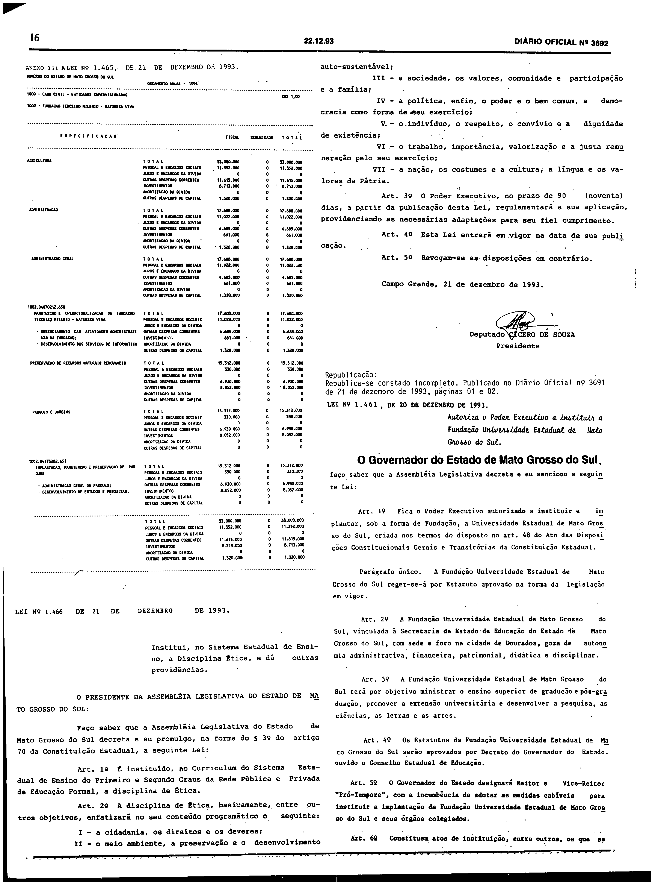
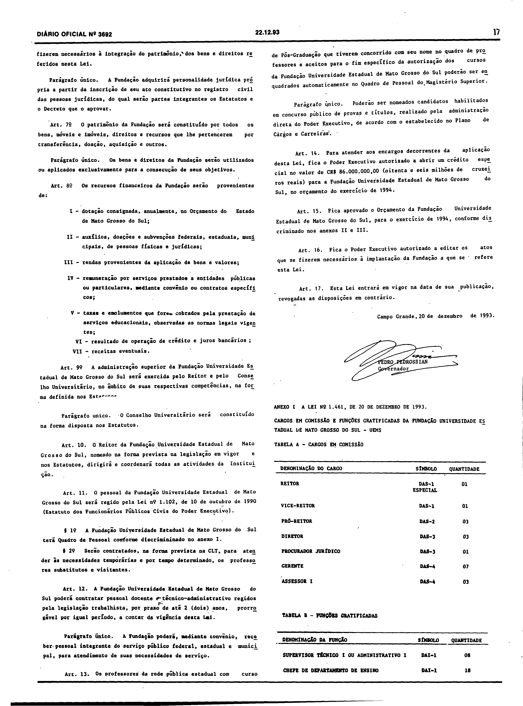
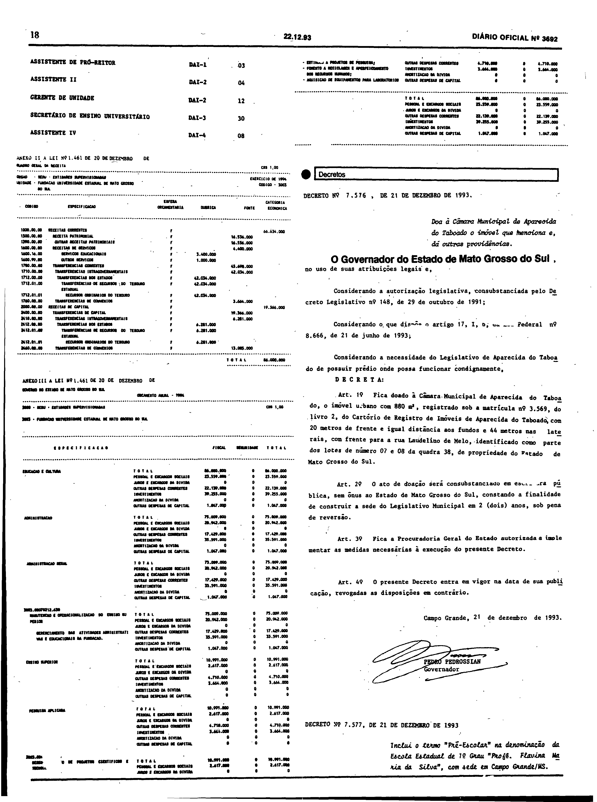

# LEI Nº 1.461, DE 20 DE DEZEMBRO DE 1993.

Versão original da lei, republicada em íntegra, com os Anexos I, II e III, no Diário Oficial do Estado de Mato Grosso do Sul nº 3.692, de 22 de dezembro de 1993, páginas 16 a 18. As páginas são reproduzidas em fac-símile ao final e são a representação integral e autoritativa do ato; a lei não foi transcrita nem reconstruída por OCR.

LEI Nº 1.461, DE 20 DE DEZEMBRO DE 1993.

Autoriza o Poder Executivo a instituir a Fundação Universidade Estadual de Mato Grosso do Sul.

Republicada no Diário Oficial nº 3.692, de 22 de dezembro de 1993, páginas 16 a 18 (a edição nº 3.691, de 21 de dezembro de 1993, páginas 1 e 2, a trouxe incompleta).

## Lei e Anexos I, II e III em fac-símile (páginas originais)

**Como ler esta seção.** As imagens abaixo reproduzem, sem alteração, as páginas digitalizadas do Diário Oficial; não são transcrição nem texto pesquisável, e nenhuma célula, número ou desenho foi reconstruído ou corrigido. Para conferir uma imagem, compare seu SHA-256 com o registrado abaixo.

**Fonte:** Diário Oficial do Estado de Mato Grosso do Sul nº 3.692, de 22 de dezembro de 1993, páginas 16 a 18, exemplar digitalizado do Tribunal de Contas do Estado de Mato Grosso do Sul — <https://portal-services.tce.ms.gov.br/portal-services/diario-oficiais/download?id=19278> (HTTP 200, 5.723.072 bytes, PDF completo).

**Arquivo oficial de origem:** PDF integral da edição, SHA-256 `612939b6aa6fa115b0fa744843e35e232c96f9fd2a911c37f3e4657cdd399cc8`; páginas do PDF e páginas impressas coincidem.

**Limites das peças:**

- **Lei nº 1.461:** começa na coluna direita da página 16, logo abaixo da nota de republicação (título, ementa, preâmbulo e arts. 1º a 6º), continua na página 17 e termina com a assinatura do Governador na coluna direita dessa página (arts. 7º a 17).
- **Anexo I** (“Cargos em comissão e funções gratificadas da Fundação Universidade Estadual de Mato Grosso do Sul – UEMS”, Tabelas A e B): abaixo da assinatura, no pé da coluna direita da página 17, e topo da coluna esquerda da página 18.
- **Anexo II** (“Quadro geral da receita”, Fundação Universidade Estadual de Mato Grosso do Sul, exercício de 1994): coluna esquerda da página 18, abaixo do Anexo I; termina na linha “TOTAL”.
- **Anexo III** (“Orçamento anual – 1994”, despesa da Fundação): coluna esquerda da página 18, abaixo do Anexo II, com continuação no topo da coluna direita até o bloco “TOTAL”.
- Na página 16, o que precede a nota de republicação (o anexo orçamentário da Lei nº 1.465, o fim do texto dessa lei e a Lei nº 1.466) e, na página 18, os Decretos nºs 7.576 e 7.577 (coluna direita) não fazem parte desta lei.

**Páginas reproduzidas:**

- Página 16 (título, ementa e arts. 1º a 6º) — `doe3692-p16.png` (3040×4123 px, 300 ppi, SHA-256 `65fc15090e11ad2778bd3e8b34ea7bfd33fdf25e089a2cebf70afb51d64ca2a4`)
- Página 17 (arts. 7º a 17, assinatura e início do Anexo I) — `doe3692-p17.png` (3040×4092 px, 300 ppi, SHA-256 `d91312517b260045cba2372bea809251f71ce01e9925364bf219e21735005e14`)
- Página 18 (fim do Anexo I, Anexos II e III) — `doe3692-p18.png` (3040×4076 px, 300 ppi, SHA-256 `07e421b88104d4408b1e1fb52adbad6f8eaa3ea208846b56458bf016b7f689a2`)

**Observações:**

- A nota impressa acima do título diz: “Republica-se por ter constado incompleto. Publicado no Diário Oficial nº 3691 de 21 de dezembro de 1993, páginas 01 e 02.” A edição nº 3.691 (pp. 1–2), que a trouxe incompleta, não é reproduzida aqui; a republicação da edição nº 3.692 é a versão íntegra, com os três anexos (leitura visual da página 18).
- O texto compilado disponibilizado pela Consultoria Legislativa (com marcas de alterações posteriores, como as Leis nºs 1.498/1994 e 2.230/2001) não é reproduzido, para não misturar a versão original com redação posterior. O texto da lei não foi transcrito.
