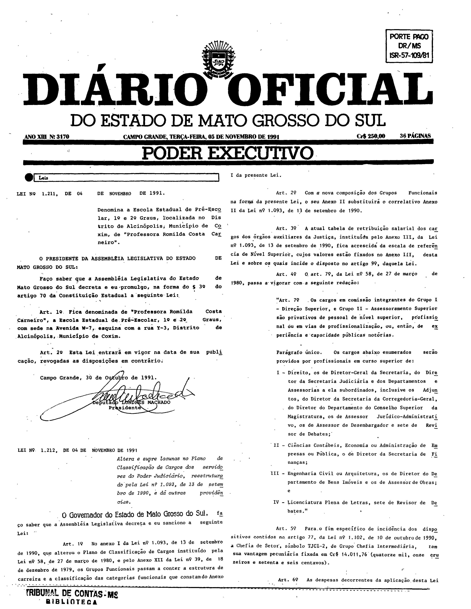
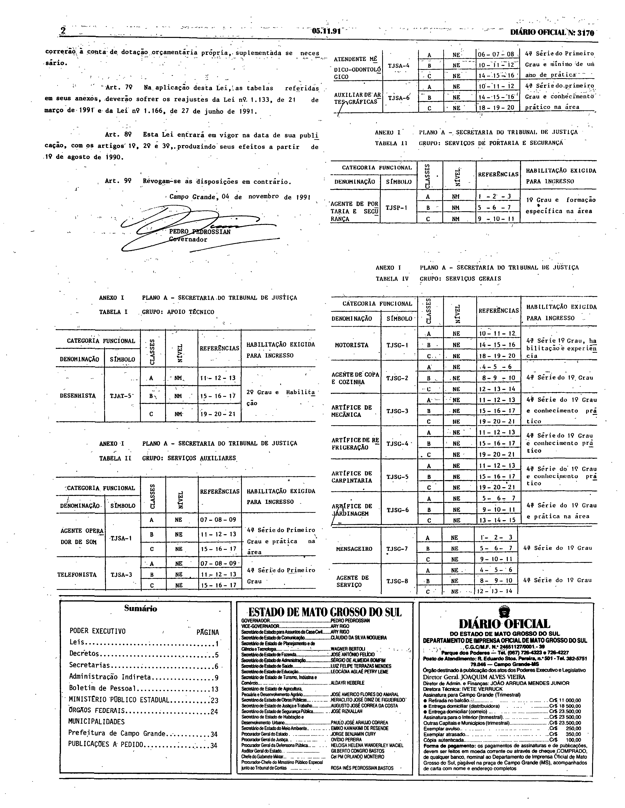
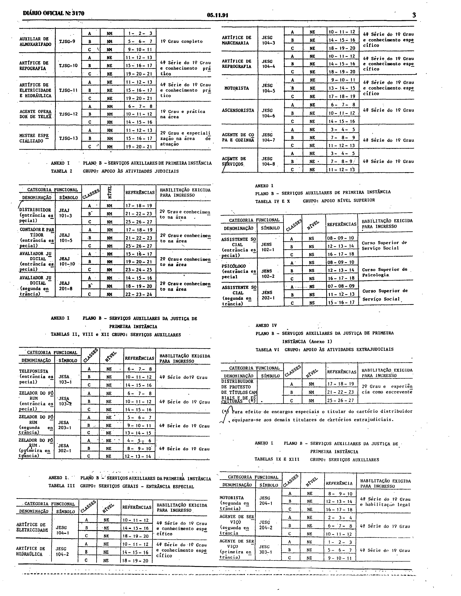
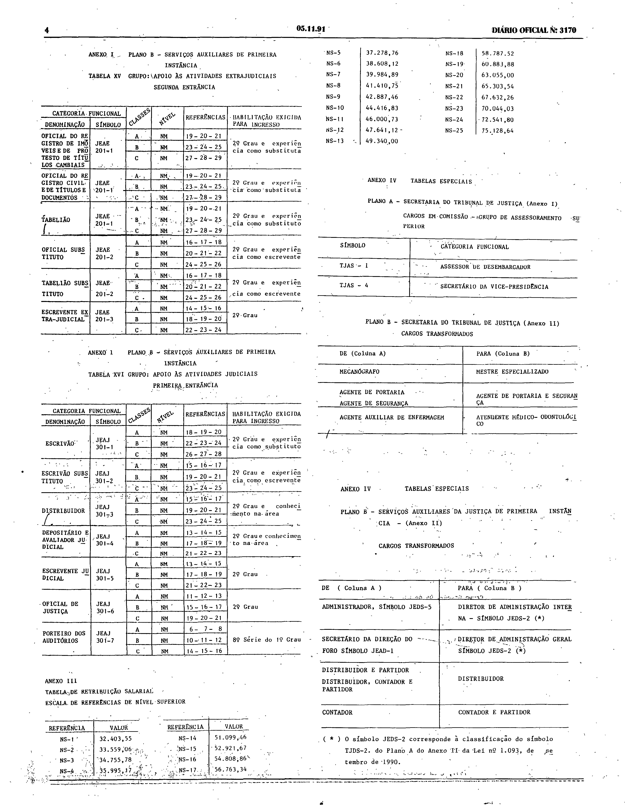

# LEI Nº 1.212, DE 4 DE NOVEMBRO DE 1991.

Versão original da lei, tal como publicada no Diário Oficial do Estado de Mato Grosso do Sul nº 3.170, de 5 de novembro de 1991, páginas 1 a 4. As páginas são reproduzidas em fac-símile ao final e são a representação integral e autoritativa do ato; a lei não foi transcrita.

LEI Nº 1.212, DE 4 DE NOVEMBRO DE 1991.

Publicada no Diário Oficial nº 3.170, de 5 de novembro de 1991.

## Lei e anexos em fac-símile (páginas originais)

**Como ler esta seção.** As imagens abaixo reproduzem, sem alteração, as páginas digitalizadas do Diário Oficial; não são transcrição nem texto pesquisável, e nenhuma célula, número ou desenho foi reconstruído ou corrigido. Para conferir uma imagem, compare seu SHA-256 com o registrado abaixo.

**Fonte:** Diário Oficial do Estado de Mato Grosso do Sul nº 3.170, de 5 de novembro de 1991, páginas 1 a 4, exemplar digitalizado do Tribunal de Contas do Estado de Mato Grosso do Sul — <https://portal-services.tce.ms.gov.br/portal-services/diario-oficiais/download?id=18474> (HTTP 200, 6.628.352 bytes, PDF completo).

**Arquivo oficial de origem:** PDF integral da edição, SHA-256 `a91ab3bc24ad536722b45c9def5ca8d6e39cd77783eea8beefb6afe6be2b0b1c`; páginas do PDF e páginas impressas coincidem.

**Limites das peças:**

- **Lei nº 1.212:** começa na parte inferior da coluna esquerda da página 1 (título, ementa, preâmbulo e artigos iniciais) e termina com a assinatura do Governador na coluna esquerda da página 2.
- **Anexo I** (Planos A e B, tabelas de categorias funcionais): a partir da coluna direita da página 2 e ao longo das páginas 3 e 4.
- **Anexo III** (“Tabela de retribuição salarial – escala de referências de nível superior”): fim da página 4. **Anexo IV** (“Tabelas especiais”, Planos A e B): página 4.
- Nas páginas 1 a 4 não aparece peça com o rótulo impresso “Anexo II” isolado. O art. 2º da lei diz que o “Anexo II” desta lei substitui o correlativo da Lei nº 1.093; essa correspondência não foi demonstrada nestas páginas e não foi inferida.
- As páginas 1 e 2 incluem também o cabeçalho, outras leis da mesma edição, o sumário e o expediente; eles não fazem parte desta lei.

**Páginas reproduzidas:**

- Página 1 (início da lei) — `doe3170-p01.png` (3168×4096 px, 300 ppi, SHA-256 `779301a5e1bca5e5d61b096cc9ca4083a8c342ece1e7b069085339a1c96a6772`)
- Página 2 (fim da lei e início dos anexos) — `doe3170-p02.png` (3168×4093 px, 300 ppi, SHA-256 `0f2c01d5865a9f09a9a336d52cd454f4fa7cdf1401cb8b357bbb138a290844cd`)
- Página 3 (anexos) — `doe3170-p03.png` (3168×4098 px, 300 ppi, SHA-256 `cf00b2d710cbdc30a2f84c2f858a6de1f75b7d675d555b3c4c8362788b1400e2`)
- Página 4 (anexos) — `doe3170-p04.png` (3168×4094 px, 300 ppi, SHA-256 `beebc6ad16e9e2d632f186cf3ca6ba189c7c959a0be8d2c250b04d7557e05740`)

**Observações:**

- O texto compilado disponibilizado pela Consultoria Legislativa traz marcas de revogação e de redação posterior (inclusive de 2008) e por isso não é reproduzido: a versão publicada aqui é a original do Diário Oficial. O texto da lei não foi transcrito nem corrigido por inferência.
