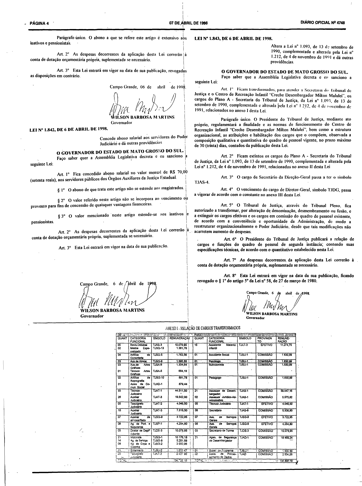
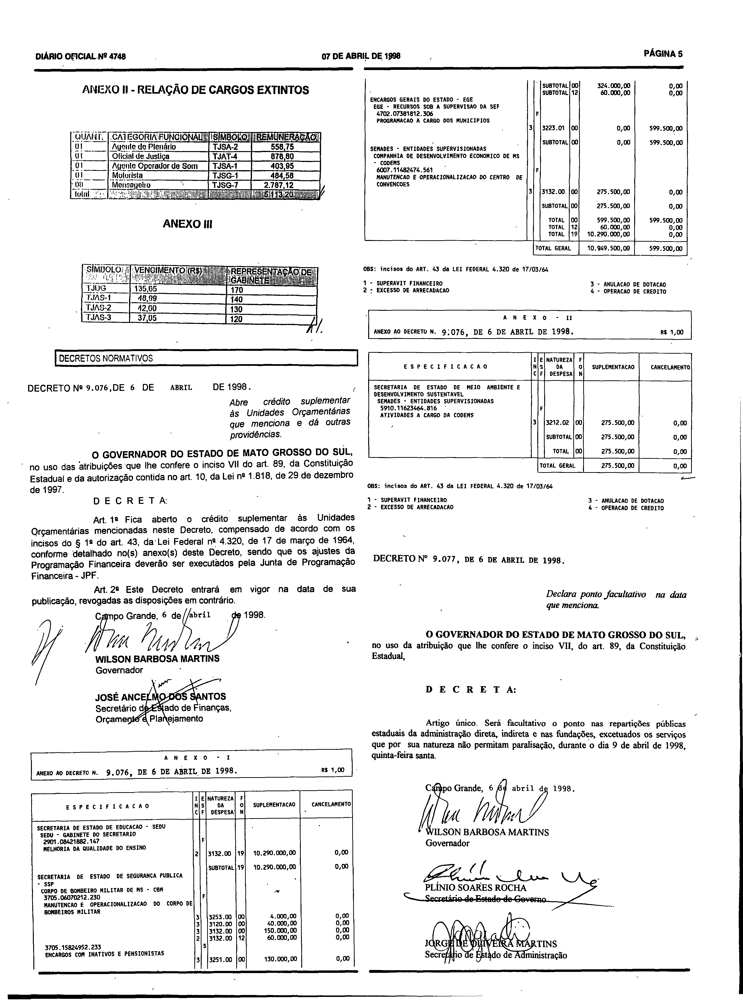

# LEI Nº 1.843, DE 6 DE ABRIL DE 1998.

ESTADO DE MATO GROSSO DO SUL

LEI Nº 1.843, DE 6 DE ABRIL DE 1998.

Altera a Lei nº 1.093, de 13 de setembro de 1990, complementada e alterada pela Lei nº 1.212, de 4 de novembro de 1991 e dá outras providências.

Publicada no Diário Oficial nº 4.748, de 7 de abril de 1998.

**O GOVERNADOR DO ESTADO DE MATO GROSSO DO SUL.** 
Faço saber que a Assembléia Legislativa decreta e eu sanciono a seguinte Lei: 
 
Art. 1º Ficam transformados, para atender a Secretaria do Tribunal de Justiça e o Centro de Recreação Infantil “Creche Desembargador Milton Malulei”, os cargos do Plano A - Secretaria do Tribunal de Justiça, da Lei nº 1.093, de 13 de setembro de 1990, complementada e alterada pela Lei nº 1.212, de 4 de novembro de 1991, relacionados no anexo I desta Lei. 
 
Parágrafo único. O Presidente do Tribunal de Justiça, mediante ato próprio, regulamentará a finalidade e as normas de funcionamento do Centro de Recreação Infantil “Creche Desembargador Milton Malulei”, bem como a estrutura organizacional, as atribuições e habilitação dos cargos que o compõem, observada a composição qualitativa e quantitativa do quadro de pessoal vigente, no prazo máximo de 30 (trinta) dias, contados da publicação desta Lei 
 
Art. 2º Ficam extintos os cargos do Plano A - Secretaria do Tribunal de Justiças, da Lei nº 1.093, de 13 de setembro de 1990, complementada e alterada pela Lei nº 1.212, de 4 de novembro de 1991, relacionados no anexo II desta Lei. 
 
Art. 3º O cargo de Secretário da Direção-Geral passa a ter o símbolo TJAS-4. 
 
Art. 4º O vencimento do cargo de Diretor-Geral, símbolo TJDG, passa a vigorar de acordo com o constante no anexo III desta Lei. 
 
Art. 5º O Tribunal de Justiça, através do Tribunal Pleno, fica autorizado a transformar, por alteração de denominação, desmembramento ou fusão, e a extinguir os cargos efetivos e os cargos em comissão do quadro de pessoal existente, de acordo com a conveniência e oportunidade da Administração, de modo a reestruturar organizacionalmente o Poder Judiciário, desde que tais modificações não acarretem aumento de despesas. 
 
Art. 6º O Presidente do Tribunal de Justiça publicará a relação de cargos e funções do quadro de pessoal de segunda instância, contendo suas especificações técnicas, de acordo com o quantitativo estabelecido nesta Lei. 
 
Art. 7º As despesas decorrentes da aplicação desta Lei correrão à conta de dotação orçamentária própria, suplementada se necessário. 
 
Art. 8º Esta Lei entrará em vigor na data da sua publicação, ficando revogado o § 1º do artigo 5º da Lei nº 58, de 27 de março de 1980. 
 
Campo Grande, 6 de abril de 1998. 
 
**WILSON BARBOSA MARTINS** 
**Governador**

## Anexos em fac-símile do Diário Oficial

O texto acima, disponibilizado pela Consultoria Legislativa, não contém os Anexos I, II e III mencionados nos arts. 1º, 2º e 4º. Eles constam da edição do Diário Oficial em que a lei foi publicada e são reproduzidos abaixo em fac-símile.

**Como ler esta seção.** As imagens abaixo são reproduções fac-similares, sem alteração, das páginas digitalizadas do Diário Oficial; não são transcrição nem texto pesquisável, e nenhuma célula, número ou desenho foi reconstruído. Para conferir uma imagem, compare seu SHA-256 com o registrado abaixo.

**Fonte:** Diário Oficial do Estado de Mato Grosso do Sul nº 4.748, de 7 de abril de 1998, páginas 4 e 5, exemplar digitalizado do Tribunal de Contas do Estado de Mato Grosso do Sul — <https://portal-services.tce.ms.gov.br/portal-services/diario-oficiais/download?id=20349> (HTTP 200, 14.826.496 bytes, PDF completo).

**Arquivo oficial de origem:** PDF integral da edição, SHA-256 `c881745f6b112479e455419a0cfae864f4339c93399c07ee749c3c4c291ae5a6`; páginas do PDF e páginas impressas coincidem.

**Limites das peças:**

- **Anexo I** (“Relação de cargos transformados”): rodapé da página 4, abaixo da assinatura da Lei nº 1.843; termina na linha “TOTAL”.
- **Anexo II** (“Relação de cargos extintos”) e **Anexo III** (símbolos, vencimentos e representação de gabinete): topo da página 5, terminando antes da caixa “Decretos Normativos”.
- As páginas inteiras incluem também a Lei nº 1.842, de 6 de abril de 1998 (página 4), os Decretos nºs 9.076 e 9.077 (página 5) e o cabeçalho e rodapé da edição; esses atos não fazem parte desta lei.

**Páginas reproduzidas:**

- Página 4 (lei e Anexo I) — `doe4748-p04.png` (3120×4182 px, 300 ppi, SHA-256 `49b41f0e59facd2c2b242519dcc7c2055d90b86621a08e3d0aa9041197a4ba84`)
- Página 5 (Anexos II e III) — `doe4748-p05.png` (3120×4196 px, 300 ppi, SHA-256 `bb89e324e934c4196519b2e652fc9952da1ba1a0a2dcb00671f9dbd547b8e32f`)

**Observações sobre a imagem:**

- A tabela do Anexo I está impressa em corpo pequeno e suas últimas linhas, inclusive a linha “TOTAL”, estão borradas na digitalização; a imagem é reproduzida como digitalizada, sem transcrição das células e sem leitura dos valores ilegíveis.
