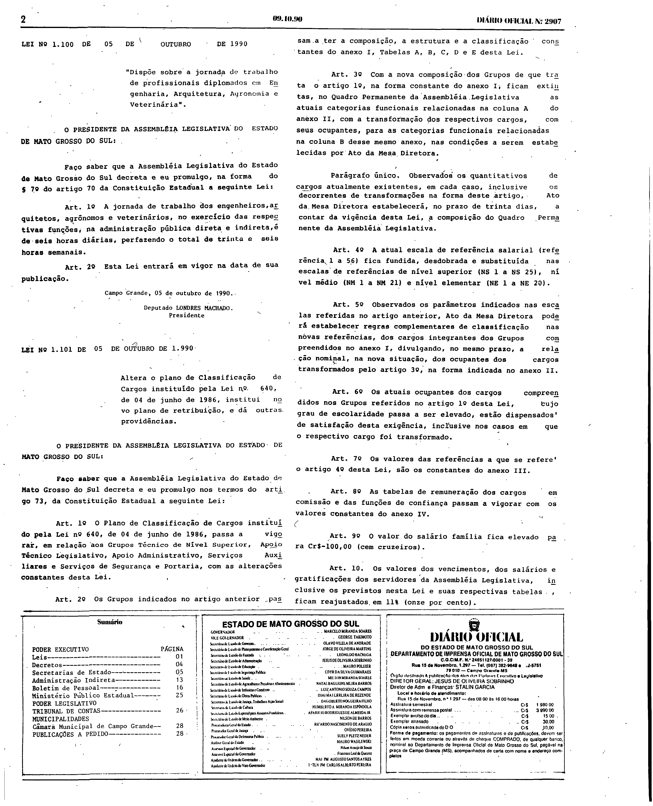
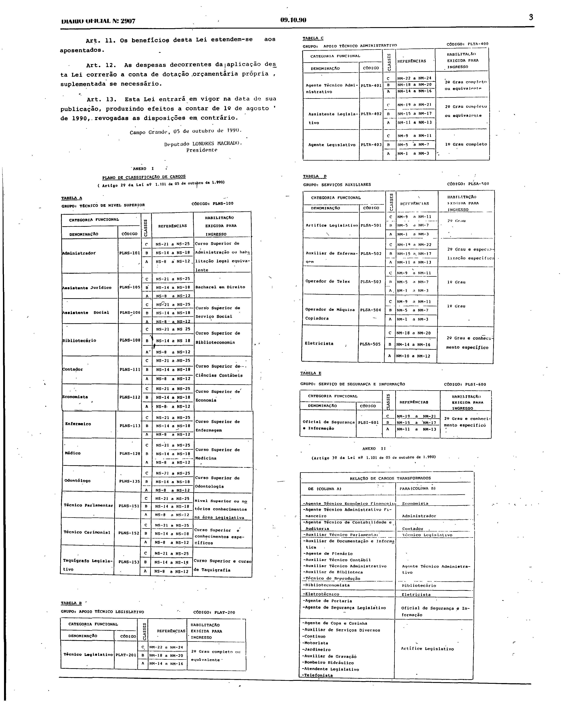
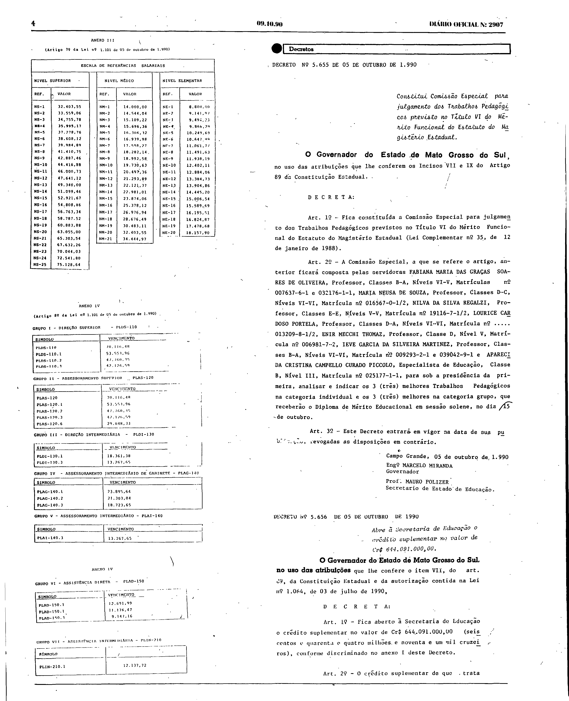

# LEI Nº 1.101, DE 5 DE OUTUBRO DE 1990.

Versão original da lei, tal como publicada no Diário Oficial do Estado de Mato Grosso do Sul nº 2.907, de 9 de outubro de 1990, páginas 2 a 4. As páginas são reproduzidas em fac-símile ao final e são a representação integral e autoritativa do ato; a lei não foi transcrita.

LEI Nº 1.101, DE 5 DE OUTUBRO DE 1990.

Publicada no Diário Oficial nº 2.907, de 9 de outubro de 1990. Lei promulgada pela Assembleia Legislativa.

## Lei e anexos em fac-símile (páginas originais)

**Como ler esta seção.** As imagens abaixo reproduzem, sem alteração, as páginas digitalizadas do Diário Oficial; não são transcrição nem texto pesquisável, e nenhuma célula, número ou desenho foi reconstruído ou corrigido. Para conferir uma imagem, compare seu SHA-256 com o registrado abaixo.

**Fonte:** Diário Oficial do Estado de Mato Grosso do Sul nº 2.907, de 9 de outubro de 1990, páginas 2 a 4, exemplar digitalizado do Tribunal de Contas do Estado de Mato Grosso do Sul — <https://portal-services.tce.ms.gov.br/portal-services/diario-oficiais/download?id=18823> (HTTP 200, 6.776.576 bytes, PDF completo).

**Arquivo oficial de origem:** PDF integral da edição, SHA-256 `cef4e19f3d988dadfc024aaba8817a3eb90b4a5b1ef98ade39f4f5364c5e7aa8`; páginas do PDF e páginas impressas coincidem.

**Limites das peças:**

- **Lei nº 1.101:** começa na página 2 (título, ementa, preâmbulo e artigos iniciais) e termina com a assinatura do Presidente da Assembleia Legislativa na página 3 (lei promulgada pela Assembleia).
- **Anexo I** (“Plano de classificação de cargos”, Tabelas A a E): página 3, abaixo da assinatura. **Anexo II** (“Relação de cargos transformados”): fim da página 3.
- **Anexo III** (“Escala de referências salariais”): topo da página 4, com o rótulo impresso “Anexo III”. **Anexo IV** (tabelas de vencimentos dos Grupos I a VII): página 4.
- A página 2 inclui também outras leis promulgadas na mesma edição, o sumário e o expediente; a página 4 inclui os Decretos nºs 5.655 e 5.656. Esses atos não fazem parte desta lei.

**Páginas reproduzidas:**

- Página 2 (início da lei) — `doe2907-p02.png` (3248×4001 px, 300 ppi, SHA-256 `0184de52cb158c65475f7c7096a288c355d8f4ffa476c920ac388b5022cc1653`)
- Página 3 (fim da lei, Anexos I e II) — `doe2907-p03.png` (3232×4009 px, 300 ppi, SHA-256 `97cb5664256888b91baccd73e4633d313353e739fd7cd9e01ff37dd8ea727ceb`)
- Página 4 (Anexos III e IV) — `doe2907-p04.png` (3248×4004 px, 300 ppi, SHA-256 `1cd74d7a25569b98bf7b37ff946e073fc9745bf6fc4d5b7b85a8e371727b8d35`)

**Observações:**

- O texto disponibilizado pela Consultoria Legislativa traz o rótulo “ANEXO II” sobre a escala de referências salariais, repetindo o rótulo do anexo anterior, enquanto o impresso traz “Anexo III”. Como a Consultoria diverge do impresso, o texto dela não é reproduzido; os rótulos impressos foram preservados, sem renumerar nem corrigir por inferência.
