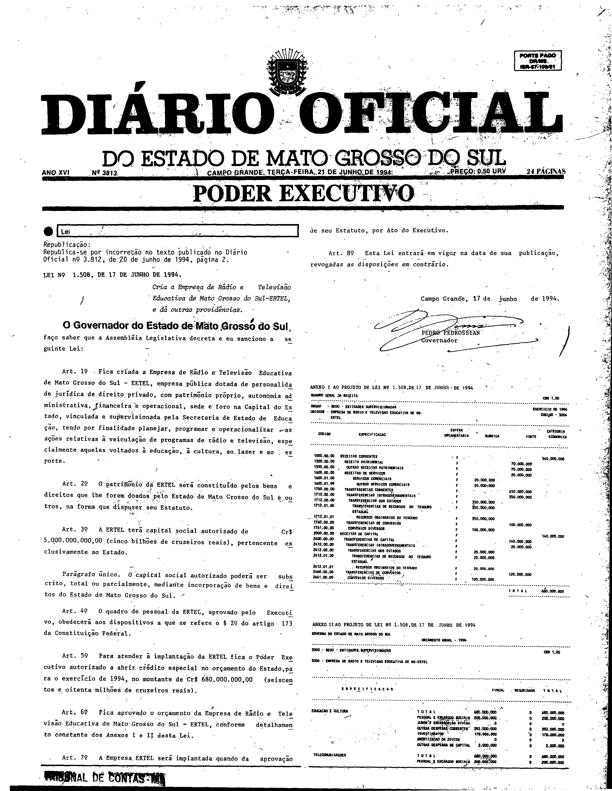
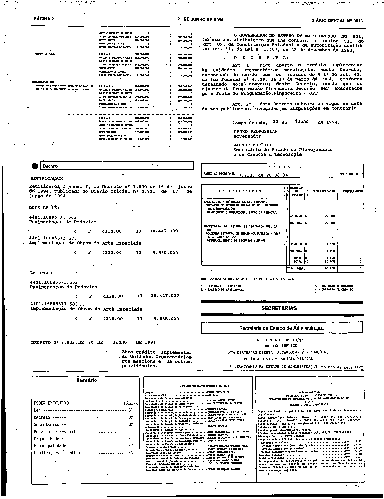

# LEI Nº 1.508, DE 17 DE JUNHO DE 1994.

ESTADO DE MATO GROSSO DO SUL

LEI Nº 1.508, DE 17 DE JUNHO DE 1994.

Cria a Empresa de Rádio e Televisão Educativa de Mato Grosso do Sul-ERTEL, e dá outras providências.

Publicada no Diário Oficial nº 3.812, de 20 de junho de 1994, página 2. Republicada no Diário Oficial nº 3.813, de 21 de junho de 1994, página 1.

**O Governador do Estado de Mato Grosso do Su**l, faço saber que a Assembléia Legislativa decreta e eu sanciono a seguinte Lei: 
 
Art. 1º Fica criada a Empresa de Rádio e Televisão Educativa de Mato Grosso do Sul - ERTEL, empresa pública dotada de personalidade jurídica de direito privado, com patrimônio próprio, autonomia administrativa, financeira e operacional, sede e foro na Capital do Estado, vinculada e supervisionada pela Secretaria de Estado de Educação, tendo por finalidade planejar, programar e operacionalizar as ações relativas a veiculação de programas de rádio e televisão, especialmente aqueles voltados a educação, a cultura, ao lazer e ao esporte. 
 
Art. 2º O patrimônio da ERTEL será constituído pelos bens e direitos que lhe forem doados pelo Estado de Mato Grosso do Sul e outros, na forma que dispuser seu Estatuto. 
 
Art. 3º A ERTEL terá capital social autorizado de Cr$ 5.000.000.000,00 (cinco bilhões de cruzeiros reais), pertencente exclusivamente ao Estado. 
 
Parágrafo único. O capital social autorizado poderá ser subscrito, total ou parcialmente, mediante incorporação de bens e direitos do Estado de Mato Grosso do Sul. 
 
Art. 4º O quadro de pessoal da ERTEL, aprovado pelo Executivo, obedecerá aos dispositivos a que se refere o u 2º do artigo 173 da Constituição Federal. 
 
Art. 5º Para atender a implantação da ERTEL fica o Poder Executivo autorizado a abrir crédito especial no orçamento do Estado, para o exercício de 1994, no montante de Cr$ 680.000.000,00 (seiscentos e oitenta milhões de cruzeiros reais). 
 
Art. 6º Fica aprovado o orçamento da Empresa de Rádio e Televisão Educativa de Mato Grosso do Sul - ERTEL, conforme detalhamento constante dos Anexos I e II desta Lei. 
 
Art. 7º A Empresa ERTEL será implantada quando da aprovação de seu Estatuto, por Ato do Executivo. 
 
Art. 8º Esta Lei entrará em vigor na data de sua publicação, revogadas as disposições em contrário. 
 
Campo Grande, 17 de junho de 1994.

 
PEDRO PEDROSSIAN 
Governador

## Anexos em fac-símile do Diário Oficial

A lei foi publicada no Diário Oficial nº 3.812 (20/06/1994, página 2) sem os anexos e republicada, por incorreção, no Diário Oficial nº 3.813 (21/06/1994), em que constam os Anexos I e II a que o art. 6º se refere. O texto acima não os contém; eles são reproduzidos abaixo em fac-símile da edição que os imprime (a republicação).

**Como ler esta seção.** As imagens abaixo são reproduções fac-similares, sem alteração, das páginas digitalizadas do Diário Oficial; não são transcrição nem texto pesquisável, e nenhuma célula, número ou desenho foi reconstruído. Para conferir uma imagem, compare seu SHA-256 com o registrado abaixo.

**Fonte:** Diário Oficial do Estado de Mato Grosso do Sul nº 3.813, de 21 de junho de 1994, páginas 1 e 2, exemplar digitalizado do Tribunal de Contas do Estado de Mato Grosso do Sul — <https://portal-services.tce.ms.gov.br/portal-services/diario-oficiais/download?id=20028> (HTTP 200, 3.944.288 bytes, PDF completo).

**Arquivo oficial de origem:** PDF integral da edição, SHA-256 `244607076a16c8e16375fb95edde138ea40ffe6ee4368d61a6b502967cb808d8`; páginas do PDF e páginas impressas coincidem. Na edição nº 3.812, página 2, a lei aparece sem anexos (verificado visualmente).

**Limites das peças:**

- **Anexo I** (“Quadro Geral da Receita”, ERTEL): página 1, logo abaixo da assinatura da lei; termina na linha “TOTAL”.
- **Anexo II** (orçamento anual – 1994, ERTEL): começa na parte inferior da página 1 e continua no topo da coluna esquerda da página 2, terminando no bloco “TOTAL”, acima da retificação do Decreto nº 7.830.
- As páginas inteiras incluem também o cabeçalho da edição, a retificação do Anexo I do Decreto nº 7.830, o Decreto nº 7.833, o edital nº 10/94, o sumário e o expediente; esses elementos não fazem parte desta lei.

**Páginas reproduzidas:**

- Página 1 (lei republicada, Anexo I e início do Anexo II) — `doe3813-p01.png` (3168×4091 px, 300 ppi, SHA-256 `283410eb4221901aee92854c43018dabcbdd7c767d4ec64d2b7633cadfd26c3a`)
- Página 2 (continuação e fim do Anexo II) — `doe3813-p02.png` (3152×4085 px, 300 ppi, SHA-256 `a881c79226809cee7aee750a6a9962b3be5aa022ba7eec62bc1b460d58c62486`)

**Observações sobre a imagem:**

- Os cabeçalhos impressos dos anexos dizem “ao Projeto de Lei nº 1.508”; foram mantidos como estão na imagem. As tabelas estão em corpo pequeno; nenhuma célula foi transcrita.
