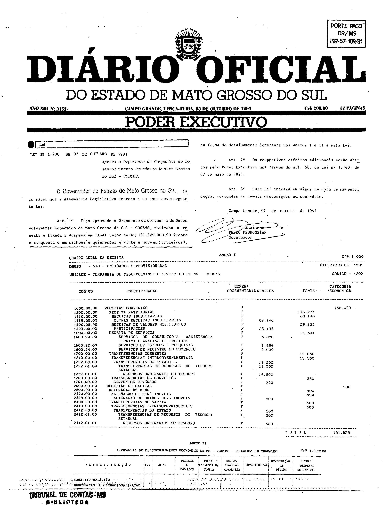
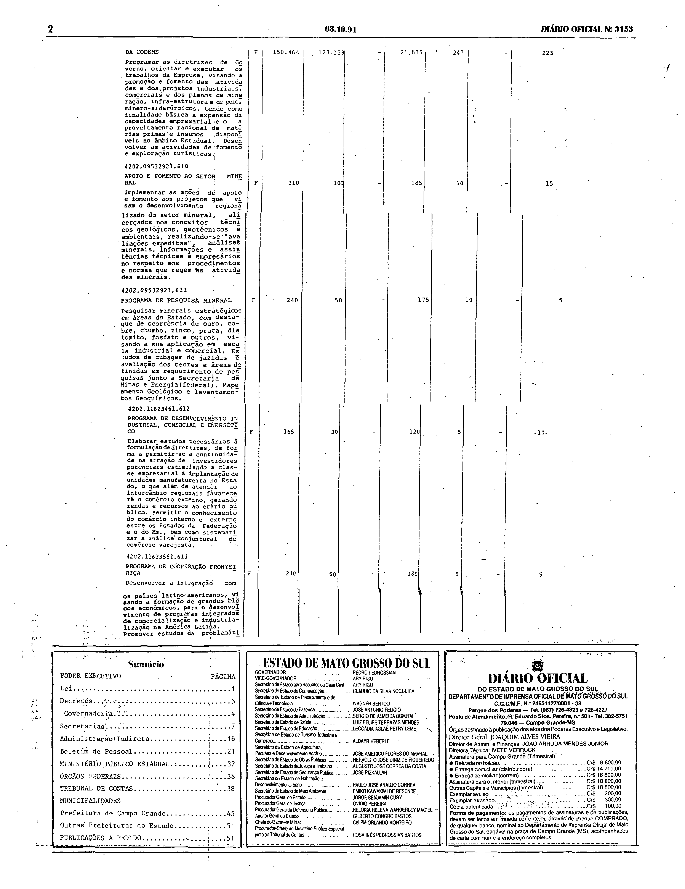
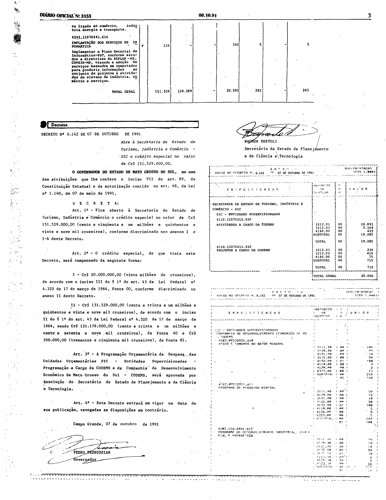

# LEI Nº 1.206, DE 7 DE OUTUBRO DE 1991.

ESTADO DE MATO GROSSO DO SUL

LEI Nº 1.206, DE 7 DE OUTUBRO DE 1991.

Aprova o Orçamento da Companhia de Desenvolvimento Econômico de Mato Grosso do Sul - CODEMS.

Publicada no Diário Oficial nº 3.153, de 8 de outubro de 1991.

**O Governador do Estado de Mato Grosso do Sul**, faço saber que a Assembléia Legislativa decreta e eu sanciono a seguinte Lei: 
 
Art. 1º Fica aprovado o Orçamento da Companhia de Desenvolvimento Econômico de Mato Grosso do Sul - CODEMS, estimada a receita e fixada a despesa em igual valor de Cr$ 151.529.000,00 (cento e cinqoenta e um milhões e quinhentos e vinte e nove mil cruzeiros) na forma do detalhamento constante nos anexos I e II a esta Lei. 
 
Art. 2º Os respectivos créditos adicionais serão abertos pelo Poder Executivo nos termos do art. 68, da Lei nº 1.140, de 07 de maio de 1991. 
 
Art. 3º Esta Lei entrará em vigor na data de sua publicação, revagadas as demais disposições em contrário. 
 
Campo Grande, 07 de outubro de 1991. 
 
PEDRO PEDROSSIAN 
Governador

**Conferência da versão do texto.** Os arts. 1º a 3º do texto acima (Consultoria Legislativa) foram comparados, em leitura visual, com a página 1 do Diário Oficial nº 3.153 e coincidem no conteúdo (diferenças de grafia do texto: “cinqoenta” no art. 1º e “revagadas” no art. 3º, onde o impresso traz “cinquenta” e “revogadas”); o texto não traz marcas de compilação posterior (sem trechos riscados, redação nova em itálico ou notas de alteração). Em caso de diferença entre o texto acima e as imagens, valem as imagens. Não foi feita conferência célula a célula dos anexos nem transcrição das imagens.

## Anexos em fac-símile do Diário Oficial

O texto acima, disponibilizado pela Consultoria Legislativa, não contém os Anexos I e II a que o art. 1º se refere. Eles constam da edição do Diário Oficial em que a lei foi publicada e são reproduzidos abaixo em fac-símile.

**Como ler esta seção.** As imagens abaixo são reproduções fac-similares, sem alteração, das páginas digitalizadas do Diário Oficial; não são transcrição nem texto pesquisável, e nenhuma célula, número ou desenho foi reconstruído. Para conferir uma imagem, compare seu SHA-256 com o registrado abaixo.

**Fonte:** Diário Oficial do Estado de Mato Grosso do Sul nº 3.153, de 8 de outubro de 1991, páginas 1 a 3, exemplar digitalizado do Tribunal de Contas do Estado de Mato Grosso do Sul — <https://portal-services.tce.ms.gov.br/portal-services/diario-oficiais/download?id=18457> (HTTP 200, 12.132.608 bytes, PDF completo).

**Arquivo oficial de origem:** PDF integral da edição, SHA-256 `7e73a65be660bbc953da7dc0cb52bdc474853463dbd74c8d659ecc042c7a2d8c`; páginas do PDF e páginas impressas coincidem.

**Limites das peças:**

- **Anexo I** (“Quadro Geral da Receita”, Companhia de Desenvolvimento Econômico de MS – CODEMS): página 1, logo abaixo da assinatura da lei; termina na linha “TOTAL”.
- **Anexo II** (“Programa de Trabalho”): começa na parte inferior da página 1, continua integralmente na página 2 e termina no “TOTAL GERAL” no topo da página 3, antes da caixa “Decretos”.
- As páginas inteiras incluem também o cabeçalho da edição, o carimbo da biblioteca do Tribunal de Contas, o sumário, o expediente e o Decreto nº 6.142, de 7 de outubro de 1991 (página 3); esses elementos não fazem parte desta lei.

**Páginas reproduzidas:**

- Página 1 (lei, Anexo I e início do Anexo II) — `doe3153-p01.png` (3168×4114 px, 300 ppi, SHA-256 `1f1a8c39d344b1c14fff7a17bfa7d814e18c41fe83aadd941db232d71c1d0962`)
- Página 2 (continuação do Anexo II) — `doe3153-p02.png` (3168×4105 px, 300 ppi, SHA-256 `4a9290c6be17e8bc3e7db12c629a4fcdafff7c54870bbfc469a49b974f90f7b6`)
- Página 3 (fim do Anexo II) — `doe3153-p03.png` (3168×4103 px, 300 ppi, SHA-256 `0cc94bb690f051f48ca9a55ff65503f1fa9c2fd48429d3ff5e750bfdb16f9ac8`)

**Observações sobre a imagem:**

- A primeira linha do Anexo II, ao pé da página 1, está parcialmente ilegível na digitalização (restam legíveis apenas parte do código e as palavras “Manutenção e Operacionalização”); a imagem é reproduzida como digitalizada e a linha não foi reconstruída.
