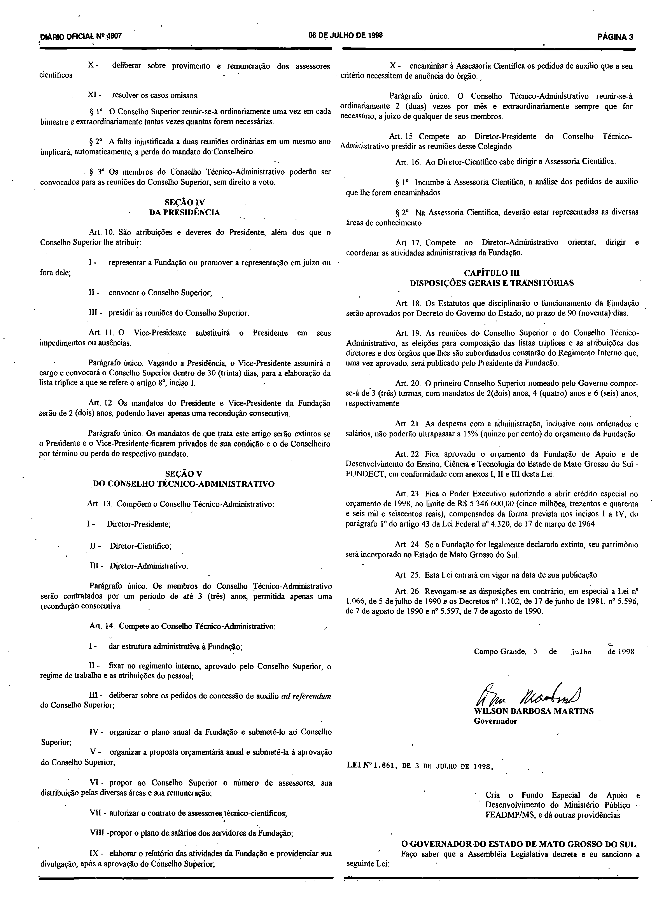
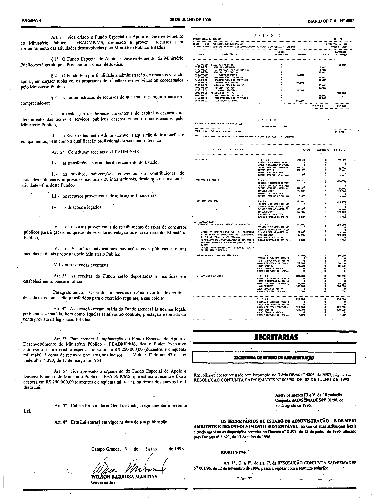

# LEI Nº 1.861, DE 3 DE JULHO DE 1998.

Versão original, publicada no Diário Oficial do Estado de Mato Grosso do Sul nº 4.807, de 6 de julho de 1998, páginas 3 e 4. O texto abaixo foi transcrito das páginas digitalizadas e conferido contra elas; as páginas, com os Anexos I e II, são reproduzidas em fac-símile ao final. Esta versão não incorpora alterações posteriores.

LEI Nº 1.861, DE 3 DE JULHO DE 1998.

Cria o Fundo Especial de Apoio e Desenvolvimento do Ministério Público – FEADMP/MS, e dá outras providências

O GOVERNADOR DO ESTADO DE MATO GROSSO DO SUL. 
Faço saber que a Assembléia Legislativa decreta e eu sanciono a seguinte Lei:

Art. 1° Fica criado o Fundo Especial de Apoio e Desenvolvimento do Ministério Público – FEADMP/MS, destinado a prover recursos para aprimoramento das atividades desenvolvidas pelo Ministério Público Estadual.

§ 1° O Fundo Especial de Apoio e Desenvolvimento do Ministério Público será gerido pela Procuradoria-Geral de Justiça.

§ 2° O Fundo tem por finalidade a administração de recursos visando apoiar, em caráter supletivo, os programas de trabalho desenvolvidos ou coordenados pelo Ministério Público.

§ 3° Na administração de recursos de que trata o parágrafo anterior, compreende-se:

I - a realização de despesas correntes e de capital necessários ao atendimento das ações e serviços públicos desenvolvidos ou coordenados pelo Ministério Público;

II - o Reaparelhamento Administrativo, a aquisição de instalações e equipamentos, bem como a qualificação profissional de seu quadro técnico.

Art 2° Constituem receitas do FEADMP/MS

I - as transferências oriundas do orçamento do Estado,

II - os auxílios, subvenções, convênios ou contribuições de entidades públicas e/ou privadas, nacionais ou internacionais, desde que destinados às atividades-fins deste Fundo;

III - os recursos provenientes de aplicações financeiras;

IV - as doações e legados;

V - os recursos provenientes do recolhimento de taxas de concursos públicos para ingresso no quadro de servidores, estagiários e na carreira do Ministério Público,

VI - os h[o]norários advocatícios nas ações civis públicas e outras medidas ju[d]iciais propostas pelo Ministério Público;

VII - outras rendas eventuais.

Art 3° As receitas do Fundo serão depositadas e mantidas em estabelecimento bancário oficial.

Parágrafo único. Os saldos financeiros do Fundo verificados no final de cada exercício, serão transferidos para o exercício seguinte, a seu crédito.

Art. 4° A execução orçamentária do Fundo atenderá às normas legais pertinentes à matéria, bem como àquelas relativas ao controle, prestação e tomada de conta prevista na legislação Estadual.

Art. 5° Para atender à implantação do Fundo Especial de Apoio e Desenvolvimento do Ministério Público – FEADMP/MS, fica o Poder Executivo autorizado a abrir crédito especial no valor de R$ 250.000,00 (duzentos e cinqüenta mil reais), à conta de recursos previstos nos incisos I a IV do § 1° do art. 43 da Lei Federal n° 4.320, de 17 de março de 1964.

Art 6 ° Fica aprovado o orçamento do Fundo Especial de Apoio e Desenvolvimento do Ministério Público – FEADMP/MS, que estima a receita e fixa a despesa em R$ 250.000,00 (duzentos e cinqüenta mil reais), na forma dos anexos I e II desta Lei.

Art. 7° Cabe à Procuradoria-Geral de Justiça regulamentar a presente Lei.

Art. 8° Esta Lei entrará em vigor na data de sua publicação.

Campo Grande, 3 de julho de 1998.

WILSON BARBOSA MARTINS 
Governador

## Anexos I e II e páginas originais em fac-símile

**Como ler esta seção.** As imagens abaixo reproduzem, sem alteração, as páginas 3 e 4 do Diário Oficial nº 4.807 digitalizado. Os Anexos I e II não foram transcritos: nenhuma célula, número ou desenho foi reconstruído, e o conteúdo das tabelas não é texto pesquisável.

**Fonte:** Diário Oficial do Estado de Mato Grosso do Sul nº 4.807, de 6 de julho de 1998, páginas 3 e 4, exemplar digitalizado do Tribunal de Contas do Estado de Mato Grosso do Sul — <https://portal-services.tce.ms.gov.br/portal-services/diario-oficiais/download?id=20478> (HTTP 200, 15.474.560 bytes, PDF completo).

**Arquivo oficial de origem:** PDF integral da edição, SHA-256 `c2eb39338ab5c0677a7641076ff1cbbbbd449a514e8dc9678ecf90cc5f573fd7`; páginas do PDF e páginas impressas coincidem.

**Limites das peças:**

- **Lei nº 1.861:** começa no pé da coluna direita da página 3 (título, ementa e preâmbulo) e continua na coluna esquerda da página 4, até a assinatura do Governador.
- **Anexo I** (“Quadro Geral da Receita”, Fundo Especial de Apoio e Desenvolvimento do Ministério Público – FEADMP/MS): topo da coluna direita da página 4; termina na linha “TOTAL”.
- **Anexo II** (orçamento anual – 1998, Procuradoria-Geral de Justiça): logo abaixo do Anexo I, na coluna direita da página 4; termina no bloco “TOTAL”, imediatamente antes da seção “Secretarias”.
- As páginas inteiras incluem também outros atos da mesma edição (na página 3, o fim do texto de ato anterior sobre a Fundação de Apoio e de Desenvolvimento do Ensino, Ciência e Tecnologia – FUNDECT; na página 4, a Resolução Conjunta SAD/SEMADES nº 008/98), o cabeçalho e o rodapé da edição; esses atos não fazem parte desta lei.

**Páginas reproduzidas:**

- Página 3 — `doe4807-p03.png` (3040×4126 px, 300 ppi, SHA-256 `fc5af62bdd7c1de6e0ca6d59e890b999833ff67fc942fa025a3d36caf33912b4`)
- Página 4 — `doe4807-p04.png` (3056×4121 px, 300 ppi, SHA-256 `967c6f50f67cfa179522ae8d5dff3b31cad73acf95a4e68ce566483504618121`)

**Observações sobre a transcrição e a imagem:**

- Foram mantidas as grafias e a pontuação impressas (por exemplo “Art 2°”, “Art 6 °”, “Assembléia”, “cinqüenta”, a ausência de dois-pontos após “FEADMP/MS” no art. 2º, e de ponto final na ementa).
- No art. 2º, inciso VI, duas letras estão danificadas na digitalização; as letras entre colchetes foram supridas e não são legíveis na imagem: “h[o]norários” e “ju[d]iciais”.
- No art. 6º, o separador de milhar de “R$ 250.000,00” aparece manchado na imagem (como dois pontos); foi transcrito como ponto, em coerência com o mesmo valor no art. 5º.
- O caractere “°” reproduz o indicador ordinal tal como impresso.
