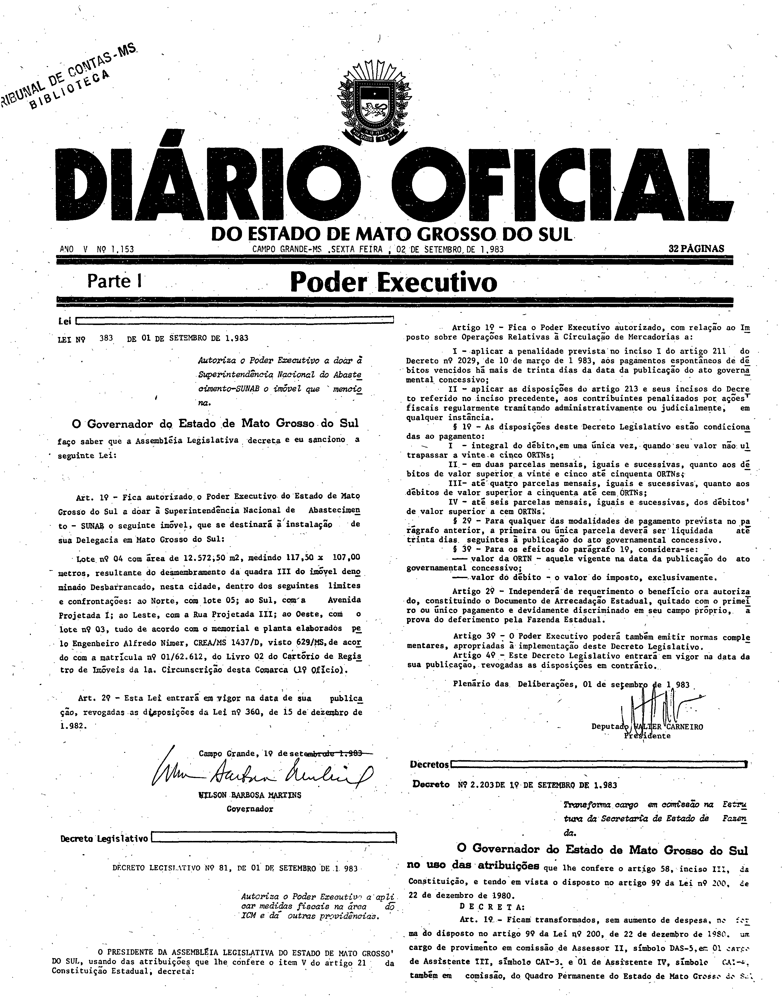

# LEI Nº 383, DE 1 DE SETEMBRO DE 1983.

ESTADO DE MATO GROSSO DO SUL

LEI Nº 383, DE 1 DE SETEMBRO DE 1983.

Autoriza o Poder Executivo a doar a Superintendência Nacional do Abastecimento-SUNAB o imóvel que menciona.

Publicada no Diário Oficial nº 1.153, de 2 de setembro de 1983, página 1.

O Governador do Estado de Mato Grosso do Sul faço saber que a 
Assembléia Legislativa decreta e eu sanciono a seguinte Lei: 
 
Art. 1º - Fica autorizado o Poder Executivo do Estado de Mato 
Grosso do Sul a doar a Superintendência Nacional de Abastecimento 
\- SUNAB o seguinte imóvel, que se destinará a instalação de sua 
Delegacia em Mato Grosso do Sul: 
 
Lote nº 04 com área de 12.572,50 m2, medindo 117,50 x 107,00 
metros, resultante do desmembramento da quadra III do imóvel 
denominado Desbarrancado, nesta cidade, dentro dos seguintes 
limites e confrontações: ao Norte, com lote 05; ao Sul, com a 
Avenida Projetada I; ao Leste, com a Rua Projetada III; ao Oeste, 
com o lote nº 03, tudo de acordo com o memorial e planta elaborados 
pelo Engenheiro Alfredo Nimer, CREA/MS 1437/D, visto 629/MS,de 
acordo com a matricula nº 01/62.612, do Livro 02 do Cartório de 
Registro de Imóveis da 1ª Circunscrição desta Comarca (1º Oficio). 
 
Art. 2º - Esta Lei entrará em Vigor na data de sua publição, 
[revogadas as disposições da Lei nº 360, de 15 de dezembro de 1.982](https://aacpdappls.net.ms.gov.br/appls/legislacao/secoge/govato.nsf/448b683bce4ca84704256c0b00651e9d/ed265fdc2a3cbbf004256e450002e88e?OpenDocument). 
 
Campo Grande, 1º de setembro de 1.983. 
 
WILSON BARBOSA MARTINS 
Governador

**Conferência da versão do texto.** Os arts. 1º e 2º do texto acima (Consultoria Legislativa) foram comparados, em leitura visual, com a página 1 do Diário Oficial e coincidem no conteúdo (diferença de grafia do texto: “publição”). Não há marcas de compilação posterior. Em caso de diferença entre o texto acima e as imagens, valem as imagens. Não foi feita conferência célula a célula dos anexos nem transcrição das imagens.

## Publicação no Diário Oficial (fac-símile)

**Como ler esta seção.** As imagens abaixo reproduzem, sem alteração, as páginas digitalizadas do Diário Oficial; não são transcrição nem texto pesquisável, e nenhuma célula, número ou desenho foi reconstruído ou corrigido. Para conferir uma imagem, compare seu SHA-256 com o registrado abaixo.

**Fonte:** Diário Oficial do Estado de Mato Grosso do Sul nº 1.153, de 2 de setembro de 1983, página 1, exemplar digitalizado do Tribunal de Contas do Estado de Mato Grosso do Sul — <https://portal-services.tce.ms.gov.br/portal-services/diario-oficiais/download?id=16627> (HTTP 200, 8.211.200 bytes, PDF completo).

**Arquivo oficial de origem:** PDF integral da edição, SHA-256 `38897c48362c34315ca37eb52f09cd68958f285f3a5053a467b7485655f83e08`; páginas do PDF e páginas impressas coincidem.

**Limites das peças:**

- **Lei nº 383:** coluna esquerda da página 1, do título à assinatura do Governador (arts. 1º e 2º); a lei é publicada por inteiro nessa página.
- O art. 1º descreve o imóvel (lote nº 04, 12.572,50 m², medidas e confrontações) e acrescenta “tudo de acordo com o memorial e planta elaborados pelo Engenheiro Alfredo Nimer”. A lei não declara esse memorial nem a planta como anexos dela, e nenhum deles aparece na página 1 nem em outra página da edição (a varredura do texto OCR das 32 páginas da edição e a leitura visual da página 1 em 100 ppi não encontraram memorial, planta ou desenho do lote). Trata-se de documentos técnicos referidos pela lei, não de peças publicadas com ela.
- A página inteira contém também o Decreto Legislativo nº 81, de 1º de setembro de 1983, o Decreto nº 2.203 e o cabeçalho da edição; esses atos não fazem parte desta lei.

**Páginas reproduzidas:**

- Página 1 (Lei nº 383, arts. 1º e 2º) — `doe1153-p01.png` (3200×4086 px, 300 ppi, SHA-256 `6674be01606bd47d6df80d603b8d5930ede0fcd77bbd67dd2c7742c1ccc6002a`)

**Observações:**

- Não se afirma que o memorial e a planta não existam fora do Diário Oficial (por exemplo, no registro de imóveis citado na lei); afirma-se apenas que não foram publicados nesta edição nem integram o texto da lei.
