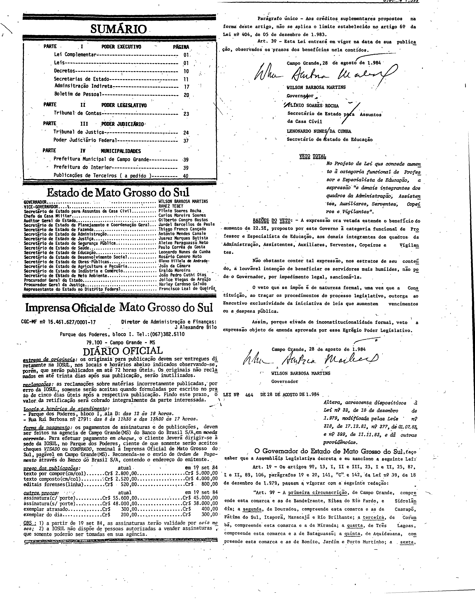
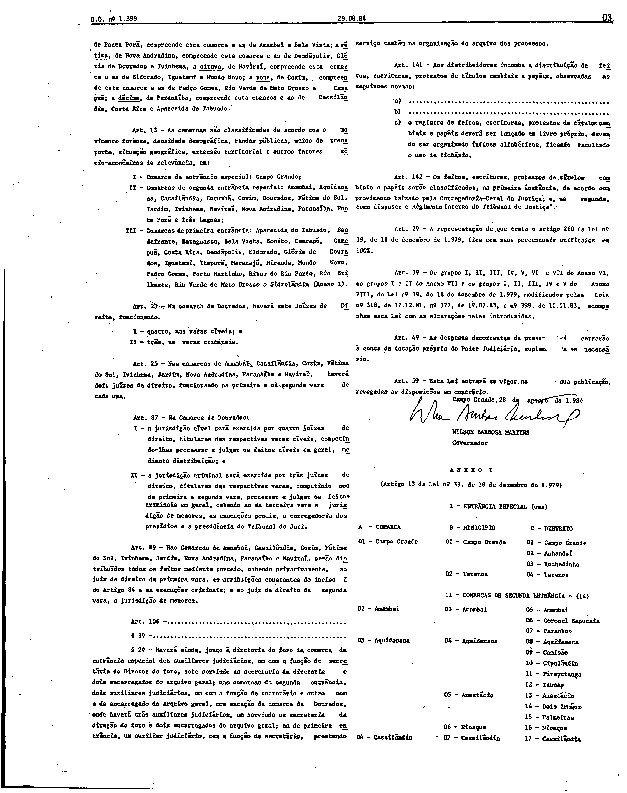
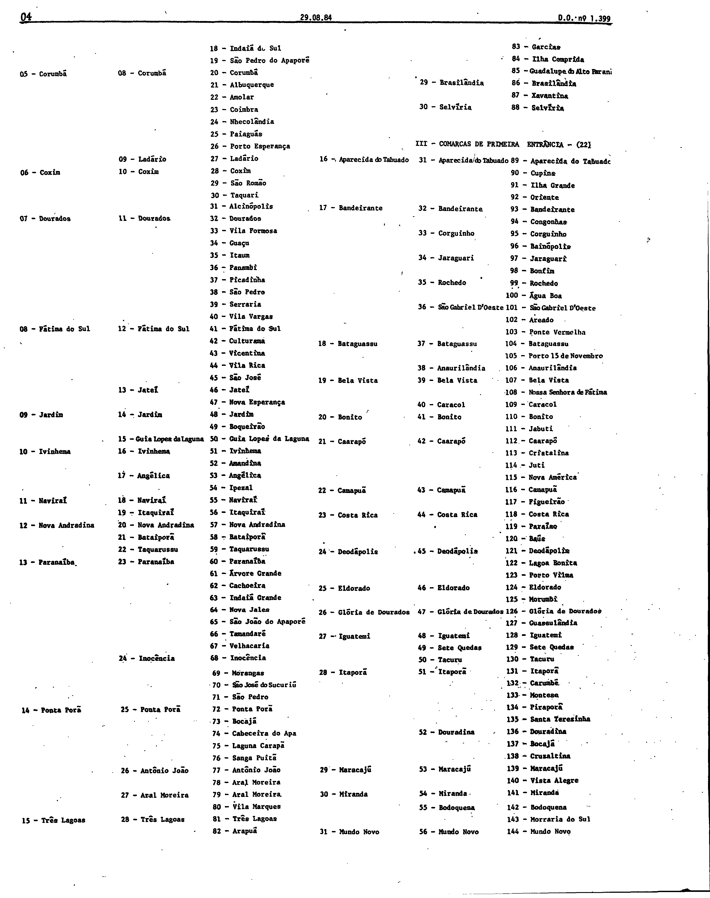
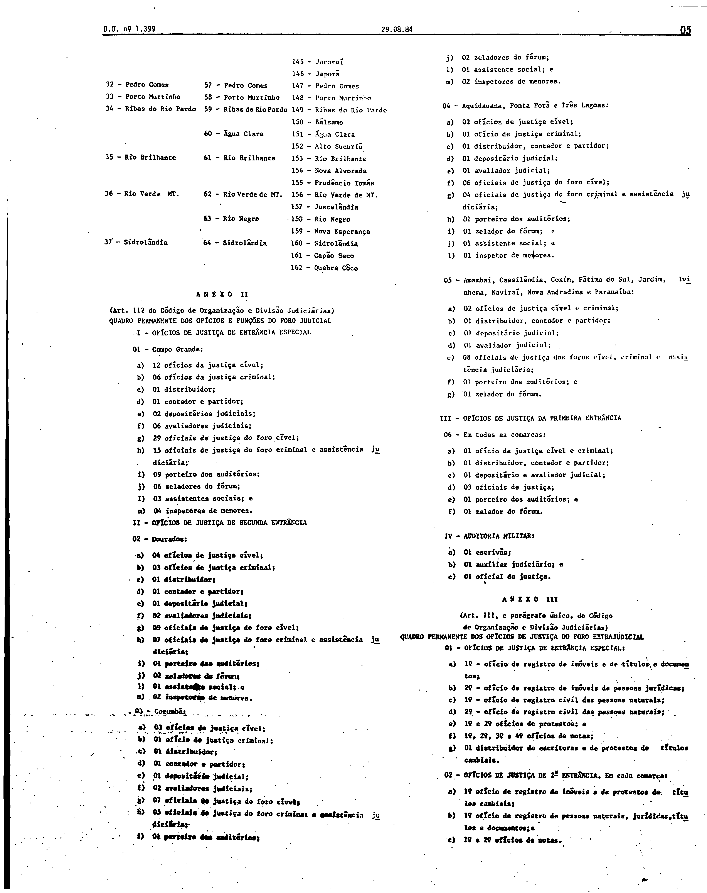
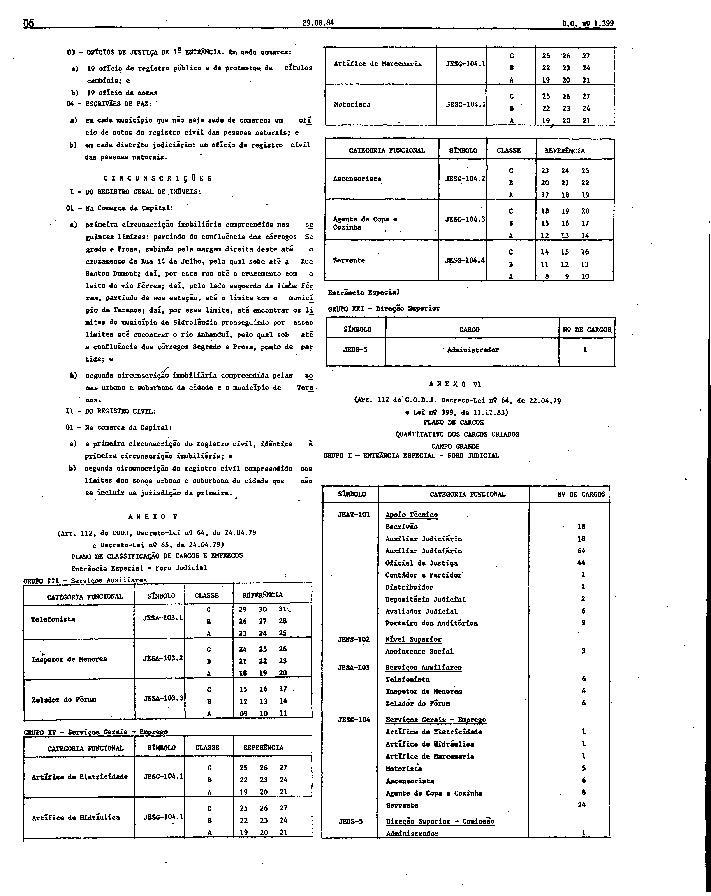
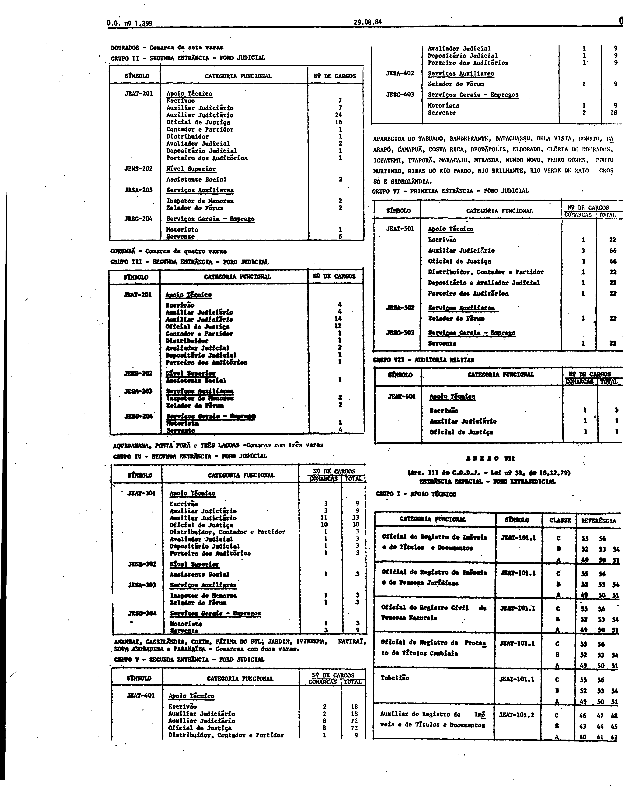
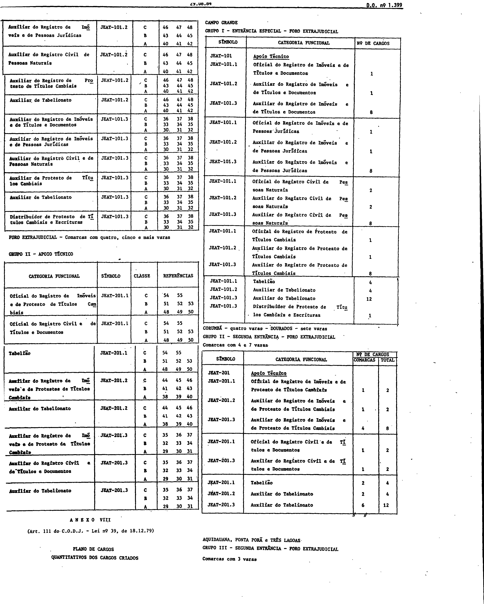
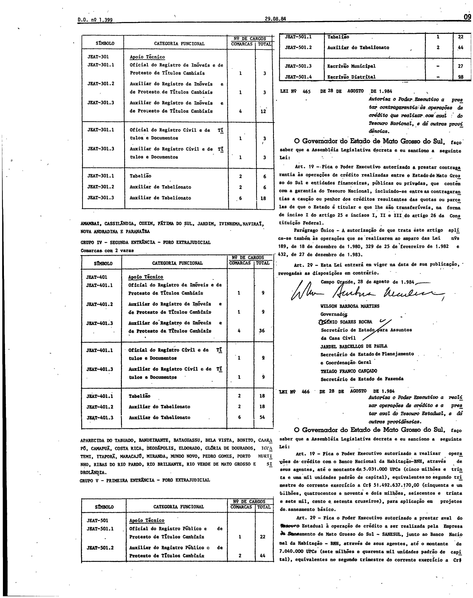

# LEI Nº 464, DE 28 DE AGOSTO DE 1984.

Versão original da lei, tal como publicada no Diário Oficial do Estado de Mato Grosso do Sul nº 1.399, de 29 de agosto de 1984, páginas 2 a 9. As páginas são reproduzidas em fac-símile ao final e são a representação integral e autoritativa do ato; a lei não foi transcrita.

LEI Nº 464, DE 28 DE AGOSTO DE 1984.

Publicada no Diário Oficial nº 1.399, de 29 de agosto de 1984, páginas 2 a 9.

## Lei e anexos em fac-símile (páginas originais)

**Como ler esta seção.** As imagens abaixo reproduzem, sem alteração, as páginas digitalizadas do Diário Oficial; não são transcrição nem texto pesquisável, e nenhuma célula, número ou desenho foi reconstruído ou corrigido. Para conferir uma imagem, compare seu SHA-256 com o registrado abaixo.

**Fonte:** Diário Oficial do Estado de Mato Grosso do Sul nº 1.399, de 29 de agosto de 1984, páginas 2 a 9, exemplar digitalizado do Tribunal de Contas do Estado de Mato Grosso do Sul — <https://portal-services.tce.ms.gov.br/portal-services/diario-oficiais/download?id=16877> (HTTP 200, 7.446.656 bytes, PDF completo).

**Arquivo oficial de origem:** PDF integral da edição, SHA-256 `b0b6dbb037aa155a677bc1b8e7092af8d8a8c7d333a473d4cac8984b3904dbf1`; páginas do PDF e páginas impressas coincidem.

**Limites das peças:**

- **Lei nº 464:** começa na parte inferior da coluna direita da página 2 e termina com a assinatura do Governador na página 3.
- **Anexo I** (“Artigo 13 da Lei nº 39”): final da página 3, página 4 e topo da página 5. **Anexo II** (quadro permanente dos ofícios do foro judicial) e **Anexo III** (foro extrajudicial): página 5.
- **Anexo V** (Foro Judicial – “Plano de classificação de cargos e empregos”): página 6, após as “Circunscrições”. **Anexo VI** (“Plano de cargos – quantitativo dos cargos criados”): páginas 6 e 7.
- **Anexo VII** (Entrância Especial – Foro Extrajudicial; Grupos I e II): páginas 7 e 8, com o rótulo impresso “ANEXO VII” no primeiro bloco da página 7. **Anexo VIII** (“Plano de cargos – quantitativos dos cargos criados”, Foro Extrajudicial): páginas 8 e 9, com o rótulo impresso “ANEXO VIII”.
- A página 2 contém também a Lei Complementar nº 16 e as Leis nºs 462 e 463, e a página 9 contém a Lei nº 465 e o início da Lei nº 466, de 28/08/1984; esses atos não fazem parte desta lei. Não foi verificada a existência de um “Anexo IV” impresso nestas páginas e nenhum foi inferido.

**Páginas reproduzidas:**

- Página 2 — `doe1399-p02.png` (3248×4100 px, 300 ppi, SHA-256 `02959c1f3a630e85c2684232cf6d1f5d5ac88a02f0a5734e7b93181620832ea2`)
- Página 3 — `doe1399-p03.png` (3248×4106 px, 300 ppi, SHA-256 `dab0a3f359fe8ecc77b3f8bccff461d4bacfb405fac463ca0d0fb6264de34bff`)
- Página 4 — `doe1399-p04.png` (3248×4102 px, 300 ppi, SHA-256 `db3dc10613467c3f190c870c5fcc7eaa82f546070377d4e6f3b14fe87322c5d5`)
- Página 5 — `doe1399-p05.png` (3248×4097 px, 300 ppi, SHA-256 `2f1c98b1be8b27e7eee61034375feb7f6423f334721513b4c915ecca48078ea1`)
- Página 6 — `doe1399-p06.png` (3248×4094 px, 300 ppi, SHA-256 `908173e4dcea271050a1c9d4f5ff04dc6657b042de715d2319ed711cd62acd8c`)
- Página 7 — `doe1399-p07.png` (3248×4097 px, 300 ppi, SHA-256 `20808d3e7a39dfe24ee6195b92a3121ccadeaa6e8791c071f60baf2a709c01d4`)
- Página 8 — `doe1399-p08.png` (3248×4096 px, 300 ppi, SHA-256 `ab00438abd2988f96992f5bb94a2e4ca113ec4df1890bfac92b0e380eceb4a35`)
- Página 9 — `doe1399-p09.png` (3248×4098 px, 300 ppi, SHA-256 `71207656949c8c80c227af1d1c91a96160175d98451f4c084fa5289e85149991`)

**Observações:**

- O texto disponibilizado pela Consultoria Legislativa traz o rótulo “ANEXO VIII” sobre o bloco do Foro Extrajudicial com classes e referências e também sobre o bloco de quantitativos de Campo Grande, enquanto o impresso traz “ANEXO VII” no primeiro e “ANEXO VIII” no segundo. Como a Consultoria diverge do impresso, o texto dela não é reproduzido; os rótulos impressos foram preservados, sem renumerar nem corrigir por inferência.
