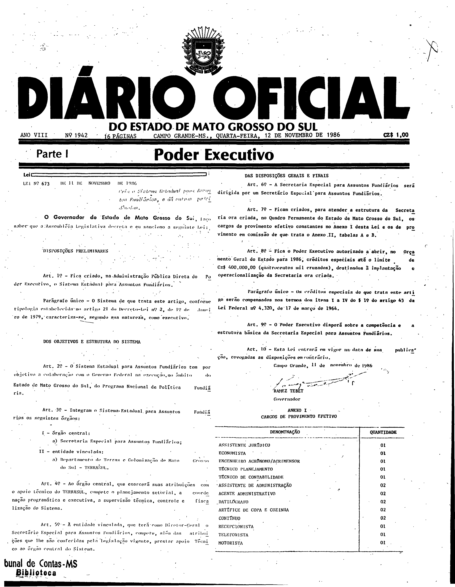
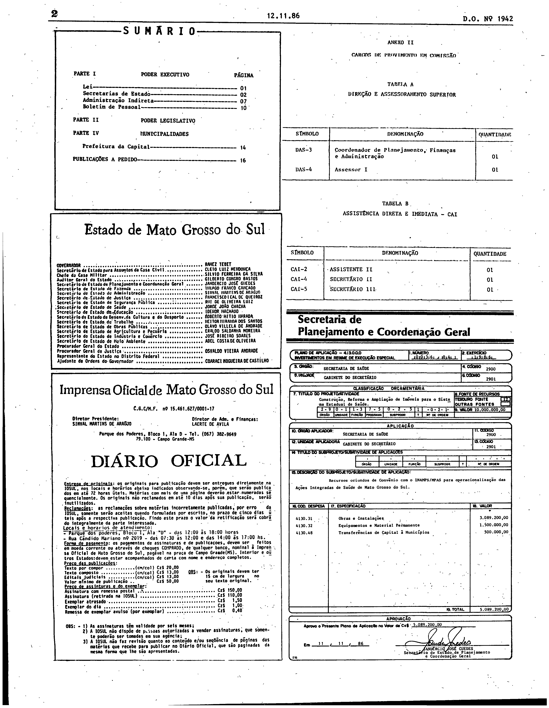

# LEI Nº 673, DE 11 DE NOVEMBRO DE 1986.

ESTADO DE MATO GROSSO DO SUL

LEI Nº 673, DE 11 DE NOVEMBRO DE 1986.

Cria o Sistema Estadual para Assuntos Fundiários, e da outras providências.

Publicada no Diário Oficial nº 1.942, de 12 de novembro de 1986, página 1.

O Governador do Estado de Mato Grosso do Sul, faço saber que a<br>
Assembléia Legislativa decreta e eu sanciono a seguinte Lei:<br>
<br>
DISPOSIÇOES PRELIMINARES<br>
<br>
Art. 1º - Fica criado, na Administração Pública Direta do Poder<br>
Executivo, o Sistema Estadual para Assuntos Fundiários.<br>
<br>
Parágrafo único - O Sistema de que trata este artigo, conforme<br>
tipologia estabelecida no artigo 21 do Decreto-Lei nº 2, de 1º de<br>
Janeiro de 1979, caracteriza-se, segundo sua natureza, como<br>
executivo.<br>
<br>
DOS OBJETIVOS E ESTRUTURA DO SISTEMA<br>
<br>
Art. 2º - O Sistema Estadual para Assuntos Fundiários tem por<br>
objetivo a colaboração com o Governo Federal na execução, no âmbito<br>
do Estado de Mato Grosso do Sul, do Programa Nacional de Política<br>
Fundiária.<br>
<br>
Art. 3º - Integram o Sistema Estadual para Assuntos Fundiários os<br>
seguintes órgãos:<br>
<br>
I- órgão central:<br>
<br>
a) Secretaria Especial para Assuntos Fundiários;<br>
<br>
II - entidade vinculada:<br>
<br>
a) Departamento de Terras e Colonização de Mato Grosso do Sul -<br>
TERRASUL.<br>
<br>
Art. 4º - Ao órgão central, que exercerá suas atribuições com o<br>
apoio técnico do TERRASUL, compete o planejamento setorial, a<br>
coordenação programática e executiva, a supervisão técnica,<br>
controle e fiscalização do Sistema.<br>
<br>
Art. 5º - A entidade vinculada, que terá como Diretor-Geral o<br>
Secretário Especial para Assuntos Fundiários, compete, além das<br>
atribuições que lhe são conferidas pela legislação vigente, prestar<br>
apoio Técnico ao órgão central do Sistema.<br>
<br>
DAS DISPOSIÇOES GERAIS E FINAIS<br>
<br>
Art. 6º - A Secretaria Especial para Assuntos Fundiários será<br>
dirigida por um Secretário Especial para Assuntos Fundiários.<br>
<br>
Art. 7º - Ficam criados, para atender a estrutura da Secretaria ora<br>
criada, no Quadro Permanente do Estado de Mato Grosso do Sul, os<br>
cargos de provimento efetivo constantes no Anexo I desta Lei e os<br>
de provimento em comissão de que trata o Anexo II, tabelas A e B.<br>
<br>
Art. 8º - Fica o Poder Executivo autorizado a abrir, no Orçamento<br>
Geral do Estado para 1986, créditos especiais até o limite de Cz$<br>
400.000,00 (quatrocentos mil cruzados), destinados a implantação<br>
e operacionalização da Secretaria ora criada.<br>
<br>
Parágrafo único - Os créditos especiais de que trata este artigo<br>
serão compensados nos termos dos itens I a IV do 1º do artigo 43<br>
da Lei Federal nº 4.320, de 17 de março de 1964.<br>
<br>
Art. 9º - O Poder Executivo disporá sobre a competência e a<br>
estrutura básica da Secretaria Especial para Assuntos Fundiários.<br>
<br>
Art. 10 - Esta Lei entrará em vigor na data de sua publicação,<br>
revogadas as disposições em contrário.<br>
<br>
Campo Grande, 11 de novembro de 1986.<br>
<br>
RAMEZ TEBET<br>
Governador<br>
CARGOS DE PROVIMENTO EFETIVO<br>
<br>
\----------------------------------------------<br>
DENOMINAÇAO QUANTIDADE<br>
\----------------------------------------------<br>
ASSISTENTE JURIDICO 01<br>
<br>
ECONOMISTA 01<br>
<br>
ENGENHEIRO AGRONOMO/AGRIMENSOR 01<br>
<br>
TECNICO PLANEJAMENTO 01<br>
<br>
TECNICO DE CONTABILIDADE 01<br>
<br>
ASSISTENTE DE ADMINISTRAÇAO 02<br>
<br>
AGENTE ADMINISTRATIVO 02<br>
<br>
DATILOGRAFO 02<br>
<br>
ARTIFICE DE COPA E COZINHA 02<br>
<br>
CONTINUO 02<br>
<br>
RECEPCIONISTA 01<br>
<br>
TELEFONISTA 01<br>
<br>
MOTORISTA 01<br>
\----------------------------------------------<br>
<br>

```
ANEXO II                                                             
                                                                    
CARGOS DE PROVIMENTO EM COMISSAO                                     
                                                                     
TABELA A                                                             
                                                                     
DIREÇAO E ASSESSORAMENTO SUPERIOR                                    
                                                                     
-------------------------------------------------------------------  
 SIMBOLO                   DENOMINAÇAO                 QUANTIDADE    
-------------------------------------------------------------------  
 DAS-3        Coordenador de Planejamento, Finanças                  
              e Administração                               01       
                                                                     
 DAS-4        Assessor I                                    01       
-------------------------------------------------------------------  
                                                                     
TABELA B                                                             
                                                                     
ASSISTENCIA DIRETA E IMEDIATA - CAI                                  
                                                                     
----------------------------------------------------------------     
SIMBOLO                DENOMINAÇAO               QUANTIDADE          
----------------------------------------------------------------     
CAI-2                  ASSISTENTE II                 01              
                                                                     
CAI-4                  SECRETARIO II                 01              
                                                                     
CAI-5                  SECRETARIO III                01              
----------------------------------------------------------------     
```

## Conferência com o Diário Oficial (fac-símile)

O texto acima reproduz a lei e seus anexos tal como disponibilizados pela Consultoria Legislativa. Para conferência, as páginas do Diário Oficial em que a lei e seus anexos foram publicados são reproduzidas em fac-símile.

**Como ler esta seção.** O texto acima é o disponibilizado pela Consultoria Legislativa e não foi alterado. As imagens abaixo são reproduções fac-similares, sem alteração, das páginas digitalizadas do Diário Oficial em que a lei foi publicada; servem apenas de conferência. Não são transcrição nem texto pesquisável, e nada foi reconstruído a partir delas. Para conferir uma imagem, compare seu SHA-256 com o registrado abaixo.

**Fonte:** Diário Oficial do Estado de Mato Grosso do Sul nº 1.942, de 12 de novembro de 1986, páginas 1 e 2, exemplar digitalizado do Tribunal de Contas do Estado de Mato Grosso do Sul — <https://portal-services.tce.ms.gov.br/portal-services/diario-oficiais/download?id=17429> (HTTP 200, 2.813.632 bytes, PDF completo).

**Arquivo oficial de origem:** PDF integral da edição, SHA-256 `495670f8808acd143f54b9c16fa85e22b44adffe7f25d0b8a2935e6ced32ecba`; páginas do PDF e páginas impressas coincidem.

**Limites das peças:**

- **Lei nº 673:** página 1, em duas colunas, terminando com a assinatura do Governador.
- **Anexo I** (“Cargos de provimento efetivo”): imediatamente abaixo da assinatura, no pé da coluna direita da página 1; na imagem o rótulo “ANEXO I” está impresso. O texto acima traz o quadro sem a linha de título “Anexo I”; o texto não foi alterado.
- **Anexo II** (“Cargos de provimento em comissão”, Tabelas A e B): coluna direita da página 2, a partir do topo.
- A página 2 inclui também o sumário, o expediente e um plano de aplicação da Secretaria de Planejamento; esses elementos não fazem parte desta lei.

**Páginas reproduzidas:**

- Página 1 (lei e Anexo I) — `doe1942-p01.png` (3216×4145 px, 300 ppi, SHA-256 `0a4f39f61dd56efe82c803a87fd5bf68a9fff5cbf5f8bc3fcfbec50bb89dfd4b`)
- Página 2 (Anexo II, Tabelas A e B) — `doe1942-p02.png` (3216×4142 px, 300 ppi, SHA-256 `1d637dd38bb4fef263fca93a2a387ee81fe53ad4811409d7175fb2e87e88cddc`)




