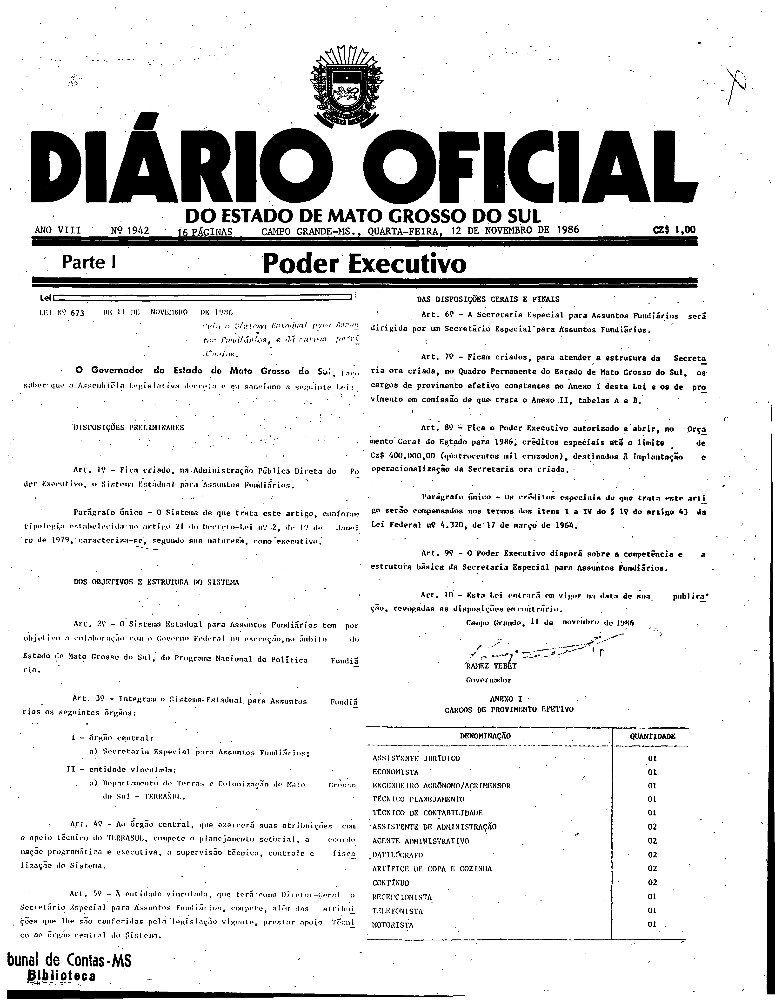
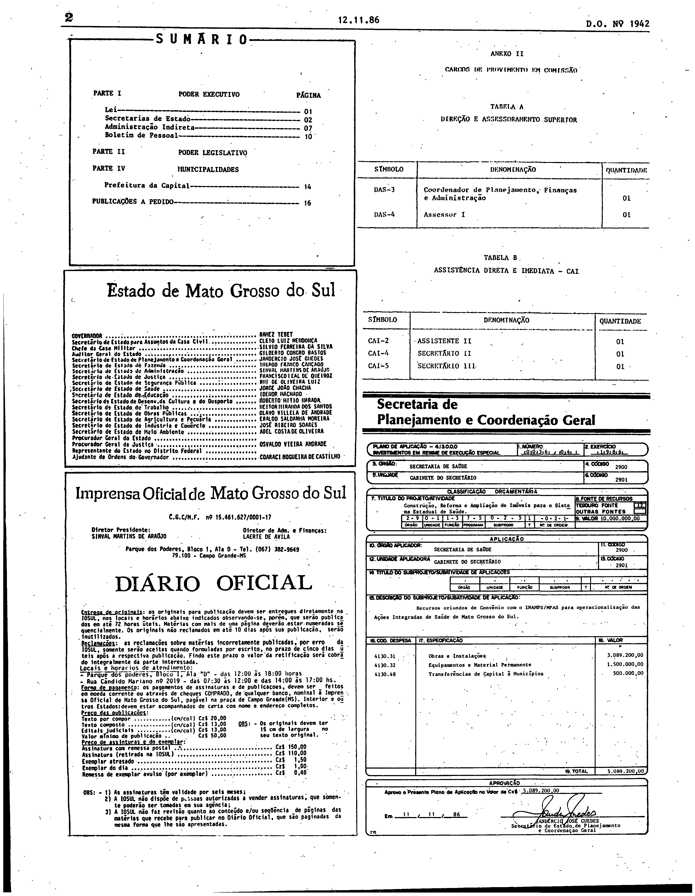

# LEI Nº 673, DE 11 DE NOVEMBRO DE 1986.

ESTADO DE MATO GROSSO DO SUL

LEI Nº 673, DE 11 DE NOVEMBRO DE 1986.

Cria o Sistema Estadual para Assuntos Fundiários, e da outras providências.

Publicada no Diário Oficial nº 1.942, de 12 de novembro de 1986, página 1.

O Governador do Estado de Mato Grosso do Sul, faço saber que a

Assembléia Legislativa decreta e eu sanciono a seguinte Lei:

DISPOSIÇOES PRELIMINARES

Art. 1º - Fica criado, na Administração Pública Direta do Poder

Executivo, o Sistema Estadual para Assuntos Fundiários.

Parágrafo único - O Sistema de que trata este artigo, conforme

tipologia estabelecida no artigo 21 do Decreto-Lei nº 2, de 1º de

Janeiro de 1979, caracteriza-se, segundo sua natureza, como

executivo.

DOS OBJETIVOS E ESTRUTURA DO SISTEMA

Art. 2º - O Sistema Estadual para Assuntos Fundiários tem por

objetivo a colaboração com o Governo Federal na execução, no âmbito

do Estado de Mato Grosso do Sul, do Programa Nacional de Política

Fundiária.

Art. 3º - Integram o Sistema Estadual para Assuntos Fundiários os

seguintes órgãos:

I- órgão central:

a) Secretaria Especial para Assuntos Fundiários;

II - entidade vinculada:

a) Departamento de Terras e Colonização de Mato Grosso do Sul -

TERRASUL.

Art. 4º - Ao órgão central, que exercerá suas atribuições com o

apoio técnico do TERRASUL, compete o planejamento setorial, a

coordenação programática e executiva, a supervisão técnica,

controle e fiscalização do Sistema.

Art. 5º - A entidade vinculada, que terá como Diretor-Geral o

Secretário Especial para Assuntos Fundiários, compete, além das

atribuições que lhe são conferidas pela legislação vigente, prestar

apoio Técnico ao órgão central do Sistema.

DAS DISPOSIÇOES GERAIS E FINAIS

Art. 6º - A Secretaria Especial para Assuntos Fundiários será

dirigida por um Secretário Especial para Assuntos Fundiários.

Art. 7º - Ficam criados, para atender a estrutura da Secretaria ora

criada, no Quadro Permanente do Estado de Mato Grosso do Sul, os

cargos de provimento efetivo constantes no Anexo I desta Lei e os

de provimento em comissão de que trata o Anexo II, tabelas A e B.

Art. 8º - Fica o Poder Executivo autorizado a abrir, no Orçamento

Geral do Estado para 1986, créditos especiais até o limite de Cz$

400.000,00 (quatrocentos mil cruzados), destinados a implantação

e operacionalização da Secretaria ora criada.

Parágrafo único - Os créditos especiais de que trata este artigo

serão compensados nos termos dos itens I a IV do 1º do artigo 43

da Lei Federal nº 4.320, de 17 de março de 1964.

Art. 9º - O Poder Executivo disporá sobre a competência e a

estrutura básica da Secretaria Especial para Assuntos Fundiários.

Art. 10 - Esta Lei entrará em vigor na data de sua publicação,

revogadas as disposições em contrário.

Campo Grande, 11 de novembro de 1986.

RAMEZ TEBET

Governador

CARGOS DE PROVIMENTO EFETIVO

\----------------------------------------------

DENOMINAÇAO QUANTIDADE

\----------------------------------------------

ASSISTENTE JURIDICO 01

ECONOMISTA 01

ENGENHEIRO AGRONOMO/AGRIMENSOR 01

TECNICO PLANEJAMENTO 01

TECNICO DE CONTABILIDADE 01

ASSISTENTE DE ADMINISTRAÇAO 02

AGENTE ADMINISTRATIVO 02

DATILOGRAFO 02

ARTIFICE DE COPA E COZINHA 02

CONTINUO 02

RECEPCIONISTA 01

TELEFONISTA 01

MOTORISTA 01

\----------------------------------------------

```
ANEXO II

CARGOS DE PROVIMENTO EM COMISSAO

TABELA A

DIREÇAO E ASSESSORAMENTO SUPERIOR

-------------------------------------------------------------------
 SIMBOLO                   DENOMINAÇAO                 QUANTIDADE
-------------------------------------------------------------------
 DAS-3        Coordenador de Planejamento, Finanças
              e Administração                               01

 DAS-4        Assessor I                                    01
-------------------------------------------------------------------

TABELA B

ASSISTENCIA DIRETA E IMEDIATA - CAI

----------------------------------------------------------------
SIMBOLO                DENOMINAÇAO               QUANTIDADE
----------------------------------------------------------------
CAI-2                  ASSISTENTE II                 01

CAI-4                  SECRETARIO II                 01

CAI-5                  SECRETARIO III                01
----------------------------------------------------------------
```

**Conferência da versão do texto.** O texto acima (Consultoria Legislativa) não traz marcas de compilação posterior (sem trechos riscados, redação nova em itálico ou notas de alteração). Os rótulos e a sequência dos anexos (Anexo I sem linha de título no texto; Anexo II, Tabelas A e B) coincidem com os impressos; o conteúdo dos artigos foi comparado apenas por OCR (cobertura lexical de cerca de 0,78), sem leitura integral. Em caso de diferença entre o texto acima e as imagens, valem as imagens. Não foi feita conferência célula a célula dos anexos nem transcrição das imagens.

## Conferência com o Diário Oficial (fac-símile)

O texto acima reproduz a lei e seus anexos tal como disponibilizados pela Consultoria Legislativa. Para conferência, as páginas do Diário Oficial em que a lei e seus anexos foram publicados são reproduzidas em fac-símile.

**Como ler esta seção.** O texto acima é o disponibilizado pela Consultoria Legislativa e não foi alterado. As imagens abaixo são reproduções fac-similares, sem alteração, das páginas digitalizadas do Diário Oficial em que a lei foi publicada; servem apenas de conferência. Não são transcrição nem texto pesquisável, e nada foi reconstruído a partir delas. Para conferir uma imagem, compare seu SHA-256 com o registrado abaixo.

**Fonte:** Diário Oficial do Estado de Mato Grosso do Sul nº 1.942, de 12 de novembro de 1986, páginas 1 e 2, exemplar digitalizado do Tribunal de Contas do Estado de Mato Grosso do Sul — <https://portal-services.tce.ms.gov.br/portal-services/diario-oficiais/download?id=17429> (HTTP 200, 2.813.632 bytes, PDF completo).

**Arquivo oficial de origem:** PDF integral da edição, SHA-256 `495670f8808acd143f54b9c16fa85e22b44adffe7f25d0b8a2935e6ced32ecba`; páginas do PDF e páginas impressas coincidem.

**Limites das peças:**

- **Lei nº 673:** página 1, em duas colunas, terminando com a assinatura do Governador.
- **Anexo I** (“Cargos de provimento efetivo”): imediatamente abaixo da assinatura, no pé da coluna direita da página 1; na imagem o rótulo “ANEXO I” está impresso. O texto acima traz o quadro sem a linha de título “Anexo I”; o texto não foi alterado.
- **Anexo II** (“Cargos de provimento em comissão”, Tabelas A e B): coluna direita da página 2, a partir do topo.
- A página 2 inclui também o sumário, o expediente e um plano de aplicação da Secretaria de Planejamento; esses elementos não fazem parte desta lei.

**Páginas reproduzidas:**

- Página 1 (lei e Anexo I) — `doe1942-p01.png` (3216×4145 px, 300 ppi, SHA-256 `0a4f39f61dd56efe82c803a87fd5bf68a9fff5cbf5f8bc3fcfbec50bb89dfd4b`)
- Página 2 (Anexo II, Tabelas A e B) — `doe1942-p02.png` (3216×4142 px, 300 ppi, SHA-256 `1d637dd38bb4fef263fca93a2a387ee81fe53ad4811409d7175fb2e87e88cddc`)




