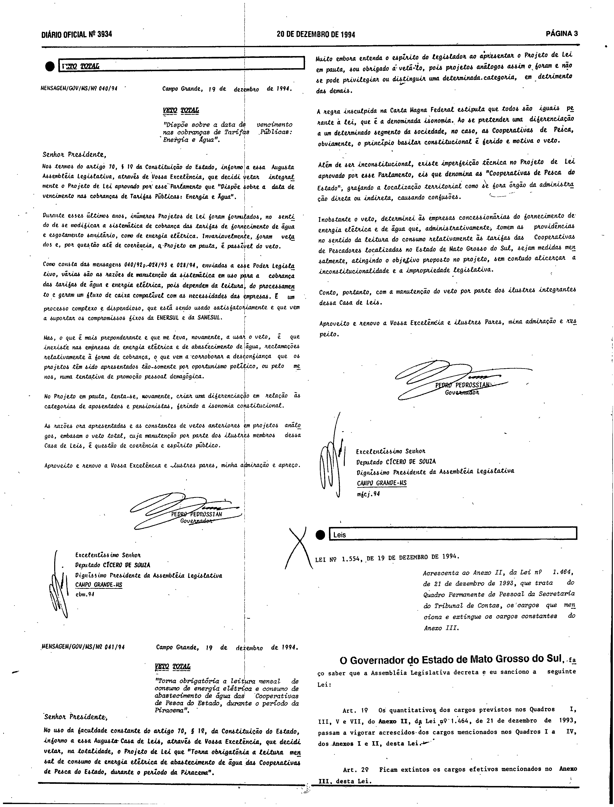
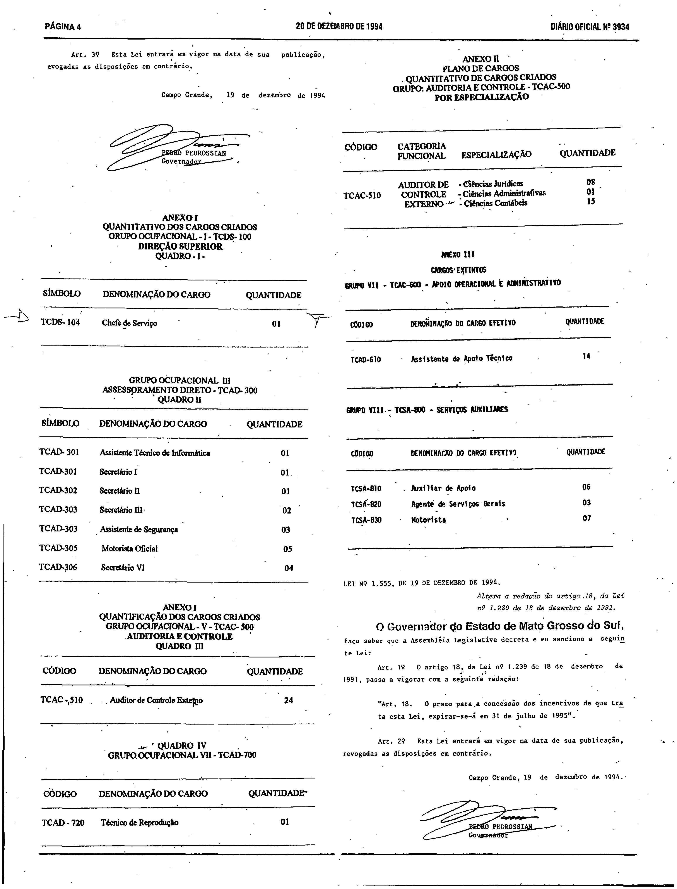

# LEI Nº 1.554, DE 19 DE DEZEMBRO DE 1994.

ESTADO DE MATO GROSSO DO SUL

LEI Nº 1.554, DE 19 DE DEZEMBRO DE 1994.

Acrescenta ao Anexo II, da Lei nº 1.464, de 21 de dezembro de 1993, que trata do Quadro Permanente de Pessoal da Secretaria do Tribunal de Contas, os cargos que menciona e extingue os cargos constantes do Anexo III.

Publicada no Diário Oficial nº 3.934, de 20 de dezembro de 1.994, página 3 e 4.

**O Governador do Estado de Mato Grosso do Sul**, faço saber que a Assembléia Legislativa decreta e eu sanciono a seguinte Lei: 
 
Art. 1º Os quantitativos dos cargos previstos nos Quadros I, III, V e VII, do Anexo II, da [Lei nº 1.464, de 21 de dezembro de 1993](https://aacpdappls.net.ms.gov.br/appls/legislacao/secoge/govato.nsf/448b683bce4ca84704256c0b00651e9d/18b9463deb5d82da04256e450002ecc6?OpenDocument), passam a vigorar acrescidos dos cargos mencionados nos Quadros I a IV, dos Anexos I e II, desta Lei. 
 
Art. 2º Ficam extintos os cargos efetivos mencionados no Anexo III, desta Lei. 
 
Art. 3º Esta Lei entrará em vigor na data de sua publicação revogadas as disposições em contrário. 
 
Campo Grande, 19 de dezembro de 1994. 
 
PEDRO PEDROSSIAN 
Governador 

<pre>       <b>ANEXO I                                                         </b>
<b>   QUANTITATIVO DOS CARGOS CRIADOS                                     </b>
<b>   GRUPO OCUPACIONAL - 1 - TCDS- 100                                   </b>
<b>   DIREÇÃO SUPERIOR                                                    </b>
<b>   QUADRO - 1 </b>-                                                                                                                             
 ------------------------------------------------------------------  
 SÍMBOLO        DENOMINAÇÃO DO CARGO              QUANTIDADE          
 ------------------------------------------------------------------  
 TCDS - 104     Chefe de Serviço                      01              
 ------------------------------------------------------------------  
                                                                        <b>GRUPO OCUPACIONAL III                                               </b>
<b>   ASSESSORAMENTO DIRETO - TCAD- 300                                   </b>
<b>   QUADRO II </b>                                                                                                                               
 ------------------------------------------------------------------  
 SÍMBOLO      DENOMINAÇÃO DO CARGO                  QUANTIDADE       
 ------------------------------------------------------------------  
 TCAD- 301     Assistente Técnico de Informática         01          
                                                                     
 TCAD-301      Secretário                                01          
                                                                     
 TCAD-302      Secretário II                             01          
                                                                     
 TCAD-303      Secretário III                            02          
                                                                     
 TCAD-303      Assistente de Segurança                   03          
                                                                     
 TCAD-305      Motorista Oficial                         05          
                                                                     
 TCAD-306      Secretário VI                             04          
 ------------------------------------------------------------------  </pre>

<pre>                                                                       <b> ANEXO I                                                             </b>
<b>   QUANTIFICAÇÃO DOS CARGOS CRIADOS                                    </b>
<b>   GRUPO OCUPACIONAL - V - TCAC 500                                    </b>
<b>   AUDITORIA E CONTROLE                                                </b>
<b>   QUADRO III                                                          </b>
                                                                      ------------------------------------------------------------------  
 CÓDIGO         DENOMINAÇÃO DO CARGO                  QUANTIDADE     
 ------------------------------------------------------------------  
 TCAC - 510      Auditor de Controle Externo               24        
 ------------------------------------------------------------------  
                                                                     
                                                                     
<b>                              QUADRO IV                                                           </b>
<b>                   GRUPO OCUPACIONAL VII - TCAD-700  </b>                                  
                                                                     
 ------------------------------------------------------------------  
 CÓDIGO         DENOMINAÇÃO DO CARGO                  QUANTIDADE     
 ------------------------------------------------------------------  
 TCAD - 720     Técnico de Reprodução                      01        
 ------------------------------------------------------------------  </pre>

<pre>                                                                        <b>ANEXO II                                                            </b>
<b>   PLANO DE CARGOS                                                     </b>
<b>   QUANTITATIVO DE CARGOS CRIADOS                                      </b>
<b>   GRUPO: AUDITORIA E CONTROLE - TCAC-500                              </b>
<b>   POR ESPECIALIZAÇÃO                </b>                                                                                                       
 ------------------------------------------------------------------  
 CÓDIGO        CATEGORIA                                             
               FUNCIONAL      ESPECIALIZAÇÃO         QUANTIDADE      
 ------------------------------------------------------------------  
               AUDITOR DE    - Ciências Jurídicas         08         
 TCAC-510      CONTROLE      - Ciências Administrativas   01         
               EXTERNO       - Ciências Contábeis         15         
 ------------------------------------------------------------------  </pre>

<pre>                                                                      <b>  ANEXO III                                                           </b>
<b>   CARGOS EXTINTOS                                                                                                                   </b>
<b>   GRUPO VII - TCAC-600 - APOIO OFERACIONAL E ADMINISTRATIVO     </b>                                                                          
 ------------------------------------------------------------------  
 CÓDIGO         DENOMINAÇÃO DO CARGO EFETIVO          QUANTIDADE     
 ------------------------------------------------------------------  
 TCAD-610       Assistente de Apoio Técnico               14         
 ------------------------------------------------------------------  
                                                                     
                                                                     
 <b>          GRUPO VIII - TCSA-800 - SERVIÇOS AUXILIARES  </b>                       
                                                                     
 ------------------------------------------------------------------  
 CÓDIGO         DENOMINAÇÃO DO CARGO EFETIVO          QUANTIDADE     
 ------------------------------------------------------------------  
 TCSA-810       Auxiliar de Apoio                         06         
                                                                     
 TCSA-820       Agente de Serviços Gerais                 03         
                                                                     
 TCSA-830       Motorista                                 07         
 ------------------------------------------------------------------  </pre>

**Conferência da versão do texto.** O texto acima (Consultoria Legislativa) não traz marcas de compilação posterior (sem trechos riscados, redação nova em itálico ou notas de alteração). Os rótulos e a sequência dos anexos, inclusive o segundo “ANEXO I” impresso no original, coincidem com os impressos; o conteúdo dos artigos foi comparado apenas por OCR (cobertura lexical de cerca de 0,91), sem leitura integral. Em caso de diferença entre o texto acima e as imagens, valem as imagens. Não foi feita conferência célula a célula dos anexos nem transcrição das imagens.

## Conferência com o Diário Oficial (fac-símile)

O texto acima reproduz a lei e seus anexos tal como disponibilizados pela Consultoria Legislativa. Para conferência, as páginas do Diário Oficial em que a lei e seus anexos foram publicados são reproduzidas em fac-símile.

**Como ler esta seção.** O texto acima é o disponibilizado pela Consultoria Legislativa e não foi alterado. As imagens abaixo são reproduções fac-similares, sem alteração, das páginas digitalizadas do Diário Oficial em que a lei foi publicada; servem apenas de conferência. Não são transcrição nem texto pesquisável, e nada foi reconstruído a partir delas. Para conferir uma imagem, compare seu SHA-256 com o registrado abaixo.

**Fonte:** Diário Oficial do Estado de Mato Grosso do Sul nº 3.934, de 20 de dezembro de 1994, páginas 3 e 4, exemplar digitalizado do Tribunal de Contas do Estado de Mato Grosso do Sul — <https://portal-services.tce.ms.gov.br/portal-services/diario-oficiais/download?id=19523> (HTTP 200, 6.484.992 bytes, PDF completo).

**Arquivo oficial de origem:** PDF integral da edição, SHA-256 `fb1807ebcf6ca74cc63ee8104deb2f7423c0adeae6e4ad621bf597b4e5786468`; páginas do PDF e páginas impressas coincidem.

**Limites das peças:**

- **Lei nº 1.554:** da coluna direita da página 3 (título, ementa, arts. 1º e 2º) ao topo da página 4 (art. 3º, data e assinatura).
- **Anexo I – Quadro I** (Grupo Ocupacional I, Direção Superior) e **Quadro II** (Grupo Ocupacional III, Assessoramento Direto): coluna esquerda da página 4.
- Em seguida, na mesma coluna, o Diário Oficial imprime novamente o rótulo “ANEXO I” sobre o **Quadro III** (Grupo Ocupacional V, Auditoria e Controle) e o **Quadro IV** (Grupo Ocupacional VII). Esse segundo rótulo “Anexo I” é impresso assim no original e foi preservado, sem renumeração, no texto acima.
- **Anexo II** (“Plano de cargos – quantitativo de cargos criados”, Auditor de Controle Externo por especialização) e **Anexo III** (“Cargos extintos”): coluna direita da página 4.
- A página 3 contém também mensagens de veto e a página 4 a Lei nº 1.555, de 19/12/1994; esses atos não fazem parte desta lei.

**Páginas reproduzidas:**

- Página 3 (lei, arts. 1º e 2º) — `doe3934-p03.png` (3104×4072 px, 300 ppi, SHA-256 `f2776c660d341850f0090e62c3b9f9a6558e16cde9d9622d3923dd3d1aa477a9`)
- Página 4 (art. 3º, assinatura e anexos) — `doe3934-p04.png` (3104×4070 px, 300 ppi, SHA-256 `2023d1b4e6573399f1e057777a4430ad63f2fe4e59be2f9be8cc21e9f4589abb`)

