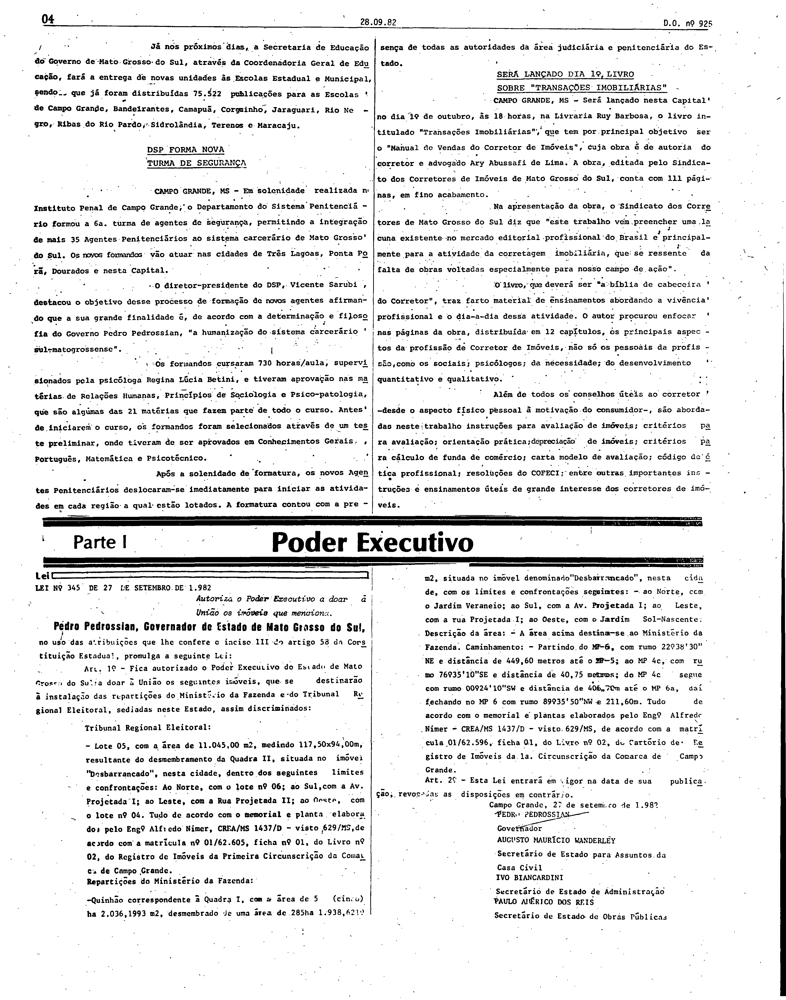

# LEI Nº 345, DE 27 DE SETEMBRO DE 1982.

ESTADO DE MATO GROSSO DO SUL

LEI Nº 345, DE 27 DE SETEMBRO DE 1982.

Autoriza o Poder Executivo a doar a União os imóveis que menciona.

Publicada no Diário Oficial nº 925, de 28 de setembro de 1982, página 4.

Pedro Pedrossian, Governador do Estado de Mato Grosso do Sul, faço 
saber que a Assembléia Legislativa decreta e eu sanciono a seguinte 
Lei: 
 
Art. 1º - Fica autorizado o Poder Executivo do Estado de Mato 
Grosso do Sul a doar a União os seguintes imóveis, que se 
destinarão a instalação das repartições do Ministério da Fazenda e 
do Tribunal Regional Eleitoral, sediadas neste Estado, assim 
discriminadados: 
 
Tribunal Regional Eleitoral: 
 
\- Lote 05, com área de 11.045,00 m2, medindo 117,50x94,00m, 
resultante do desmembramento da Quadra II, situada no imóvel 
desbarrancado, nesta cidade, dentro dos seguintes limites e 
confrontações: ao Norte, com o Lote 06; ao Sul, com a Av. Projetada 
I; ao Leste, com a Rua Projetada II, ao Oeste, com o lote 04. Tudo 
de acordo com o memorial e planta elaborados pelo Eng. Alfredo 
Nimer, CREA/MS 1437/D - visto 629/MS, de acordo com a matricula nº 
01/62.605, ficha nº 01, do livro nº 02, do Registro de Imóveis da 
Primeira Circunscrição da Comarca de Campo Grande. 
 
Repartições do Ministério da Fazenda: 
 
\- Quinhão correspondente a Quadra I, com a área de 5 (cinco) ha 
2.036, 1993 m2, desmembrado de uma área de 285ha 1.938, 6219 m2, 
situada no imóvel denominado Desbarrancado, nesta cidade, com os 
limites e confrontações seguintes: - ao Norte, com o Jardim 
Veraneio; ao Sul, com a Av. Projetada I; ao Leste, com a rua 
Projetada I; ao Oeste, com o Jardim Sol-Nascente. Descrição da 
área: - A área acima destina-se ao Ministério da Fazenda. 
Caminhamento: - Partindo do MP-6, com rumo 22º3830 NE e distância 
de 449,60 metros até o Até; ao MP 4c, com rumo 76º 3510SE e 
distância de 40,75 metros; do MP 4c segue com rumo 00o 2410SW e 
distância de 406,70m até o MP 6ª, dai fechando no 11P 6 com rumo 
89º 3550NW e 211,60m. Tudo de acordo com o memorial e plantas 
elaborados pelo Eng.s. Alfredo Nimer - CREA/MS 1437/D - visto 
629/MS, de acordo com a matricula 01/62.596, ficha 01, do Livro nº 
02, do Cartório de Registro de Imóveis da 1ª Circunscrição da 
Comarca de Campo Grande. 
 
Art. 2º - Esta Lei entrará em vigor na data de sua publicação, 
revogadas as disposições em contrário. 
 
Campo Grande, 27 de setembro de 1.982. 
 
PEDRO PEDROSSIAN 
Governador 
 
AUGUSTO MAURÍCIO WANDERLEY 
Secretário de Estado para Assuntos da Casa Civil 
 
IVO BIANCARDINI 
Secretário de Estado de Administração 
 
PAULO AMÉRICO DOS REIS 
Secretário de Estado de Obras Públicas.

**Conferência da versão do texto.** O texto acima (Consultoria Legislativa) foi comparado, em leitura visual, com a página 4 do Diário Oficial quanto à estrutura, aos lotes, às áreas e às confrontações e coincide no conteúdo; não há marcas de compilação posterior. Em caso de diferença entre o texto acima e as imagens, valem as imagens. Não foi feita conferência célula a célula dos anexos nem transcrição das imagens.

## Publicação no Diário Oficial (fac-símile)

**Como ler esta seção.** As imagens abaixo reproduzem, sem alteração, as páginas digitalizadas do Diário Oficial; não são transcrição nem texto pesquisável, e nenhuma célula, número ou desenho foi reconstruído ou corrigido. Para conferir uma imagem, compare seu SHA-256 com o registrado abaixo.

**Fonte:** Diário Oficial do Estado de Mato Grosso do Sul nº 925, de 28 de setembro de 1982, página 4, exemplar digitalizado do Tribunal de Contas do Estado de Mato Grosso do Sul — <https://portal-services.tce.ms.gov.br/portal-services/diario-oficiais/download?id=16399> (HTTP 200, 5.053.648 bytes, PDF completo).

**Arquivo oficial de origem:** PDF integral da edição, SHA-256 `724969f06891fa029343e99edbfc32c8b38cb98bf7fed6decb79e43021402d69`; páginas do PDF e páginas impressas coincidem.

**Limites das peças:**

- **Lei nº 345:** metade inferior da página 4, do título à assinatura do Governador e dos secretários (arts. 1º e 2º); a lei é publicada por inteiro nessa página, em duas colunas.
- O art. 1º descreve os imóveis (lote 05 do Tribunal Regional Eleitoral e o quinhão da Quadra I do Ministério da Fazenda, com limites, confrontações e caminhamento) e acrescenta “tudo de acordo com o memorial e plantas elaborados pelo Eng. Alfredo Nimer”. A lei não declara esses documentos como anexos dela, e nenhum memorial ou planta aparece na página 4 nem em outra página da edição (a varredura do texto OCR das 32 páginas e a leitura visual da página 4 em 100 ppi não os encontraram; as ocorrências da palavra “memorial” nas páginas 24 e 25 pertencem a processo judicial alheio). Trata-se de documentos técnicos referidos pela lei, não de peças publicadas com ela.
- A metade superior da página 4 contém matérias jornalísticas da edição; elas não fazem parte desta lei.

**Páginas reproduzidas:**

- Página 4 (Lei nº 345, arts. 1º e 2º) — `doe925-p04.png` (3248×4129 px, 300 ppi, SHA-256 `1d5024c11ae690668d42075d4ffc61e124ef19707f1a03c6e8c943a39f922699`)

**Observações:**

- Não se afirma que o memorial e as plantas não existam fora do Diário Oficial; afirma-se apenas que não foram publicados nesta edição nem integram o texto da lei.
