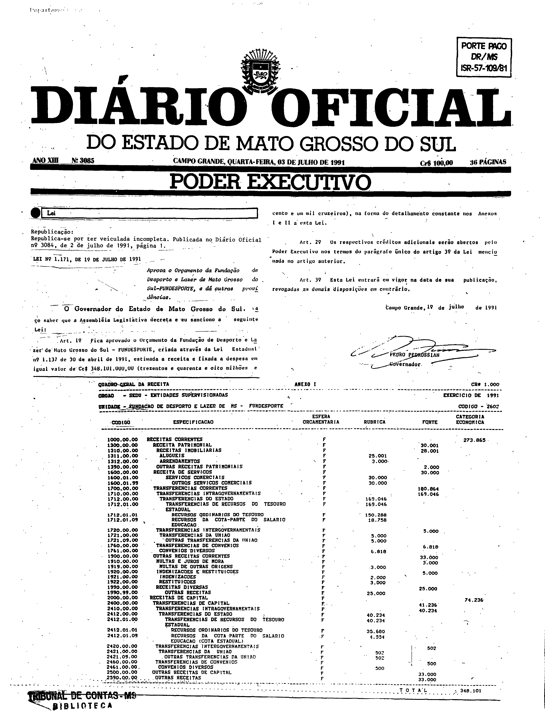
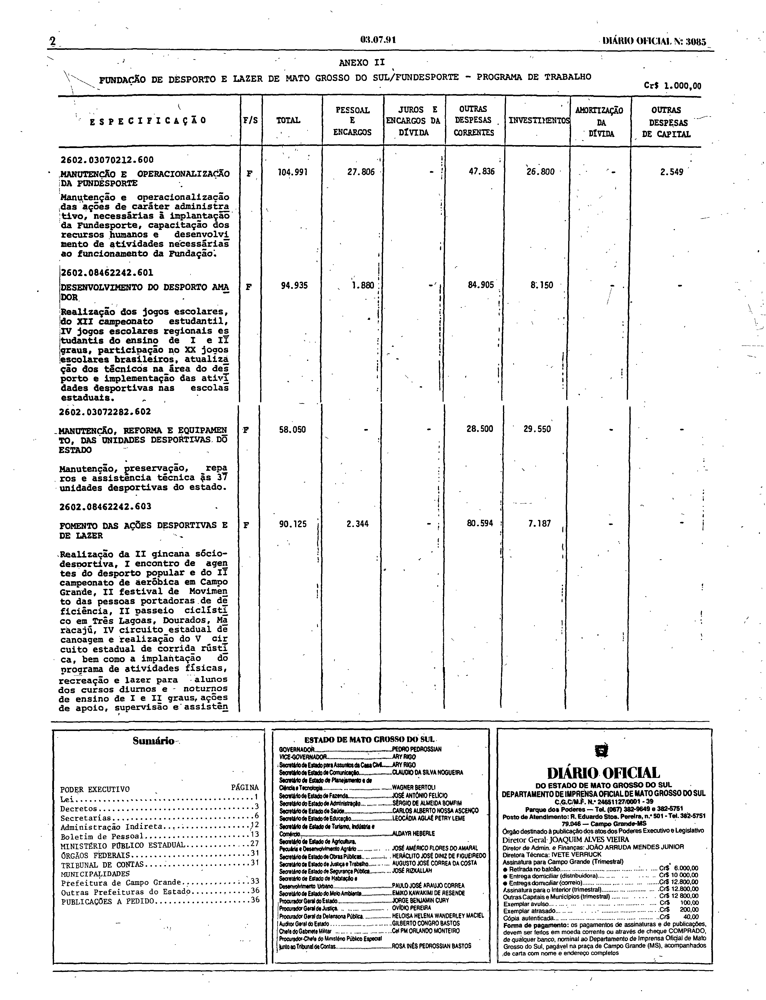
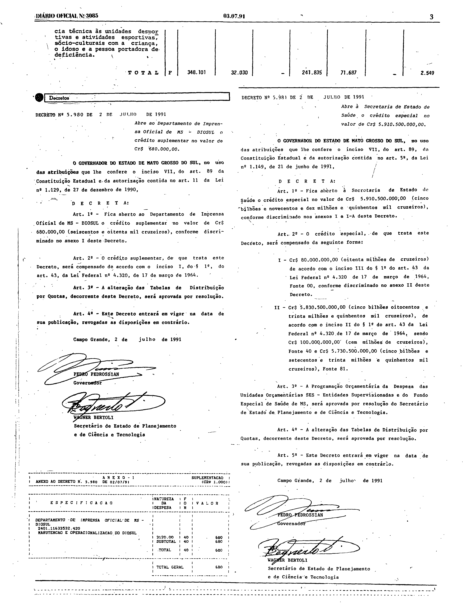

# LEI Nº 1.171, DE 1 DE JULHO DE 1991.

ESTADO DE MATO GROSSO DO SUL

LEI Nº 1.171, DE 1 DE JULHO DE 1991.

Aprova o Orçamento da Fundação de Desporto e Lazer de Mato Grosso do Sul - FUNDESPORTE, e dá outras providências.

Publicada no Diário Oficial nº 3.084, de 2 de julho de 1991.

**O Governador do Estado de Mato Grosso do Sul**, faço saber que a Assembléia Legislativa decreta e eu sanciono a seguinte Lei: 
 
Art. 1º Fica aprovado o Orçamento da Fundação de Desporto e Lazer de Mato Grosso do Sul - FUNDESPORTE, criada através da [Lei Estadual nº 1.137 de 30 de abril de 1991](https://aacpdappls.net.ms.gov.br/appls/legislacao/secoge/govato.nsf/448b683bce4ca84704256c0b00651e9d/cff25f84a67077b404256e450002eb9b?OpenDocument), estimada a receita e fixada a despesa em igual valor de Cr$ 348.101.000,00 (trezentos e quarenta e oito milhões e cento e um mil cruzeiros), na forma do detalhamento constante nos Anexos I e II a esta Lei. 
 
Art. 2º Os respectivos créditos adicionais serão abertos pelo Poder Executivo nos termos do parágrafo único do artigo 3º da Lei mencionada no artigo anterior. 
 
Art. 3º Esta Lei entrará em vigor na data de sua publicação, revogadas as demais disposições em contrário. 
 
Campo Grande, 1º de julho de 1991. 
 
PEDRO PEDROSSIAN 
Governador

## Anexos em fac-símile do Diário Oficial

A lei foi veiculada no Diário Oficial nº 3.084 (02/07/1991, página 1) sem os Anexos I e II a que o art. 1º se refere. O Diário Oficial nº 3.085 (03/07/1991) a republicou “por ter veiculada incompleta”, com os dois anexos. O texto acima, disponibilizado pela Consultoria Legislativa, não os contém; eles são reproduzidos abaixo em fac-símile da republicação.

**Como ler esta seção.** As imagens abaixo são reproduções fac-similares, sem alteração, das páginas digitalizadas do Diário Oficial; não são transcrição nem texto pesquisável, e nenhuma célula, número ou desenho foi reconstruído. Para conferir uma imagem, compare seu SHA-256 com o registrado abaixo.

**Fonte:** Diário Oficial do Estado de Mato Grosso do Sul nº 3.085, de 3 de julho de 1991, páginas 1 a 3, exemplar digitalizado do Tribunal de Contas do Estado de Mato Grosso do Sul — <https://portal-services.tce.ms.gov.br/portal-services/diario-oficiais/download?id=18386> (HTTP 200, 6.220.544 bytes, PDF completo).

**Arquivo oficial de origem:** PDF integral da edição, SHA-256 `b7fec20139ca12dcebe4039e2eb95f7ead51da49fe4b159002a854d31d4bfb3c`; páginas do PDF e páginas impressas coincidem.

**Limites das peças:**

- **Anexo I** (“Quadro Geral da Receita”, Fundação de Desporto e Lazer de MS – FUNDESPORTE): página 1, logo abaixo da assinatura da lei republicada; termina na linha “TOTAL”.
- **Anexo II** (“Programa de Trabalho”): ocupa a página 2 e continua no topo da página 3, terminando na linha “TOTAL”, imediatamente antes da caixa “Decretos”.
- As páginas inteiras incluem também a nota “Republicação”, o cabeçalho da edição, o carimbo da biblioteca do Tribunal de Contas, o sumário, o expediente e os Decretos nºs 5.980 e 5.981, de 2 de julho de 1991 (página 3); esses elementos não fazem parte desta lei.

**Páginas reproduzidas:**

- Página 1 (nota de republicação, lei e Anexo I) — `doe3085-p01.png` (3136×4095 px, 300 ppi, SHA-256 `bbd742e6e1d833ed2e36731f1f9fb26c10b14b6ae80859645311f95c0ed950de`)
- Página 2 (Anexo II) — `doe3085-p02.png` (3136×4093 px, 300 ppi, SHA-256 `48e30f5cd5e4b3cd52e5c4bac30ee785ecb2e0b32d74536adbf6c78097a89669`)
- Página 3 (fim do Anexo II) — `doe3085-p03.png` (3136×4100 px, 300 ppi, SHA-256 `bb3df8a9d1983341e909674525a59decb71baf6636cb25cc82207f119dad9a16`)

**Observações sobre a imagem:**

- As imagens são da edição que republica a lei; a edição nº 3.084 não foi usada para os anexos.
- Nenhuma célula foi transcrita; a nitidez da impressão matricial varia e alguns algarismos são de leitura duvidosa.
