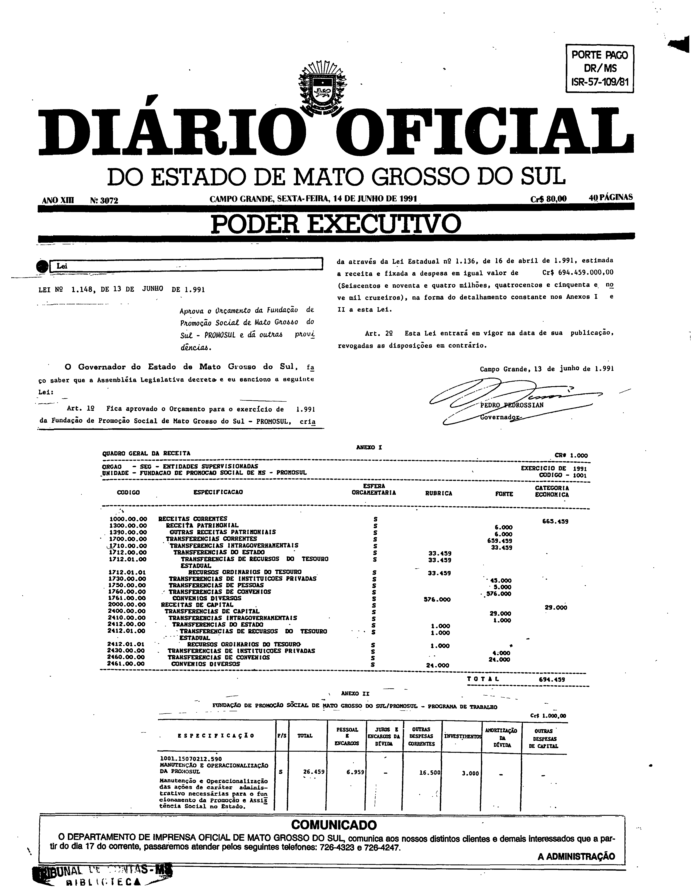
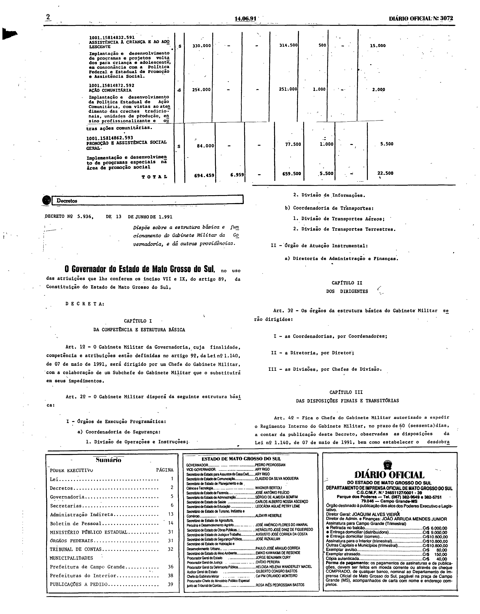

# LEI Nº 1.148, DE 13 DE JUNHO DE 1991.

ESTADO DE MATO GROSSO DO SUL

LEI Nº 1.148, DE 13 DE JUNHO DE 1991.

Aprova o Orçamento da Fundação de Promoção Social de Mato Grosso do Sul - PROMOSUL e dá outras providências.

Publicada no Diário Oficial nº 3.072, de 14 de junho de 1991.

**O Governador do Estado de Mato Grosso do Sul**, faço saber que a Assembléia Legislativa decreta e eu sanciono a seguinte Lei: 
 
Art. 1º Fica aprovado o Orçamento para o exercício de 1.991 da Fundação de Promoção Social de Mato Grosso do Sul - PROMOSUL, criada através da Lei Estadual nº 1.136, de 16 de abril de 1.991, estimada a receita e fixada a despesa em igual valor de Cr$ 694.459.000,00 (Seiscentos e noventa e quatro milhões, quatrocentos e cinquenta e nove mil cruzeiros), na forma do detalhamento constante nos Anexos I e II a esta Lei. 
 
Art. 2º Esta Lei entrará em vigor na data de sua publicação, revogadas as disposições em contrário. 
 
Campo Grande, 13 de junho de 1.991. 
 
PEDRO PEDROSSIAN 
Governador

## Anexos em fac-símile do Diário Oficial

O texto acima, disponibilizado pela Consultoria Legislativa, termina na assinatura do Governador e não contém os Anexos I e II a que o art. 1º se refere. Eles constam da edição do Diário Oficial em que a lei foi publicada e são reproduzidos abaixo em fac-símile.

**Como ler esta seção.** As imagens abaixo são reproduções fac-similares, sem alteração, das páginas digitalizadas do Diário Oficial; não são transcrição nem texto pesquisável, e nenhuma célula, número ou desenho foi reconstruído. Para conferir uma imagem, compare seu SHA-256 com o registrado abaixo.

**Fonte:** Diário Oficial do Estado de Mato Grosso do Sul nº 3.072, de 14 de junho de 1991, páginas 1 e 2, exemplar digitalizado do Tribunal de Contas do Estado de Mato Grosso do Sul — <https://portal-services.tce.ms.gov.br/portal-services/diario-oficiais/download?id=19049> (HTTP 200, 5.843.648 bytes, PDF completo).

**Arquivo oficial de origem:** PDF integral da edição, SHA-256 `6f3f0ec76d97e2271eb2e399f10ad14063fb2964159cbe6581e0ba9fdb3a8545`; páginas do PDF e páginas impressas coincidem.

**Limites das peças:**

- **Anexo I** (“Quadro Geral da Receita”, unidade Fundação de Promoção Social de MS – PROMOSUL): página 1, logo abaixo da assinatura da lei; termina na linha “TOTAL”.
- **Anexo II** (“Programa de Trabalho”): começa na parte inferior da página 1 (programa 1001.15070212.590) e continua no topo da página 2 (programas 591, 592 e 593), terminando na linha “TOTAL”, imediatamente antes da caixa “Decretos”.
- As páginas inteiras incluem também o cabeçalho da edição, o aviso “Comunicado”, o carimbo da biblioteca do Tribunal de Contas, o Decreto nº 5.936, de 13 de junho de 1991, o sumário e o expediente; esses elementos não fazem parte desta lei.

**Páginas reproduzidas:**

- Página 1 (lei, Anexo I e início do Anexo II) — `doe3072-p01.png` (3168×4070 px, 300 ppi, SHA-256 `eb76d17f011b708b0ad9bbbb0112ce004b03e2f6cc1c627fdcb1bad9dbc112f0`)
- Página 2 (continuação e fim do Anexo II) — `doe3072-p02.png` (3184×4067 px, 300 ppi, SHA-256 `2a4fa886f49a96553f37b73aa330c6faef3474e8c1948b1bb9aa95268a029adb`)

**Observações sobre a imagem:**

- Na digitalização, o símbolo da moeda em “CR$ 1.000” no cabeçalho do Anexo I e alguns separadores de milhar estão manchados; a imagem é reproduzida sem retoque e nenhum valor foi transcrito ou corrigido.
