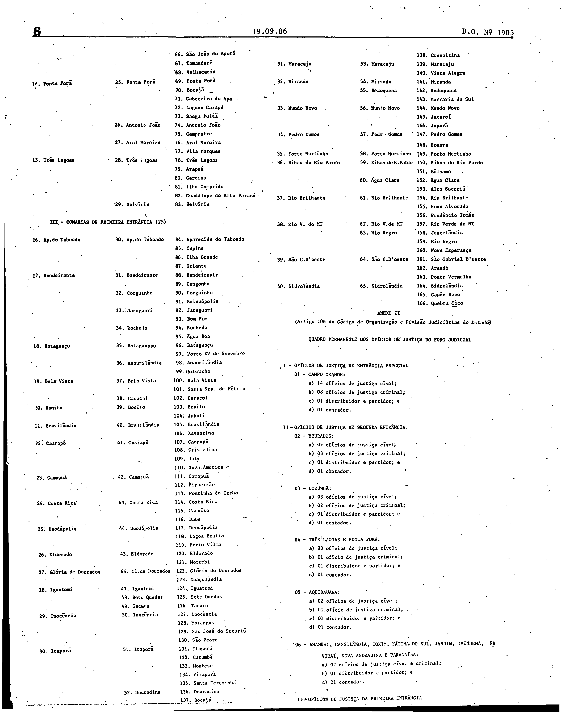
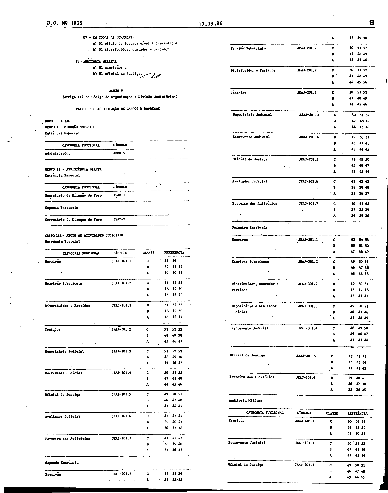

# LEI Nº 664, DE 18 DE SETEMBRO DE 1986.

ESTADO DE MATO GROSSO DO SUL

LEI Nº 664, DE 18 DE SETEMBRO DE 1986.

Altera, acrescenta dispositivos a Lei nº 39, de 1º de dezembro de 1979, modificada pelas Leis nºs 318, de 17.12.82, 377, de 01.07.83, 399, de 11.11.83 e 464, de 28.08.84, e dá outras providências.

Publicada no Diário Oficial nº 1.905, de 19 de setembro de 2016, páginas 5 a 16.

O Governador do Estado de Mato Grosso do Sul, faço saber que a<br>
Assembléia Legislativa decreta e eu sanciono a seguinte Lei:<br>
<br>
Art. 1º - O artigo 9º; item III do artigo 13; o item II e 1º e<br>
4º do artigo 14; o item II do artigo 16; os artigos 22, itens I e<br>
II, 23, itens I e II e 24; as alíneas 1, m e p do item I e item<br>
VIII do artigo 34; a alínea a do item I do artigo 36; os artigos<br>
37, 38, 64, 65 e 70; o parágrafo único do artigo 71; o artigo 72; o<br>
item I e suas alíneas a, 1, d, e e, e as alíneas a, c, d, e e do<br>
item II do artigo 86, o item I do artigo 87; os artigos 88, 90,<br>
112, 159 e 273, da Lei nº 39, de 18 de dezembro de 1979 e seus<br>
anexos I, II, III, V, VII e VIII, alterados pelas o Leis nºs 318,<br>
de 17 de dezembro de 1981, 377, de 1º de julho de 1983,399, de 11<br>
de novembro de 1983 e 464, de 28 de agosto de 1984, passam a<br>
vigorar com a seguinte redação:<br>
<br>
Artigo 9º - A primeira circunscrição, de Campo Grande, compreende<br>
esta Comarca e as de Bandeirante, Ribas do Rio Pardo e Sidrolandia;<br>
a segunda, de Dourados, compreende esta Comarca e as de Caarapó,<br>
Fatima do Sul, Itapora, Maracaju e Rio Brilhante; a terceira, de<br>
Corumbá, compreende esta Comarca e a de Miranda; a quarta, de Três<br>
Lagoas, compreende esta Comarca e as de Bataguassu e Brasilândia; a<br>
quinta, de Aquidauana, compreende esta Comarca e as de Bonito,<br>
Jardim e Porto Murtinho, sexta , de Ponta Porã, compreende esta<br>
Comarca e as de Amambai e Bela Vista; a sétima a, de Nova Andradina,<br>
compreende esta Comarca e as de Deodapolis, Gloria de Dourados e<br>
Ivinhema; a oitava, de Naviraí, compreende esta Comarca e as de<br>
Eldorado, Iguatemi e Mundo Novo; a nona, de Coxim, compreende esta<br>
Comarca e as de Pedro Gomes e Rio Verde de Mato Grosso, São Gabriel<br>
do Oeste e Camapua; a décima, de Paranaiba, compreende esta Comarca<br>
e as de Aparecida do Taboado, Cassilandia, Costa Rica e Inocência.<br>
<br>
Artigo 13 - ......................................................<br>
<br>
I - ...............................................................<br>
<br>
II- ...............................................................<br>
<br>
III - comarcas de primeira entrância:<br>
<br>
Aparecida do Taboado, Bandeirante, Bataguassu, Bela Vista, Bonito,<br>
Brasilandia, Caarapó, Camapuã, Costa Rica, Deodápolis, Eldorado,<br>
Gloria de Dourados, Iguatemi, Inocência, Itaporã, Maracajú,<br>
Miranda, Mundo Novo, Pedro Gomes, Porto Murtinho, Ribas do Rio Pardo<br>
Rio Brilhante, Rio Verde de Mato Grosso, São Gabriel do Oeste e<br>
Sidrolândia. (anexo I).<br>
<br>
Artigo 14 - ......................................................<br>
<br>
I - ...............................................................<br>
<br>
II - arrecadação estadual, proveniente de impostos, não inferior a<br>
hum mil e quinhentos (1.500) OTNS (Obrigações do Tesouro Nacional)<br>
<br>
III - .............................................................<br>
<br>
IV - ..............................................................<br>
<br>
V - ...............................................................<br>
<br>
VI - ..............................................................<br>
<br>
§ 1º Os requisitos de população, número de casas e extensão<br>
territorial serão provados por certidões fornecidas pelos órgãos<br>
incumbidos de seu registro ou avaliação; o de renda, mediante<br>
certidão fornecida pela Secretaria de Fazenda; os dos edifícios<br>
públicos, por declaração da Secretaria de Obras Públicas ou de<br>
Orgão congênere da Prefeitura interessada; o número de eleitores,<br>
por informação do Tribunal Regional Eleitoral, o do volume de<br>
serviço forense, por relatório do Juiz diretor do foro da Comarca a<br>
que pertence o município objetivado.<br>
<br>
§ 2º ............................................................<br>
<br>
§ 3º ............................................................<br>
<br>
§ 4º Os índices estabelecidos neste artigo poderão ser<br>
dispensados em relação a município com precários meios de<br>
comumnicação.<br>
<br>
Artigo 16 - ......................................................<br>
<br>
II - arrecadação estadual, proveniente de impostos, não-inferior a<br>
dez mil (10.000) OTNs, apurada por certidão da Secretaria de<br>
Fazenda e referente ao ano anterior;<br>
<br>
Artigo 22 - Na Comarca de Campo Grande haverá vinte e dois<br>
juízes, funcionando:<br>
<br>
I- quatorze nas varas cíveis; e<br>
<br>
II - oito nas varas criminais.<br>
<br>
Artigo 23 - Na Comarca de Dourados haverá oito juízes de direito,<br>
funcionando:<br>
<br>
I- cinco nas varas cíveis; e<br>
<br>
II - Três, nas varas criminais.<br>
<br>
Artigo 24 - Na Comarca de Aquidauana haverá Três juízes de direito<br>
funcionando dois em varas cíveis e um na vara criminal<br>
(3ª vara) e nas Comarcas de Três Lagoas e Ponta Porã haverá quatro<br>
juízes de direito funcionando Três em varas cíveis e um na vara<br>
criminal (4ª vara).<br>
<br>
Artigo 34 - ......................................................<br>
<br>
I - ...............................................................<br>
<br>
l) as ações rescisórias e as revisões criminais dos seus acordãos,<br>
bem como dos acordos proferidos pela Turma Cível ou Criminal em<br>
grau de embargos infringentes;<br>
<br>
m) os embargos infringentes opostos ao julgamento das ações<br>
resisorias e revisões criminais, bem como o recurso contra o<br>
despacho que os indeferir liminarmente;<br>
<br>
p) as reabilitações, quanto as condenações que haja proferido;<br>
<br>
VIII - eleger seu Presidente, Vice-Presidente, Corregedor-Geral da<br>
Justiça, além dos Membros das Comissões Permanentes e as que forem<br>
constituídas;<br>
<br>
Artigo 36 - .......................................................<br>
<br>
I - ...............................................................<br>
<br>
a) os mandados de segurança contra atos dos juízes de grau<br>
inferior, em matéria Cível, e dos procuradores de justiça.<br>
<br>
Artigo 37 - .......................................................<br>
<br>
I - ...............................................................<br>
<br>
a) os pedidos de habeas corpus sempre que os atos de violência ou<br>
coação ilegal forem atribuídos a juízes de primeira instância,<br>
podendo a ordem ser expedida de ofício, no curso dos feitos<br>
submetidos a sua decisão;<br>
<br>
b) os mandados de segurança contra atos dos juízes inferiores, em<br>
matéria criminal;<br>
<br>
c) a suspeição arguida contra juízes de primeira instância e por<br>
estes não reconhecida, em processo criminal;<br>
<br>
d) os embargos infringentes e de nulidade dos seus acórdãos;<br>
<br>
Artigo 38 - A Turma Especial, que funciona, extraordinariamente,<br>
durante as ferias coletivas do Tribunal, e formada pelo Presidente<br>
do Tribunal, pelo Corregedor-Geral da Justiça e por um<br>
desembargador, na ordem sucessiva de antiguidade.<br>
<br>
§ 1º No período de ferias coletivas compete a Turma Especial<br>
processar e julgar os habeas corpus e os mandados de segurança que<br>
couberem na competência das turmas; julgar os recursos interpostos<br>
contra as decisões proferidas nas causas previstas no artigo 174 do<br>
Código de Processo Civil, e praticar os atos mencionados no artigo<br>
173 do Código de Processo Civil.<br>
<br>
§ 2º Para a conclusão dos julgamentos que houver iniciado a Turma<br>
Especial terá a sua competência prorrogada, após o encerramento das<br>
ferias coletivas.<br>
<br>
Artigo 64 - .......................................................<br>
<br>
§ 1º Na Comarca da Capital, o tribunal do júri funcionará a<br>
qualquer tempo, de acordo com a necessidade do serviço.<br>
<br>
§ 2º Quando, por motivo de força maior, não for convocado o<br>
júri, na época determinada, a reunião efetuar-se-á no mês seguinte.<br>
<br>
Artigo 65 - Nas Comarcas do interior , em circunstâncias<br>
excepcionais, o júri reunir-se-á, extraordinariamente, com<br>
autorização do Conselho Superior da Magistratura, por convocação do<br>
juiz ou dos interessados.<br>
<br>
Artigo 70 - Para a administração da Justiça Militar haverá uma<br>
auditoria com sede na capital e jurisdição em todo o Estado,<br>
composta de um juiz-auditor, escrivão, escrevente judicial e oficial<br>
de justiça.<br>
<br>
Artigo 71 - .......................................................<br>
<br>
Parágrafo único - O juiz-auditor terá todos os direitos e garantias<br>
e impedimentos dos magistrados em geral, exceto a promoção, tendo<br>
seus vencimentos e vantagens equiparados aos de juiz de direito de<br>
entrância especial.<br>
<br>
Artigo 72 - O escrivão, o escrevente judicial e o oficial de<br>
justiça serão nomeados mediante concurso organizado pelo Tribunal<br>
de Justiça, com as mesmas exigências para os cargos semelhantes da<br>
justiça comum e terão seus vencimentos equiparados aos de entrância<br>
especial.<br>
<br>
Artigo 86 - .......................................................<br>
<br>
I- a jurisdição cível será exercida por quatorze juízes de direito,<br>
titulares das respectivas varas cíveis, competindo:<br>
<br>
a) ao juiz da 1ª vara, processar e julgar os feitos relativos aos<br>
registros públicos e de interesse da Fazenda Pública, excetuados os<br>
executivos fiscais;<br>
<br>
b) aos Juízes da 2ª , 3ª , 7ª e 14ª varas, processar e julgar os<br>
feitos relativos a família e sucessão, mediante distribuição;<br>
<br>
...................................................................<br>
<br>
d) aos Juízes da 4ª , 5ª , 6ª , 9ª , 10ª., 11ª e 12ª varas,<br>
processar e julgar os demais feitos Cíveis em geral e os<br>
acidentes de trabalho, mediante distribuição;<br>
<br>
e) ao juiz da 13ª vara, processar e julgar os executivos fiscais,<br>
as ações anulatórias de débitos fiscais e dar cumprimento as<br>
precatórias cíveis em geral.<br>
<br>
II - a jurisdição criminal será exercida por oito juízes de<br>
direito, titulares das respectivas varas criminais, competindo:<br>
<br>
a) ao juiz da 1ª vara, a corregedoria dos presídios, as execuções<br>
criminais e a presidência do júri;<br>
<br>
c) aos juízes da 3ª , 4ª , 6ª e 7ª varas, processar e julgar as<br>
demais infrações penais, mediante distribuição;<br>
<br>
d) ao juiz da 5ª vara, a jurisdição de menores e cumprimento de<br>
precatórias criminais;<br>
<br>
e) ao juiz da 8ª vara, processar os crimes dolosos contra a vida,<br>
até a pronuncia, inclusive.<br>
<br>
Artigo 87 - .......................................................<br>
<br>
I- a jurisdição cível será exercida por cinco juízes de direito,<br>
titulares das respectivas varas, competindo-lhes processar e julgar<br>
os feitos cíveis em geral, mediante distribuição; e<br>
<br>
Artigo 88 - .......................................................<br>
<br>
I - Em Aquidauana a jurisdição será exercida, cumulativamente, por<br>
dois juízes de direito, titulares das respectivas varas cíveis,<br>
regulando-se a competência pela distribuição alternada, mediante<br>
sorteio; e a jurisdição do crime e de menores será exercida pelo<br>
juiz de direito da vara criminal;<br>
<br>
II - Em Três Lagoas e Ponta Porã, a jurisdição cível será exercida<br>
por Três juízes de direito, titulares das respectivas varas,<br>
competindo:<br>
<br>
a) ao juiz da 1ª vara os feitos relativos a família, sucessões,<br>
alimentos, menores e o cumprimento de precatórias em geral;<br>
<br>
b) aos da 2ª e 3ª , os feitos cíveis em geral, mediante<br>
distribuição;<br>
<br>
III - Em Três Lagoas e Ponta Porã a jurisdição criminal será<br>
exercida pelo juiz da 4ª vara.<br>
Artigo 90 - Anualmente, até 28 de fevereiro, o Presidente do<br>
Conselho Superior da Magistratura designará o juiz de direito que<br>
exercera, nas comarcas em que houver mais de uma vara, a direção do<br>
foro, o qual será substituído pelo juiz mais antigo da comarca, nas<br>
faltas e impedimentos ou afastamento.<br>
<br>
Artigo 112 - O Quadro Permanente de Pessoal dos serviços<br>
auxiliares da justiça de primeira instância fica instituído por um<br>
sistema de classificação denominado Plano de Classificação de<br>
Cargos e Empregos e o correspondente sistema de retribuição<br>
denominado Plano de Retribuição (Anexos V, VII e IX).<br>
<br>
§ 1º Os sistemas de classificação e de Retribuição previstos<br>
neste artigo são constituídos dentro dos limites e conceitos<br>
estabelecidos no Anexo XII, deste Código.<br>
<br>
§ 2º O Tribunal de Justiça, por ato do Tribunal Pleno, expedira<br>
normas complementares necessárias a execução dos planos de<br>
classificação e retribuição instituídos pelo caput deste artigo.<br>
<br>
§ 3º A primeira investidura nos cargos dependerá de aprovação<br>
previa em concurso público de provas, ressalvadas as exceções<br>
indicadas no Anexo XII.<br>
<br>
Artigo 159 - Os servidores da justiça não poderão, sob pena de<br>
demissão, exercer outra função Pública, antes de seu afastamento<br>
devidamente autorizado pelo órgão competente.<br>
<br>
Parágrafo único - O afastamento para concorrer a mandato público<br>
eletivo dar-se-á mediante previa comunicação ao órgão competente,<br>
em conformidade com o que for estabelecido pela legislação<br>
eleitoral.<br>
<br>
Artigo 273 - Os magistrados terão direito a férias anuais por<br>
sessenta dias, coletivas ou individuais.<br>
<br>
Parágrafo único - Os desembargadores, os juízes de direito e o<br>
juiz-auditor gozarão ferias nos períodos de dois a trinta e um de<br>
janeiro e de dois a trinta e um de julho. Os juízes substitutos<br>
gozarão ferias individuais, conforme escala elaborada, anualmente,<br>
pelo Tribunal de Justiça.<br>
<br>
Artigo 2º - Os artigos 4º e 5º da Lei nº 318, de 17 de dezembro de<br>
1981, passam a vigorar com a seguinte redação:<br>
<br>
Artigo 4º - Na Comarca de Corumbá haverá cinco juízes de direito,<br>
funcionando:<br>
<br>
I- três, nas varas cíveis;<br>
<br>
II - dois, nas varas criminais.<br>
<br>
Artigo 5º - Na Comarca de Corumbá:<br>
<br>
I- a jurisdição cível será exercida por Três juízes de direito,<br>
titulares das respectivas varas, competindo:<br>
<br>
a) ao juiz da primeira vara, os feitos relativos a família,<br>
sucessão, alimentos, menores e o cumprimento de precatórias em<br>
geral;<br>
<br>
b) aos da segunda e terceira varas, os feitos cíveis em geral,<br>
mediante distribuição.<br>
<br>
II - a jurisdição criminal será exercida por dois juízes de<br>
direito, titulares das respectivas varas, competindo:<br>
<br>
a) ao juiz da primeira vara, a corregedoria dos presídios, as<br>
execuções criminais, a jurisdição de menores, precatórias criminais<br>
e processar os feitos de competência do júri; e<br>
<br>
b) ao juiz da segunda vara, os demais feitos criminais,<br>
<br>
Artigo 3º - Ficam acrescidos a Lei nº 39; de 18 de dezembro de<br>
1979, os anexos IX, X, XI e XII.<br>
<br>
Artigo 4º - O pessoal integrante do Quadro Suplementar e os juízes<br>
de paz, terão seus vencimentos fixados nos anexos X e XI, a que se<br>
refere o artigo anterior.<br>
<br>
Artigo 5º - Esta Lei entrará em vigor na data de sua publicação,<br>
revogadas as disposições em contrário.<br>
<br>
Campo Grande, 18 de setembro de 1986.<br>
<br>
RAMEZ TEBET<br>
Governador<br>
<br>
ANEXO I<br>
<br>
<br>
(Artigo 13 do Código de Organização e Divisão Judiciarias)<br>
<br>
I - ENTRANCIA ESPECIAL (O1)<br>
<br>
A. COMARCA B. MUNICIPIO C. DISTRITO<br>
<br>
01\. Campo Grande 01.Campo Grande 01.Campo Grande<br>
<br>
02.Anhandui<br>
<br>
03.Rochedinho<br>
<br>
02.Terenos 04.Terenos<br>
<br>
<br>
II - COMARCAS DE SEGUNDA ENTRANCIA (14)<br>
<br>
<br>
02\. Amambai 03.Amambai 05.Amambai<br>
<br>
04.Cel. Sapucaia 06.Cel. Sapucaia<br>
<br>
07.Paranhos<br>
<br>
03\. Aquidauana 05.Aquidauana 08.Aquidauana<br>
<br>
09.Camisão<br>
<br>
10.Cipolandia<br>
<br>
11.Piraputanga<br>
<br>
12.Taunay<br>
<br>
06.Anastácio 13.Anastacio<br>
<br>
14.Dois Irmãos<br>
<br>
15.Palmeiras<br>
<br>
07.Nioaque 16.Nioaque<br>
<br>
04\. Cassilandia 08.Cassilandia 17.Cassilandia<br>
<br>
18.Indaiá do Sul<br>
<br>
19.Chapadão do Sul<br>
<br>
05\. Corumbá 09.Corumbá 20.Corumbá<br>
<br>
21.Albuquerque<br>
<br>
22.Amolar<br>
<br>
23.Coimbra<br>
<br>
24.Nhecolandia<br>
<br>
25.Paiaguas<br>
<br>
26.Porto Esperança<br>
<br>
10.Ladário 27.Ladario<br>
<br>
06\. Coxim 11.Coxim 28.Coxim<br>
<br>
29.São Romão<br>
<br>
30.Taquari<br>
<br>
31.Alcinopolis<br>
<br>
32.Jauru<br>
<br>
07\. Dourados 12.Dourados 33.Dourados<br>
<br>
34.Vila Formosa<br>
<br>
35.Guaçu<br>
<br>
36.Itahum<br>
<br>
37.Panambi<br>
<br>
38.Picadinha<br>
<br>
39.São Pedro<br>
<br>
40.Indapólis<br>
<br>
41.Vila Vargas<br>
<br>
08\. Fátima do Sul 13.Fatima do Sul 42.Fatima do Sul<br>
<br>
43.Culturama<br>
<br>
44.Vicentina<br>
<br>
45.Vila Rica<br>
<br>
46.São José<br>
<br>
14.Jatei 47.Jatei<br>
<br>
48.Nova Esperança<br>
<br>
09\. Jardim 15.Jardim 49.Jardim<br>
<br>
50.Boqueirão<br>
<br>
16.Guia L. da Laguna 51.Guia L. da Laguna<br>
<br>
10\. Ivinhema 17.Ivinhema 52.Ivinhema<br>
<br>
53.Amandina<br>
<br>
18.Angélica 54.Angélica<br>
<br>
55.Ipezal<br>
<br>
11\. Naviraí 19.Navirai 56.Naviraí<br>
<br>
20.Itaquirai 57.Itaquirai<br>
<br>
12\. Nova Andradina 21.Nova Andradina 58.Nova Andradina<br>
<br>
22.Bataiporã 59.Bataiporã<br>
<br>
23.Taquarussu 60.Taquarussu<br>
<br>
13\. Paranaiba 24.Paranaiba 61.Paranaiba<br>
<br>
62.Arvore Grande<br>
<br>
63.Cachoeira<br>
<br>
64.Indaiá Grande<br>
<br>
65.Nova Jales<br>
<br>
66.São João do Apore<br>
<br>
67.Tamandare<br>
<br>
68.Velhacaria<br>
<br>
14\. Ponta Porã 25.Ponta Porã 69.Ponta Porã<br>
<br>
70.Bocaja<br>
<br>
71.Cabeceira do Apa<br>
<br>
72.Laguna Carapó<br>
<br>
73.Sanga Puita<br>
<br>
26.Antonio João 74.Antonio João<br>
<br>
75.Campestre<br>
<br>
27.Aral Moreira 76.Aral Moreira<br>
<br>
77.Vila Marques<br>
<br>
15\. Três Lagoas 28.Três Lagoas 78.Três Lagoas<br>
<br>
79.Arapuã<br>
<br>
80.Garcias<br>
<br>
81.Iha Comprida<br>
<br>
82.Guadalupe do<br>
<br>
Alto Paraná<br>
<br>
29.Selviria 83.Selviria<br>
<br>
III - COMARCAS DE PRIMEIRA ENTRANCIA (25)<br>
<br>
16\. Aparecida do 30.Aparecida do 84.Aparecida do<br>
Taboado Taboado Taboado<br>
<br>
85.Cupins<br>
<br>
86.Ilha Grande<br>
<br>
87.Oriente<br>
<br>
17\. Bandeirante 31.Bandeirante 88.Bandeirante<br>
<br>
89.Congonha<br>
<br>
32.Corguinho 90.Corguinho<br>
<br>
91.Baianópolis<br>
<br>
33.Jaraguari 92.Jaraguari<br>
<br>
93.Bom Fim<br>
<br>
34.Rochedo 94.Rochedo<br>
<br>
95.Agua Boa<br>
<br>
18\. Bataguassu 35.Bataguassu 96.Bataguassu<br>
<br>
97.Porto XV de<br>
Novembro<br>
<br>
36.Anaurilândia 98.Anaurilândia<br>
<br>
99.Quebracho<br>
<br>
19\. Bela Vista 37.Bela Vista 100.Bela Vista<br>
<br>
101.Nossa Sra. de<br>
Fátima<br>
<br>
38.Caracol 102.Caracol<br>
<br>
20\. Bonito 39.Bonito 103.Bonito<br>
<br>
104.Jabuti<br>
<br>
21\. Brasilândia 40.Brasilândia 105.Brasilândia<br>
<br>
106.Xavantina<br>
<br>
22\. Caarapó 41.Caarapó 107.Caarapó<br>
<br>
108.Cristalina<br>
<br>
109.Juty<br>
<br>
110.Nova América<br>
<br>
23\. Camapuã 42.Camapuã 111.Camapuã<br>
<br>
112.Figueirão<br>
<br>
113.Pontinha do Cocho<br>
<br>
24\. Costa Rica 43.Costa Rica 114.Costa Rica<br>
<br>
115.Paraíso<br>
<br>
116.Baús<br>
<br>
25\. Deodápolis 44.Deodápolis 117.Deodápolis<br>
<br>
118.Lagoa Bonita<br>
<br>
119.Porto Vilma<br>
<br>
26\. Eldorado 45.Eldorado 120.Eldorado<br>
<br>
121.Morumbi<br>
<br>
27\. Glória de Dourados 46.Gl.de Dourados 122.Gl. de Dourados<br>
<br>
123.Guaculândia<br>
<br>
28\. Iguatemi 47.Iguatemi 124.Iguatemi<br>
<br>
48.Sete Quedas 125.Sete Quedas<br>
<br>
49.Tacuru 126.Tacuru<br>
<br>
29\. Inocência 50.Inocência 127.Inocência<br>
<br>
128.Morangas<br>
<br>
129.São José<br>
do Sucuriu<br>
<br>
130.São Pedro<br>
<br>
30\. Itaporã 51.Itaporã 131.Itaporã<br>
<br>
132.Carumbe<br>
<br>
133.Montese<br>
<br>
134.Pirapora<br>
<br>
135.Santa Terezinha<br>
<br>
52.Douradina 136.Douradina<br>
<br>
137.Bocaja<br>
<br>
138.Cruzaltina<br>
<br>
31\. Maracaju 53.Maracaju 139.Maracaju<br>
<br>
140.Vista Alegre<br>
<br>
32\. Miranda 54.Miranda 141.Miranda<br>
<br>
55.Bodoquena 142.Bodoquena<br>
<br>
143.Morrária do Sul<br>
<br>
33\. Mundo Novo 56.Mundo Novo 144.Mundo Novo<br>
<br>
145.Jacareí<br>
<br>
146.Japorã<br>
<br>
34\. Pedro Gomes 57.Pedro Gomes 147.Pedro Gomes<br>
<br>
148.Sonora<br>
<br>
35\. Porto Murtinho 58.Porto Murtinho 149.Porto Murtinho<br>
<br>
36\. Ribas do Rio 59.Ribas do Rio 150.Ribas do Rio<br>
Pardo Pardo Pardo<br>
<br>
151.Balsámo<br>
<br>
60.Agua Clara 152.Agua Clara<br>
<br>
153.Alto Sucuriu<br>
<br>
37\. Rio Brilhante 61.Rio Brilhante 154.Rio Brilhante<br>
<br>
155.Nova Alvorada<br>
<br>
156.Prudêncio Tomas<br>
<br>
38\. Rio V. de MT 62.Rio V.de MT 157.Rio Verde de MT<br>
<br>
158.Juscelândia<br>
<br>
63.Rio Negro 159.Rio Negro<br>
<br>
160.Nova Esperança<br>
<br>
39\. São G.Doeste 64.São G.Doeste 161.São G. Doeste<br>
<br>
162.Areado<br>
<br>
163.Ponte Vermelha<br>
<br>
40\. Sidrolândia 65.Sidrolândia 164.Sidrolândia<br>
<br>
165.Capão Seco<br>
<br>
166.Quebra Côco<br>
<br>
ANEXO II<br>
<br>
(Artigo 106 do Código de Organização e Divisão Judiciárias do<br>
Estado)<br>
<br>
QUADRO PERMANENTE DOS OFICIOS DE JUSTIÇA DO FORO JUDICIAL<br>
<br>
I - OFICIOS DE JUSTIÇA DE ENTRANCIA ESPECIAL<br>
<br>
O1 - CAMPO GRANDE:<br>
<br>
a) 14 ofícios de justiça cível;<br>
<br>
b) 08 ofícios de justiça criminal;<br>
<br>
c) 01 distribuidor e partidor; e<br>
<br>
d) 01 contador.<br>
<br>
II - OFICIOS DE JUSTIÇA DE SEGUNDA ENTRANCIA<br>
<br>
02 - DOURADOS:<br>
<br>
a) 05 ofícios de justiça cível;<br>
<br>
b) 03 ofícios de justiça criminal;<br>
<br>
c) 01 distribuidor e partidor; e<br>
<br>
d) 01 contador.<br>
<br>
03 - CORUMBA:<br>
<br>
a) 03 ofícios de justiça cível;<br>
<br>
b) 02 ofícios de justiça criminal;<br>
<br>
c) 01 distribuidor e partidor; e<br>
<br>
d) 01 contador.<br>
<br>
04 - TRES LAGOAS E PONTA PORA:<br>
<br>
a) 03 ofícios de justiça cível;<br>
<br>
b) 01 ofício de justiça criminal;<br>
<br>
c) 01 distribuidor e partidor; e<br>
<br>
d) 01 contador.<br>
<br>
05 - AQUIDAUANA:<br>
<br>
a) 02 ofícios de justiça cível;<br>
<br>
b) 01 ofício de justiça criminal;<br>
<br>
c) 01 distribuidor e partidor; e<br>
<br>
d) 01 contador.<br>
<br>
06 - AMAMBAI, CASSILANDIA, COXIM, FATIMA DO SUL, JARDIM, IVINHEMA,<br>
NAVIRAI, NOVA ANDRADINA E PARANAIBA:<br>
<br>
a) 02 ofícios de justiça cível e criminal;<br>
<br>
b) 01 distribuidor e partidor; e<br>
<br>
c) 01 contador.<br>
<br>
OFICIOS DE JUSTIÇA DA PRIMEIRA ENTRANCIA<br>
<br>
07 - EM TODAS AS COMARCAS:<br>
<br>
a) 01 ofício de justiça cível e criminal; e<br>
<br>
b) 01 distribuidor, contador e partidor.<br>
<br>
AUdITORIA MILITAR<br>
<br>
a) 01 escrivão; e<br>
<br>
b) 01 oficial de justiça.<br>
<br>

```
ANEXO V

Artigo 112 do Código de Organização e Divisão Judiciárias)

PLANO DE CLASSIFICAÇAO DE CARGOS E EMPREGOS

FORO JUDICIAL

GRUPO I - DIREÇAO SUPERIOR

Entrância Especial

-------------------------------------------------------------------
CATEGORIA FUNCIONAL                    SIMBOLO
-------------------------------------------------------------------
Administrador                           JEDS-5
-------------------------------------------------------------------
GRUPO II - ASSISTENCIA DIRETA

Entrância Especial

-------------------------------------------------------------------
CATEGORIA FUNCIONAL                     SIMBOLO
-------------------------------------------------------------------
Secretário da Direção do Foro            JEAD-1
-------------------------------------------------------------------
Segunda Entrância
-------------------------------------------------------------------
Secretário da Direção do Foro            JEAD-2
-------------------------------------------------------------------


GRUPO III - APOIO AS ATIVIDADES JUDICIAIS

Entrância Especial

-------------------------------------------------------------------
CATEGORIA FUNCIONAL        SIMBOLO        CLASSE     REFERENCIA
-------------------------------------------------------------------
Escrivão                  JEAJ-101.1         C        55  56

B        52  53  54

A        49  50  51
-------------------------------------------------------------------
Escrivão Substituto       JEAJ-101.2         C        51  52  53

B        48  49  50

A        45  46  47
-------------------------------------------------------------------
Distribuidor e Partidor   JEAJ-101.2         C        51  52  53

B        48  49  50

A        45  46  47
-------------------------------------------------------------------
Contador                  JEAJ-101.2         C        51  52  53

B        48  49  50

A        45  46  47
-------------------------------------------------------------------
Depositário Judicial      JEAJ-101.3         C        51  52  53

B        48  49  50

A        45  46  47

-------------------------------------------------------------------
Escrevente Judicial       JEAJ-101.4         C        50  51  52

B        47  48  49

A        44  45  46
------------------------------------------------------------------
Oficial de Justiça        JEAJ-101.5         C        49  50  51

B        46  47  48

A        43  44  45
-------------------------------------------------------------------
Avaliador Judicial        JEAJ-101.6         C        42  43  44

B        39  40  41

A        36  37  38
-------------------------------------------------------------------
Porteiro dos Auditórios   JEAJ-101.7         C        41  42  43

B        38  39  40

A        35  36  37
-------------------------------------------------------------------

Segunda Entrância

-------------------------------------------------------------------
Escrivão                  JEAJ-201.1         C         54  55  56

B         51  52  53

A         48  49  50
-------------------------------------------------------------------
Escrivão Substituto       JEAJ-201.2         C         50  51  52

B         47  48  49

A         44  45  46
-------------------------------------------------------------------
Distribuidor e Partidor   JEAJ-201.2         C         50  51  52

B         47  48  49

A         44  45  56
-------------------------------------------------------------------
Contador                  JEAJ-201.2         C         50  51  52

B         47  48  49

A         44  45  46
-------------------------------------------------------------------
Depositário Judicial      JEAJ-201.3         C         50  51  52

B         47  48  49

A         44  45  46

-------------------------------------------------------------------
Escrevente Judicial       JEAJ-201.4         C         49  50  51

B         46  47  48

A         43  44  45
-------------------------------------------------------------------
Oficial de Justiça        JEAJ-201.5         C         48  49  50

B         45  46  47

A         42  43  44
-------------------------------------------------------------------
Avaliador Judicial        JEAJ-201.6         C         41  42  43

B         38  39  40

A         35  36  37
-------------------------------------------------------------------
Porteiro dos Auditórios   JEAJ-201.7         C         40  41  42

B         37  38  39

A         34  35  36
-------------------------------------------------------------------

Primeira Entrância
-------------------------------------------------------------------
Escrivão                  JEAJ-301.1         C         53  54  55

B         50  51  52

A         47  48  49
-------------------------------------------------------------------
Escrivão Substituto       JEAJ-301.2         C         49  50  51

B         46  47  48

A         43  44  45
-------------------------------------------------------------------
Distribuidor, Contador e  JEAJ-301.2         C         49  50  51
Partidor
B         46  47  48

A         43  44  45
-------------------------------------------------------------------
Depositário e Avaliador   JEAJ-301.3         C         49  50  51
Judicial
B         46  47  48

A         43  44  45
-------------------------------------------------------------------
Escrevente Judicial       JEAJ-301.4         C         48  49  50

B         45  46  47

A         42  43  44
-------------------------------------------------------------------

Oficial de Justiça        JEAJ-301.5         C         47  48  49

B         44  45  46

A         41  42  43
-------------------------------------------------------------------
Porteiro de Auditórios    JEAJ-301.6         C         39  40  41

B         36  37  38

A         33  34  35
-------------------------------------------------------------------

Auditoria Militar

-------------------------------------------------------------------
CATEGORIA FUNCIONAL         SIMBOLO       CLASSE      REFERENCIA
-------------------------------------------------------------------
Escrivão                   JEAJ-401.1        C         55  56  57

B         52  53  54

A         49  50  51
-------------------------------------------------------------------
Escrevente Judicial        JEAJ-401.2        C         50  51  52

B         47  48  49

A         44  45  46
-------------------------------------------------------------------
Oficial de Justiça         JEAJ-401.3        C         49  50  51

B         46  47  48

A         43  44  45
-------------------------------------------------------------------


GRUPO IV - APOIO TECNICO

Entrância Especial

-------------------------------------------------------------------
CATEGORIA FUNCIONAL          SIMBOLO      CLASSE       REFERENCIA
-------------------------------------------------------------------
Assistente Social           JEAT-102.1       C          55  56

B          52  53  54

A          49  50  51
-------------------------------------------------------------------

Segunda Entrância
-------------------------------------------------------------------
Assistente Social          JEAT-202.1        C          54  55  56

B          51  52  53


A          48  49  50
-------------------------------------------------------------------


GRUPO V - SERVIÇOS AUXILIARES

Entrância Especial

-------------------------------------------------------------------
CATEGORIA FUNCIONAL         SIMBOLO        CLASSE      REFERENCIA
-------------------------------------------------------------------
Inspetor de Menores        JESA-103.1         C         50  51  52

B         47  48  49

A         44  45  46
-------------------------------------------------------------------
Telefonista                JESA-103.2         C         31  32  33

B         28  29  30

A         25  26  27
-------------------------------------------------------------------
Zelador do Fórum           JESA-103.3         C         29  30  31

B         26  27  28

A         23  24  25
-------------------------------------------------------------------

Segunda Entrância
-------------------------------------------------------------------
Inspetor de Menores        JESA-203.1         C         49  50  51

B         46  47  48

A         43  44  45
--------------------------------------------------------------------
Telefonista                JESA-203.2         C         30  31  32

B         27  28  29

A         24  25  26
-------------------------------------------------------------------
Zelador do Fórum           JESA-203.3         C         28  29  30

B         25  26  27

A         22  23  24
-------------------------------------------------------------------

Primeira Entrância
-------------------------------------------------------------------
Zelador do Fórum            JESA-302.1        C         27  28  29

B         24  25  26

A         21  22  23

-------------------------------------------------------------------
GRUPO VI - SERVIÇOS GERAIS - EMPREGO

Entrância Especial

-------------------------------------------------------------------
CATEGORIA FUNCIONAL           SIMBOLO       CLASSE     REFERENCIA
-------------------------------------------------------------------
Artífice de Eletricidade     JESG-104.1        C        36  37  38

B        33  34  35

A        30  31  32
-------------------------------------------------------------------
Artífice de Hidráulica       JESG-104.1        C        36  37  38

B        33  34  35

A        30  31  32
-------------------------------------------------------------------
Artífice de Marcenaria       JESG-104.1        C        36  37  38

B        33  34  35

A        30  31  32
-------------------------------------------------------------------
Operador de Máquina          JESG-104.1        C        33  34  35
Reprográfica
B        30  31  32

A        27  28  29
-------------------------------------------------------------------
Motorista                    JESG-104.1        C        33  34  35

B        30  31  32

A        27  28  29
-------------------------------------------------------------------
Ascensorista                 JESG-104.2        C        29  30  31

B        26  27  28

A        23  24  25
-------------------------------------------------------------------
Agente de Copa e Cozinha     JESG-104.3        C        27  28  29

B        24  25  26

A        21  22  23
-------------------------------------------------------------------
Agente de Serviço            JESG-104.4        C        26  27  28

B        23  24  25

A        20  21  22
-------------------------------------------------------------------


Segunda Entrância

-------------------------------------------------------------------
Artífice de Eletricidade     JESG-204.1        C        35  36  37

B        32  33  34

A        29  30  31
-------------------------------------------------------------------
Artífice de Hidráulica       JESG-204.1        C        35  36  37

B        32  33  34

A        29  30  31
-------------------------------------------------------------------
Operador de Máquina
Reprográfica                 JESG-204.1        C        32  33  34

B        29  30  31

A        26  27  28
-------------------------------------------------------------------
Motorista                    JESG-204.1        C        32  33  34


B        29  30  31

A        26  27  28
-------------------------------------------------------------------
Ascensorista                 JESG-204.2        C        28  29  30

B        25  26  27

A        22  23  24
-------------------------------------------------------------------
Agente de Copa e Cozinha     JESG-204.3        C        26  27  28

B        23  24  25

A        20  21  22
-------------------------------------------------------------------
Agente de Serviço            JESG-204.4        C        25  26  27

B        22  23  24

A        19  20  21
-------------------------------------------------------------------


Primeira Entrância

-------------------------------------------------------------------
Agente de Serviço            JESG-301.1        C        24  25  26

B        21  22  23

A        18  19  20
-------------------------------------------------------------------


```

```
ANEXO VI

(Artigo 112, do Código de Organização e Divisão Judiciárias)

P L A N O   D E   C A R G O S

QUANTITATIVO DE CARGOS

FORO JUDICIAL

- Campo Grande

TABELA I - Entrância Especial


-------------------------------------------------------------------
SIMBOLO         CATEGORIA FUNCIONAL                   Nº DE CARGOS
-------------------------------------------------------------------
JEDS-5          Direção Superior
Administrador                               01

JEAD-1          Assistência Direta
Secretário da Direção do Foro               01

JEAJ-101        Apoio as atividades Judiciais
Escrivão                                    22

Escrivão Substituto                         22

Distribuidor e Partidor                     01

Contador                                    01

Depositário Judicial                        02

Escrevente Judicial                        114

Oficial de Justiça                          52

Avaliador Judicial                          06

Porteiro dos Auditórios                     09


JEAT-102        Apoio Técnico
Assistente Social                           03

JESA-103        Serviços Auxiliares

Inspetor de Menores                         04

Telefonista                                 06

Zelador do Fórum                            06

JESG-104        Serviços Gerais - Emprego


Artífice de Eletricidade                    01

Artífice de Hidráulica                      01

Artífice de Marcenaria                      01

Operador de Máquina Reprográfica            03

Motorista                                   05

Ascensorista                                06

Agente de Copa e Cozinha                    08

Agente de Serviço                           24
-------------------------------------------------------------------


Nota - Na Comarca de Entrância Especial haverá:

a)  Nos  Ofícios  de Justiça: Um Escrivão, um Escrivão Substituto
quatro Escreventes Judiciais;

b)  no Ofício de Distribuição: Um Distribuidor e Partidor e  seis
Escreventes Judiciais;

c)  no  Ofício  de  Contadoria:  Um  Contador  e seis Escreventes
Judiciais; e

d)  Na direção do Foro: Quatorze Escreventes Judiciais, sendo dez
servindo  na Secretaria da Direção do Foro, Três  encarregados do
Arquivo-Geral e um auxiliando o Administrador.


TABELA II - Segunda Entrância

- Dourados - Comarca com oito varas

-------------------------------------------------------------------
SIMBOLO          CATEGORIA FUNCIONAL                  Nº DE CARGOS
-------------------------------------------------------------------
JEAD-2           Assistência Direta

Secretário da Direção do Foro                01

JEAJ-201         Apoio as Atividades Judiciais

Escrivão                                     08

Escrivão Substituto                          08

Distribuidor e Partidor                      01

Contador                                     01

Depositário Judicial                         01


Escrevente Judicial                          46

Oficial de Justiça                           19

Avaliador Judicial                           02

Porteiro dos Auditórios                      03

JEAT-202         Apoio Técnico

Assistente Social                            02

JESA-203         Serviços Auxiliares

Inspetor de Menores                          02

Telefonista                                  03

Zelador do Fórum                             02

JESG-204         Serviços Gerais - Emprego

Artífice de Eletricidade                     01

Artífice de Hidráulica                       01

Operador de Máquina Reprográfica             02

Motorista                                    02

Ascensorista                                 02
-------------------------------------------------------------------
Nota - Na Comarca de Dourados haverá:

a)   Nos Ofícios de Justiça: Um Escrivão, um Escrivão Substituto e
quatro Escreventes Judiciais;

b)    no  Ofício  de  Distribuição:  Um Distribuidor e Partidor e
quatro Escreventes Judiciais;

c)  no  Ofício  de  Contadoria:  Um Contador e quatro Escreventes
Judiciais; e

d)  Na Direção do Foro: Seis Escreventes Judiciais, sendo  quatro
servindo  na Secretaria da Direção do Foro e dois Encarregados do
Arquivo-Geral.

Corumbá - Comarca com cinco varas


-------------------------------------------------------------------
SIMBOLO       CATEGORIA FUNCIONAL                     Nº DE CARGOS
-------------------------------------------------------------------
JEAJ-201      Apoio as Atividades Judiciais

Escrivão                                        05

Escrivão Substituto                             05


Distribuidor e Partidor                         01

Contador                                        01

Depositário Judicial                            01

Escrevente Judicial                             25

Oficial de Justiça                              15

Avaliador Judicial                              02

Porteiro dos Auditórios                         01

JEAT-202      Apoio Técnico

Assistente Social                               01

JESA-203      Serviços Auxiliares

Inspetor de Menores                             02

Zelador do Fórum                                02

JESG-204      Serviços Gerais - Emprego

Motorista                                       02

Agente de Serviço                               04
-------------------------------------------------------------------
Nota: - Na Comarca de Corumbá haverá:

a)  Nos Ofícios de Justiça: Um Escrivão, um Escrivão Substituto e
quatro Escreventes Judiciais;

b)  no  Ofício  de  Distribuição: Um Distribuidor e Partidor e um
Escrevente Judicial;

c)  no  Ofício  de  Contadoria:  Um  Contador  e dois Escreventes
Judiciais; e

d) Na Direção do Foro: Dois Escreventes Judiciais, sendo um  com a
função  de  Secretário  e outro com a de Encarregado do  Arquivo-
Geral:

-  Amambai,  Cassilândia, Coxim, Fátima do Sul, Jardim, Ivinhema,
Naviraí, Nova Andradina e Paranaiba - Comarcas com duas varas.


-------------------------------------------------------------------
SIMBOLO           CATEGORIA FUNCIONAL                Nº  DE CARGOS
COMARCA TOTAL
-------------------------------------------------------------------
JEAJ-201        Apoio as Atividades Judiciais

Escrivão                               02       18


Escrivão Substituto                    02       18

Distribuidor e  Partidor               01       09

Contador                               01       09

Depositário Judicial                   01       09

Escrevente Judicial                    10       90

Oficial de Justiça                     08       72

Avaliador Judicial                     01       09

Porteiro dos Auditórios                01       09

JESA-203        Serviços Auxiliares

Zelador do Fórum                       01       09

JESA-204        Serviços Gerais - Emprego

Motorista                              01       09

Agente de Serviço                      02       18
-------------------------------------------------------------------

Nota - Nas Comarcas de Duas varas haverá:

a)  Nos Ofícios de Justiça: Um Escrivão, um Escrivão Substituto e
quatro Escreventes Judiciais; e

b) Na direção do Foro: Dois Escreventes Judiciais, sendo um  com a
função  de  Secretário  e outro com a de Encarregado do  Arquivo-
Geral.


TABELA III - Primeira Entrância

-  Aparecida  do  Taboado,  Bandeirante,  Bataguassu, Bela Vista,
Bonito,  Brasilândia,  Caarapó,  Camapuã, Costa Rica, Deodápolis,
Eldorado,  Glória  de  Dourados,  Iguatemi, Inocência, Itaporã,
Maracajú, Miranda, Mundo Novo, Pedro Gomes, Porto Murtinho, Ribas
do Rio Pardo, Rio Brilhante, Rio Verde de Mato Grosso, São Gabriel
D'Oeste e Sidrolândia.


--------------------------------------------------------------------
SIMBOLO           CATEGORIA FUNCIONAL                 Nº  DE CARGOS
COMARCA TOTAL
--------------------------------------------------------------------
JEAJ-301     Apoio as Atividades Judiciais

Escrivão                                   01       25

Escrivão Substituto                        01       25


Distribuidor, Contador e Partidor          01       25

Depositário e Avaliador Judicial           01       25

Escrevente Judicial                        03       75

Oficial de Justiça                         03       75

Porteiro dos Auditórios                    01       25

JESA-302     Serviços Auxiliares

Zelador do Fórum                           01       25

JESG-303     Serviços  Gerais - Emprego

Agente de Serviço                          01       25
-------------------------------------------------------------------

Nota - Nas Comarcas de uma vara haverá:

a)  Nos Ofícios de Justiça: Um Escrivão, um Escrivão Substituto e
dois Escreventes Judiciais; e

b)  Na Direção do Foro: Um Escrevente Judicial com a função    de
Secretário,  prestando serviços, também na organização do arquivo
dos processos.

TABELA IV - Auditoria Militar


--------------------------------------------------------------------
SIMBOLO           CATEGORIA FUNCIONAL                  Nº DE CARGOS
--------------------------------------------------------------------
JEAJ-401          Apoio as Atividades Judiciais

Escrivão                                    01

Escrevente Judicial                         02

Oficial de Justiça                          01
--------------------------------------------------------------------

- Três Lagoas e Ponta Porã - Comarcas com quatro varas.


--------------------------------------------------------------------
SIMBOLO         CATEGORIA FUNCIONAL                   Nº  DE CARGOS
COMARCA TOTAL
--------------------------------------------------------------------
JEAJ-201        Apoio as Atividades Judiciais

Escrivão                               04       08

Escrivão Substituto                    04       08

Distribuidor e Partidor                01       02


Contador                               01       02

Depositário Judicial                   01       02

Escrevente Judicial                    20       40

Oficial de Justiça                     12       24

Avaliador Judicial                     02       04

Porteiro dos Auditórios                01       02

JEAT-202        Apoio Técnico

Assistente Social                      01       02

JESA-203        Serviços Auxiliares

Inspetor de Menores                    02       04

Zelador do Fórum                       02       04

JESG-204        Serviços  Gerais  - Emprego

Motorista                              01       02

Agente de Serviço                      04       08
--------------------------------------------------------------------


Nota - Nas Comarcas de Três Lagoas e Ponta Porã haverá:

a)  Nos Ofícios de Justiça: um Escrivão, um Escrivão Substituto e
quatro Escreventes Judiciais;

b)  no  Ofício  de  Distribuição: um Distribuidor e Partidor e um
Escrevente Judicial;

c) no Ofício de Contadoria: um Contador e um Escrevente Judicial; e

d) Na Direção do Foro: dois Escreventes Judiciais, sendo um  com a
função  de  Secretário  e outro com a de Encarregado do  Arquivo-
Geral.

- Aquidauana - Comarca com Três varas.


--------------------------------------------------------------------
SIMBOLO             CATEGORIA FUNCIONAL                Nº DE CARGOS
--------------------------------------------------------------------
JEAJ-201       Apoio as Atividades Judiciais

Escrivão                                         03

Escrivão Substituto                              03

Distribuidor e Partidor                          01


Contador                                         01

Depositário Judicial                             01

Escrevente Judicial                              16

Oficial de Justiça                               10

Avaliador Judicial                               01

Porteiro dos Auditórios                          01

JEAT-202       Apoio Técnico

Assistente Social                                01

JESA-203       Serviço Auxiliares

Inspetor de Menores                              01

Zelador do Fórum                                 01

JESG-204       Serviços Gerais - Emprego

Motorista                                        01

Agente de Serviço                                03
--------------------------------------------------------------------


Nota - Nas Comarcas de Três varas haverá:

a)  Nos Ofícios de Justiça: um Escrivão, um Escrivão Substituto e
quatro Escreventes Judiciais;

b)  no  Ofício  de  Distribuição: um Distribuidor e Partidor e um
Escrevente Judicial;

c) no Ofício da Contadoria: um Contador e um Escrevente Judicial; e

d) Na Direção do Foro: Dois Escreventes Judiciais, sendo um  com a
função de Secretário e outro com a de Encarregado do  Arquivo-Geral
```

```
ANEXO VII

(Artigo 112, do Código de Organização e Divisão Judiciárias)

PLANO DE CLASSIFICAÇAO DE CARGOS E EMPREGOS

FORO EXTRAJUDICIAL

GRUPO UNICO - Apoio as Atividades Extrajudiciais

TABELA I - Entrância Especial

--------------------------------------------------------------------
CATEGORIA FUNCIONAL            SIMBOLO        CLASSE     REFERENCIA
--------------------------------------------------------------------
Oficial do Registro de                          C        55  56
Imóveis e de
Títulos e Documentos          JEAE-101.1        B        52  53  54

A        49  50  51
--------------------------------------------------------------------
Oficial do Registro de Imóveis                  C        55  56
e de Pessoas Jurídicas
JEAE-101.1        B        52  53  54

A        49  50  51
--------------------------------------------------------------------
C        55  56

Oficial do Registro de Imóveis JEAE-101.1       B        52  53  54

A        49  50  51
--------------------------------------------------------------------
Oficial do Registro Civil de                    C        55  56
Pessoas Naturais
JEAE-101.1       B        52  53  54

A        49  50  51
--------------------------------------------------------------------
Oficial do Registro de Protesto                 C        55  56
de Títulos Cambiais
JEAE-101.1       B        52  53  54

A        49  50  51
--------------------------------------------------------------------
C        55  56

Tabelião                       JEAE-101.1       B        52  53  54

A        49  50  51
--------------------------------------------------------------------
C        51  52  53

Oficial Substituto             JEAE-101.2       B        48  49  50


A        45  46  47
--------------------------------------------------------------------
C        51  52  53

Tabelião Substituto            JEAE-101.2       B        48  49  50

A        45  46  47
--------------------------------------------------------------------
Distribuidor de Protesto de                     C        51  52  53
Títulos Cambiais e Escrituras
JEAE-101.2       B        48  49  50

A        45  46  47
--------------------------------------------------------------------
C        50  51  52

Escrevente Extrajudicial      JEAE-101.3        B        47  48  49

A        44  45  46
--------------------------------------------------------------------


TABELA II - Segunda Entrância


--------------------------------------------------------------------
CATEGORIA FUNCIONAL            SIMBOLO        CLASSE     REFERENCIA
--------------------------------------------------------------------
Oficial do Registro de                          C        54  55  56
Imóveis e de
Proteto Cambiais              JEAE-201.1        B        51  52  53

A        48  49  50
--------------------------------------------------------------------
Oficial do Registro Civil                       C        54  55  56
e de Títulos e documentos
JEAE-201.1        B        51  52  53

A        48  49  50
--------------------------------------------------------------------
C        54  55  56

Tabelião                      JEAE-201.1        B        51  52  53

A        48  49  50
--------------------------------------------------------------------
C        50  51  52

Oficial Substituto            JEAE-201.2        B        47  48  49

A        44  45  46
--------------------------------------------------------------------
C        50  51  52


Tabelião Substituto           JEAE-201.2        B        47  48  49

A        44  45  46
--------------------------------------------------------------------
C        49  50  51

Escrevente Extrajudicial      JEAE-201.3        B        46  47  48

A        43  44  45
--------------------------------------------------------------------

TABELA III - Primeira Entrância


--------------------------------------------------------------------
CATEGORIA FUNCIONAL            SIMBOLO        CLASSE     REFERENCIA
--------------------------------------------------------------------
Oficial do Registro                             C        53  54  55
Público e de Protesto
de Títulos Cambiais           JEAE-301.1        B        50  51  52

A        47  48  49
--------------------------------------------------------------------
C        53  54  55

Tabelião                      JEAE-301.1        B        50  51  52

A        47  48  49
--------------------------------------------------------------------
C        49  50  51

Oficial Substituto            JEAE-301.2        B        46  47  48

A        43  44  45
--------------------------------------------------------------------
C        49  50  51

Tabelião Substituto           JEAE-301.2        B        46  47  48

A        43  44  45
--------------------------------------------------------------------
C        48  49  50

Escrevente Extrajudicial      JEAE-301.3        B        45  46  47

A        42  43  44
--------------------------------------------------------------------
TABELA IV - Ofícios Municipais e Distritais


--------------------------------------------------------------------
CATEGORIA FUNCIONAL       SIMBOLO           CLASSE       REFERENCIA

--------------------------------------------------------------------
C         49  50  51

Escrivão Municipal       JEAE-501.1            B         46  47  48

A         43  44  45
--------------------------------------------------------------------
C         40  41  42

Escrivão Distrital       JEAE-501.2            B         37  38  39

A         34  35  36
--------------------------------------------------------------------


```

```
ANEXO VIII

(Artigo 112, do Código de Organização e Divisão Judiciárias)

P L A N O   D E   C A R G O S

QUANTITATIVOS DE CARGOS

FORO EXTRAJUDICIAL

GRUPO UNICO - Apoio as Atividades Extrajudiciais

- Campo Grande

TABELA I - Entrância Especial


-------------------------------------------------------------------
SIMBOLO         CATEGORIA FUNCIONAL                   Nº DE CARGOS
-------------------------------------------------------------------
JEAE-101.1    Oficial do Registro de Imóveis e de
Títulos e Documentos                             01

JEAE-101.2    Oficial Substituto                               01

JEAE-101.3    Escrevente Extrajudicial                         08
-------------------------------------------------------------------
JEAE-101.1    Oficial do Registro de Imóveis e de
Pessoa Jurídica                                  01

JEAE-101.2    Oficial Substituto                               01

JEAE-101.3    Escrevente Extrajudicial                         08
-------------------------------------------------------------------
JEAE-101.1    Oficial do Registro de Imóveis                   02

JEAE-101.2    Oficial Substituto                               02

JEAE-101.3    Escrevente Extrajudicial                         16
-------------------------------------------------------------------

JEAE-101.1    Oficial do Registro Civil de
Pessoas Naturais                                 04

JEAE-101.2    Oficial Substituto                               04

JEAE-101.3    Escrevente Extrajudicial                         32
-------------------------------------------------------------------
JEAE-101.1    Oficial do Registro de Protesto
de Títulos  Cambiais                             02

JEAE-101.2    Oficial Substituto                               02

JEAE-101.3    Escrevente Extrajudicial                         16
-------------------------------------------------------------------
JEAE-101.1    Tabelião                                         04

JEAE-101.2    Tabelião Substituto                              04

JEAE-101.3    Escrevente Extrajudicial                         12
-------------------------------------------------------------------
JEAE-101.2    Distribuidor de Protesto e Títulos
Cambiais e Escrituras                            01

JEAE-101.3    Escrevente Extrajudicial                         10
-------------------------------------------------------------------

-  Amambai,  Aquidauana,  Cassilândia,  Corumbá, Coxim, Dourados,
Fátima   do  Sul,  Ivinhema,  Jardim,  Naviraí,  Nova  Andradina,
Paranaiba, Ponta Porã e  Três Lagoas.

TABELA II - Segunda Entrância


-------------------------------------------------------------------
SIMBOLO          CATEGORIA FUNCIONAL                 Nº  DE CARGOS
COMARCA TOTAL
-------------------------------------------------------------------
JEAE-201.1      Oficial do Registro de Imóveis e
de Protestos de Títulos Cambiais       01       14

JEAE-201.2      Oficial Substituto                     01       14

JEAE-201.3      Escrevente Extrajudicial               04       56
-------------------------------------------------------------------
JEAE-201.1      Oficial do Registro Civil e de
Títulos e Documentos                   01       14

JEAE-201.2      Oficial Substituto                     01       14

JEAE-201.3      Escrevente Extrajudicial               01       14
-------------------------------------------------------------------
JEAE-201.1      Tabelião                               02       28

JEAE-201.2      Tabelião Substituto                    02       28


JEAE-201.3      Escrevente Extrajudicial               06       84
-------------------------------------------------------------------


-  Aparecida  do  Taboado,  Bandeirante,  Bataguassu, Bela Vista,
Bonito,  Brasilândia, Caarapó,   Camapuã, Costa Rica, Deodápolis,
Eldorado,  Glória  de  Dourados,  Iguatemi,  Inocência,  Itaporã,
Maracajú, Miranda, Mundo Novo, Pedro Gomes, Porto Murtinho, Ribas
do  Rio  Pardo,  Rio  Brilhante, Rio Verde de Mato Grosso,    São
Gabriel D'Oeste e Sidrolândia.

TABELA III - Primeira Entrância


-------------------------------------------------------------------
SIMBOLO          CATEGORIA FUNCIONAL                 Nº  DE CARGOS
COMARCA TOTAL
--------------------------------------------------------------------
JEAE-301.1      Oficial do Registro Público e
de Protesto de Títulos Cambiais        01       25

JEAE-301.2      Oficial Substituto                     01       25

JEAE-301.3      Escrevente Extrajudicial               02       50
-------------------------------------------------------------------
JEAE-301.1      Tabelião                               01       25

JEAE-301.2      Tabelião Substituto                    01       25

JEAE-301.3      Escrevente Extrajudicial               02       50
-------------------------------------------------------------------
TABELA IV - Ofícios Municipais e Distritais

-------------------------------------------------------------------
SIMBOLO         CATEGORIA FUNCIONAL                   Nº DE CARGOS
-------------------------------------------------------------------
JEAE-501.1      Escrivão Municipal                           25

JEAE-501.2      Escrivão Distrital                          101
-------------------------------------------------------------------


```

```
ANEXO IX

(Artigo 112, do Código de Organização e Divisão Judiciárias)

P L A N O    D E   R E T R I B U I Ç A O

S A L A R I A L

TABELA I - Direção Superior


--------------------------------------------------------------------
SIMBOLO             VENCIMENTO            REPRESENTAÇAO DE GABINETE
--------------------------------------------------------------------
JEDS-5              Cz$ 4.545,09                        15%
--------------------------------------------------------------------


TABELA II - Assistência Direta


--------------------------------------------------------------------
SIMBOLO            VENCIMENTO             REPRESENTAÇAO DE GABINETE
--------------------------------------------------------------------
JEAD-1             Cz$ 2.579,35                      40%

JEAD-2             Cz$ 2.320,51                      30%
--------------------------------------------------------------------


TABELA III - Referências Salariais


--------------------------------------------------------------------
REFERENCIA     VALOR      REFERENCIA    VALOR  REFERENCIA     VALOR
--------------------------------------------------------------------
1          964,26       19         1.753,01        37      3.256,17

2          998,01       20         1.814,37        38      3.370,14

3        1.032,95       21         1.877,86        39      3.488,09


4        1.069,10       22         1.943,59        40      3.610,18

5        1.106,52       23         2.011,62        41      3.736,52

6        1.120,89       24         2.082,02        42      3.867,30

7        1.160,11       25         2.154,89        43      4.002,66

8        1.200,72       26         2.230,31        44      4.142,75

9        1.242,75       27         2.308,37        45      4,287,75

10       1.286,24       28         2.389,16        46      4.437,82

11       1.331,27       29         2.472,78        47      4.593,14

12       1.377,86       30         2.559,33        48      4.753,91

13       1.426,08       31         2.648,91        49      4.920,28

14       1.475,99       32         2.741,61        50      5.092,50

15       1.527,65       33         2.837,57        51      5.270,74

16       1.581,12       34         2.936.88        52      5.455,20

17       1.636,45       35         3.039,67        53      5.646,14

18       1.693,73       36         3.146,06        54      5.843,75

55      6.048,28

56      6.259,97
--------------------------------------------------------------------


TABELA IV - Gratificação por Encargos


-------------------------------------------------------------------
SIMBOLO                                         PORCENTAGEM
-------------------------------------------------------------------
JEAJ - 101.1,    201.1, 301.1, 401.1               100%

JEAT - 102.1,    202.1                             100%

JEAE - 101.1,    201.1, 30l.l                      100%

JEAJ - 101.2,    201.2, 301.2                       50%

JEAE - 101.2,    201.2, 301.2                       50%
-------------------------------------------------------------------


TABELA V - Gratificação de Função


-------------------------------------------------------------------

SIMBOLO                                         PORCENTAGEM
-------------------------------------------------------------------
JEAJ - 101.4                                        50%

JEAJ - 30l.4                                        50%
-------------------------------------------------------------------


TABELA VI - Gratificação - Oficial de Justiça e Avaliador Judicial


-------------------------------------------------------------------
SIMBOLO                          VALOR UNITARIO P/MANDADO CUMPRIDO
-------------------------------------------------------------------
JEAJ - 101,5                              29,00

JEAJ - 101.6                              29,00

JEAJ - 201.5                              35,00

JEAJ - 201.6                              35,00

JEAJ - 301.3                              42,00

JEAJ - 301.5                              42,00

JEAJ - 401.3                              29,00
-------------------------------------------------------------------


```

```
ANEXO X

JUSTIÇA DE PAZ

(Decreto-Lei  nº  63,  de  24.04.79  e  artigo  97  do  Código de
Organização e Divisão Judiciárias)


--------------------------------------------------------------------
SIMBOLO    CATEGORTA FUNCIONAL    Nº DE CARGOS     REF.  VENCIMENTO
--------------------------------------------------------------------
PJ-16/20   Juiz de Paz Municipal       65           25     2.154,89

PJ-15      Juiz de Paz Distrital      101           20     1.814,37
--------------------------------------------------------------------


```

```
ANEXO XI

QUADRO SUPLEMENTAR

(Decreto nº 941, de 19 de março de 1981)


-------------------------------------------------------------------
SIMBOLO                 REFERENCIA                VENCIMENTO
-------------------------------------------------------------------
SJ-10                       39                     3.488,09

-------------------------------------------------------------------

```

ANEXO XII<br>
<br>
(Parágrafo 1º do artigo 112 do Código de Organização e Divisão<br>
Judiciárias)<br>
<br>
<br>
REGULAMENTO DO PLANO DE CARGOS DO QUADRO PERMANENTE DOS SERVIÇOS<br>
AUXILIARES DA JUSTIÇA DE PRIMEIRA INSTANCIA<br>
<br>
<br>
Art. 1º - O Quadro Permanente de Pessoal dos Serviços Auxiliares<br>
Oficializados da Justiça de Primeira Instância do Poder Judiciário<br>
do Estado de Mato Grosso do Sul fica constituído por um sistema de<br>
classificação denominado PLANO DE CLASSIFICAÇAO DE CARGOS E<br>
EMPREGOS e o correspondente sistema de retribuição, denominado<br>
PLANO DE RETRIBUIÇAO:<br>
<br>
Parágrafo único - A nomeação para os cargos de que trata este<br>
artigo e de competência do Tribunal de Justiça, obedecidas as<br>
condições e formas de provimento do cargos públicos.<br>
<br>
Art. 2º - Para os efeitos do art. 112 e seus parágrafos do Código<br>
de Organização e Divisão Judiciárias, considera-se:<br>
<br>
I - cargo: a mais simples unidade de poderes e deveres a serem<br>
expressos por um agente, denominado servidor, identificada pelas<br>
características de criação na forma da lei, denominação própria,<br>
número certo e pagamento de seu ocupante pelos cofres do Estado;<br>
<br>
II - função: o conjunto de deveres, responsabilidades, atividades e<br>
tarefas ou atribuições cometidas a servidores;<br>
<br>
III - classe: um conjunto de cargos da mesma natureza, distribuídos<br>
numa faixa de referência de vencimentos;<br>
<br>
IV - categoria funcional: uma profissão bem definida, integrada de<br>
classes hierarquizadas, constituídas de cargos da mesma natureza,<br>
distribuídos por níveis de Referências crescentes;<br>
<br>
V - grupo: um conjunto de categorias funcionais;<br>
<br>
VI - linhas de acesso: a hierarquização de categorias funcionais;<br>
<br>
VII - referência: a nível de retribuição;<br>
<br>
VlI - progressão funcional: a passagem de uma referência para a<br>
imediatamente superior na mesma classe de uma determinada categoria<br>
funcional;<br>
<br>
IX - ascensão funcional: a passagem de uma classe para a<br>
imediatamente superior; da mesma categoria funcional;<br>
<br>
X - remoção: a passagem de uma para outra tabela de pessoal;<br>
<br>
XI - permuta: a remoção, a pedido, entre servidores;<br>
<br>
<br>
XII - promoção: a passagem de uma para outra categoria funcional<br>
de nível mais elevado;<br>
<br>
XIII - lotação: a designação de servidor para servir em ofício; e<br>
<br>
XIV - tabela de pessoal: o quantitativo de cargos em cada comarca,<br>
segundo a entrância e o número de varas.<br>
<br>
Parágrafo único - Os institutos de que trata este artigo só serão<br>
aplicados quando houver compatibilidade entre o regime jurídico de<br>
uma e outro situação funcional.<br>
<br>
Art. 3º - O Quadro Permanente de que trata o artigo 1º deste Anexo<br>
constitui-se de Tabelas de Pessoal, nas comarcas, respeitada a<br>
estrutura da Entrância, ficando organizado conforme os Anexos II e<br>
III.<br>
<br>
Art. 4º - O Plano de Classificação de Cargos e Empregos, no qual<br>
se desdobra o Quadro Permanente, e o constante dos Anexos V e VII,<br>
ficando assim constituído:<br>
<br>
I - FORO JUDICIAL (Anexo V):<br>
<br>
Grupo I - Direção Superior;<br>
<br>
Grupo II - Assistência Direta;<br>
<br>
Grupo III - Apoio as Atividades Judiciais;<br>
<br>
Grupo IV - Apoio Técnico;<br>
<br>
Grupo V - Serviços Auxiliares;<br>
<br>
Grupo VII - Serviços Gerais.<br>
<br>
II - FORO EXTRAJUDICIAL (Anexo VII):<br>
<br>
Grupo Unico - Apoio as Atividades Extrajudiciais.<br>
<br>
Art. 5º - Os Grupos são estruturados em tantas categorias<br>
funcionais quantos forem os conjuntos de atividades profissionais<br>
afins ou correlatas, identificadas segundo os deveres e<br>
responsabilidades e tem as seguintes destinações:<br>
<br>
I - FORO JUDICIAL:<br>
<br>
Grupo I - Direção Superior:<br>
<br>
\-atendimento das atividades de planejamento e coordenação dos<br>
serviços de administração do foro;<br>
<br>
Grupo II - Assistência Direta:<br>
<br>
\-atendimento das atividades de Apoio ao juiz de direito diretor do<br>
foro, assim como prestar-lhe assistência direta e imediata nas<br>
ações inerentes ao exercício dessas funções;<br>
<br>
Grupo III - Apoio as Atividades Judiciais:<br>
<br>
<br>
\-atendimento das atividades vinculadas a atribuições específicas do<br>
foro judicial, indispensáveis ao funcionamento do Poder Judiciário;<br>
Grupo IV - Apoio Técnico:<br>
<br>
\-atendimento das atividades relacionadas com o exercício de<br>
tarefas compreendidas na área de serviço social;<br>
<br>
<br>
Grupo V - Serviços Auxiliares<br>
<br>
\- atendimento das atividades próprias de telefonia, zeladoria do<br>
fórum, e inspetoria de menores;<br>
<br>
Grupo VI - Serviços Gerais:<br>
<br>
\-atendimento das atividades próprias dos serviços de limpeza e<br>
conservação de móveis e imóveis, serviços de copa e execução de<br>
trabalhos profissionais semi-qualificados.<br>
<br>
II - FORO EXTRAJUDICIAL:<br>
<br>
Grupo único - Apoio as Atividades Extrajudiciais:<br>
<br>
\-atendimento das atividades vinculadas as atribuições específicas<br>
do foro extrajudicial, indispensáveis ao funcionamento do Poder<br>
Judiciário;<br>
<br>
Art. 6º - Os cargos que integram o Grupo I - Direção Superior, e o<br>
Grupo II - Assistência Direta, do FORO JUDICIAL, são de provimento<br>
em comissão e de livre nomeação e exoneração da Presidente do<br>
Tribunal de Justiça, por indicação do juiz-diretor do foro.<br>
<br>
Parágrafo único - Os cargos da categoria funcional que integram o<br>
Grupo II - Assistência Direta, são privativos do pessoal<br>
pertencente ao Quadro Permanente, que esteja lotado na Direção do<br>
Foro.<br>
<br>
Art. 7º - Os cargos em que se desdobram as categorias funcionais de<br>
Grupo III - Apoio as Atividades Judiciais, do Grupo IV - Apoio<br>
Técnico e do Grupo V - Serviços Auxiliares, do FORO JUDICIAL e os<br>
do Grupo único - Apoio as Atividades Extrajudiciais, do FORO<br>
EXTRAJUDICIAL são de provimento efetivo e serão preenchidos na<br>
seguinte forma:<br>
<br>
I - por promoção e por remoção os cargos das categorias funcionais<br>
que se encontrarem em linha de acesso;<br>
<br>
II - por concurso público de provas e por remoção, os cargos das<br>
categorias iniciais da linha de acesso; e<br>
<br>
III - por concurso público de provas; os cargos da demais<br>
categorias funcionais.<br>
<br>
Art. 8º - Os cargos em que se desdobram as categorias funcionais do<br>
Grupo V - SERVIÇOS GERAIS, do FORO JUDICIAL, serão providos pela<br>
C.L.T.<br>
<br>
Art. 9º - Quando o provimento se der por concurso público de<br>
provas, este será na primeira referência da classe inicial para a<br>
qual se tenha habilitado o candidato, ressalvada a conveniência de<br>
o Tribunal de Justiça, excepcionalmente, dispor de modo diverso.<br>
<br>
Art. 10 - A estrutura geral de retribuição salarial do pessoal<br>
integrante do Quadro Permanente de Pessoal dos Serviços Auxiliares<br>
Oficializados da Justiça de Primeira Instância e constituído<br>
basicamente pelo PLANO DE RETRIBUIÇAO constante do Anexo IX, e<br>
integrada pelas demais disposições desta Lei, observada a<br>
correspondência com o Plano de Classificação de Cargos e Empregos.<br>
<br>
Art. 11 - Os ocupantes de cargos em comissão farão jus a<br>
representação nos percentuais constantes das Tabelas I e II, do<br>
Anexo IX.<br>
<br>
Art. 12 - Os titulares e substitutos de ofício do Foro Judicial,<br>
do Foro Extrajudicial, os Assistentes Sociais e os Distribuidores<br>
Contadores e Partidores, farão jus a uma gratificação por encargos,<br>
nos percentuais constantes da Tabela IV do Anexo IX.<br>
<br>
Art. 13 - Os ocupantes dos cargos das categorias funcionais de<br>
oficial de justiça e de avaliador judicial farão jus a uma<br>
gratificação por mandado cumprido, cujos valores são os constantes<br>
da Tabela VI do Anexo IX.<br>
<br>
Art. 14 - Nas Comarcas de segunda entrância com menos de oito varas<br>
e nas de primeira, o servidor que for designado para desempenhar as<br>
funções de Secretário da Direção do Foro, fará jus a uma<br>
gratificação de função, em percentual constante da Tabela V do<br>
Anexo IX.<br>
<br>
Art. 15 - as demais vantagens pecuniárias deferidas aos servidores<br>
de que trata o artigo 10 deste Anexo são as constantes do Estatuto<br>
dos Servidores Civis do Estado (Lei Complementar nº 2, de 18 de<br>
janeiro de 1980, e suas alterações), conforme normas a serem<br>
expedidas pelo Tribunal de Justiça.<br>
<br>
Art. 16 - A progressão funcional consiste na movimentação do<br>
servidor da referência em que esta localizado para a imediatamente<br>
superior, dentro da respectiva classe, obedecido o critério de<br>
antiguidade.<br>
<br>
Parágrafo único - A progressão funcional exige um período mínimo de<br>
dois anos de permanência na referência em que estiver classificado<br>
o servidor.<br>
<br>
Art. 17 - A ascensão funcional consiste na elevação do servidor a<br>
classe imediatamente superior aquela a que pertence, dentro da<br>
respectiva categoria funcional.<br>
<br>
Parágrafo único - A ascensão funcional se processará pelos<br>
critérios de antiguidade e merecimento, alternadamente, exigindo<br>
interstício mínimo de seis anos de permanência na classe a que<br>
pertencer o servidor.<br>
<br>
Art. 18 - A Promoção consiste na elevação do servidor de<br>
determinada categoria funcional para outra de nível mais elevado,<br>
obedecidos os critérios de antiguidade e merecimento,<br>
alternadamente.<br>
<br>
Parágrafo único - A promoção exige um interstício mínimo de três<br>
anos de permanência na categoria funcional.<br>
<br>
Art. 19 - A remoção e a passagem do servidor de uma para outra<br>
tabela de pessoal na mesma entrância.<br>
<br>
1º - Para a remoção, deverá contar o servidor com um mínimo de<br>
dois anos de permanência na tabela de pessoal.<br>
<br>
2º - Havendo interesse da Administração, poderá ocorrer a<br>
permuta entre servidores, desde que manifestada expressamente.<br>
<br>
Art. 20 - Os critérios e normas para o processamento da progressão<br>
e ascensão funcional, da remoção, da permuta e da promoção serão<br>
objeto de regulamentação própria a ser expedida pela Tribunal de<br>
Justiça.<br>
<br>
Art. 21 - Os funcionários da Justiça, efetivos ou estáveis,<br>
enumerados no artigo 101, alíneas e e d, da Resolução nº 03/71, que<br>
aprovou o Código de Organização e Divisão Judiciárias do Estado de<br>
Mato Grosso, poderão optar pela sua integração ao Quadro<br>
Permanente a que se refere o artigo 112, da Lei nº 39/79.<br>
<br>
1º - A integração de que trata este artigo far-se-á na categoria<br>
de atribuições semelhantes a que vem ocupando o servidor na data de<br>
vigência da Lei de que trata o caput deste artigo.<br>
<br>
2º - Quando ao servidor competir atribuições de mais de uma<br>
categoria funcional, deverá este optar por uma das que corresponder<br>
ao desdobramento da função atual.<br>
<br>
Art. 22 - Os atuais ocupantes dos cargos das categorias funcionais<br>
de Distribuidor, Contador e Partidor, que se encontrarem agrupadas,<br>
poderão optar por uma das que corresponder ao desdobramento atual.<br>
<br>
Art. 23 - as atuais categorias funcionais de Auxiliar Judiciário e<br>
Auxiliar Judiciário com funções de substituição constantes do Grupo<br>
Apoio Técnico, passam a denominar-se Escrevente Judicial e Escrivão<br>
Substituto, respectivamente.<br>
<br>
Art. 24 - as atuais categorias funcionais de Auxiliar de Registro<br>
de imóveis e de Títulos e Documentos, de Auxiliar do Registro de<br>
Imóveis e de Pessoas Jurídicas, de Auxiliar de Registro Civil de<br>
Pessoas Naturais, de Auxiliar de Registro de Protestos de Títulos<br>
Cambiais e de Auxiliar de Tabelionato, e aquelas de mesma<br>
designação com funções de substituição, constantes do Grupo Apoio<br>
Técnico, passam a denominar-se Escrevente Extrajudicial, Oficial<br>
Substituto e Tabelião Substituto, respectivamente.<br>
<br>
Art. 25 - A promoção para as categorias funcionais de Escrivão<br>
Substituto, Oficial Substituto e Tabelião Substituto só serão<br>
processadas após regulamentação própria, facultando-se ao juiz de<br>
direito diretor do foro, a designação de servidor para o<br>
desempenho dessas atribuições.<br>
<br>
Art. 26 - Quando houver elevação de entrância da comarca, os<br>
servidores constantes de sua Tabela de Pessoal serão elevados a<br>
mesma categoria, com efeitos a partir da instalação da nova vara.<br>
<br>
Art. 27 - O concurso público de provas para o ingresso nas<br>
categorias funcionais do Quadro Permanente obedecerão as<br>
disposições do Decreto-Lei nº 31, de 1º de janeiro de 1979, em seu<br>
Livro III, que dispõe sobre o Estatuto dos Servidores da Justiça,<br>
e regulamentação específica.<br>
<br>
Art. 28 - as disposições deste anexo de lei aplicam-se, no que<br>
couber, aos servidores aposentados do Poder Judiciário.

## Conferência com o Diário Oficial (fac-símile)

O texto acima reproduz a lei e seus anexos tal como disponibilizados pela Consultoria Legislativa. Para conferência dos rótulos dos anexos, duas páginas do Diário Oficial em que a lei foi publicada são reproduzidas em fac-símile.

**Como ler esta seção.** O texto acima é o disponibilizado pela Consultoria Legislativa e não foi alterado. As imagens abaixo são reproduções fac-similares, sem alteração, das páginas digitalizadas do Diário Oficial em que a lei foi publicada; servem apenas de conferência. Não são transcrição nem texto pesquisável, e nada foi reconstruído a partir delas. Para conferir uma imagem, compare seu SHA-256 com o registrado abaixo.

**Fonte:** Diário Oficial do Estado de Mato Grosso do Sul nº 1.905, de 19 de setembro de 1986, páginas 8 e 9, exemplar digitalizado do Tribunal de Contas do Estado de Mato Grosso do Sul — <https://portal-services.tce.ms.gov.br/portal-services/diario-oficiais/download?id=17392> (HTTP 200, 6.425.408 bytes, PDF completo).

**Arquivo oficial de origem:** PDF integral da edição, SHA-256 `0be1955cd1846eb64afebe9c53e7c17e312635dc48245ac1ad143a4e8b3e5c0a`; páginas do PDF e páginas impressas coincidem.

**Limites das peças:**

- Reproduzidas apenas as páginas 8 e 9 do exemplar; a lei ocupa as páginas 5 a 16 e as demais páginas não são reproduzidas.
- **Anexo I** (relação de comarcas, municípios e distritos): termina na página 8. **Anexo II** (“Quadro permanente dos ofícios de justiça do foro judicial”): coluna direita da página 8, terminando no topo da página 9. **Anexo V** (“Plano de classificação de cargos e empregos – foro judicial”): começa logo em seguida, na página 9.
- Nessas duas páginas, ao Anexo II segue imediatamente o Anexo V; não há peça rotulada “Anexo III” ou “Anexo IV” entre eles. O texto acima menciona, em dispositivo que altera a Lei nº 39/1979, os “anexos I, II, III, V, VII e VIII” dessa lei; a localização de um “Anexo III” desta lei nas demais páginas (10 a 16) não foi verificada aqui.
- O exemplar é o do registro de catálogo 17392 do Tribunal de Contas, rotulado “nº 19058” no catálogo e “nº 1905” na própria edição impressa; vale o número impresso. Não foi usada a edição de rótulo “19058”.

**Páginas reproduzidas:**

- Página 8 (fim do Anexo I e Anexo II) — `doe1905-p08.png` (3232×4107 px, 300 ppi, SHA-256 `1c90457459b0914a5e9249bcdc2fb7ebaf057d769aff2cbb8521cb2674a6c32f`)
- Página 9 (fim do Anexo II e início do Anexo V) — `doe1905-p09.png` (3232×4098 px, 300 ppi, SHA-256 `5e70fd05d520706f48aad0f4e51bfc536bacd3e508059270ff40d9adae232a1b`)




