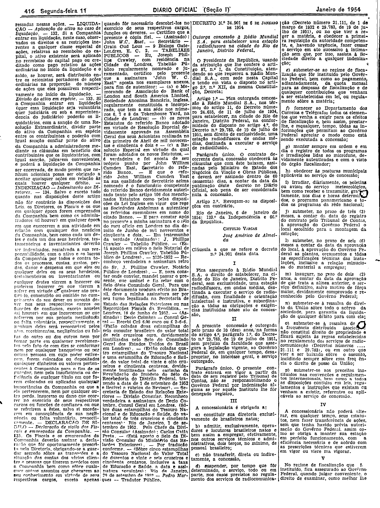
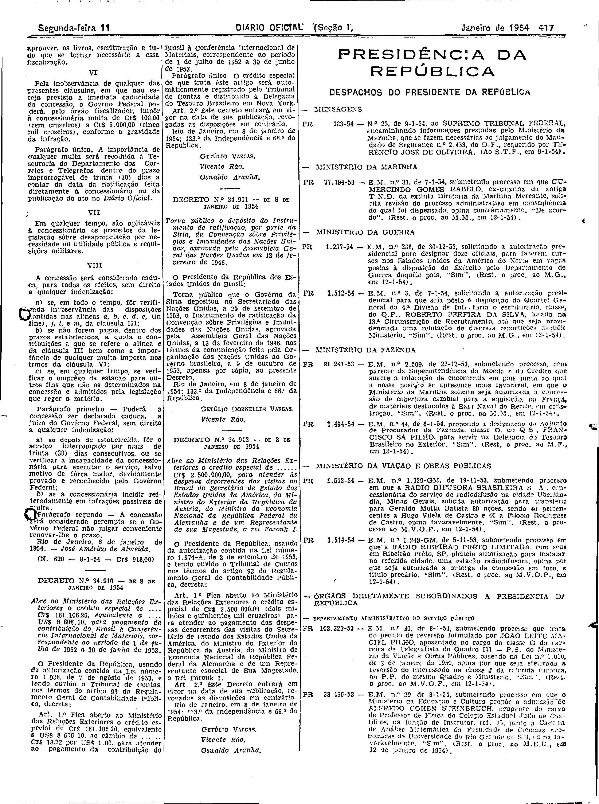

###DEC-034901-0-000-06-01-1954@@@

<strong>DECRETO Nº 34.901, DE 6 DE JANEIRO DE 1954.</strong>

<!-- fac-simile-oficial:inicio -->

## Fac-símile oficial do ato inteiro

Esta norma é reproduzida apenas em imagem. Ela reúne o decreto e as cláusulas que o acompanham, na publicação oficial do _Diário Oficial da União_ (Seção I) de 11 de janeiro de 1954: página 8 do PDF (a partir de DECRETO N.º 34.901 — DE 6 DE JANEIRO DE 1954); página 9 do PDF (até N. 620 — 8-1-54 — Cr$ 918,00).

O texto do Senado que antes constava nesta página foi substituído, para manter uma só versão do ato: ele diverge da publicação oficial em pontos de identificação (por exemplo, “Rádio Municipal S. A.” e “11 de junho de 1934” onde a imagem do Diário Oficial traz “Rádio Mundial S. A.” e “11 de julho de 1934”), e a fonte do Senado não contém as cláusulas.

As imagens são as páginas inteiras, tal como digitalizadas pela Imprensa Nacional, sem recorte, sem redesenho e sem transcrição. Cada página traz também outros atos do mesmo dia. O texto do ato só existe na imagem. Não há OCR validado.

Fonte: Imprensa Nacional, Biblioteca Machado de Assis, arquivo `DO_1_19540111_008.PDF` (SHA-256 `130097340d3f06a7ed05ac190b603302e9415bfc5df0d10d7ce7486f5abd3fe8`), páginas 8, 9 do PDF. SHA-256 das imagens, na ordem: `d11ffe7fa11ed47343e03fc2aa7226f53da9ee7ffe5e00ca6108755beac97635`, `9ff54c0b7b986b92ddb3a3b8a8c9d749c387272941518063f592a8bb5845055c`.

<!-- fac-simile-oficial:fim -->
