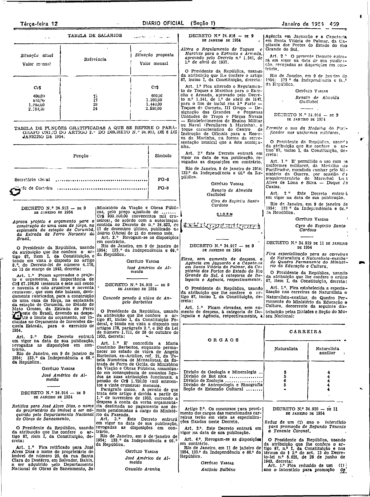

###DEC-034916-0-000-09-01-1954@@@

<strong>DECRETO Nº 34.916, DE 9 DE JANEIRO DE 1954.</strong>

<em><strong>Altera o Regulamento de Toques e Marchas para o Exército e Armada, aprovado pelo Decreto nº 1.541, de 1º de abril de 1937.</strong></em>

<strong>O PRESIDENTE DA REPÚBLICA</strong>, usando da atribuição que lhe confere o art. 87, inciso I da Constituição,

<strong>DECRETA:</strong>

<strong>Art</strong>. 1<strong>º</strong> Fica alterado o Regulamento de Toques e Marchas para o Exército e Armada, aprovado pelo Decreto nº 1.541, de 1º de abril de 1937, para o fim de incluir na 3º Parte - Toques de Corneta, III Grupo - Designação das Grandes e Pequenas Unidades de Tropa e Fôrças Navais - Estabelecimentos de Ensino Militar ou Naval (Peculiares à Marinha), o toque característico do Centro de Intrução de Oficiais para a reserva da Marinha, na forma da representação Musical que a êste acompanha.

<strong>Art</strong>. 2<strong>º</strong> Êste Decreto entrará em vigor na data de sua publicação, revogadas as disposições em contrário.

Rio de Janeiro, 9 de janeiro de 1954; 133º da Independência e 66º da República.

<strong>GETÚLIO VARGAS.</strong>

Renato de Almeida Guillobel

Ciro do Espírito Santo Cardoso

<!-- fac-simile-oficial:inicio -->

## Fac-símile oficial: cláusulas

O texto acima não inclui as cláusulas a que se refere este decreto. A publicação oficial do anexo está em imagem, nas páginas do _Diário Oficial da União_ (Seção I) de 12 de janeiro de 1954: página 5 do PDF (decreto, com o traço musical impresso logo abaixo das assinaturas, sob a legenda «C.I.O.R.M»).

As imagens são as páginas inteiras, tal como digitalizadas pela Imprensa Nacional, sem recorte, sem redesenho e sem transcrição. Cada página traz também outros atos do mesmo dia; a peça deste decreto está apenas no trecho indicado, e o texto do anexo só existe na imagem. Não há OCR validado.

Fonte: Imprensa Nacional, Biblioteca Machado de Assis, arquivo `DO_1_19540112_009.PDF` (SHA-256 `607e8a91b131051a0c2d2540ee7c8c4947db2c6aabafeea6133a55320d30346f`), páginas 5 do PDF. SHA-256 das imagens, na ordem: `f6ef34ec092588c43f09cfb60245040dd9ce84b3e57f4f0b47bfee86d9426807`.

<!-- fac-simile-oficial:fim -->
