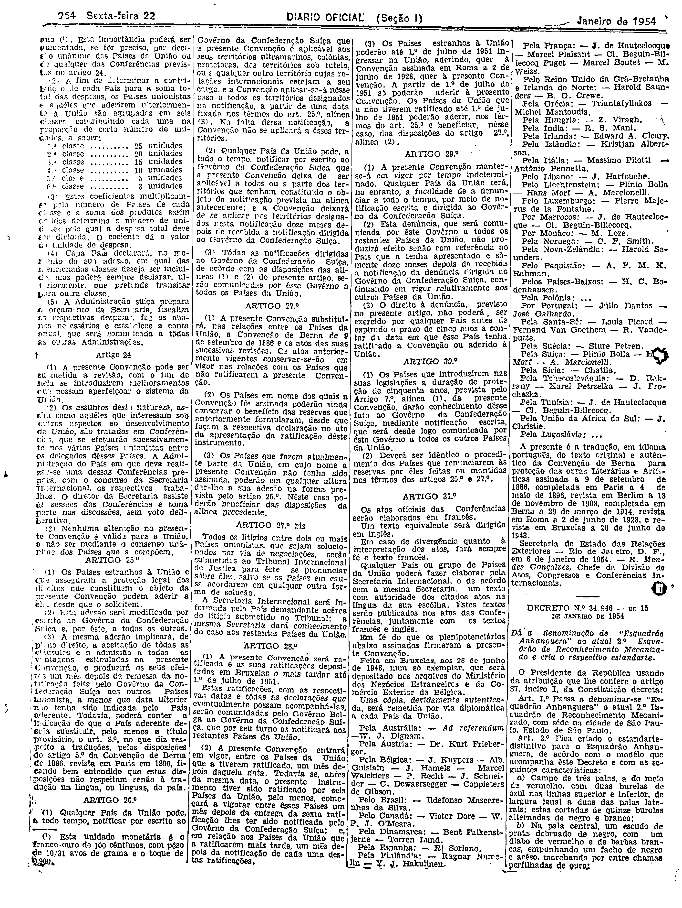
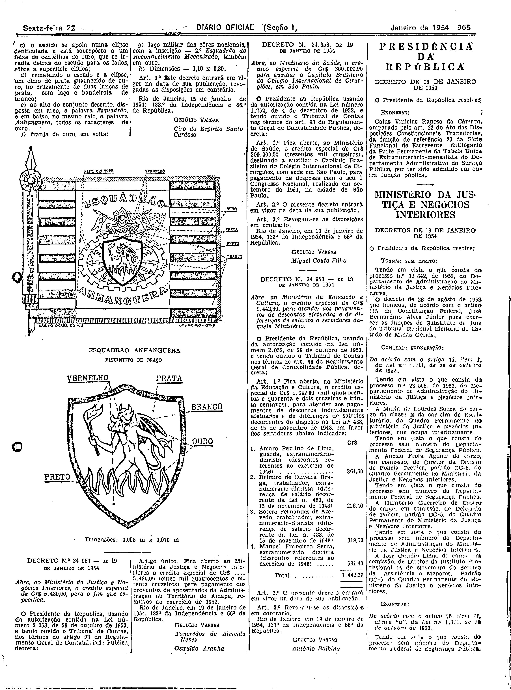

###DEC-034946-0-000-15-01-1954@@@

<strong>DECRETO Nº 34.946, DE 15 DE JANEIRO DE 1.954.</strong>

<em><strong>Dá a denominação de “Esquadrão Anhanquera” ao atual 2° Esquadrão de reconhecimento mecanizado e cria o respectivo estandarte.</strong></em>

<strong>O PRESIDENTE DA REPUBLICA</strong> usando da atribuição que lhe confere o artigo 87, inciso I da Constituição,

<strong>DECRETA:</strong>

<strong>Art</strong> 1<strong>°</strong> passa a denominar-se “Esquadrão Anhanquera” o atual 2° Esquadrão de reconhecimento mecanizado com sede na cidade de São Paulo, Estado de São Paulo

<strong>Art</strong>. 2<strong>°</strong> fica criado o estandarte - distintivo para o Esquadrão Anhanquera, de acôrdo com o modelo que acompanha êste decreto e com as seguintes características:

a).Campo de três palas, a do meio de vermelho, com duas burelas de azul nas linhas superior e inferior de largura igual a duas das palas laterais; estas cortadas de quinze burolas alternadas de negro e branco;

b).Na pala central um escudo de prata debruado de negro, com um diabo de vermelho e de barbas brancas, empunhando um facho de negro e aceso, marchando por entre chamas perfilhadas de ouro

c).O escudo se apoia numa elipse denticulada e está sobrepôsto a um feixe de centélhas de ouro, que se irradia de traz do escudo para os lados, sôbre a superfície elítica

d).Rematando o escudo e a elipse um elmo de prata guarnecido de ouro no cruzamento de duas lanças de prata com laço e bandeirola de branco;

e).Ao alto do conjunto descrito, disposta em arco, a palavra Esquadrão e em baixo, no mesmo raio apalavra Anhanquera todos os caracteres de ouro

f).Franja de ouro, em volta:

g).Laço militares das côres nacionais; com a inscrição - 2º Esquadrão de Reconhecimento Mecanizado; também em ouro

h).Dimensões - 1,10 x 080.

<strong>A</strong>r<strong>t</strong>. 3<strong>º</strong> Êste decreto entrara em vigor na data de sua publicação ,revogadas as disposição em contrário.

Rio de Janeiro 15 de janeiro de 1954; 133º da independência e 66º da Republica .

<strong>GETULIO VARGAS</strong>

Ciro do Espirito Santo Cardoso

<!-- fac-simile-oficial:inicio -->

## Fac-símile oficial: cláusulas

O texto acima não inclui as cláusulas a que se refere este decreto. A publicação oficial do anexo está em imagem, nas páginas do _Diário Oficial da União_ (Seção I) de 22 de janeiro de 1954: página 4 do PDF (a partir de «DECRETO N.º 34.946 — DE 15 DE JANEIRO DE 1954»); página 5 do PDF (continuação, com o desenho do estandarte e a legenda «Dimensões: 0,058 m x 0,070 m»).

As imagens são as páginas inteiras, tal como digitalizadas pela Imprensa Nacional, sem recorte, sem redesenho e sem transcrição. Cada página traz também outros atos do mesmo dia; a peça deste decreto está apenas no trecho indicado, e o texto do anexo só existe na imagem. Não há OCR validado.

Fonte: Imprensa Nacional, Biblioteca Machado de Assis, arquivo `DO_1_19540122_017.PDF` (SHA-256 `bb61b83a735e916afa76df5935f901ed86737132268d61fefcf0eddc19a01e8a`), páginas 4, 5 do PDF. SHA-256 das imagens, na ordem: `c7101753cdb6c8967061c4866c3ddf90a68979df3245bd00c348a870261e4002`, `c8fe05e8c1de5c48cfc919a7963a9ae0b09ded5c1ef78d2420a76bdf5054f4d8`.

<!-- fac-simile-oficial:fim -->
