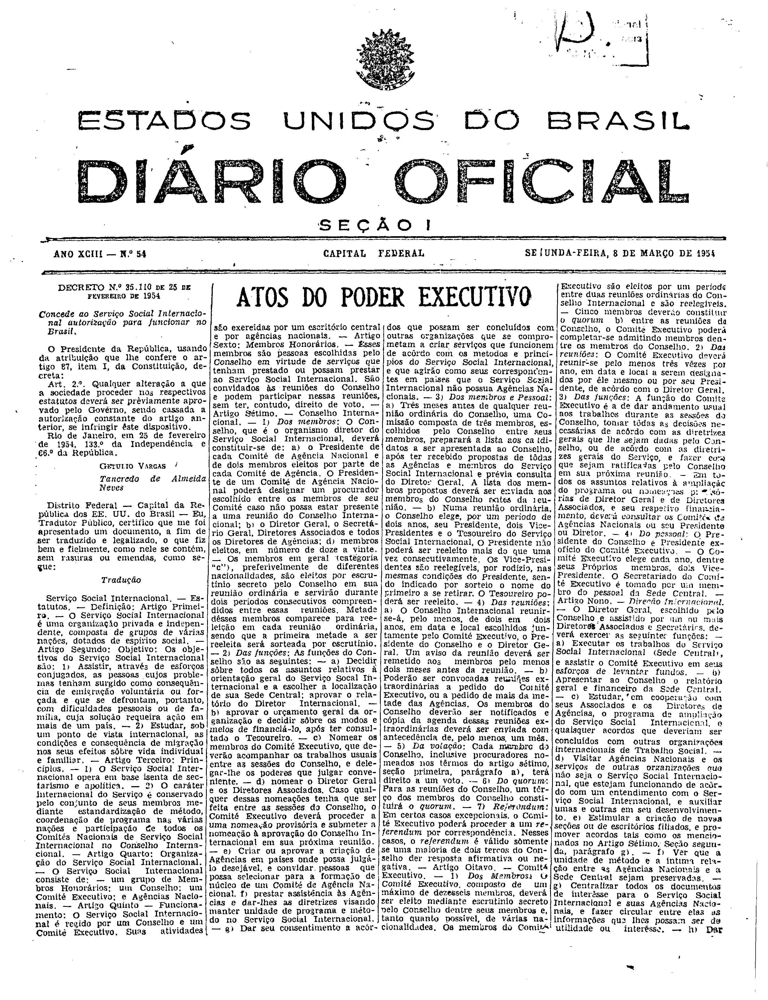
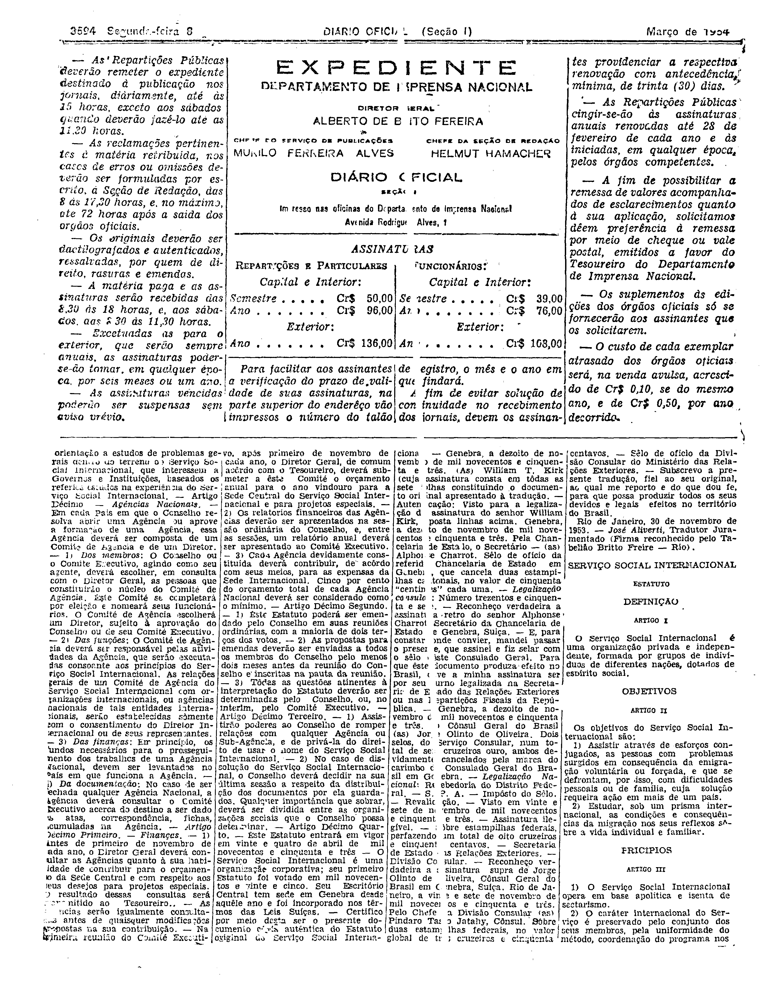
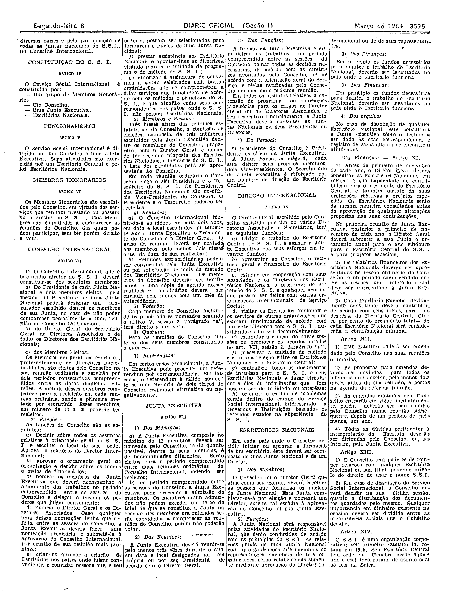
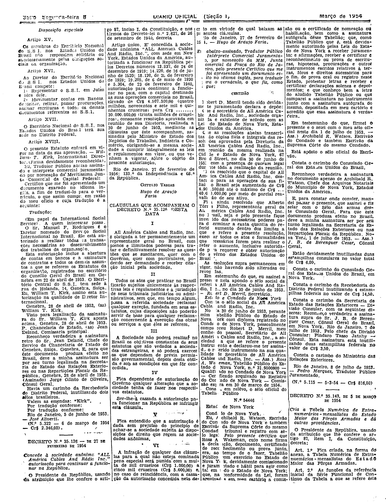

###DEC-035110-0-000-25-02-1954@@@

<strong>DECRETO Nº 35.110, DE 25 DE FEVEREIRO DE 1954.</strong>

<!-- fac-simile-oficial:inicio -->

## Fac-símile oficial do ato inteiro: Estatuto do Serviço Social Internacional (traduções) — instrumento

Esta norma é reproduzida apenas em imagem. As páginas inteiras do _Diário Oficial da União_ (Seção I) de 8 de março de 1954 trazem o decreto e o instrumento que o acompanha: PDF `DO_1_19540308_054.PDF`, p.1 do PDF (impressa 3593, inferida: capa sem folio visível), p.2 do PDF (impressa 3594), p.3 do PDF (impressa 3595), p.4 do PDF (impressa 3596).

O texto do Senado que antes constava aqui foi retirado para manter uma só versão do ato: não foi colacionado palavra a palavra com o impresso.

**Numeração impressa:** o decreto impresso no DOU traz «Art. 2.º» logo após «decreta:», sem «Art. 1º»; a numeração não foi normalizada.

**Limites lidos nas imagens:** p.3593 (PDF 1): col.1 topo = Decreto 35.110 (impresso com «Art. 2.º» logo após «decreta:»; sem «Art. 1º» no impresso; GETÚLIO VARGAS / Tancredo de Almeida Neves); a partir de «Distrito Federal — Capital da República… Tradutor Público certifico…» a tradução do Estatuto (Artigos Primeiro…) corre por todas as colunas. p.3594 (PDF 2): cols.1–4 da metade superior = EXPEDIENTE (fora da peça); metade inferior cols.1–4: fim da primeira versão (Arts. Décimo… Décimo Quarto), legalizações (William T. Kirk), «Rio de Janeiro, 30 de novembro de 1953. — José Aliverti», e col.4 «SERVIÇO SOCIAL INTERNACIONAL — ESTATUTO — DEFINIÇÃO…» (segunda versão). p.3595 (PDF 3): cols.1–4 estatuto (Art. III–XIV). p.3596 (PDF 4): col.1 topo «Disposições especiais» Art. XV–XVIII, carta Manuel F. Rodrigues e «Por tradução conforme… José Aliverti. (N.º 5.322 — 6 de março de 1954 — Cr$ 2.346,00)»; a partir daí começa o Decreto 35.126 (ALL America Cables) — fora da peça.

**Assinatura(s):** William T. Kirk (Diretor Internacional, assinatura reproduzida); José Aliverti (tradutor juramentado)

As imagens são as páginas inteiras, extraídas do PDF com `pdfimages -png` (imagem JBIG2 embutida, uma por página, sem reduzir), sem recorte, sem redesenho e sem transcrição. Cada página traz também outros atos do mesmo dia; a peça está apenas no trecho indicado. O texto do ato só existe na imagem. Não há OCR validado.

Fonte: Imprensa Nacional, Biblioteca Machado de Assis, `DO_1_19540308_054.PDF` (SHA-256 `8f46bafdacd0005110a302045412753319d48fd87a3c437d9c868642c2c3527d`). SHA-256 das imagens, na ordem: `552229a6677acdc1349f231ab5900e75451ac58edbb7db0a067edc9b6cdb36bb`, `57d58104794c2de770640057c7f9aff55cdb04c28a2407b405e89cf14643a586`, `170692bc67c05f17fa89f8d0a9bf7a5e5d0482810e16c55a0914a7be60bc1e3b`, `586501b187f6f1c18d662371e536bea259e0ef5857de3145458b66040577adc1`.

[PDF da edição oficial](https://biblioteca.in.gov.br/documents/271518/581333/DO_1_19540308_054.PDF/a8cd5d60-b2cb-5d64-b149-00942f43291e?t=1574962230400&download=true).

<!-- fac-simile-oficial:fim -->
