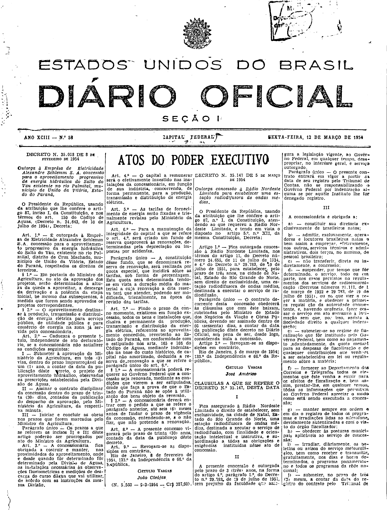

###DEC-035147-0-000-05-03-1954@@@

<strong>DECRETO Nº 35.147, DE 5 DE MARÇO DE 1954.</strong>

<em><strong>Outorga concessão a Rádio Nordeste Limitada para estabelecer uma estação radiodifusora de ondas médias.</strong></em>

<strong>O PRESIDENTE DA REPÚBLICA</strong>, usando da atribuição que lhe confere o artigo 87, nº I, da Constituição, atendendo ao que requereu a Rádio Nordeste Limitada, e tendo em vista o disposto no artigo 5º, nº XII, da mesma Constituição,

<strong>DECRETA:</strong>

<strong>Art</strong>. 1º - Fica outorgada concessão à Rádio Nordeste Limitada, nos têrmos do artigo 11, do Decreto número 24.655, de 11 de julho de 1934, e 4º do Decreto nº 29.783, de 19 de julho de 1951, para estabelecer, pelo prazo de três anos, na cidade de Natal, Estado do Rio Grande do Norte, sem direito de exclusividade, uma estação radiodifusora de ondas médias, destinada a executar o serviço de radiodifusão.

Parágrafo único - O contrato de decorrente desta concessão obedecerá às cláusulas que com êste baixam, rubricadas pelo Ministro de Estado dos Negócios da Viação e Obras Públicas, devendo ser assinado dentro de 60 (sessenta) dias, a contar da data da publicação dêste decreto no <em>Diário Oficial</em>, sob pena de ser, desde logo, considerada nula a concessão.

<strong>Art</strong> 2º - Revogam-se as disposições em contrário.

Rio de Janeiro, 5 de março de 1954; 133º da Independência e 66º da República.

<strong>GETÚLIO VARGAS</strong>

José Américo

<!-- fac-simile-oficial:inicio -->

## Fac-símile oficial: cláusulas

O texto acima não inclui as cláusulas a que se refere este decreto. A publicação oficial do anexo está em imagem, nas páginas do _Diário Oficial da União_ (Seção I) de 12 de março de 1954: p. 3945 (a partir de CLÁUSULAS A QUE SE REFERE O DECRETO N. 35.147); p. 3946 (até N. 5.615).

As imagens são as páginas inteiras, tal como digitalizadas pela Imprensa Nacional, sem recorte, sem redesenho e sem transcrição. Cada página traz também outros atos do mesmo dia; a peça deste decreto está apenas nas colunas indicadas, e o texto do anexo só existe na imagem. Não há OCR validado.

Fonte: Imprensa Nacional, Biblioteca Machado de Assis, arquivo `DO_1_19540312_058.PDF` (SHA-256 `2f7517ba7bd78701146160695cb4d7407f8479c62d87cc913943fbfee400c0cf`), páginas 1, 2 do PDF. SHA-256 das imagens, na ordem: `caececa9f4af3fdbc0b03819dcdecc73988146214246af1bfe99a6b8e7bb9214`, `5bd1910add193972dd7951dd3cfa5a59180c7a57284d4b83ad1f667b05058c05`.

<!-- fac-simile-oficial:fim -->
