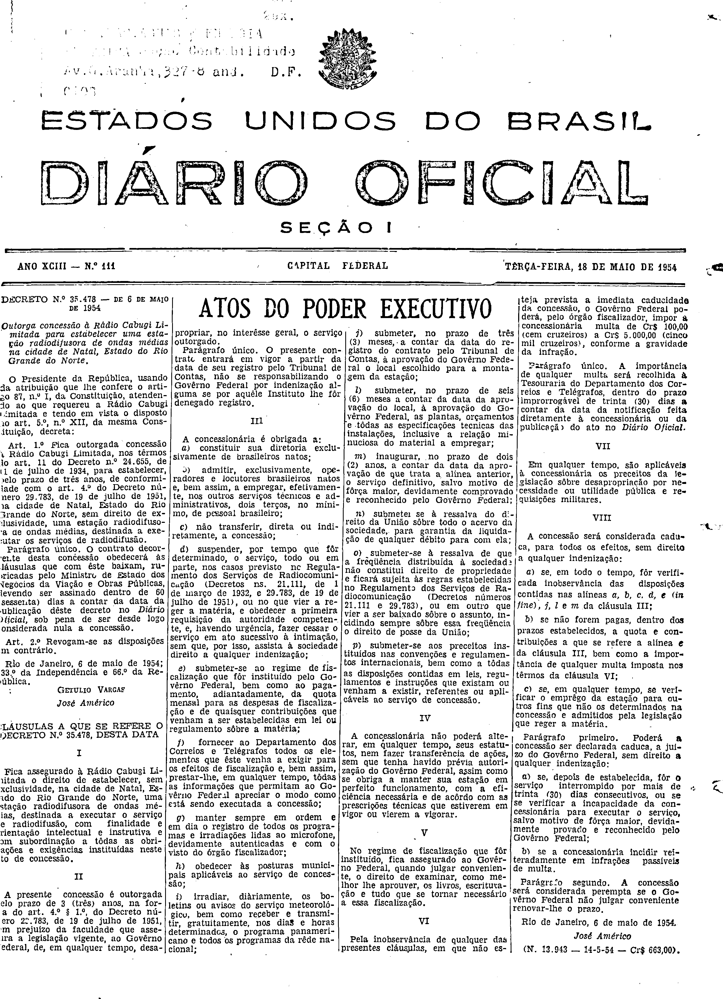

###DEC-035478-0-000-06-05-1954@@@

<strong>DECRETO N. 35.478 – DE 6 DE MAIO DE 1954</strong>

<em><strong>Outorga concessão à Rádio Cabugi limitada para estabelecer uma estação radiodifusora de ondas médias na cidade de Natal, Estado do Rio Grande do Norte.</strong></em>

O Presidente da República, usando da atribuição que lhe confere o artigo 87, nº I, da Constituição, atendendo ao que requereu a Rádio Cabugi Limitada e tendo em vista o disposto no art. 5º, nº XII, da mesma Constituição,

<strong>DECRETA:</strong>

<strong>Art.</strong> 1º Fica outorgada concessão à Rádio Cabugi Limitada, nos têrmos do art. 11 do Decreto nº 24.655, de 11 de julho de 1934, para estabelecer, pelo prazo de três anos, de conformidade com o art. 4º do Decreto número 29.783, de 19 de julho de 1951, na cidade de Natal, Estado do Rio Grande do Norte, sem direito de exclusividade, uma estação radiodifusora de ondas médias, destinada a executar os serviços de radiodifusão.

Parágrafo único. O contrato decorrente desta concessão obedecerá às cláusulas que com êste baixam, rubricadas pelo Ministro de Estado dos Negócios da Viação e Obras Públicas, devendo ser assinado dentro de 60 (sessenta) dias a contar da data da publicação dêste decreto no Diário Oficial, sob pena de ser desde logo considerada nula a concessão.

<strong>Art.</strong> 2º Revogam-se as disposições em contrário.

Rio de Janeiro, 6 de maio de 1954; 133º da Independência e 66º da República.

<strong>GETULIO VARGAS</strong>

José Américo

<!-- fac-simile-oficial:inicio -->

## Fac-símile oficial: cláusulas

O texto acima não inclui as cláusulas a que se refere este decreto. A publicação oficial do anexo está em imagem, nas páginas do _Diário Oficial da União_ (Seção I) de 18 de maio de 1954: página 1 do PDF (capa do caderno) (a partir de «CLÁUSULAS A QUE SE REFERE O DECRETO N.º 35.478, DESTA DATA», até «N. 13.943 — 14-5-54 — Cr$ 663,00»).

As imagens são as páginas inteiras, tal como digitalizadas pela Imprensa Nacional, sem recorte, sem redesenho e sem transcrição. Cada página traz também outros atos do mesmo dia; a peça deste decreto está apenas no trecho indicado, e o texto do anexo só existe na imagem. Não há OCR validado.

Fonte: Imprensa Nacional, Biblioteca Machado de Assis, arquivo `DO_1_19540518_111.PDF` (SHA-256 `79f4014427cee4f0ae05385829d1604c08743a914b1b98b561d0a5ee148370da`), páginas 1 do PDF. SHA-256 das imagens, na ordem: `6bc5570d8f3616dde8ccf73b4e5ecc82575ad8620de91112c93ded25e156e04e`.

<!-- fac-simile-oficial:fim -->
