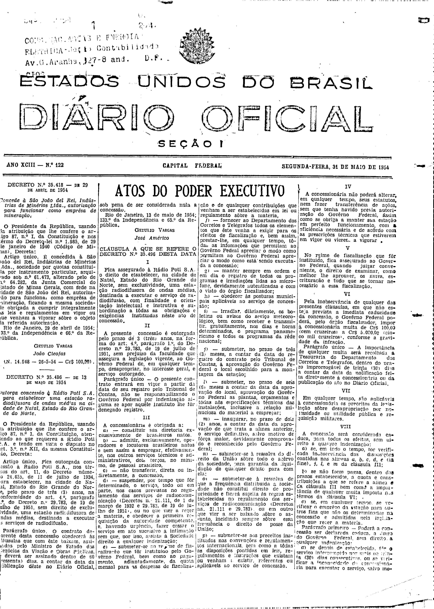
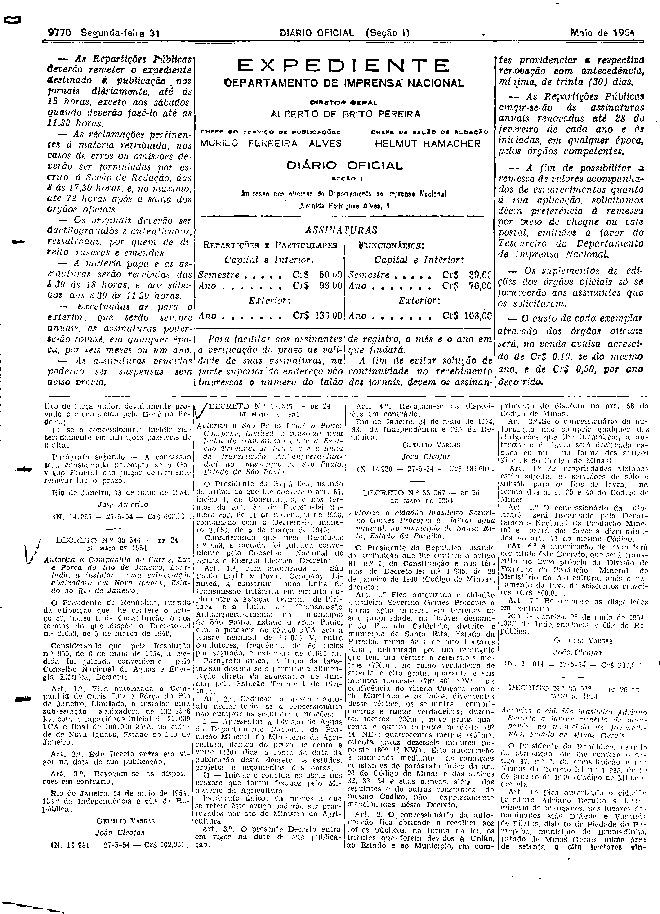

###DEC-035496-0-000-13-05-1954@@@

<strong>DECRETO Nº 35.496, DE 13 DE MAIO DE 1954.</strong>

<em><strong>Outorga concessão à Rádio Poti S.A. para estabelecer uma estação rediodifusora de ondas médias na cidade de Natal, Estado do Rio Grande do Norte.</strong></em>

<strong>O</strong> <strong>PRESIDENTE DA REPÚBLICA</strong>, usando da atribuição que lhe confere o art. 87, nº I, da Constituição, atendendo ao que requereu a Rádio Poti S.A. e tendo em vista o disposto no art. 5º nº XII, da mesma Constituição,

<strong>DECRETA:</strong>

Artigo único. Fica outorgada concessão à Rádio Poti S.A. nos têrmos do art. 11, do Decreto número 24.655, de 11 de julho de 1934, para estabelecer, na cidade de Natal, Estado do Rio Grande do Norte, pelo prazo de três (3) anos, na conformidade do art. 4º, parágrafo 1º, do Decreto nº 29.783, de 19 de julho de 1951, sem direito de exclusividade, uma estação rediodifusora de ondas médias, destinadas a executar os serviços de radiodifusão.

Parágrafo único. O contrato decorrente desta concessão obedecerá às cláusulas que com êste baixam, assinadas pelo Ministro de Estado dos Negócios da Viação e Obras Públicas, e deverá ser assinado dentro de 60 (sessenta) dias, a contar da data da publicação dêste no <em>Diário</em> <em>Oficial</em>, sob pena de ser considerada nula a concessão.

Rio de Janeiro, 13 de maio de 1954; 133º da Independência e 66º da República.

<strong>GETÚLIO VARGAS</strong>

José Américo

<!-- fac-simile-oficial:inicio -->

## Fac-símile oficial: cláusulas

O texto acima não inclui as cláusulas a que se refere este decreto. A publicação oficial do anexo está em imagem, nas páginas do _Diário Oficial da União_ (Seção I) de 31 de maio de 1954: capa (1ª página do caderno, sem numeração impressa; página 1 do PDF) (a partir de CLÁUSULA A QUE SE REFERE O DECRETO N.º 35.496); p. 9770 (até N. 14.987).

As imagens são as páginas inteiras, tal como digitalizadas pela Imprensa Nacional, sem recorte, sem redesenho e sem transcrição. Cada página traz também outros atos do mesmo dia; a peça deste decreto está apenas nas colunas indicadas, e o texto do anexo só existe na imagem. Não há OCR validado.

Fonte: Imprensa Nacional, Biblioteca Machado de Assis, arquivo `DO_1_19540531_122.PDF` (SHA-256 `20de310de4a08155d97b82032b9c175c636c46892305471863db8ff9a8495570`), páginas 1, 2 do PDF. SHA-256 das imagens, na ordem: `d7beea5c0237c59c77eba132ca9b46dd497dfca757943906dfa1e5cb60800e33`, `a9b2a31faa722fa0fa879edf2d3a2d1d007b32179f6ff194e8186562b236d9ae`.

<!-- fac-simile-oficial:fim -->
