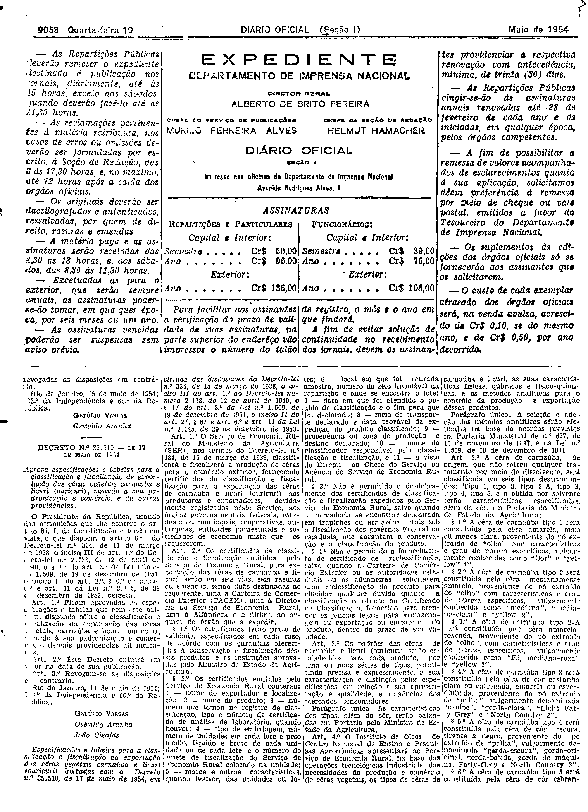
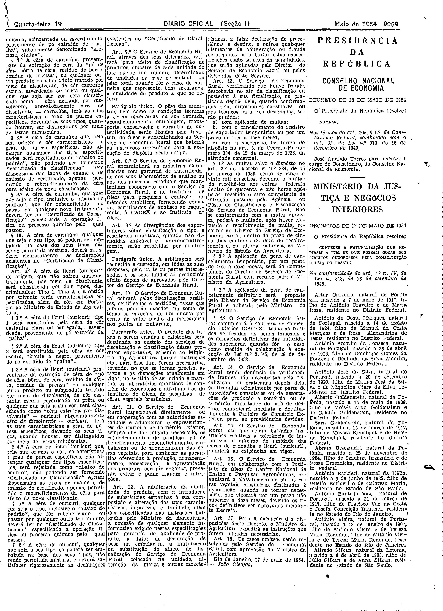

###DEC-035510-0-000-17-05-1954@@@

<strong>DECRETO Nº 35.510, DE 17 DE MAIO DE 1954.</strong>

<em><strong>Aprova especificações e tabelas para a classificação e fiscalização de exportação das cêras vegetais carnaúba e licuri (ouricurí), visando à sua padronização e comércio, e dá outras providências.</strong></em>

<strong>O PRESIDENTE DA REPÚBLICA</strong>, usando da atribuição que lhe confere o artigo 87, I, da Constituição e tendo em vista o que dispõem o artigo 6º do Decreto-lei nº 334, de 11 de março de 1938, o inciso III do art. 1º do Decreto-lei nº 2.138, de 12 de abril de 1940, o § 1º do art. 3º da Lei nº 1.509, de 19 de dezembro de 1951, o inciso II do art. 2º, § 6º do artigo 6º e art. 11 da Lei nº 2.145, de 29 de dezembro de 1953,

<strong>DECRETA:</strong>

<strong>Art</strong>. 1º Ficam aprovadas as especificações e tabelas que com êste baixam, dispondo sôbre a classificação e fiscalização da exportação das cêras vegetais, carnaúba e licuri (ouricurí), visando à sua padronização e comércio, e demais providências alí indicadas.

<strong>Art</strong>. 2º Êste Decreto entrará em vigor na data de sua publicação.

<strong>Art</strong>. 3º Revogam-se as disposições em contrário.

Rio de Janeiro, 17 de maio de 1954; 133º da Independência e 66º da República.

<strong>GETÚLIO VARGAS</strong>

Oswaldo Aranha

João Cleofas

<!-- fac-simile-oficial:inicio -->

## Fac-símile oficial: tabela

O texto acima não inclui a tabela a que se refere este decreto. A publicação oficial do anexo está em imagem, nas páginas do _Diário Oficial da União_ (Seção I) de 19 de maio de 1954: página 2 do PDF (a partir de «Especificações e tabelas para a classificação e fiscalização da exportação das cêras vegetais carnaúba e licuri (ouricuri) baixadas com o Decreto n.º 35.510, de 17 de maio de 1954»); página 3 do PDF (até «Rio de Janeiro, 17 de maio de 1954. — João Cleofas.»).

As imagens são as páginas inteiras, tal como digitalizadas pela Imprensa Nacional, sem recorte, sem redesenho e sem transcrição. Cada página traz também outros atos do mesmo dia; a peça deste decreto está apenas no trecho indicado, e o texto do anexo só existe na imagem. Não há OCR validado.

Fonte: Imprensa Nacional, Biblioteca Machado de Assis, arquivo `DO_1_19540519_112.PDF` (SHA-256 `e7c282c546405899c2984a312373e4c4d9868586e4de456708533e0c35566515`), páginas 2, 3 do PDF. SHA-256 das imagens, na ordem: `c5284a86c65df6f778857d79226ff2c94a2b4b786280b421b0a4cf66e66adc6a`, `c7dc7a7514e5403c21896f231245c566cf1f0a201de5d18a0162957ddc5b1b95`.

<!-- fac-simile-oficial:fim -->
