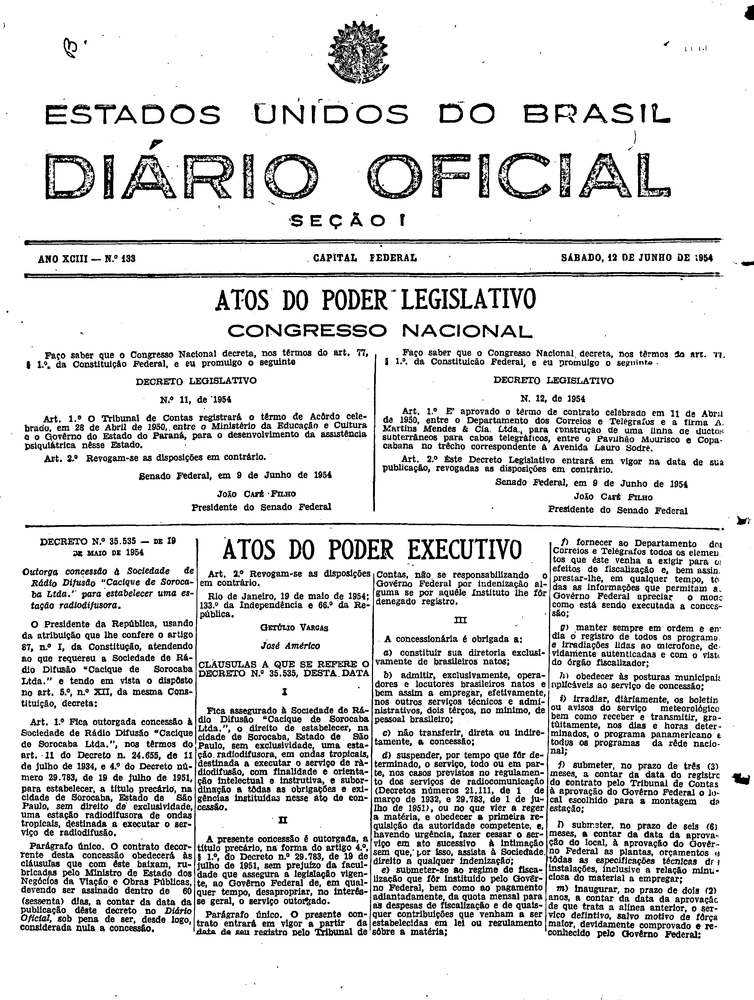
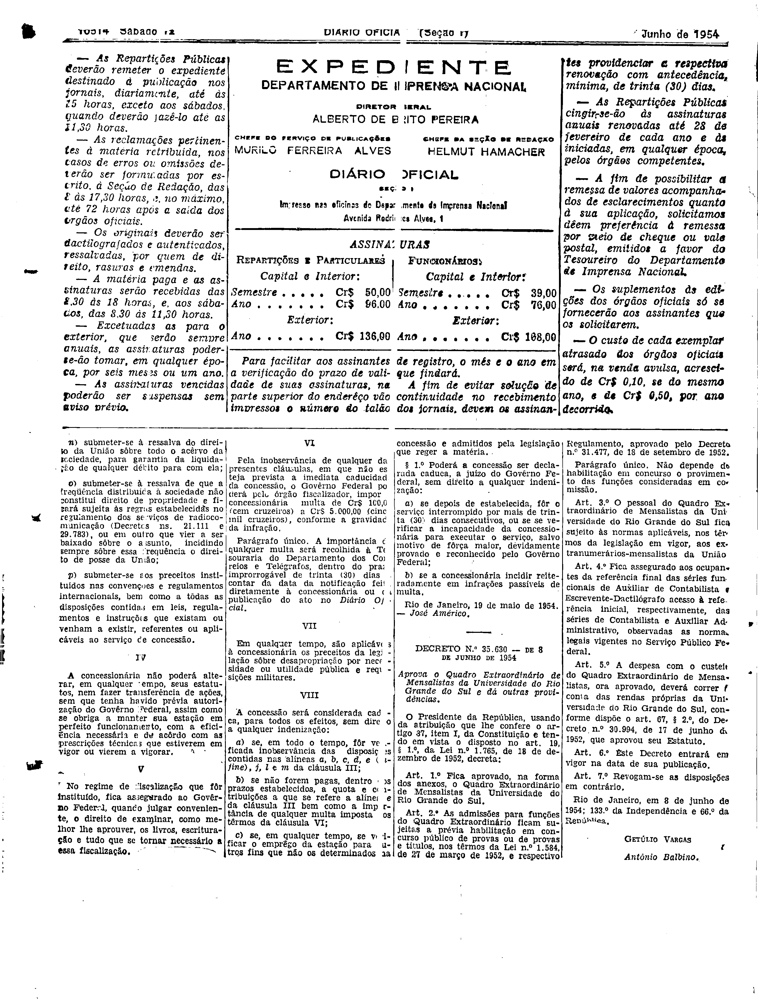

###DEC-035535-0-000-19-05-1954@@@

<strong>DECRETO Nº 35.535, DE 19 DE MAIO DE 1954.</strong>

<em><strong>Outorga concessão à Sociedade de Rádio Difusão ”Cacique de Sorocaba Ltda.” para estabelecer uma estação radiodifusória.</strong></em>

<strong>O PRESIDENTE DA REPÚBLICA</strong>, usando da atribuição que lhe confere o artigo 87, nº I, da Constituição, atendendo ao que requereu a Sociedade de Rádio Difusão “Cacique de Sorocaba Ltda.” e tendo em vista o dispôsto no art. 5º, nº XII, da mesma Constituição,

<strong>DECRETA:</strong>

<strong>Art</strong>. 1.º Fica outorgada concessão à Sociedade de Rádio Difusão “Cacique de Sorocaba Ltda.”, nos têrmos do art. 11 do Decreto nº 24.655, de 11 de julho de 1934, e 4º do Decreto número 29.783, de 19 de julho de 1951, para estabelecer, a título precário, na cidade de Sorocaba, Estado de São Paulo, sem direito de exclusividade, uma estação radiofusora de ondas tropicais, destinada a executar o serviço de radiodifusão.

Parágrafo único. o contrato decorrente desta concessão obedecerá às clausulas que com êste baixam, rubricadas pelo Ministro de Estado dos Negócios da Viação e Obras Públicas, devendo ser assinado dentro de 60 (sessenta) dias, a contar data de publicação dêste decreto no <em>Diário</em> <em>Oficial</em>, sob pena de ser, desde logo, considerada nula a concessão.

<strong>Art</strong>. 2.º Revogam-se as disposições em contrário.

Rio de Janeiro, 19 de maio de 1954; 133º da Independência e 66º da República.

<strong>GETÚLIO VARGAS</strong>

José Américo

<!-- fac-simile-oficial:inicio -->

## Fac-símile oficial: cláusulas

O texto acima não inclui as cláusulas a que se refere este decreto. A publicação oficial do anexo está em imagem, nas páginas do _Diário Oficial da União_ (Seção I) de 12 de junho de 1954: página 1 do PDF (capa do caderno) (a partir de «CLÁUSULAS A QUE SE REFERE O DECRETO N.º 35.535, DESTA DATA»); página 2 do PDF (até «Rio de Janeiro, 19 de maio de 1954. — José Américo.»).

As imagens são as páginas inteiras, tal como digitalizadas pela Imprensa Nacional, sem recorte, sem redesenho e sem transcrição. Cada página traz também outros atos do mesmo dia; a peça deste decreto está apenas no trecho indicado, e o texto do anexo só existe na imagem. Não há OCR validado.

Fonte: Imprensa Nacional, Biblioteca Machado de Assis, arquivo `DO_1_19540612_133.PDF` (SHA-256 `518c39ce23a19a48966ef073cacc8f4b4e4e64669da3b7fb929e62d2bab7024f`), páginas 1, 2 do PDF. SHA-256 das imagens, na ordem: `c8a3e3526f3cb25f826ba34796f414fa34c83dfa9a40f4e3d379767f1f615643`, `12e47610b206c0803003cda92205fe10aea5c8a492b829fabbe1bf9030ae7124`.

<!-- fac-simile-oficial:fim -->
