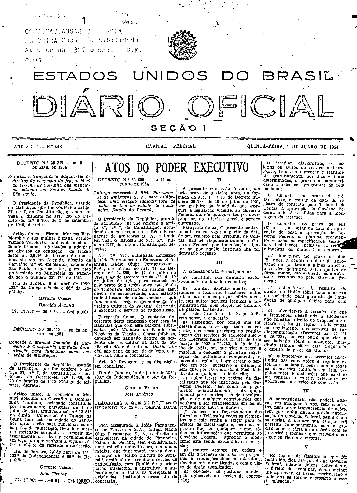
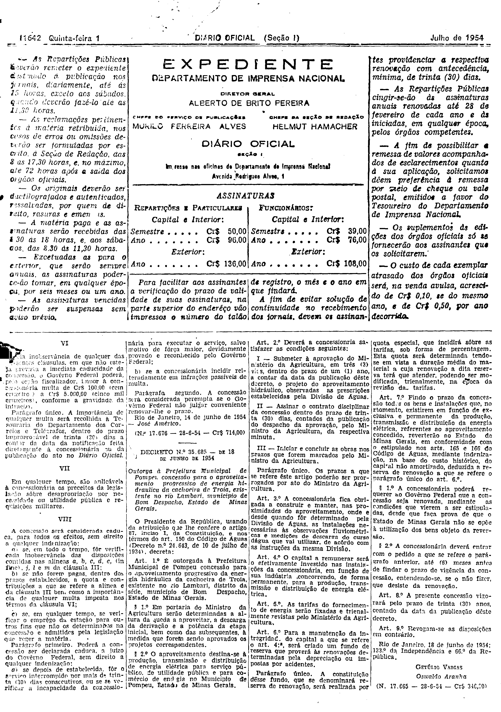

###DEC-035655-0-000-14-06-1954@@@

<strong>DECRETO Nº 35.655, DE 14 DE JUNHO DE 1954.</strong>

<em><strong>Outorga concessão à Rêde Paranaense de Emissoras S. A. para estabelecer uma estação rádiodifusora de ondas médias na cidade de Timoneira, Estado do Paraná.</strong></em>

<strong>O PRESIDENTE DA REPÚBLICA</strong>, usando da atribuição que lhe confere o art. 87, nº I, da Constituição, atendendo ao que requereu a Rêde Paranaense de Emissoras S. A. e tendo em vista o disposto no art. 5º número XII, da mesma Constituição,

<strong>DECRETA:</strong>

<strong>Art</strong>. 1º Fica outorgada a concessão à Rêde Paranaense de Emissoras S. A. Antiga Rádio Clube Pontagrossense S. A., nos têrmos do art. 11, do Decreto nº 24.655, de 11 de julho de 1934, e 4º do Decreto nº 29.783, de 19 de julho de 1951, para estabelecer, pelo prazo de três (3) anos, na cidade de Timoneira, Estado do Paraná, sem direito de exclusividade, uma estação radiodifusora de ondas médias, que funcionará sob a denominação de “Rádio Cultura do Paraná” destinada a executar o serviço de radiodifusão.

Parágrafo único. O contrato decorrente desta concessão obedecerá as clausulas que com êste baixam, rubricado pelo Ministro de Estado dos Negócios da Viação e Obras Públicas, devendo ser assinado dentro de sessenta dias, a contar da data da publicação dêste decreto no <em>Diário Oficial</em> sob pena de ser, desde logo, considerada nula a concessão.

<strong>Art</strong>. 2º Revogam-se as disposições em contrário.

Rio de Janeiro, 14 de junho de 1954; 133º da Independência e 66º da República.

<strong>GETÚLIO VARGAS</strong>

José Américo

<!-- fac-simile-oficial:inicio -->

## Fac-símile oficial: cláusulas

O texto acima não inclui as cláusulas a que se refere este decreto. A publicação oficial do anexo está em imagem, nas páginas do _Diário Oficial da União_ (Seção I) de 1 de julho de 1954: capa (1ª página do caderno, sem numeração impressa; página 1 do PDF) (a partir de CLÁUSULAS A QUE SE REFERE O DECRETO N.º 35.655); p. 11642 (até N. 17.676).

As imagens são as páginas inteiras, tal como digitalizadas pela Imprensa Nacional, sem recorte, sem redesenho e sem transcrição. Cada página traz também outros atos do mesmo dia; a peça deste decreto está apenas nas colunas indicadas, e o texto do anexo só existe na imagem. Não há OCR validado.

Fonte: Imprensa Nacional, Biblioteca Machado de Assis, arquivo `DO_1_19540701_148.PDF` (SHA-256 `f1b905c23c4acf58fe507f9492348bab25d92fd7929b98930b8fe72f1710c0a9`), páginas 1, 2 do PDF. SHA-256 das imagens, na ordem: `a0ac29b5b1f33c467e23d42ec6b5cacb442489ae94e9d8aedd2f495d9482f98a`, `eb80f6cf4ae71b1b56da4328b5ed6cbb0b304866a1fa85b1f82174831e7bcaaa`.

<!-- fac-simile-oficial:fim -->
