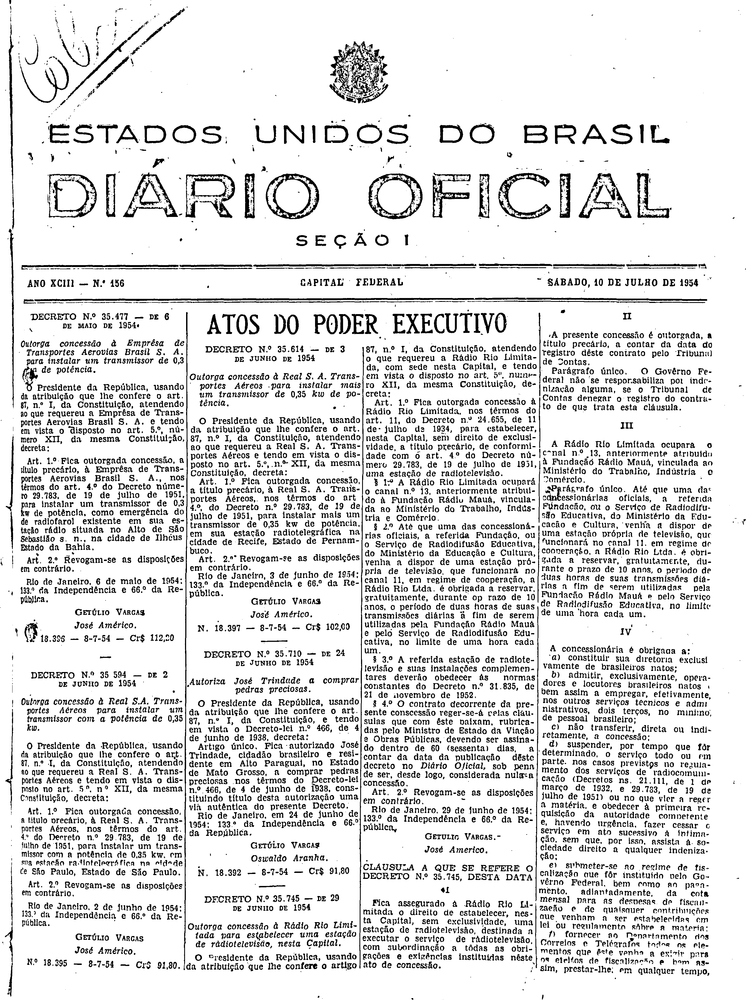
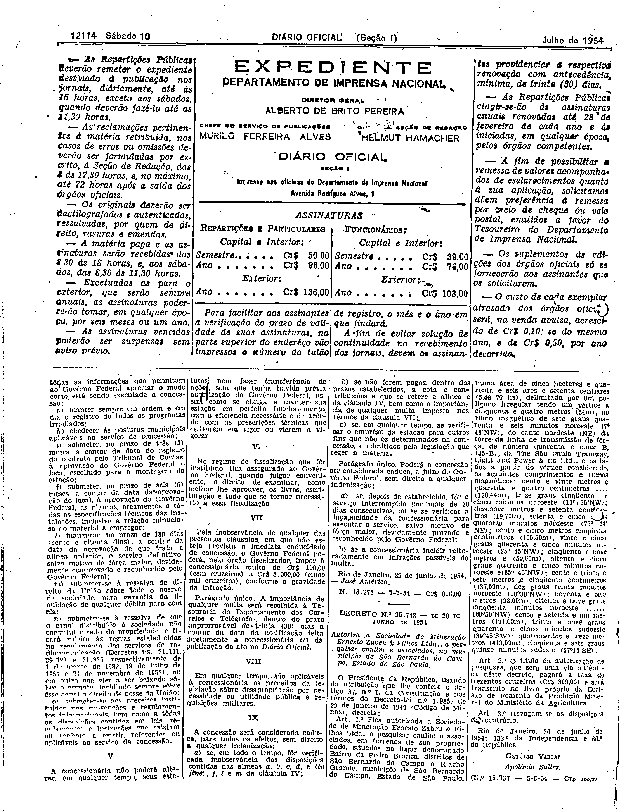

###DEC-035745-0-000-29-06-1954@@@

<strong>DECRETO Nº 35.745, DE 29 DE JUNHO DE 1954</strong>

<em><strong>Outorgada concessão à radio Rio Limitada para estabelecer uma estação rádiotelevisão, nesta Capital.</strong></em>

<strong>O PRESIDENTE DA REPÚBLICA</strong>, usando da atribuição que lhe confere o artigo 87, nº I, da constituição, atendendo o que requereu a Rádio Rio Limitada, com sede nesta capital, e tendo em vista o disposto no art. 5º número XII, da mesma Constituição,

<strong>DECRETA:</strong>

<strong>Art</strong>. 1º fica outorgada concessão à Rádio Rio Limitada, nos têrmos art.11, do Decreto nº 24.655 de 11 de julho de 1934, para estabelecer, nesta Capital, sem direito de exclusividade, a título precário, de conformidade com o art. 4º do Decreto número 29.783, de 19 de julho de 1951, uma estação de radiotelevisão.

§ 1º. A Rádio Rio Limitada ocupará o canal nº 13, anteriormente atribuída a função Rádio Mauá, vinculada ao ministério do Trabalho, Indústria e Comércio.

§ 2º. Até que uma das concessionárias oficiais a referida Fundação ou o Serviço de radiodifusão Educativa, do Ministério da Educação e Cultura, venha a dispor de uma estação própria de televisão, que funcionará no canal 11 em regime de cooperação, a Rádio rio LTDA. é obrigada a reservar; gratuitamente, durante o prazo de 10 anos o período de duas horas de suas transmissões diárias a fim de serem utilizadas pela fundação Rádio Mauá e pelo serviço de Radiodifusão Educativa, no limite de uma hora cada um.

§ 3º A referência estação de radiotelevisão e suas instalações complementares deverão obedecer às normas constantes no Decreto nº 31.835, de 21 de novembro de 1952.

§ 4º O contrato decorrente da presente concessão reger-se-á pelas clausulas que com êste baixam, rubricadas pelo Ministro de Estado de Viação e Obras Públicas, devendo ser assinada dentro de 60 (sessenta) dias, a contar da data da publicação deste Decreto no <em>Diário</em> <em>Oficial</em>, sob pena de ser, desde logo, considerada nula concessão.

<strong>Art</strong>. 2º Revogam-se as disposições em contrário.

Rio de Janeiro, 29 de julho de 1954; 133º da independência e 66º da República.

<strong>GETÚLIO VAGAS</strong>

José Américo

<!-- fac-simile-oficial:inicio -->

## Fac-símile oficial: cláusulas

O texto acima não inclui as cláusulas a que se refere este decreto. A publicação oficial do anexo está em imagem, nas páginas do _Diário Oficial da União_ (Seção I) de 10 de julho de 1954: página 1 do PDF (capa do caderno) (a partir de CLÁUSULA A QUE SE REFERE O DECRETO N.º 35.745); página 2 do PDF (até N. 18.271).

As imagens são as páginas inteiras, tal como digitalizadas pela Imprensa Nacional, sem recorte, sem redesenho e sem transcrição. Cada página traz também outros atos do mesmo dia; a peça deste decreto está apenas no trecho indicado, e o texto do anexo só existe na imagem. Não há OCR validado.

Fonte: Imprensa Nacional, Biblioteca Machado de Assis, arquivo `DO_1_19540710_156.PDF` (SHA-256 `8bf83ea06b81d6545b5132cef40861e09d66207ae89395cae0d0ab5740a79d01`), páginas 1, 2 do PDF. SHA-256 das imagens, na ordem: `640338ece9426698c4e0b38fdacca8bc15d0e931e1a9a83b6f70a9036c78f32e`, `570250a54a052f812f3ad8d5ab2782b2cecf16031c183936f6f5d9c37c60b5f2`.

<!-- fac-simile-oficial:fim -->
