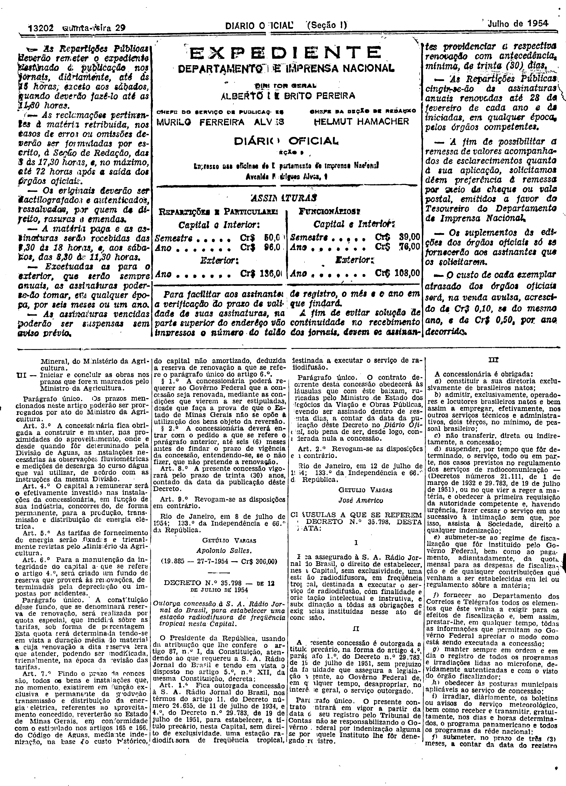
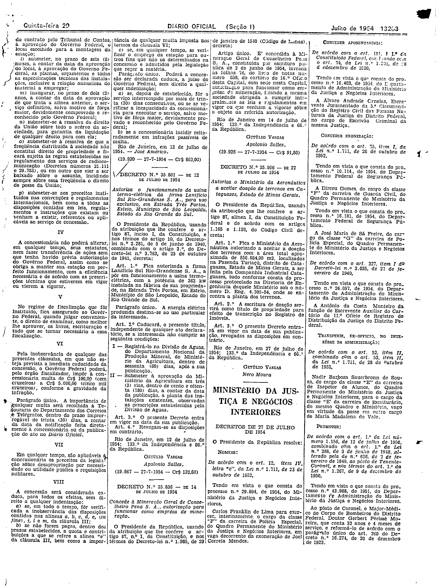

###DEC-035798-0-000-12-07-1954@@@

<strong>DECRETO Nº 35.798, DE 12 DE JULHO DE 1954.</strong>

<em><strong>Outorga concessão à S.A. Rádio Jornal do Brasil, para estabelecer uma estação radiodifusora de freqüência tropical nesta Capital.</strong></em>

<strong>O PRESIDENTE DA REPÚBLICA</strong>, usando da atribuição que lhe confere o art. 87, nº I, da Constituição, atendendo ao que requer a S.A. Rádio Jornal do Brasil e tendo em vista o disposto no artigo 5º, nº XII, da mesma Constituição,

<strong>DECRETA:</strong>

<strong>Art</strong>. 1º Fica outorgada concessão à S. A. Rádio Jornal do Brasil, nos têrmos do artigo 11, do Decreto nº 24.655, de 11, de julho de 1934, e 4º, do Decreto nº 29.783, de 19 de julho de 1951, para estabelecer, a título precário, nesta Capital, sem direito de exclusividade, uma estação radiodifusora de freqüência tropical, destinada a executar o serviço de radiodifusão.

Parágrafo único. O contrato decorrente desta concessão obterá às cláusulas que com êste baixam, rubricadas pelo Ministro de Estado dos Negócios da Viação e Obras Públicas, devendo se assinado dentro de sessenta dias, a contar da data da publicação dêste Decreto no <em>Diário</em> <em>Oficial</em>, sob pena de ser, desde logo, considerada nula a concessão.

<strong>Art</strong>. 2º Revogam-se as disposições em contrário.

Rio de Janeiro, 12 de julho de 1954; 133º da Independência e 66º da República.

<strong>GETÚLIO VARGAS</strong>

José Américo

<!-- fac-simile-oficial:inicio -->

## Fac-símile oficial: cláusulas

O texto acima não inclui as cláusulas a que se refere este decreto. A publicação oficial do anexo está em imagem, nas páginas do _Diário Oficial da União_ (Seção I) de 29 de julho de 1954: página 2 do PDF (a partir de «CLÁUSULAS A QUE SE REFEREM O DECRETO N.º 35.798, DESTA DATA»); página 3 do PDF (até «(19.920 — 27-7-1954 — Cr$ 663,00)»).

As imagens são as páginas inteiras, tal como digitalizadas pela Imprensa Nacional, sem recorte, sem redesenho e sem transcrição. Cada página traz também outros atos do mesmo dia; a peça deste decreto está apenas no trecho indicado, e o texto do anexo só existe na imagem. Não há OCR validado.

Fonte: Imprensa Nacional, Biblioteca Machado de Assis, arquivo `DO_1_19540729_172.PDF` (SHA-256 `1576e4faa4c75c171c8c675baac9f2dd6ddaf13c87abd45ba92710b22712603c`), páginas 2, 3 do PDF. SHA-256 das imagens, na ordem: `86ce3479be6c3e08c880255482e477af23fd1ea8d85f9fdb3ec4a9d5c24d0808`, `f663edcdb8e51fcfa0ed60933d4886887f9ed3a322f25b352ba311eb0efb187e`.

<!-- fac-simile-oficial:fim -->
