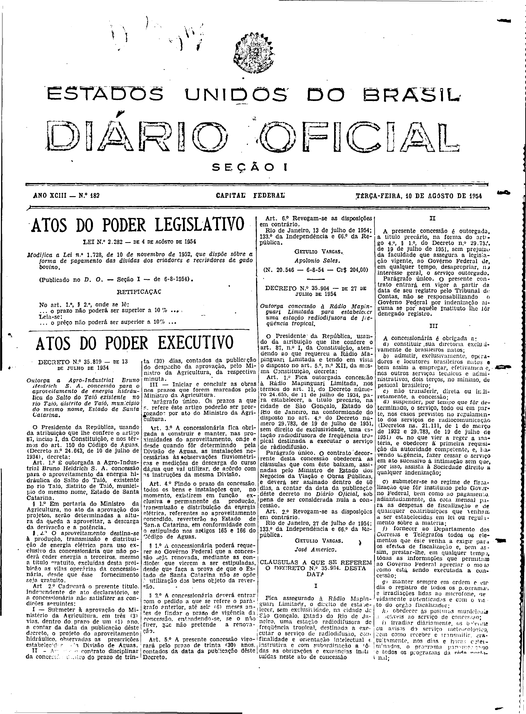
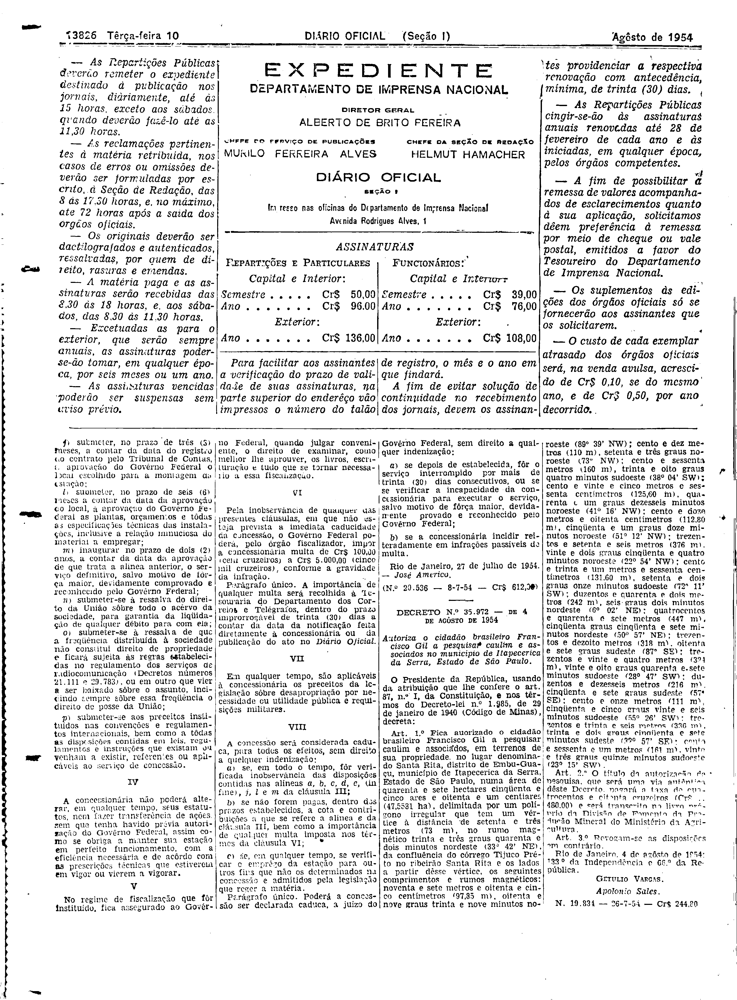

###DEC-035904-0-000-27-07-1954@@@

<strong>DECRETO Nº 35.904, DE 27 DE JULHO DE 1954.</strong>

<em><strong>Outorga concessão à Rádio Mapinguari Limitada para estabelecer uma estação radiodifusora de freqüência tropical.</strong></em>

<strong>O PRESIDENTE DA REPÚBLICA</strong>, usando da atribuição que lhe confere o art. 87, nº I, da Constituição, atendendo ao que requereu a Rádio Mapinguari Limitada e tendo em vista o disposto no art. 5º, nº XII, da mesma Constituição,

<strong>DECRETA:</strong>

<strong>Art</strong>. 1º Fica outorgada concessão à Rádio Mapinguari Limitada, nos têrmos do art. 11, do Decreto número 24.655, de 11 de julho de 1934, para estabelecer, a título precário, na cidade de São Gonçalo, Estado do Rio de Janeiro, na conformidade do disposto no art. 4º do Decreto número 29.783, de 19 de julho de 1951, sem direito de exclusividade, uma estação radiofusora de freqüência tropical destinada a executar o serviço de radiodifusão.

Parágrafo único. O contrato decorrente desta concessão obedecerá às cláusulas que com êste baixam, assinadas pelo Ministro de Estado dos Negócios da Viação e Obras Públicas, e deverá ser assinado dentro de 60 dias a contar de data da publicação dêste decreto no <em>Diário</em> <em>Oficial</em>, sob pena de ser considerada nula a concessão.

<strong>Art</strong>. 2º Revogam-se as disposições em contrário.

Rio de Janeiro, 27 de julho de 1954; 133º da Independência e 66º da República.

<strong>GETÚLIO VARGAS</strong>

José Américo

<!-- fac-simile-oficial:inicio -->

## Fac-símile oficial: cláusulas

O texto acima não inclui as cláusulas a que se refere este decreto. A publicação oficial do anexo está em imagem, nas páginas do _Diário Oficial da União_ (Seção I) de 10 de agosto de 1954: página 1 do PDF (capa do caderno) (a partir de CLÁUSULAS A QUE SE REFEREM O DECRETO N.º 35.904); página 2 do PDF (até N. 20.536).

As imagens são as páginas inteiras, tal como digitalizadas pela Imprensa Nacional, sem recorte, sem redesenho e sem transcrição. Cada página traz também outros atos do mesmo dia; a peça deste decreto está apenas no trecho indicado, e o texto do anexo só existe na imagem. Não há OCR validado.

Fonte: Imprensa Nacional, Biblioteca Machado de Assis, arquivo `DO_1_19540810_182.PDF` (SHA-256 `85553dafb7882762a724f5330795f973c2ec21966a2f8688c267b7975c88ee2e`), páginas 1, 2 do PDF. SHA-256 das imagens, na ordem: `1ff5a14c1f6f978facae43843b348adec8f87e63eb4e1e1f9ba6f1e3fd15e616`, `801aeaf545de74e868243651122380d69a45d6362ed1b8091aa0d698f3580aa3`.

<!-- fac-simile-oficial:fim -->
