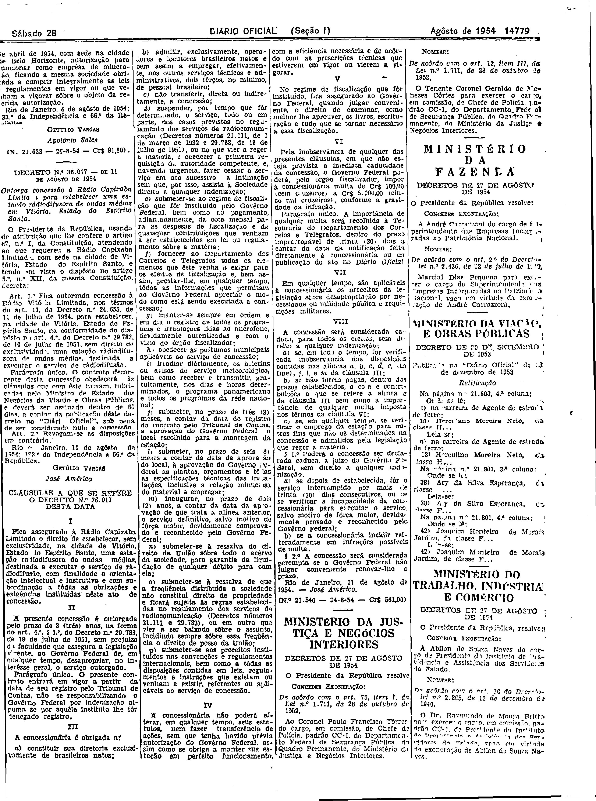

###DEC-036017-0-000-11-08-1954@@@

<strong>DECRETO Nº 36.017, DE 11 DE AGÔSTO DE 1954.</strong>

<em><strong>Outorga concessão à Rádio Capixaba Limitada para estabelecer uma estação radiodifusora de ondas médias em Vitória, Estado do Espírito Santo.</strong></em>

<strong>O PRESIDENTE DA REPÚBLICA</strong>, usando da atribuição que lhe confere o artigo 87, nº I, da Constituição, atendendo ao que requereu a Rádio Capixaba Limitada, com sede na cidade de Vitória, Estado do Espírito Santo, e tendo em vista o disposto no artigo 5º, nº XII, da mesma Constituição,

<strong>DECRETA:</strong>

<strong>Art</strong>. 1º Fica outorgada concessão à Rádio Vitória Limitada, nos têrmos do art. 11, do Decreto nº 24.655, de 11 de julho de 1934, para estabelecer, na cidade de Vitória, Estado do Espírito Santo, na conformidade do disposto no art. 4º, do Decreto nº 29.783, de 19 de julho de 1951, sem direito de exclusividade, uma estação radiodifusorade de ondas médias, destinada a executar o serviço de radiodifusão.

Parágrafo único. O contrato decorrente desta concessão obedecerá às cláusulas que com êste baixam, rubricadas pelo Ministro de Estado dos Negócios da Viação e Obras Públicas, e deverá ser assinado dentro de 60 dias, a contar da publicação dêste decreto no <em>Diário</em> <em>Oficial</em>, sob pena de ser considerada nula a concessão.

<strong>Art</strong>. 2º Revogam-se as disposições em contrário.

Rio de Janeiro, 11 de agôsto de 1954; 133º da Independência e 66º da República.

<strong>GETÚLIO VARGAS</strong>

José Américo

<!-- fac-simile-oficial:inicio -->

## Fac-símile oficial: cláusulas

O texto acima não inclui as cláusulas a que se refere este decreto. A publicação oficial do anexo está em imagem, nas páginas do _Diário Oficial da União_ (Seção I) de 28 de agosto de 1954: p. 14779 (a partir de CLÁUSULAS A QUE SE REFERE O DECRETO N.º 36.017, até N. 21.546).

As imagens são as páginas inteiras, tal como digitalizadas pela Imprensa Nacional, sem recorte, sem redesenho e sem transcrição. Cada página traz também outros atos do mesmo dia; a peça deste decreto está apenas nas colunas indicadas, e o texto do anexo só existe na imagem. Não há OCR validado.

Fonte: Imprensa Nacional, Biblioteca Machado de Assis, arquivo `DO_1_19540828_197.PDF` (SHA-256 `dc3f8fb31eeb70f676440df97bf553e76937bc0ad0f253ea3004139c78e70a70`), páginas 3 do PDF. SHA-256 das imagens, na ordem: `8ad2946490966fe85edf9bcab8628a93f33d7bff08ee5a091b0e025ecf6358de`.

<!-- fac-simile-oficial:fim -->
