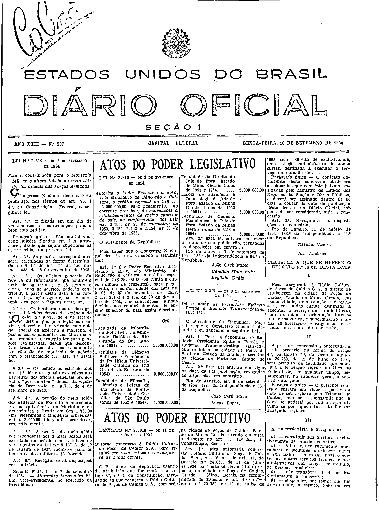
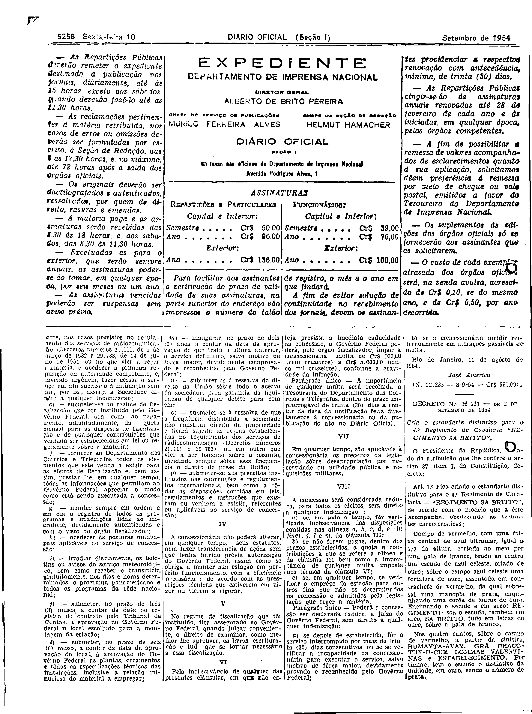

###DEC-036019-0-000-11-08-1954@@@

<strong>DECRETO Nº 36.019, DE 11 DE AGÔSTO DE 1954.</strong>

<em><strong>Outorga concessão à Rádio Cultura de Poços de Caldas S.A. para estabelecer uma estação radiodifusora de ondas curtas.</strong></em>

<strong>O PRESIDENTE DA REPÚBLICA</strong>, usando da atribuição que lhe confere o artigo 87, nº I, da Constituição, atendendo ao que requereu a Rádio Cultura de Poços de Caldas S.A., com sede na cidade de Poços de Caldas, Estado de Minas Gerais e tendo em vista o disposto no art. 5º, nº XII, da Constituição,

<strong>DECRETA:</strong>

<strong>Art</strong>. 1º Fica outorgada concessão à Rádio Cultura de Poços de Caldas S.A., nos têrmos do art. 11, do Decreto nº 24.655, de 11 de julho de 1934, para estabelecer, a título precário, na cidade de Poços de Caldas, Estado de Minas Gerais, na conformidade do disposto no art. 4º do Decreto nº 29.783, de 19 de julho de 1955, sem direito de exclusividade, uma estação radiodifusora de ondas curtas, destinada a executar o serviço de radiodifusão.

Parágrafo único - O contrato decorrente desta concessão obedecerá às cláusulas que com êste baixam, assinadas pelo Ministro de Estado dos Negócios da Viação e Obras Públicas, e deverá ser assinado dentro de 60 dias, a contar da data da publicação dêste Decreto no <em>Diário</em> <em>Oficial</em>, sob pena de ser considerada nula a concessão.

<strong>Art</strong>. 2º Revogam-se as disposições em contrário.

Rio de Janeiro, 11 de agôsto de 1954; 133º da Independência e 66º da República.

<strong>GETÚLIO VARGAS</strong>

José Américo

<!-- fac-simile-oficial:inicio -->

## Fac-símile oficial: cláusulas

O texto acima não inclui as cláusulas a que se refere este decreto. A publicação oficial do anexo está em imagem, nas páginas do _Diário Oficial da União_ (Seção I) de 10 de setembro de 1954: página 1 do PDF (capa do caderno) (a partir de CLÁUSULA A QUE SE REFERE O DECRETO N.º 36.019); página 2 do PDF (até N. 22.365).

As imagens são as páginas inteiras, tal como digitalizadas pela Imprensa Nacional, sem recorte, sem redesenho e sem transcrição. Cada página traz também outros atos do mesmo dia; a peça deste decreto está apenas no trecho indicado, e o texto do anexo só existe na imagem. Não há OCR validado.

Fonte: Imprensa Nacional, Biblioteca Machado de Assis, arquivo `DO_1_19540910_207.PDF` (SHA-256 `31680a0464935967be3eb92a4d37ee45b778e037b754f75b20c373c31b4aa135`), páginas 1, 2 do PDF. SHA-256 das imagens, na ordem: `00f3ea0622c0596c8dab352f36bbfdf23ddd372b4dbc90ad5d85bd93c96d9374`, `aa121cab6f3f6019c3e0c9f8745adc2ecf260c8c353b2a409d0881b382c99ca4`.

<!-- fac-simile-oficial:fim -->
