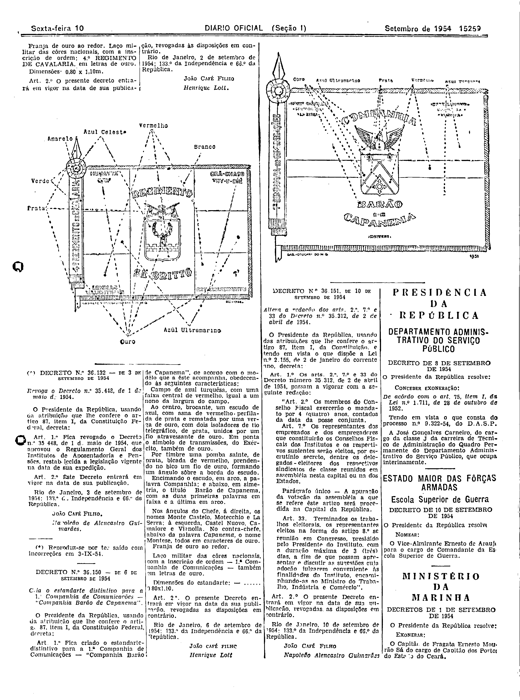

###DEC-036131-0-000-02-09-1954@@@

<strong>DECRETO Nº 36.131, DE 2 DE SETEMBRO DE 1954.</strong>

<em><strong>Cria o estandarte distintivo para o 4º Regimento de Cavalaria “REGIMENTO SÁ BRITTO”.</strong></em>

<strong>O PRESIDENTE DA REPÚBLICA</strong>, usando da atribuição que lhe confere o artigo 87, item I, da Constituição,

<strong>DECRETA:</strong>

<strong>Art</strong>. 1º Fica criado o estandarte distintivo para o 4º Regimento de Cavalaria - “REGIMENTO SÁ BRITTO”, de acôrdo com o modêlo que a êste acompanha, obedecendo às seguintes características:

Campo de vermelho, com uma faixa central de azul ultramar, igual a 1/3 da altura, cortada ao meio por uma pala de branco, tendo ao centro um escudo de azul celeste, orlado de ouro: sôbre o campo azul celeste uma fortaleza de ouro, assentada em contrachefe de vermelho, da qual sobressai uma manopla de parta, empunhando uma corôa de louros de ouro. Encimando o escudo, também em arco: REGIMENTO: sob o escudo, também em arco; SÁ BRITTO, tudo em letras de ouro, sôbre a pala de branco.

Nos quatro cantos, sôbre o campo de vermelho, a partir da sinistra, HUMAYTÁ-AVAY, GRÃ CHACOTUY-U-CUÊ, LOMMAS VALENTINAS e ESTABELECIMENTO. Por timbre, tem o escudo o distintivo da unidade, em ouro, sendo o número de prata.

Franja de ouro ao redor. Laço militar das côres nacionais, com a inscrição de ordem: 4º REGIMENTO DE CAVALARIA, em letras de ouro.

Dimensões 0,80 x 1,10m.

<strong>Art</strong>. 2º O presente decreto entrará em vigor na data de sua publicação, revogadas as disposições em contrário.

Rio de Janeiro, 2 de setembro de 1954; 133º da Independência e 66º da República.

<strong>JOÃO CAFÉ FILHO</strong>

Henrique Lott

<!-- fac-simile-oficial:inicio -->

## Fac-símile oficial: cláusulas

O texto acima não inclui as cláusulas a que se refere este decreto. A publicação oficial do anexo está em imagem, nas páginas do _Diário Oficial da União_ (Seção I) de 10 de setembro de 1954: página 2 do PDF (a partir de «DECRETO N.º 36.131 — DE 2 DE SETEMBRO DE 1954»); página 3 do PDF (continuação, com o primeiro desenho de estandarte da página, o do 4.º Regimento de Cavalaria «Regimento Sá Britto»), e o segundo desenho da página pertence a outro decreto, o de n.º 36.150).

As imagens são as páginas inteiras, tal como digitalizadas pela Imprensa Nacional, sem recorte, sem redesenho e sem transcrição. Cada página traz também outros atos do mesmo dia; a peça deste decreto está apenas no trecho indicado, e o texto do anexo só existe na imagem. Não há OCR validado.

Fonte: Imprensa Nacional, Biblioteca Machado de Assis, arquivo `DO_1_19540910_207.PDF` (SHA-256 `31680a0464935967be3eb92a4d37ee45b778e037b754f75b20c373c31b4aa135`), páginas 2, 3 do PDF. SHA-256 das imagens, na ordem: `aa121cab6f3f6019c3e0c9f8745adc2ecf260c8c353b2a409d0881b382c99ca4`, `26fea5f2c0c669171abd794717f0d45c93f02d5bf77106acac597c9a48047a21`.

<!-- fac-simile-oficial:fim -->
