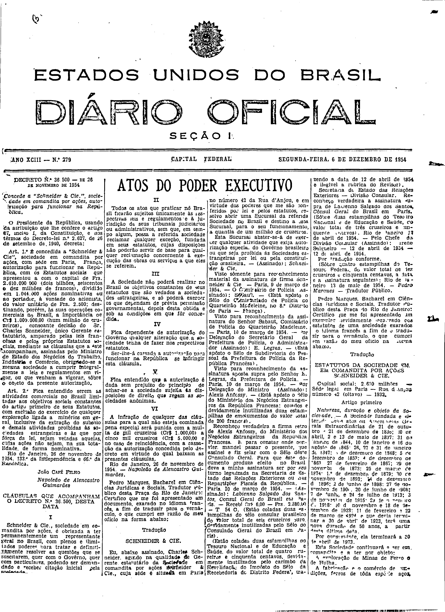
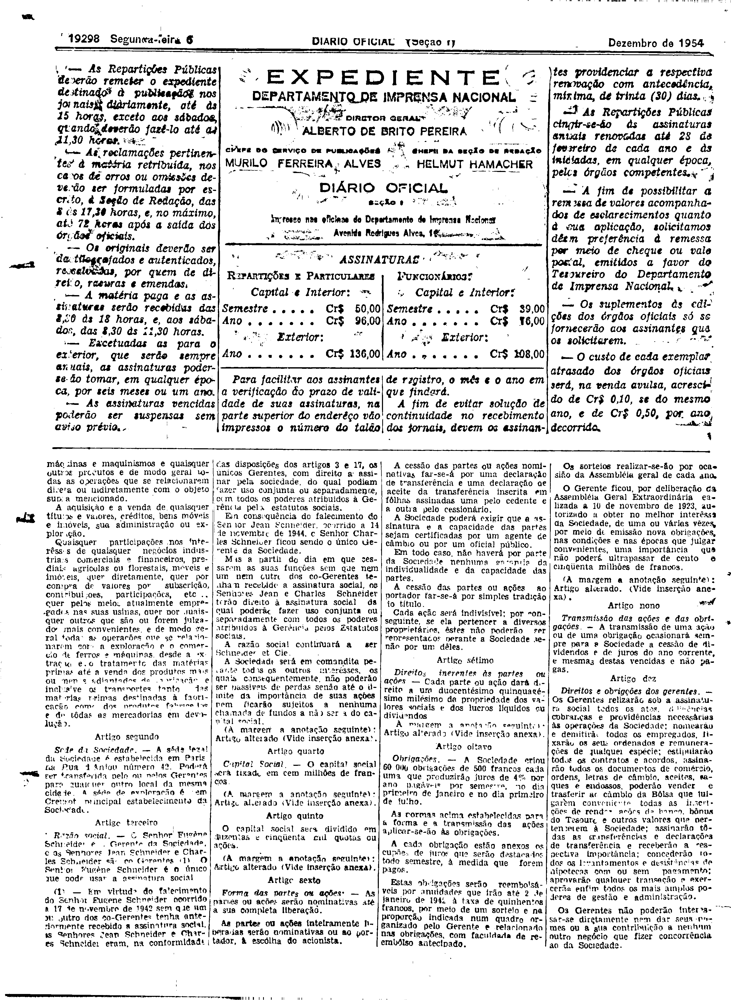
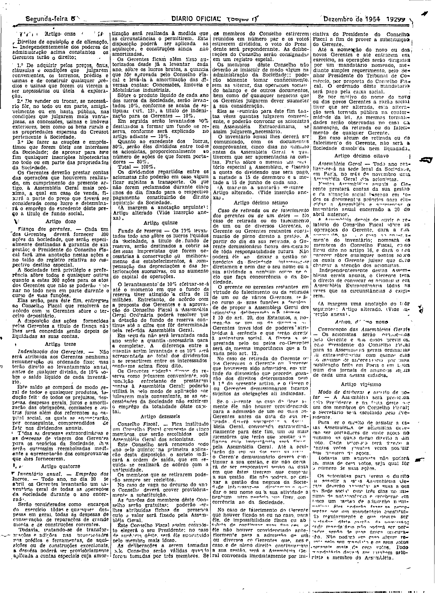
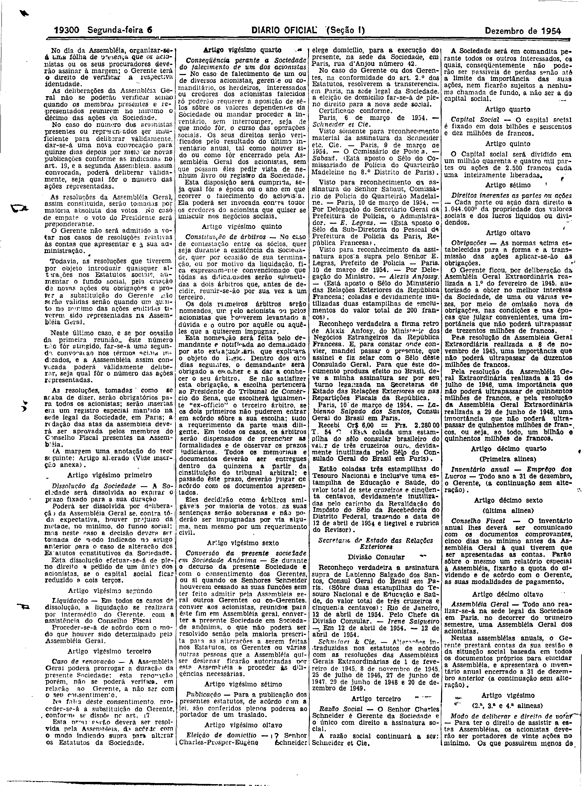
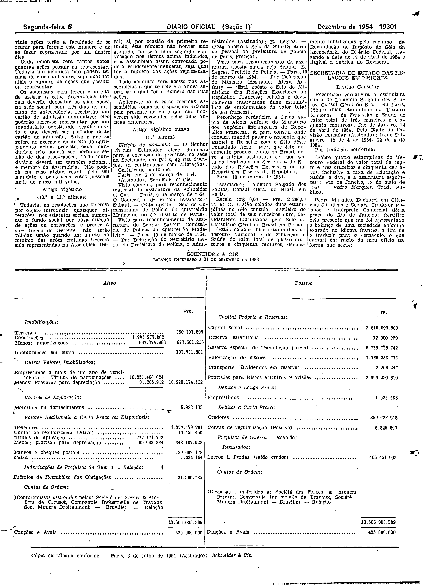
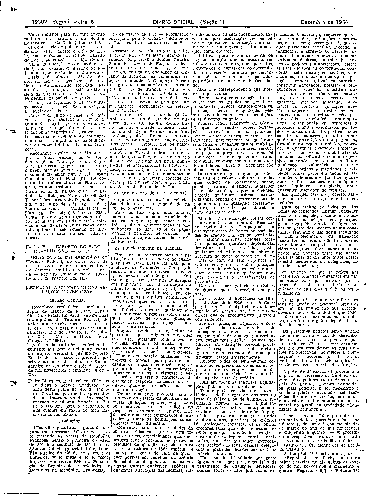
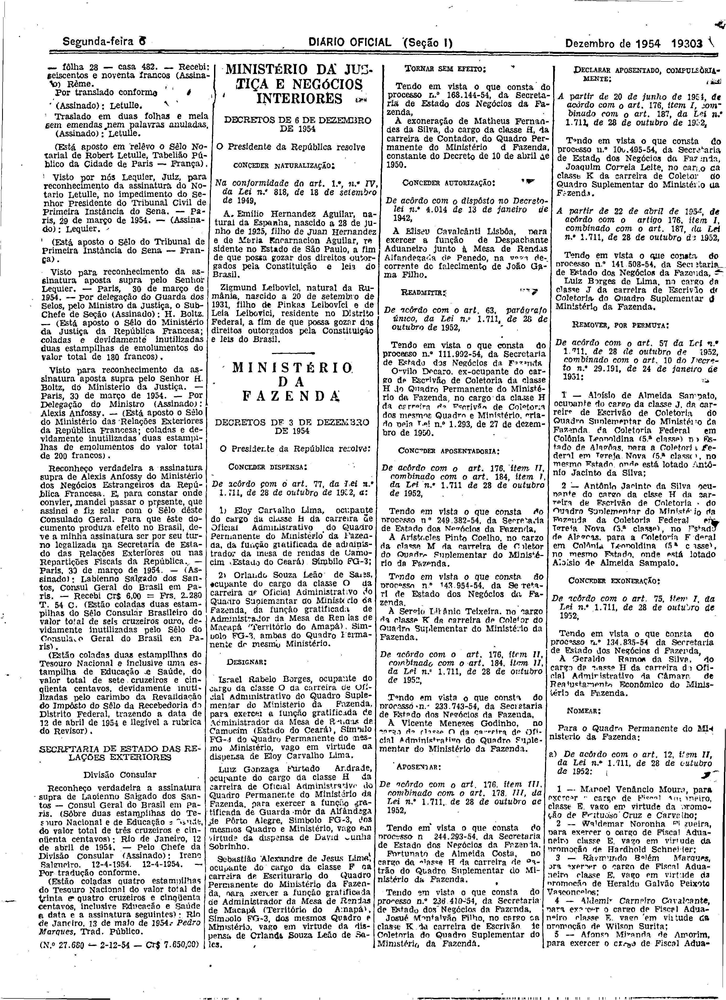

###DEC-036500-0-000-26-11-1954@@@

<strong>DECRETO Nº 36.500, DE 26 DE NOVEMBRO DE 1954.</strong>

<em><strong>Concede a “Schneider & Cie”, sociedade em comandita por ações, autorização para funcionar na República.</strong></em>

<strong>O PRESIDENTE DA REPÚBLICA</strong>, usando da atribuição que lhe confere o artigo 87, inciso I, da Constituição, e nos têrmos do Decreto-lei nº 2.627, de 26 de setembro de 1940,

<strong>DECRETA:</strong>

<strong>Art</strong>. 1º É concedida a “Schneider & Cie”, sociedade em comandita por ações, com séde em Paris, França, autorização para funcionar na República, com os Estatutos sociais que apresentou a com o capital de Frs.2.610.000.000 (dois bilhões, seiscentos e dez mil milhões de francos), dividido em 1.044,000 ações nominativas ou ao portador, à vontade do acionista, do valor unitário de Frs.2.500; destinando, porém, às suas operações comerciais no Brasil, a importância de Cr$1.000.000,00 (hum milhão de cruzeiros), consoante decisão do Sr. Charles Schneider, único Gerente estatutário, amparado pelas leis francêsas e pelos próprios Estatutos sociais, mediante as cláusulas que a este acompanham, assinadas pelo Ministro de Estado dos Negócios do Trabalho, Indústria e Comércio, obrigando-se a mesma sociedade a cumprir integralmente as leis e regulamentos em vigor, ou que venham a vigorar, sobre o objeto da presente autorização.

<strong>Art</strong>. 2º Fica entendido serem as atividades comerciais no Brasil limitadas aos objetivos sociais constantes do artigo primeiro de seus Estatutos, com exclusão do exercício de qualquer exploração ligada a minérios em geral, inclusive da extração do subsolo e demais atividades proibidas às sociedades estrangeiras e às que por fôrça da lei, sejam vetadas aquelas, cujas ações não sejam, na sua totalidade, de forma nominativa.

Rio de Janeiro, 26 de novembro de 1954, 133º; da Independência e 66º da República.

<strong>JOÃO CAFÉ FILHO</strong>

Napoleão de Alencastro Guimarães

<!-- fac-simile-oficial:inicio -->

## Fac-símile oficial: cláusulas

O texto acima não inclui as cláusulas a que se refere este decreto. A publicação oficial do anexo está em imagem, nas páginas do _Diário Oficial da União_ (Seção I) de 6 de dezembro de 1954: página 1 do PDF (capa do caderno) (a partir de «CLÁUSULAS QUE ACOMPANHAM O DECRETO N.º 36.500, DESTA DATA»); página 2 do PDF (continuação); página 3 do PDF (continuação); página 4 do PDF (continuação); página 5 do PDF (continuação); página 6 do PDF (continuação); página 7 do PDF (até «(N.º 27.680 — 2-12-54 — Cr$ 7.650,20)»).

As imagens são as páginas inteiras, tal como digitalizadas pela Imprensa Nacional, sem recorte, sem redesenho e sem transcrição. Cada página traz também outros atos do mesmo dia; a peça deste decreto está apenas no trecho indicado, e o texto do anexo só existe na imagem. Não há OCR validado.

Fonte: Imprensa Nacional, Biblioteca Machado de Assis, arquivo `DO_1_19541206_279.PDF` (SHA-256 `facc7d92e9aba879109ffd89e86d9c9c31fec63ac6b30be006ff6d4f9d7d8e76`), páginas 1, 2, 3, 4, 5, 6, 7 do PDF. SHA-256 das imagens, na ordem: `e2901470a4501968d615a58a69bd37982856521c99c65d98e15e777e3ade3fe2`, `5c72c2b06b1543c6ae96cc10be3104ef3dd74707e5f54ef45e877852f0df405f`, `3ab3da9ad50cb11ccf25d2fd2ad91b09b4223ee8677c0d7c4a600e66549d46d7`, `6d29cf3cb4482f5a26e2d7c42a163d915d80ce5fae9f4018cca9b18551497838`, `6ed1ed9eeb4c8e14c3687c3013d3c85c80f5026abe126a66158e9c4a1ddb479f`, `18f3a058c72e413337e09a70af9ca2a37ff992e3a7ef0046e306a4c589fb423f`, `668db95fd99c231e0f6ed6053f3f9662832cc1feefa1c69db90c49a4abfca7fb`.

<!-- fac-simile-oficial:fim -->
