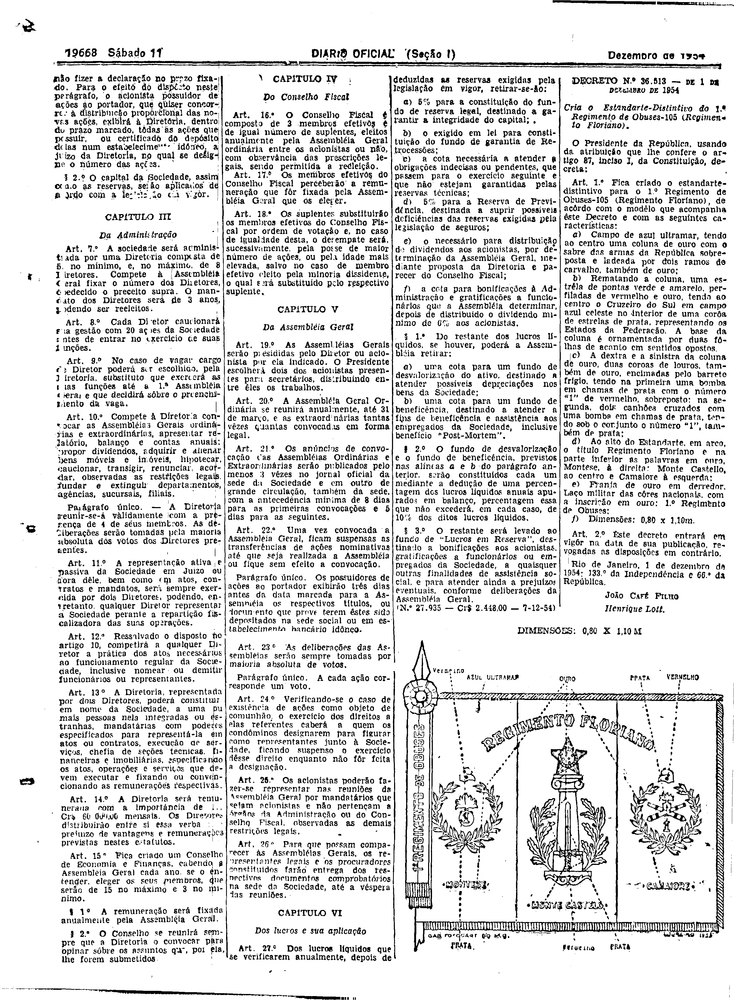

###DEC-036513-0-000-01-12-1954@@@

<strong>DECRETO Nº 36.513, DE 1 DE DEZEMBRO DE 1954.</strong>

<em><strong>Cria o Estandarte-Distintivo do 1º Regimento de Obuses-105 (Regimento Floriano).</strong></em>

<strong>O PRESIDENTE DA REPUBLICA</strong>, usando da atribuição que lhe confere o artigo 87, inciso I, da constituição,

<strong>DECRETA:</strong>

<strong>Art</strong>. 1º Fica criado o estandarte-distivo para o 1º Regimento de Obuses-105 (Regime Floriano), de acôrdo com o môdelo que acompanha este decreto e com as seguintes característica:

a) Campo de azul ultramar, tendo ao centro uma coluna de ouro com o sabre das armas da Republica sobreposta e ladeada por dois ramos de carvalho, também de ouro;

b) Rematado a coluna, uma estrêla de pontas verdes e amarelas, perfilandas de vermelhas e ouro, tendo ao centro o Cruzeiro do Sul em campo azul celeste no interior de uma corôa de estrela de prata, representando os estados da confederação. A base da coluna é ornamental por duas fôlhas de acanto em sentidos opostos

c) A dextra e a sinistra da coluna de ouro, duas coroas de louros, também de ouro, encimadas pelo barrete frigio tendo na primeira uma bomba em chamas de prata com numero “1” de vermelhos, sobreposto; na segunda,dois canhões cruzados com uma bomba em chamas de prata, tendo sob o conjunto o numero “1”, também de prata;

d) Ao alto do estabelecimento,em arco o titulo regimento floriano e na parte inferior as palavras em ouro Montese, a direita: Monte castelo ao centro e camaiore à esquerda;

e) Franja de ouro em derredor laço militar das côres nacionais, com a inscrição em ouro: 1º regimento de obuses;

f) Dimensões 0,80 x1,10m

<strong>Art</strong>. 2º Êste decreto entrara em vigôr na data de sua publicação, em contrario

Rio de janeiro, 1 de dezembro de 1954; 133º da independente e 66º da republica.

<strong>JOÃO CAFÉ FILHO</strong>

Henrique Lott

<!-- fac-simile-oficial:inicio -->

## Fac-símile oficial: cláusulas

O texto acima não inclui as cláusulas a que se refere este decreto. A publicação oficial do anexo está em imagem, nas páginas do _Diário Oficial da União_ (Seção I) de 11 de dezembro de 1954: página 4 do PDF (decreto e, abaixo do texto, o desenho do estandarte com «DIMENSÕES: 0,80 X 1,10 M»).

As imagens são as páginas inteiras, tal como digitalizadas pela Imprensa Nacional, sem recorte, sem redesenho e sem transcrição. Cada página traz também outros atos do mesmo dia; a peça deste decreto está apenas no trecho indicado, e o texto do anexo só existe na imagem. Não há OCR validado.

Fonte: Imprensa Nacional, Biblioteca Machado de Assis, arquivo `DO_1_19541211_284.PDF` (SHA-256 `ef9aac884517f942305d38e0d71d3e6a17b63b322f6b64ad454916c47e688146`), páginas 4 do PDF. SHA-256 das imagens, na ordem: `fa4ca071beaeae5023609989a51716f550a449f2ff0d503a5dd1031eefb792e1`.

<!-- fac-simile-oficial:fim -->
