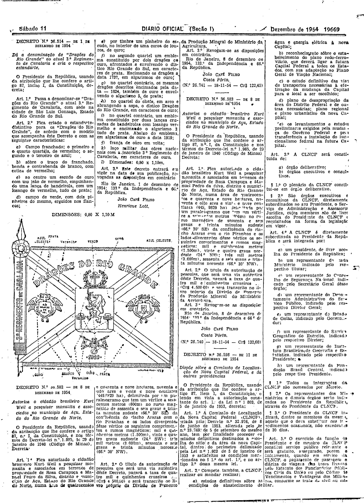

###DEC-036514-0-000-01-12-1954@@@

<strong>DECRETO Nº 36.514, DE 1 DE DEZEMBRO DE 1954.</strong>

<em><strong>Dá a denominação de “Dragões do Rio Grande” ao atual 3º Regimento de Cavalaria e cria o respectivo estandarte.</strong></em>

<strong>O PRESIDENTE DA REPÚBLICA</strong>, usando da atribuição que lhe confere o artigo 87, inciso I, da Constituição,

<strong>DECRETA:</strong>

<strong>Art</strong>. 1º Passa a denominar-se “Dragões do Rio Grande” o atual 3º Regimento de Cavalaria, com sede na cidade de São Luiz Gonzaga, Estado do Rio Grande do Sul.

<strong>Art</strong>. 2º Fica criado o estandarte distintivo para os “Dragões do Rio Grande”, de acôrdo com o modêlo que acompanha êste Decreto e com as seguintes características:

a) campo franchado: o primeiro e o quarto quartéis, de vermelho; o segundo e o terceiro de azul;

b) sôbre o traço do franchado, banda e contrabanda de branco, com cotica de vermelho;

c) ao centro um escudo de ouro com um leão de vermelho, empunhando uma lança de bandeirola, com um losango de vermelho, tudo de prata;

d) campo de verde, com dois pinheiros do mesmo, erguidos nos flancos;

e) por um timbre um pinheiro do escudo, no interior de uma coroa de louros, de ouro;

f) no segundo quartel um emblema constituido por dois dragões de ouro, afrontados e envolvendo o dístico Rio Grande do Sul, em caracteres de prata. Encimando os dragões a data 1737, em algarismos de ouro;

g) no quartel contrário, os mesmos dragões descridos encimados pela data - 1824, também de ouro e envolvendo o algarismo 5, de prata;

h) no quartel do chefe, em arco e abrangendo a aspa, o distico Dragões do Rio Grande, em caracteres de ouro;

i) no quartel contrário, um emblema constituído por duas lanças cruzadas de bandeirolas com losango vermelho e encimando o algarismo 3, tudo de prata. Abaixo do emblema, em algarismo de ouro a data de 1919;

j) franja de ouro em volta;

k) laço militar das côres nacionais com a inscrição 3º Regimento de Cavalaria, em caracteres de ouro.

l) dimensões: 0,80 x 1,10m.

<strong>Art</strong>. 3º Êste decreto  entrará vigôr na data de sua publicação, revogadas as disposições em contrário.

Rio de Janeiro, 1 de dezembro de 1954; 133º da Independencia e 66º da República.

<strong>JOÃO CAFÉ FILHO</strong>

Henrique Lott

<!-- fac-simile-oficial:inicio -->

## Fac-símile oficial: cláusulas

O texto acima não inclui as cláusulas a que se refere este decreto. A publicação oficial do anexo está em imagem, nas páginas do _Diário Oficial da União_ (Seção I) de 11 de dezembro de 1954: página 5 do PDF (decreto e, abaixo do texto, o desenho do estandarte com «DIMENSÕES: 0,80 X 1,10 M»).

As imagens são as páginas inteiras, tal como digitalizadas pela Imprensa Nacional, sem recorte, sem redesenho e sem transcrição. Cada página traz também outros atos do mesmo dia; a peça deste decreto está apenas no trecho indicado, e o texto do anexo só existe na imagem. Não há OCR validado.

Fonte: Imprensa Nacional, Biblioteca Machado de Assis, arquivo `DO_1_19541211_284.PDF` (SHA-256 `ef9aac884517f942305d38e0d71d3e6a17b63b322f6b64ad454916c47e688146`), páginas 5 do PDF. SHA-256 das imagens, na ordem: `c0d39ffbf59912b14c5cf634c18d443e184f19b27ce8b4ce321edafa9ad052e5`.

<!-- fac-simile-oficial:fim -->
