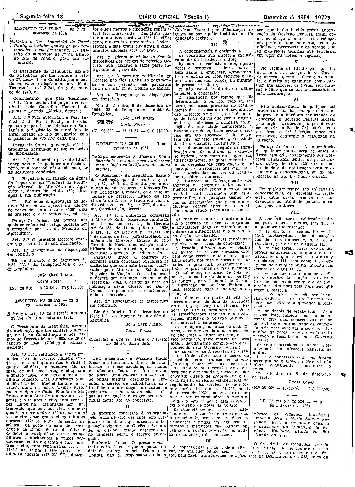

###DEC-036571-0-000-07-12-1954@@@

<strong>DECRETO Nº 36.571, DE 7 DE DEZEMBRO DE 1954.</strong>

<em><strong>Outorga concessão à Mossoró Rádio Sociedade Limitada para estabelecer uma estação radiodifusora de ondas médias.</strong></em>

<strong>O PRESIDENTE DA REPÚBLICA</strong>, usando da atribuição que lhe confere o artigo 87, nº I da Constituição atendendo ao que requereu a Mossoró Radio Sociedade Limitada com sede na cidade de Mossoró Estado  do Rio Grande do Norte, e tendo em vista o dispostos no art. 5º XII, da mesma Constituição,

<strong>DECRETA:</strong>

<strong>Art</strong>. 1º Fica outorgada a concessão à Mossoró Rádio Sociedade Limitada, nos têrmos do art. 11, do Decreto n.º 24.655, de 11 de julho de 1934, e art. 16, do Decreto nº 21.111, de 1 de março de 1932, para estabelecer na cidade de Mossoró, Estado do Rio Grande do Norte, uma estação radiodifusora de ondas médias, destinada a executar o serviço de radiodifusão.

Parágrafo único O contrato decorrente desta concessão obedecera às cláusulas que com êste baixam, rubricadas pelo Ministro de Estado dos Negócios da Viação e Obras Públicas, e deverá ser assinado dentro de 60 (sessenta) dias, a contar da data da publicação dêste decreto no DIÁRIO <em>Oficial</em>, sob pena de ser considerada nula a concessão.

<strong>Art</strong>. 2º Revogam-se as disposições em contrário.

Rio de janeiro, 7 de dezembro de 1954; 133º da Independência e 66º da República.

<strong>JOÃO CAFÉ FILHO</strong>

Lucas Lopes

<!-- fac-simile-oficial:inicio -->

## Fac-símile oficial: cláusulas

O texto acima não inclui as cláusulas a que se refere este decreto. A publicação oficial do anexo está em imagem, nas páginas do _Diário Oficial da União_ (Seção I) de 13 de dezembro de 1954: página 3 do PDF (a partir de Cláusulas a que se refere o Decreto n.º 36.571, até N. 28.462).

As imagens são as páginas inteiras, tal como digitalizadas pela Imprensa Nacional, sem recorte, sem redesenho e sem transcrição. Cada página traz também outros atos do mesmo dia; a peça deste decreto está apenas no trecho indicado, e o texto do anexo só existe na imagem. Não há OCR validado.

Fonte: Imprensa Nacional, Biblioteca Machado de Assis, arquivo `DO_1_19541213_285.PDF` (SHA-256 `684329a27a9f4737969a1670b3fac49b410e57cf6d06e2b0e9f83591ad3ffc8b`), páginas 3 do PDF. SHA-256 das imagens, na ordem: `0e278710a69e5babdcc67212c878cf69fbe56ed571622825c8c9292eb64df810`.

<!-- fac-simile-oficial:fim -->
